<!-- Unified personal study notes -->

Personal AWS data engineering study notes. Technical details that change over time should be checked against current AWS documentation.

# Section Fundamentals

<!-- original-note: 0 -->
<!-- section -->

## Key Concepts

Data Engineering lifecycle is a subset of **Data lifecycle**.


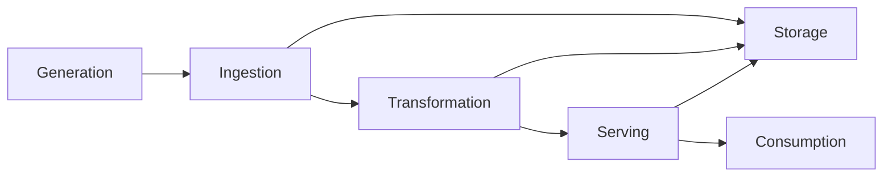

> Generation, storage, ingestion, transformation and serving are stages of the Data Engineering lifecycle.

## Ingestion vs Integration

**Data ingestion** is primarily about movement: getting data from A to B.

**Data integration** is about unification: making data from different systems work together coherently.


> For example, copying Salesforce, PostgreSQL and application events into a lake is ingestion. Joining and standardizing customer information from those three sources into a unified customer model is integration.

## Types of Data

<!-- original-note: 1 -->

Start by identifying the data's structure: fixed columns, flexible named fields, or content that needs interpretation before it can be queried.

- Structured: a consistent row-and-column model, such as a relational table or well-defined CSV.
- Semi-structured: keys, tags or nesting provide organization, as in JSON, XML and many logs.
- Unstructured: text, media and other content need interpretation or preprocessing for the intended analysis.

## Structured Data


Structured data follows an explicit model, such as named columns with consistent meanings and types, which makes repeated queries straightforward.

- A schema defines how to interpret each field.
- Relational tables and consistently organized spreadsheets are examples.
- Delimited files count as structured only when their records follow an agreed layout.

## Unstructured Data


Unstructured data lacks a ready-made row-and-column model. Extract useful features or text before applying the analysis the content requires.

- Examples include free text, audio, video and images.
- A document may contain useful information without exposing it as predefined fields.
- The preparation depends on the question: searching text and analyzing an image require different processing.

## Semi-Structured Data


Semi-structured records use tags, keys or nesting to provide organization without requiring every record to share the same fixed layout.

- JSON and XML make the field structure explicit while allowing variation between records.
- Logs may mix common fields with event-specific attributes.
- Email headers are structured fields surrounding a less structured message body.

# Properties of Data

<!-- original-note: 2 -->

The three Vs describe different design pressures: how much data exists, how quickly it arrives, and how many shapes and sources must be supported.

- Volume determines the scale of storage and processing.
- Velocity connects arrival rate to the required processing delay.
- Variety determines the formats, schemas and connectors the pipeline must handle.

- Review prompt: estimate a real organization's daily arrival volume, retained history and working-set size before choosing capacity.

## Volume


Volume is the amount of data to store and process. Estimate both today's working set and its growth before selecting storage and compute capacity.

- Key properties:
  - May range from gigabytes to petabytes or even more
  - Challenges in storing, processing, and analyzing high volumes of data
- Examples:
  - A popular social media platform processing terabytes of data daily from user posts, images, and videos.
  - Retailers collecting years' worth of transaction data, amounting to several petabytes.

## Velocity


Velocity is the rate at which data arrives and must be processed. The required freshness determines whether batch, near-real-time or streaming operation is appropriate.

- Key properties:
  - High velocity requires real-time or near-real-time processing capabilities
  - Rapid ingestion and processing can be critical for certain applications
- Examples:
  - Sensor data from IoT devices streaming readings every millisecond.
  - High-frequency trading systems where milliseconds can make a difference in decision-making.

## Variety


Variety describes differences in source systems, formats and structure. A pipeline may combine relational records with API documents, logs, images or other content.

- Example from the personal notes: combine clinical-system database records with JSON returned by an API.
- Identify each source's format and meaning before trying to join its records.
- Flexible storage does not remove the need to interpret and validate the fields used in analysis.

# Data Warehouse

<!-- original-note: 3 -->

A warehouse brings curated, structured data together for reporting and analytical queries. Model the data before loading it and optimize for repeated reads.

- Key properties:
  - Designed for complex queries and analysis
  - Data is cleaned, transformed, and loaded (ETL process)
  - Typically uses a star or snowflake schema
  - Optimized for read-heavy operations
- Examples:
  - Amazon Redshift
  - Google BigQuery
  - Microsoft Azure SQL Data Warehouse

## Data Warehouse example


Source systems feed a central warehouse; subject-specific data marts serve accounting, analysis and machine learning.


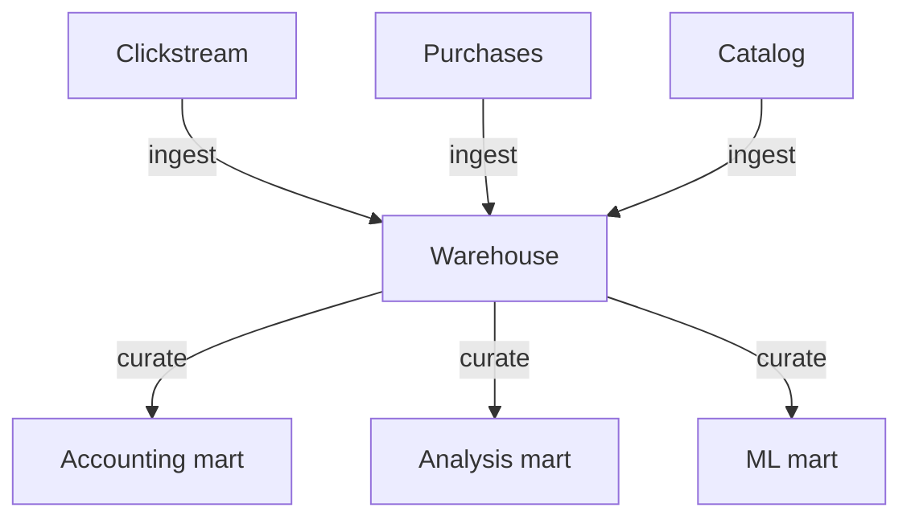

> Source systems feed a central warehouse; subject-specific data marts serve accounting, analysis and machine learning.

# Data Lake

<!-- original-note: 4 -->

A lake keeps source data in its original form so different processing engines can reuse it. Raw storage is flexible, but useful analysis still needs metadata, quality checks and access control.

- Key properties:
  - Can store large volumes of raw data without predefined schema
  - Data is loaded as-is, no need for preprocessing
  - Supports batch, real-time, and stream processing
  - Can be queried for data transformation or exploration purposes
- Examples:
  - Amazon Simple Storage Service (S3) when used as a data lake
  - Azure Data Lake Storage
  - Hadoop Distributed File System (HDFS)

## Comparisons

<!-- original-note: 5 -->

Compare a lake and a warehouse by when structure is imposed, which data types they retain and how much preparation each query needs.

| Decision | Warehouse | Lake |
| --- | --- | --- |
| Data preparation | Curated data fitted to a model before loading | Raw or prepared data retained for later processing |
| Schema | Commonly enforced on write | Commonly interpreted on read |
| Workload | Repeated analytical SQL and reporting | Exploration, processing and multiple analytical consumers |
| Data shape | Primarily modeled, structured datasets | Structured, semi-structured and unstructured datasets |
| Cost question | Compute and storage for the reporting workload | Storage plus the processing and scans used by consumers |

- ETL and ELT are workflow choices, not absolute definitions of either storage architecture.
- Many organizations retain raw data in a lake and publish curated warehouse tables.

## When to use datawarehouse:

<!-- original-note: 6 -->

Many pipelines use both: retain incoming data in a lake, then publish curated datasets to a warehouse for stable business reporting.

- Use a Data Warehouse when:
  - You have structured data sources and require fast and complex queries.
  - Data integration from different sources is essential.
  - Business intelligence and analytics are the primary use cases.
- Use a Data Lake when:
  - You have a mix of structured, semi-structured, or unstructured data.
  - You need a scalable and cost-effective solution to store massive amounts of data.
  - Future needs for data are uncertain, and you want flexibility in storage and processing.
  - Advanced analytics, machine learning, or data discovery are key goals.
- Often, organizations use a combination of both, ingesting raw data into a data lake and then processing and moving refined data into a data warehouse for analysis.

# Data Lakehouses

<!-- original-note: 7 -->

A lakehouse adds table management and warehouse-style reliability to lake storage, aiming to keep open data access while supporting dependable analytics.

- Key properties:
  - Supports both structured and unstructured data.
  - Allows for schema-on-write and schema-on-read.
  - Provides capabilities for both detailed analytics and machine learning tasks.
  - Typically built on top of cloud or distributed architectures.
  - Benefits from technologies like Delta Lake, which bring ACID transactions to big data.
- Examples:
  - AWS Lake Formation (with S3 and Redshift Spectrum)
  - Delta Lake: An open-source storage layer that brings ACID transactions to Apache Spark and big data workloads.
  - Databricks Lakehouse Platform: A unified platform that combines the capabilities of data lakes and data warehouses.
  - Azure Synapse Analytics: Microsoft's analytics service that brings together big data and data warehousing.


> Illustrative reference: a medallion-style lakehouse flow.

# Data Mesh

<!-- original-note: 8 -->

Data mesh is an ownership model: domain teams publish usable data products, while shared tooling and federated standards keep the organization coordinated.

- Coined in 2019; it’s more about governance and organization
- Individual teams own “data products” within a given domain
- These data products serve various “use cases” around the organization
- “Domain-based data management”
- Federated governance with central standards
- Self-service tooling & infrastructure
- Data lakes, warehouses, etc. may be part of it
  - But a “data mesh” is more about the “data management paradigm” and not the specific technologies or architectures.


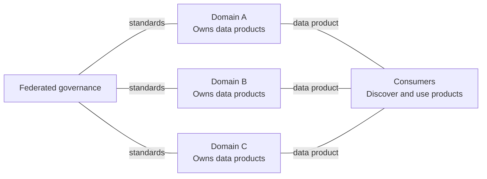

> Data mesh distributes ownership to domains while sharing governance standards and self-service infrastructure.

# ETL Pipelines

<!-- original-note: 9 -->

ETL extracts source records, prepares them for the target model and loads them into an analytical store. Choose batch or streaming operation from the freshness requirement.

- Extract:
  - Retrieve raw data from source systems, which can be databases, CRMs, flat files, APIs, or other data repositories.
  - Ensure data integrity during the extraction phase.
  - Can be done in real-time or in batches, depending on requirements.

## Extract

<!-- original-note: 10 -->

Extraction gathers records from databases, applications, files or APIs while preserving the information needed to load them correctly.

# Transform

<!-- original-note: 11 -->

Transformation turns source records into usable target data: clean values, align formats, enrich fields, calculate measures and handle missing information.

- Can involve various operations such as:
  - Data cleansing (e.g., removing duplicates, fixing errors)
  - Data enrichment (e.g., adding additional data from other sources)
  - Format changes (e.g., date formatting, string manipulation)
  - Aggregations or computations (e.g., calculating totals or averages)
  - Encoding or decoding data
  - Handling missing values

# Load

<!-- original-note: 12 -->

Loading writes prepared data into its destination. Batch size, streaming behavior and integrity checks must match the target system's constraints.

- Can be done in batches (all at once) or in a streaming manner (as data becomes available).
- Ensure that data maintains its integrity during the loading phase.

# Managing ETL pipelines

<!-- original-note: 13 -->

Orchestration makes the pipeline repeatable: schedule work, enforce dependencies, observe failures and arrange retries instead of relying on manual execution.

- AWS Glue
- Orchestration services
  - EventBridge
  - Amazon Managed Workflows for Apache Airflow [Amazon MWAA]
  - AWS Step Functions
  - Lambda
  - Glue Workflows
- We’ll get into specific architectures later.

# Data sources

<!-- original-note: 14 -->

A source connection depends on both the interface and the driver. JDBC and ODBC provide database access; APIs, logs and streams require their own ingestion paths.

- JDBC
  - Java Database Connectivity
  - Platform-independent
  - Language-dependent
- ODBC
  - Open Database Connectivity
  - Platform-dependent (thx to drivers)
  - Language-independent
- Raw logs
- API’s
- Streams


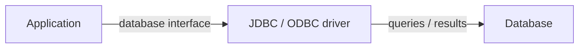

> Applications use database drivers; JDBC is Java-oriented, while ODBC exposes a language-independent interface through drivers.

## JDBC

<!-- original-note: 15 -->
<!-- title: JDBC -->

JDBC gives Java applications a database interface through an appropriate driver. Separate the application's language from the database engine it connects to.

## ODBC

<!-- original-note: 16 -->
<!-- title: ODBC -->

ODBC exposes a common database interface to different application languages. Install a driver compatible with the database and host platform.

## OTher data sources

<!-- original-note: 17 -->
<!-- title: Other data sources -->

Logs, APIs and event streams are source systems too. Record their format, arrival pattern and recovery behavior before designing ingestion.

# Data Formats

<!-- original-note: 18 -->

Choose a format for the access pattern: readable interchange, schema-aware record transport or compressed analytical column scans.

## CSV : Text based format that represents data in tabular form where each line corresponds to a row and values are separeted by comma or similar separator

<!-- original-note: 19 -->
<!-- title: CSV -->

CSV represents rows as delimited text. It is convenient for exchanging and inspecting tabular data, but applications must agree on delimiters, quoting and column meanings.

- When to Use:
  - For small to medium datasets.
  - For data interchange between systems with different technologies.
  - For human-readable and editable data storage.
  - Importing/Exporting data from databases or spreadsheets.
- Systems: Databases (SQL-based), Excel, Pandas in Python, R, many ETL tools.

## Json

<!-- original-note: 20 -->
<!-- title: JSON -->

JSON represents values with named fields and nested structures. It suits APIs and flexible records, while leaving validation and type interpretation to the consuming system.

- When to Use:
  - Data interchange between a web server and a web client.
  - Configurations and settings for software applications.
  - Use cases that need a flexible schema or nested data structures.
- Systems: Web browsers, many programming languages (like JavaScript, Python, Java, etc.), RESTful APIs, NoSQL databases (like MongoDB).

## AVRO

<!-- original-note: 21 -->
<!-- title: Avro -->

Avro stores records in a compact binary representation with schema information. It is useful when systems exchange records and their schemas evolve over time.

- When to Use:
  - With big data and real-time processing systems.
  - When schema evolution (changes in data structure) is needed.
  - Efficient serialization for data transport between systems.
- Systems: Apache Kafka, Apache Spark, Apache Flink, Hadoop ecosystem.

## Parquet

<!-- original-note: 22 -->

Parquet stores values by column, allowing analytical engines to read selected fields and compress similar values efficiently.

- When to Use:
  - Analyzing large datasets with analytics engines.
  - Use cases where reading specific columns instead of entire records is beneficial.
  - Storing data on distributed systems where I/O operations and storage need optimization.
- Systems: Hadoop ecosystem, Apache Spark, Apache Hive, Apache Impala, Amazon Redshift Spectrum.

# Data Modelling

<!-- original-note: 23 -->

Choose the grain of a fact table, identify its measures and connect descriptive dimensions through keys. The enrollment example illustrates this separation.

- The exam guide doesn’t really talk about specific data models.
- But here’s a star schema.
  - Fact tables
  - Dimensions
  - Primary / foreign keys
- This sort of diagram is an Entity Relationship Diagram (ERD)


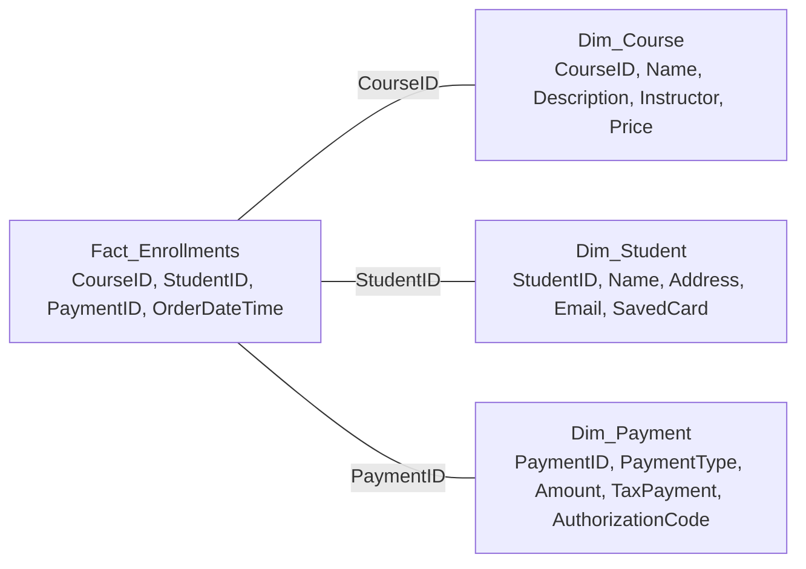

> The enrollment star schema connects the fact table to course, student and payment dimensions through foreign keys.

## Star Schema

<!-- original-note: 24 -->

A star schema keeps the fact table at the center with direct links to its dimensions. Explain the grain and each foreign-key relationship using the enrollment diagram.

## Snowflake

<!-- original-note: 25 -->
<!-- unexpanded -->

# Data Lineage

<!-- original-note: 26 -->

Lineage records where data originated, which transformations changed it and which outputs depend on it. Use that history to trace errors and assess downstream impact.

- A visual representation that traces the flow and transformation of data through its lifecycle, from its source to its final destination.
- Importance:
  - Helps in tracking errors back to their source.
  - Ensures compliance with regulations.
  - Provides a clear understanding of how data is moved, transformed, and consumed within systems.

- Review prompt: trace one field through a Glue/Spark transformation and explain how its recorded lineage would help investigate an incorrect report.


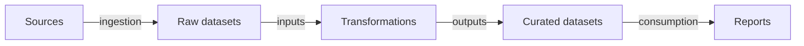

> Lineage follows source data through transformations to outputs, making upstream dependencies and downstream impact visible.

## Capturing Spark lineage


In the illustrated lineage solution, a Spline agent observes Glue/Spark jobs; Lambda loads lineage metadata into Neptune for traversal.

- Example of capturing data lineage
  - Uses Spline Agent (for Spark) attached to Glue
  - Dump lineage data into Neptune via Lambda


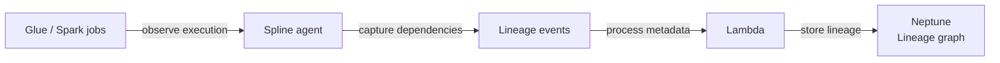

> In the illustrated lineage solution, a Spline agent observes Glue/Spark jobs; Lambda loads lineage metadata into Neptune for traversal.

# schema evolution

<!-- original-note: 27 -->
<!-- title: Schema evolution -->

Schema evolution changes fields or their definitions without unexpectedly breaking readers and writers. Treat compatibility as part of the pipeline contract.

- Importance:
  - Ensures data systems can adapt to changing business requirements.
  - Allows for the addition, removal, or modification of columns/fields in a dataset.
  - Maintains backward compatibility with older data records.
- Glue Schema Registry
  - Schema discovery, compatibility, validation, registration…

- Review prompt: design a production process for adding, removing or changing a field without breaking existing pipeline readers.

# Database Performance Optimization

<!-- original-note: 28 -->

Improve performance by addressing the actual bottleneck: indexes narrow lookups, partitions reduce work, and compression lowers storage and transfer volume.

- Indexing
  - Avoid full table scans!
  - Enforce data uniqueness and integrity
- Partitioning
  - Reduce amount of data scanned
  - Helps with data lifecycle management
  - Enables parallel processing
- Compression
  - Speed up data transfer, reduce storage & disk reads
  - GZIP, LZOP, BZIP2, ZSTD (Redshift examples)
    - Various tradeoffs between compression & speed
  - Columnar compression


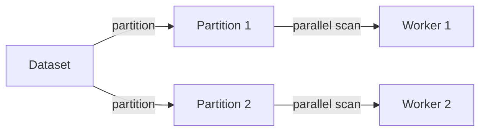

> Partitioning distributes data for parallel work; indexing and compression address different parts of query cost.

# Data Sampling Techniques

<!-- original-note: 29 -->

Sampling reduces the amount of data examined while preserving the properties needed for the question. Match the selection method to the population's structure.

- Random: give eligible observations a random chance of selection.
- Stratified: sample separately within defined groups, then combine them.
- Systematic: take every kth observation after selecting a starting point.
- Other methods named in the notes include cluster, convenience and judgmental sampling; assess their selection bias before relying on the result.


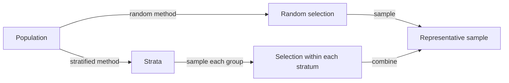

> Random sampling selects from the entire population; stratified sampling first divides the population into groups.

## Random Sampling


Random sampling gives each eligible item a chance of selection; highlighted items need not be regularly spaced.


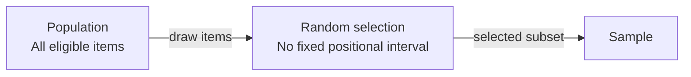

> Random sampling gives each eligible item a chance of selection; highlighted items need not be regularly spaced.

## Stratified Sampling


Stratified sampling takes samples from books, music, home/garden and apparel separately, then combines them.


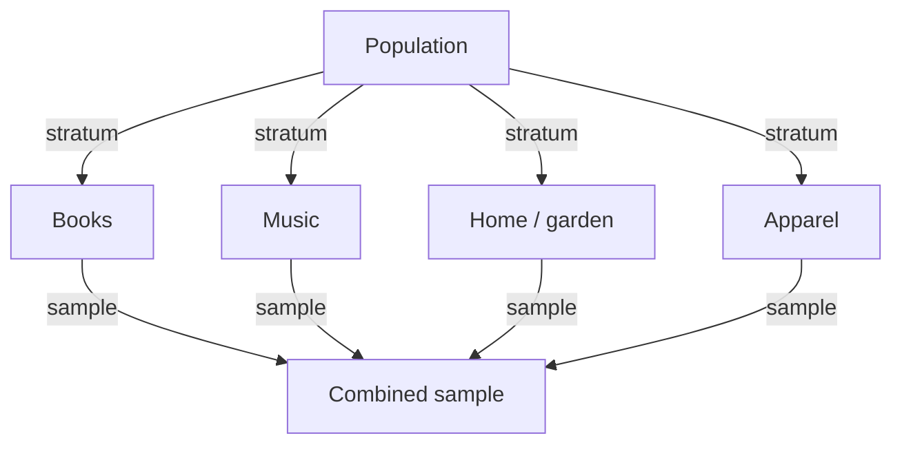

> Stratified sampling takes samples from books, music, home/garden and apparel separately, then combines them.

## Systematic sampling


Select every kth observation after choosing a starting point.

- Systematic sampling selects every kth record after a randomized start.
- Avoid a sampling interval that aligns with periodic structure in the population.


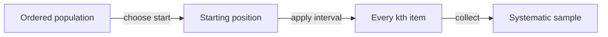

> Systematic sampling uses a starting position and a regular interval; periodic patterns can bias the result.

# Data Skew mechanisms

<!-- original-note: 30 -->

Skew occurs when some keys or partitions receive much more work than others. A celebrity account or a busy recent partition can become the limiting part of a distributed job.

- Data skew refers to the unequal distribution or imbalance of data across various nodes or partitions in distributed computing systems.
- “The celebrity problem”
  - Even partitioning doesn’t work if your traffic is uneven
  - Imagine you’re IMDb… Brad Pitt could overload his partition
- Causes:
  - Non-uniform distribution of data
  - Inadequate partitioning strategy
  - Temporal skew
- Important to monitor data distribution and alert when skew issues arise.


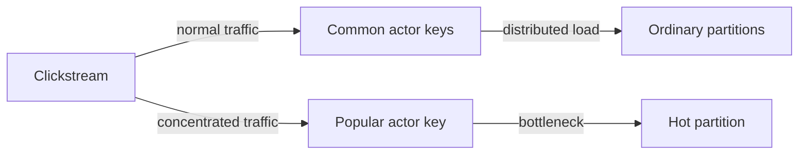

> A popular partition key sends disproportionate traffic to one partition; even storage distribution alone does not prevent hot keys.

## Solutions

<!-- original-note: 31 -->
<!-- title: Reducing data skew -->

Redistribute work with better partitioning, sampling or salting, and verify that the change preserves the required result.

- Adaptive partitioning adjusts partitioning to observed data characteristics.
- Salting adds a distribution factor; account for it when joining or combining results.
- Repartitioning redistributes existing data, trading shuffle cost for a better balance.
- Sampling estimates the distribution before choosing a strategy.
- Custom partitioning applies domain-specific placement rules.

- Review prompts: work through a salted join, then choose a domain-specific partitioning rule and explain how to recombine its results.

# Data Validation and Profiling

<!-- original-note: 32 -->

Profile data along four separate dimensions: missing information, contradictory values, incorrect values and broken relationships.

- Completeness: required fields and records exist; inspect missing/null counts and populated-field percentages.
- Consistency: cross-field rules and comparisons across sources or time do not contradict each other.
- Accuracy: compare values with trusted sources, known standards and business rules.
- Integrity: preserve valid relationships and lifecycle consistency, including foreign-key/reference checks.
- Missing, contradictory, inaccurate or disconnected data can each produce misleading conclusions; report these dimensions separately.

# Add a topic about Data Cardinality

<!-- original-note: 34 -->
<!-- title: Data cardinality: review prompt -->
<!-- unexpanded -->

# Section SQL and Git

## Aggregation


COUNT, SUM, AVG, MIN and MAX summarize a set of input rows.

- COUNT
  - SELECT COUNT(*) AS total_rows FROM employees;
- SUM
  - SELECT SUM(salary) AS total_salary FROM employees;
- AVG
  - SELECT AVG(salary) AS average_salary FROM employees;
- MAX / MIN
  - SELECT MAX(salary) AS highest_salary FROM employees;

## Conditional aggregation with CASE


WHERE filters input rows before grouping; CASE lets one query calculate several conditional aggregates.

- WHERE filters input rows before grouping; HAVING filters groups after aggregation.
- COUNT(CASE WHEN condition THEN 1 END) counts matches because COUNT(expression) ignores NULL.
- SUM(CASE WHEN condition THEN amount ELSE 0 END) totals values within a condition.

```sql
SELECT
  COUNT(CASE WHEN salary > 70000 THEN 1 END) AS high_count,
  COUNT(CASE WHEN salary BETWEEN 50000 AND 70000 THEN 1 END) AS middle_count,
  COUNT(CASE WHEN salary < 50000 THEN 1 END) AS low_count
FROM employees;
```

**Current reference (checked 2026-10-13):** [Redshift WHERE and HAVING](https://docs.aws.amazon.com/redshift/latest/dg/r_HAVING_clause.html).

## Grouping


GROUP BY returns one aggregate row per distinct grouping key.

- The screenshot filters employees by join date before counting each department.
- For the pictured sample, HR has 5 qualifying rows and IT has 8; those are example results, not properties of the query.

```sql
SELECT department_id, COUNT(*) AS number_of_employees
FROM employees
WHERE join_date > '2020-01-01'
GROUP BY department_id;
```

## Multiple grouping keys and sorting


Grouping by year and product produces one row for each year/product combination.

- ORDER BY controls result order; GROUP BY alone does not guarantee a sorted result.
- The source uses YEAR(); this version uses EXTRACT for Redshift-style SQL.

```sql
SELECT EXTRACT(YEAR FROM sale_date) AS sale_year,
       product_id, SUM(amount) AS total_sales
FROM sales
GROUP BY EXTRACT(YEAR FROM sale_date), product_id
ORDER BY sale_year, total_sales DESC;
```

# SQL Pivoting

<!-- original-note: 33 -->

Pivoting changes category values into report columns. For sales reporting, group by salesperson and aggregate the amount for each month.

- The screenshot pivots monthly sales into January and February columns per salesperson.
- PIVOT syntax differs by database; conditional aggregation is a portable alternative.

## Pivoting with conditional aggregation


Use CASE inside an aggregate to build a cross-tab report without a dedicated PIVOT operator.

- Group by salesperson; each CASE selects the month contributing to its output column.
- The source sample shows Alice: 1000 January / 1100 February and Bob: 900 / 950.

```sql
SELECT salesperson,
  SUM(CASE WHEN month = 'Jan' THEN sales ELSE 0 END) AS jan_sales,
  SUM(CASE WHEN month = 'Feb' THEN sales ELSE 0 END) AS feb_sales
FROM sales
GROUP BY salesperson;
```

## INNER JOIN


INNER JOIN returns matching row pairs. Duplicate keys can produce multiple output rows.


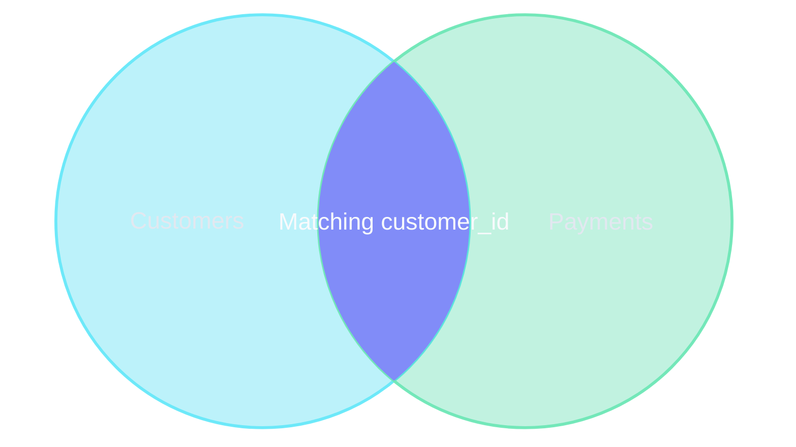

> INNER JOIN returns matching row pairs. Duplicate keys can produce multiple output rows.

## INNER JOIN worked example


An inner join emits rows only when the join condition matches. A customer with several matching payments contributes several joined rows.

- The screenshot is interpreted as SQL plus result semantics; individual customer/payment rows are illustrative.

```sql
SELECT c.customerName, p.paymentDate, p.amount
FROM customers c
INNER JOIN payments p
  ON c.customerNumber = p.customerNumber;
```

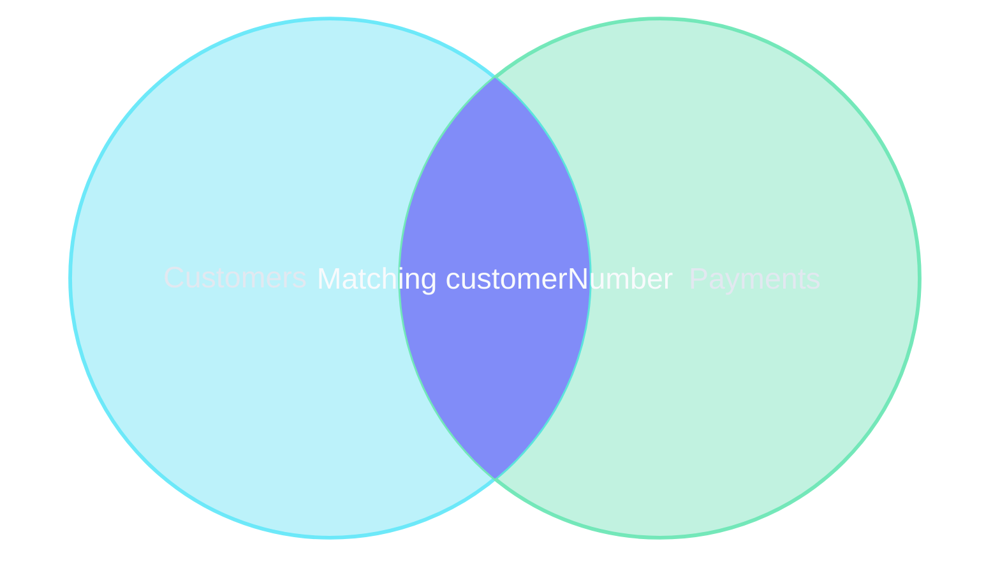

## LEFT OUTER JOIN


LEFT OUTER JOIN keeps every left row; unmatched right-side columns become NULL.


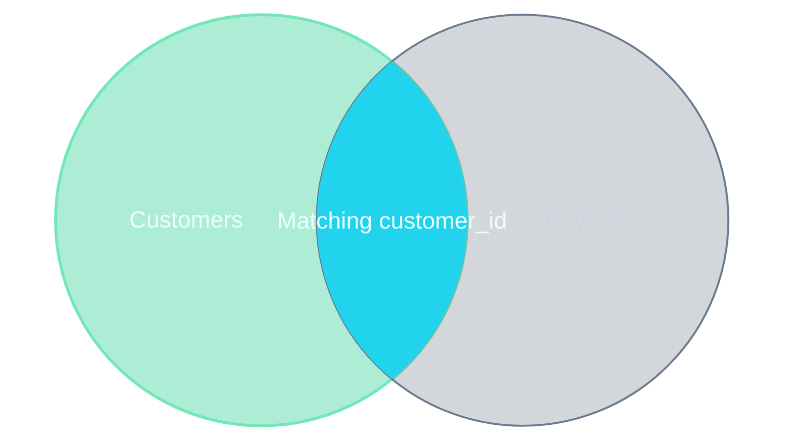

> LEFT OUTER JOIN keeps every left row; unmatched right-side columns become NULL.

## LEFT JOIN worked example


A left join preserves every row from its left input. When no payment matches a customer, the payment columns in the result are NULL.

- The screenshot is interpreted as SQL plus result semantics; individual customer/payment rows are illustrative.

```sql
SELECT c.customerName, p.paymentDate, p.amount
FROM customers c
LEFT JOIN payments p
  ON c.customerNumber = p.customerNumber;
```

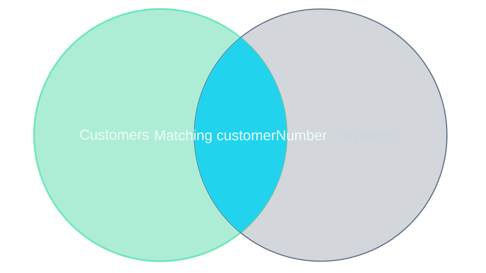

## RIGHT OUTER JOIN


RIGHT OUTER JOIN keeps every right row; unmatched left-side columns become NULL.


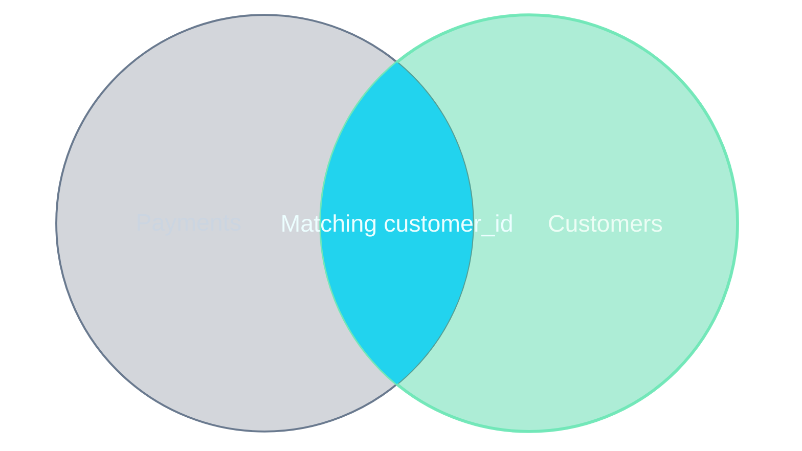

> RIGHT OUTER JOIN keeps every right row; unmatched left-side columns become NULL.

## RIGHT JOIN worked example


A right join preserves every row from its right input. Swapping the inputs changes which unmatched records remain in the result.

- The screenshot is interpreted as SQL plus result semantics; individual customer/payment rows are illustrative.

```sql
SELECT c.customerName, p.paymentDate, p.amount
FROM payments p
RIGHT JOIN customers c
  ON c.customerNumber = p.customerNumber;
```


## FULL OUTER JOIN


FULL OUTER JOIN preserves unmatched rows from both inputs and includes all matching row pairs.


```mermaid
venn-beta
    set Left["Left input"]
    set Right["Right input"]
    union Left,Right["Matching keys"]
    style Left fill:#22d3ee,fill-opacity:0.34,stroke:#67e8f9,stroke-width:3,color:#e2e8f0
    style Right fill:#34d399,fill-opacity:0.34,stroke:#6ee7b7,stroke-width:3,color:#e2e8f0
    style Left,Right fill:#818cf8,fill-opacity:0.65,stroke:#c4b5fd,stroke-width:3,color:#f8fafc
```

> FULL OUTER JOIN preserves unmatched rows from both inputs and includes all matching row pairs.

## CROSS JOIN


A cross join returns the Cartesian product: m rows times n rows yields m × n combinations.

- CROSS JOIN returns the Cartesian product of its inputs.
- There is no matching ON predicate in this example.


```mermaid
venn-beta
    set Colors["Colors"]
    set Sizes["Sizes"]
    style Colors fill:#22d3ee,fill-opacity:0.32,stroke:#67e8f9,stroke-width:3,color:#e2e8f0
    style Sizes fill:#34d399,fill-opacity:0.32,stroke:#6ee7b7,stroke-width:3,color:#e2e8f0
```

> The slide's 'CROSS OUTER JOIN' is a CROSS JOIN: every left row pairs with every right row, producing m × n rows.

## CROSS JOIN worked example


A cross join pairs each row from one input with every row from the other, producing all combinations without a matching-key condition.

- The screenshot is interpreted as SQL plus result semantics; individual customer/payment rows are illustrative.

```sql
SELECT c.customerName, p.paymentDate, p.amount
FROM payments p
CROSS JOIN customers c;
```

```mermaid
venn-beta
    set Payments["Payments"]
    set Customers["Customers"]
    style Payments fill:#22d3ee,fill-opacity:0.32,stroke:#67e8f9,stroke-width:3,color:#e2e8f0
    style Customers fill:#34d399,fill-opacity:0.32,stroke:#6ee7b7,stroke-width:3,color:#e2e8f0
```

## SQL Regular Expressions


Regular expressions match patterns inside text; SQL syntax and supported operators depend on the database.

- Pattern matching
  - Think a much more powerful “LIKE”
- ~ is the regular expression operator
- ~* is case-insensitive
- !~* would mean “not match expression, case insensitive”
- Regular expression 101
  - ^ - match a pattern at the start of a string
  - $ - match a pattern at the end of a string (boo$ would match boo but not book)
  - | - alternate characters (sit|sat matches both sit and sat)
  - Ranges ([a-z] matches any lower case letter)
  - Repeats ([a-z]{4} matches any four-letter lowercase word)
  - Special metacharacters
    - \d – any digit; \w – any letter, digit, or underscore, \s – whitespace, \t – tab
- Example:
  - SELECT * FROM name WHERE name ~ * ‘^(fire|ice)’;
  - Selects any rows where the name starts with “fire” or “ice” (case insensitive)

## Git review


Git separates working files, the staging area, local commits and the remote repository.


```mermaid
flowchart LR
  accTitle: Git review
  n0["Working tree"]
  n1["Index / staging"]
  n2["Local repository"]
  n3["Remote repository"]
  n0 -->|"git add"| n1
  n1 -->|"git commit"| n2
  n2 -->|"git push"| n3
  n3 -->|"git fetch"| n2
  n2 -->|"checkout / restore"| n0
```

> Git separates working files, the staging area, local commits and the remote repository.

## Common git commands


Git configuration sets identity and preferences; init and clone create a local repository in different ways.

- Setting Up and Configuration:
  - git init: Initialize a new Git repository.
  - git config: Set configuration values for user info, aliases, and more.
    - git config --global user.name "Your Name": Set your name.
    - git config --global user.email "your@email.com": Set your email.
- Basic Commands:
  - git clone <repository>: Clone (or download) a repository from an existing URL.
  - git status: Check the status of your changes in the working directory.
  - git add <filename>: Add changes in the file to the staging area.
    - git add .: Add all new and changed files to the staging area.
  - git commit -m "Commit message here": Commit the staged changes with a message.
  - git log: View commit logs.

## Branching with git


Branches diverge from a common commit and may later merge; branch pointers identify the current tip.

- git branch: List all local branches.
  - git branch <branchname>: Create a new branch.
- git checkout <branchname>: Switch to a specific branch.
  - git checkout -b <branchname>: Create a new branch and switch to it.
- git merge <branchname>: Merge the specified branch into the current branch.
- git branch -d <branchname>: Delete a branch.


```mermaid
flowchart LR
  accTitle: Branching with git
  n0["Common commit"]
  n1["Main branch"]
  n2["Feature branch"]
  n3["Merge commit"]
  n0 -->|"main development"| n1
  n0 -->|"feature development"| n2
  n1 -->|"first parent"| n3
  n2 -->|"merged changes"| n3
```

> Branches diverge from a common commit and may later merge; branch pointers identify the current tip.

## Remote repositories


Remote repositories provide shared references for collaboration. Configure a remote, fetch its history and explicitly push the branches you intend to publish.

- git remote: List all remote repositories.
- git push <remote> <branch>: Push a branch to a remote repository.
- git pull <remote> <branch>: Pull changes from a remote repository branch into the current local branch.

## Undoing changes


Choose an undo operation by what must change: the staging area, working files or committed history. Check the affected scope before resetting or reverting.

- git reset --hard: Reset the staging area and the working directory to match the most recent commit.
- git revert <commit>: Create a new commit that undoes all of the changes from a previous commit.

## Advanced git


Stashing, rebasing, cherry-picking and bisecting solve different history-management problems; select the operation from the result you need.

  - git stash pop: Restore the most recently stashed changes.
- git rebase <branch>: Reapply changes from one branch onto another, often used to integrate changes from one branch into another.
- git cherry-pick <commit>: Apply changes from a specific commit to the current branch.

## Git collaboration and inspection


Inspect commits, file attribution and differences to understand a change before integrating it. Use patches when exchanging changes outside the usual branch workflow.

- git diff: Show changes between commits, commit and working tree, etc.
- git fetch: Fetch changes from a remote repository without merging them.

## Git maintenance and data recovery


Git integrity checks, cleanup and the reflog support local repository maintenance and recovery.

- git fsck: Check the database for errors.
- git gc: Clean up and optimize the local repository.
- git reflog: Record when refs were updated in the local repository, useful for recovering lost commits.

# Section Storage

<!-- original-note: 35 -->
<!-- section -->

## Amazon S3


S3 stores objects for data lakes, backups, archives, application assets and content distribution. Other AWS services often use it as a durable exchange point.

- Storage and recovery: backups, disaster recovery, archives and hybrid transfer.
- Applications and delivery: static websites, media, application assets and software updates.
- Analytics: retain datasets and exchange outputs between processing tools.
- The personal notes use long-retention financial archives and analytical reports as example workloads; they are examples rather than current customer claims.

### Amazon S3 Use cases


S3 supports object-backed storage, archives, recovery copies, content delivery and analytical lakes.

- Backup and storage
- Disaster Recovery
- Archive
- Hybrid Cloud storage
- Application hosting
- Media hosting
- Data lakes & big data analytics
- Software delivery
- Static website

### Buckets

<!-- original-note: 36 -->
<!-- title: S3 buckets -->

A bucket is the container for S3 objects in a Region. Choose its namespace deliberately; object key prefixes organize names rather than creating ordinary directories.

- Shared-global bucket names must be unique across accounts and Regions within their AWS partition.
- An account-regional namespace reserves names for one account using the required account/Region suffix; it does not make arbitrary duplicate global names valid.
- Account-regional creation uses the documented naming convention and namespace request setting.
- Naming basics: 3-63 characters; lowercase letters, digits, periods and hyphens; begin and end with a letter or digit. Uppercase, underscores, adjacent periods and IP-address formatting are invalid.
- Reserved names include the xn-- prefix and -s3alias suffix; consult the linked rules for the complete list and namespace-specific requirements.

**Current reference (checked 2026-10-13):** [S3 bucket namespaces and naming](https://docs.aws.amazon.com/AmazonS3/latest/userguide/bucketnamingrules.html).

### Amazon S3 - Objects


An S3 object key identifies the object within its bucket; slash-separated prefixes do not create ordinary filesystem directories.

- Objects (files) have a Key
- The key is the FULL path:
  - s3://my-bucket/my_file.txt
  - s3://my-bucket/my_folder1/another_folder/my_file.txt
- The key is composed of prefix + object name
- There’s no concept of “directories” within buckets (although the UI will trick you to think otherwise)
- Just keys with very long names that contain slashes (“/”) with Objects

### Amazon S3 – Objects (cont.)


An S3 object combines its bytes with metadata, optional tags and a version identifier when versioning is enabled.

- Current correction: S3 supports objects up to 53.7 TB (48.8 TiB), commonly called 50 TB; a single PUT supports up to 5 GB. Use multipart upload for larger objects.
- Object values are the content of the body:
  - Max. Object Size is 50TB (50,000GB)
  - If uploading more than 5GB, must use “multi-part upload”
- Metadata (list of text key / value pairs – system or user metadata)
- Tags (Unicode key / value pair – up to 10) – useful for security / lifecycle
- Version ID (if versioning is enabled)

**Current reference (checked 2026-10-13):** [S3 object limits](https://docs.aws.amazon.com/AmazonS3/latest/userguide/UsingObjects.html).

### S3 - Security

<!-- original-note: 37 -->
<!-- title: S3 security -->

S3 access depends on the requesting identity, applicable resource policies and blocking controls. An explicit deny takes precedence over an allow.

- User-Based
  - IAM Policies – which API calls should be allowed for a specific user from IAM
- Resource-Based
  - Bucket Policies – bucket wide rules from the S3 console - allows cross account
  - Object Access Control List (ACL) – finer grain (can be disabled)
  - Bucket Access Control List (ACL) – less common (can be disabled)
- Note: an IAM principal can access an S3 object if
  - The user IAM permissions ALLOW it OR the resource policy ALLOWS it
  - AND there’s no explicit DENY
- Encryption: encrypt objects in Amazon S3 using encryption keys

### S3 - Bucket Policies


A bucket policy is a resource policy that scopes S3 actions by principal, resource and optional conditions.

- JSON based policies
  - Resources: buckets and objects
  - Effect: Allow / Deny
  - Actions: Set of API to Allow or Deny
  - Principal: The account or user to apply the policy to
- Use S3 bucket for policy to:
  - Grant public access to the bucket
  - Force objects to be encrypted at upload
  - Grant access to another account (Cross Account)

### Example: Public Access - Use Bucket Policy


Anonymous access requires an applicable bucket policy and public-access settings that permit it; public access is an explicit configuration choice.


```mermaid
flowchart LR
  accTitle: Example: Public Access - Use Bucket Policy
  n0["Anonymous visitor"]
  n1["Bucket policy<br/>Explicit public allow"]
  n2["S3 bucket"]
  n0 -->|"request"| n1
  n1 -->|"authorize if permitted"| n2
```

> Anonymous access requires an applicable bucket policy and public-access settings that permit it; public access is an explicit configuration choice.

### Example: User Access to S3 – IAM permissions


An IAM user's identity policy can authorize same-account S3 access, subject to all applicable policy restrictions.


```mermaid
flowchart LR
  accTitle: Example: User Access to S3 – IAM permissions
  n0["IAM user"]
  n1["Identity policy"]
  n2["S3 bucket"]
  n0 -->|"evaluate request"| n1
  n1 -->|"allow required actions"| n2
```

> An IAM user's identity policy can authorize same-account S3 access, subject to all applicable policy restrictions.

### Example: EC2 instance access - Use IAM Roles


An EC2 instance uses an IAM role and temporary credentials to access S3 without embedded long-lived keys.


```mermaid
flowchart LR
  accTitle: Example: EC2 instance access - Use IAM Roles
  n0["EC2 application"]
  n1["Instance role<br/>Temporary credentials"]
  n2["S3 bucket"]
  n0 -->|"assume service role"| n1
  n1 -->|"authorized requests"| n2
```

> An EC2 instance uses an IAM role and temporary credentials to access S3 without embedded long-lived keys.

### Advanced: Cross-Account Access – Use Bucket Policy


Cross-account S3 access requires authorization on both sides; the destination bucket policy trusts the external principal.


```mermaid
flowchart LR
  accTitle: Advanced: Cross-Account Access – Use Bucket Policy
  n0["Account A principal"]
  n1["Identity policy"]
  n2["Account B bucket policy"]
  n3["S3 bucket"]
  n0 -->|"identity permission"| n1
  n1 -->|"cross-account request"| n2
  n2 -->|"resource permission"| n3
```

> Cross-account S3 access requires authorization on both sides; the destination bucket policy trusts the external principal.

### Bucket settings for Block Public Access


Block Public Access adds controls against unintended public exposure. Evaluate these settings together with the bucket's policies and access-control configuration.

- If you know your bucket should never be public, leave these on
- Can be set at the account level

### Amazon S3 - Versioning


Versioning retains distinct versions under the same object key; a delete marker hides the current object without erasing retained versions.

- You can version your files in Amazon S3
- It is enabled at the bucket level
- Same key overwrite will change the “version”: 1, 2, 3….
- It is best practice to version your buckets
  - Protect against unintended deletes (ability to restore a version)
  - Easy roll back to previous version
- Notes:
  - Any file that is not versioned prior to enabling versioning will have version “null”
  - Suspending versioning does not delete the previous versions


```mermaid
flowchart LR
  accTitle: Amazon S3 - Versioning
  n0["Object key"]
  n1["Version 1"]
  n2["Version 2"]
  n3["Version 3"]
  n4["Delete marker"]
  n0 ---|"retained version"| n1
  n0 ---|"retained version"| n2
  n0 ---|"retained version"| n3
  n0 ---|"logical deletion"| n4
```

> Versioning retains distinct versions under the same object key; a delete marker hides the current object without erasing retained versions.

### Amazon S3 - Replication

<!-- original-note: 38 -->
<!-- title: S3 replication -->

Replication copies eligible objects to another bucket in the same Region or a different Region. Configure the rule, permissions and destination for the recovery or distribution requirement.

- Must enable Versioning in source and destination buckets
- Cross-Region Replication (CRR)
- Same-Region Replication (SRR)
- Buckets can be in different AWS accounts
- Copying is asynchronous
- Must give proper IAM permissions to S3
- Use cases:
  - CRR – compliance, lower latency access, replication across accounts
  - SRR – log aggregation, live replication between production and test accounts


```mermaid
flowchart LR
  accTitle: S3 replication
  n0["Versioned source bucket"]
  n1["Replication role / rule"]
  n2["Versioned destination bucket"]
  n0 -->|"eligible versions"| n1
  n1 -->|"asynchronous copy"| n2
```

> S3 asynchronously replicates eligible new object versions to another bucket in the same or a different Region.

### Amazon S3 – Replication (Notes)


A newly enabled replication rule handles eligible new writes. Use a separate batch-replication workflow when existing objects also need to be copied.

- Optionally, you can replicate existing objects using S3 Batch Replication
  - Replicates existing objects and objects that failed replication
- For DELETE operations
  - Can replicate delete markers from source to target (optional setting)
  - Deletions with a version ID are not replicated (to avoid malicious deletes)
- There is no “chaining” of replication
  - If bucket 1 has replication into bucket 2, which has replication into bucket 3
  - Then objects created in bucket 1 are not replicated to bucket 3

### Amazon S3 – Replication Time Control (RTC)


Replication Time Control adds a defined replication-time objective and monitoring to supported replication rules, with additional charges and documented eligibility.

- 99.99% of new objects replicated within 15 minutes
- Provides predictable, auditable replication time
- Publishes CloudWatch metrics to monitoring
- Alerts you if replication falls behind
- Can replicate to same or different AWS Region
- Helps you meet compliance or business requirements
- Extra cost per GB for the replication

### S3 Classes

<!-- original-note: 39 -->
<!-- title: S3 storage classes -->

Choose a storage class by access frequency, retrieval delay, resilience and retention charges rather than storage price alone.

- Amazon S3 Standard - General Purpose
- Amazon S3 Standard-Infrequent Access (IA)
- Amazon S3 One Zone-Infrequent Access
- Amazon S3 Glacier Instant Retrieval
- Amazon S3 Glacier Flexible Retrieval
- Amazon S3 Glacier Deep Archive
- Amazon S3 Intelligent Tiering
- Can move between classes manually or using S3 Lifecycle configurations

### S3 Durability and Availability


Durability measures protection against data loss; availability measures successful access over time.

- Durability:
  - High durability (99.999999999%, 11 9’s) of objects across multiple AZ
  - If you store 10,000,000 objects with Amazon S3, you can on average expect to incur a loss of a single object once every 10,000 years
  - Same for all storage classes
- Availability:
  - Measures how readily available a service is
  - Varies depending on storage class
  - Example: S3 standard has 99.99% availability = not available 53 minutes a year

### S3 Standard – General Purpose


S3 Standard targets frequently accessed data with immediate access and multi-AZ resilience.

- 99.99% Availability
- Used for frequently accessed data
- Low latency and high throughput
- Sustain 2 concurrent facility failures
- Use Cases: Big Data analytics, mobile & gaming applications, content distribution…

### S3 Storage Classes – Infrequent Access


Infrequent-access classes trade lower storage prices for retrieval charges and minimum-duration rules while retaining immediate object access.

- Lower cost than S3 Standard
- Amazon S3 Standard-Infrequent Access (S3 Standard-IA)
  - 99.9% Availability
  - Use cases: Disaster Recovery, backups
- Amazon S3 One Zone-Infrequent Access (S3 One Zone-IA)
  - High durability (99.999999999%) in a single AZ; data lost when AZ is destroyed
  - 99.5% Availability
  - Use Cases: Storing secondary backup copies of on-premises data, or data you can recreate

### Amazon S3 Glacier Storage Classes


Glacier classes serve long-retention and rarely accessed data. Choose between immediate reads and restore workflows according to the acceptable retrieval delay.

- Pricing: price for storage + object retrieval cost
- Amazon S3 Glacier Instant Retrieval
  - Millisecond retrieval, great for data accessed once a quarter
  - Minimum storage duration of 90 days
- Amazon S3 Glacier Flexible Retrieval (formerly Amazon S3 Glacier):
  - Expedited (1 to 5 minutes), Standard (3 to 5 hours), Bulk (5 to 12 hours) – free
- Amazon S3 Glacier Deep Archive – for long term storage:
  - Standard (12 hours), Bulk (48 hours)
  - Minimum storage duration of 180 days

### S3 Intelligent-Tiering


Intelligent-Tiering adapts eligible objects to changing access patterns, with monitoring and optional archive-tier considerations.

- Small monthly monitoring and auto-tiering fee
- Moves objects automatically between Access Tiers based on usage
- There are no retrieval charges in S3 Intelligent-Tiering
- Frequent Access tier (automatic): default tier
- Infrequent Access tier (automatic): objects not accessed for 30 days
- Archive Instant Access tier (automatic): objects not accessed for 90 days
- Archive Access tier (optional): configurable from 90 days to 700+ days

### S3 storage-class comparison


Compare access latency, AZ resilience, retention charges and retrieval fees before comparing storage price.

- The course table describes 11-nines designed durability; durability and availability are different measures.
- Standard, Intelligent-Tiering and IA classes provide immediate access; Flexible Retrieval and Deep Archive require restore workflows.
- One Zone-IA stores data in one AZ: choose it only for reproducible or otherwise acceptable single-AZ datasets.
- Course minimum-duration examples: IA 30 days, Glacier Instant/Flexible 90 days, Deep Archive 180 days. Validate current class rules before implementation.

| Class family | Typical role | Tradeoff to check |
| --- | --- | --- |
| Standard | Frequent access | Storage price versus request volume |
| Intelligent-Tiering | Unpredictable access | Monitoring, object eligibility, optional archive tiers |
| Standard-IA / One Zone-IA | Infrequent immediate reads | Retrieval charges; single-AZ risk for One Zone |
| Glacier Instant Retrieval | Rare immediate reads | Minimum duration and retrieval cost |
| Glacier Flexible Retrieval | Archives with restore delay | Restore tier and temporary restored copy |
| Glacier Deep Archive | Long retention, hours acceptable | Longer restore time and minimum duration |

### S3 pricing: compare the complete workload


The us-east-1 dollar amounts are an illustrative snapshot, not a current quote.

- Include storage, requests, retrieved bytes, lifecycle transitions, monitoring and transfer in the estimate.
- Frequent small reads can make the lowest per-GB storage class more expensive overall.
- The source illustrates Flexible Retrieval tiers of minutes to hours and Deep Archive restore times of hours; check the selected tier and current pricing.

**Current reference (checked 2026-10-13):** [S3 pricing](https://aws.amazon.com/s3/pricing/).

### S3 Express One Zone


S3 Express One Zone places a directory bucket in one Availability Zone; co-locating compute reduces access latency.

- High performance, single Availability Zone storage class
- Objects stored in a Directory Bucket (bucket in a single AZ)
- Handle 100,000s requests per second with single- digit millisecond latency
- Up to 10x better performance than S3 Standard (50% lower costs)
- High Durability (99.999999999%) and Availability (99.95%)
- Co-locate your storage and compute resources in the same AZ (reduces latency)
- Use cases: latency-sensitive apps, data-intensive apps, AI & ML training, financial modeling, media processing, HPC…
- Best integrated with SageMaker Model Training,


```mermaid
flowchart LR
  accTitle: S3 Express One Zone
  n0["Region"]
  n1["Availability Zone"]
  n2["Compute"]
  n3["Directory bucket<br/>S3 Express One Zone"]
  n0 ---|"contains"| n1
  n1 ---|"co-located"| n2
  n1 ---|"single-AZ storage"| n3
  n2 ---|"low-latency requests"| n3
```

> S3 Express One Zone places a directory bucket in one Availability Zone; co-locating compute reduces access latency.

### Amazon S3 – Moving between Storage Classes


The lifecycle waterfall shows alternative permitted transitions, not a mandatory sequence. Intelligent-Tiering exits depend on the object's access tier; eligibility and minimum-duration rules still apply.

- You can transition objects between storage classes
- For infrequently accessed object, move them to Standard IA
- For archive objects that you don’t need fast access to, move them to Glacier or Glacier Deep Archive
- Moving objects can be automated using a Lifecycle Rules

**Current reference (checked 2026-10-13):** [S3 supported lifecycle transitions](https://docs.aws.amazon.com/AmazonS3/latest/userguide/lifecycle-transition-general-considerations.html).


```mermaid
flowchart TB
  accTitle: Amazon S3 – Moving between Storage Classes
  n0["S3 Standard"]
  n1["Standard-IA"]
  n2["Intelligent-Tiering<br/>Access-tier restrictions apply"]
  n3["One Zone-IA"]
  n4["Glacier Instant Retrieval"]
  n5["Glacier Flexible Retrieval"]
  n6["Glacier Deep Archive"]
  n0 -->|"transition"| n1
  n0 -->|"transition"| n2
  n0 -->|"transition"| n3
  n0 -->|"transition"| n4
  n0 -->|"transition"| n5
  n0 -->|"transition"| n6
  n1 -->|"transition"| n2
  n1 -->|"transition"| n3
  n1 -->|"transition"| n4
  n1 -->|"transition"| n5
  n1 -->|"transition"| n6
  n2 -->|"Frequent / Infrequent tiers"| n3
  n2 -->|"eligible access tiers"| n4
  n2 -->|"eligible access tiers"| n5
  n2 -->|"eligible access tiers"| n6
  n3 -->|"transition"| n5
  n3 -->|"transition"| n6
  n4 -->|"transition"| n5
  n4 -->|"transition"| n6
  n5 -->|"transition"| n6
```

> The lifecycle waterfall shows alternative permitted transitions, not a mandatory sequence. Intelligent-Tiering exits depend on the object's access tier; eligibility and minimum-duration rules still apply.

### Amazon S3 – Lifecycle Rules


Lifecycle rules transition or expire eligible objects, versions and uploads. Scope each rule to the intended dataset and retention requirement.

  - Move objects to Standard IA class 60 days after creation
  - Move to Glacier for archiving after 6 months
- Expiration actions – configure objects to expire (delete) after some time
  - Access log files can be set to delete after a 365 days
  - Can be used to delete old versions of files (if versioning is enabled)
  - Can be used to delete incomplete Multi-Part uploads
- Rules can be created for a certain prefix (example: s3://mybucket/mp3/*)

### Amazon S3 – Lifecycle Rules (Scenario 1)


Store profile originals for immediate access for 60 days, then allow a six-hour retrieval delay. Treat reproducible thumbnails separately because they can be deleted and regenerated.

- S3 source images can be on Standard, with a lifecycle configuration to transition them to Glacier after 60 days
- S3 thumbnails can be on One-Zone IA, with a lifecycle configuration to expire them (delete them) after 60 days

### Amazon S3 – Lifecycle Rules (Scenario 2)


Combine versioning and lifecycle transitions to keep deleted objects immediately recoverable for 30 days, then recoverable with a longer delay through day 365.

- Enable S3 Versioning in order to have object versions, so that “deleted objects” are in fact hidden by a “delete marker” and can be recovered
- Transition the “noncurrent versions” of the object to Standard IA
- Transition afterwards the “noncurrent versions” to Glacier Deep Archive

### Amazon S3 Analytics – Storage Class Analysis


S3 storage-class analysis produces reports to inform lifecycle decisions; recommendations do not themselves move objects.

- Help you decide when to transition objects to the right storage class
- Recommendations for Standard and Standard IA
  - Does NOT work for One-Zone IA or Glacier
- Report is updated daily
- 24 to 48 hours to start seeing data analysis
- Good first step to put together Lifecycle Rules (or improve them)!


```mermaid
flowchart LR
  accTitle: Amazon S3 Analytics – Storage Class Analysis
  n0["S3 objects / access patterns"]
  n1["Storage-class analysis"]
  n2["Reports"]
  n3["Lifecycle policy decision"]
  n0 -->|"analyze"| n1
  n1 -->|"export insights"| n2
  n2 -->|"choose transitions"| n3
```

> S3 storage-class analysis produces reports to inform lifecycle decisions; recommendations do not themselves move objects.

### S3 Event Notifications

<!-- original-note: 40 -->
<!-- title: S3 event notifications -->

With s3 event notifications object events can trigger downstream processing. 
Select the event type, destination and destination permissions as separate parts of the notification setup.

- S3:ObjectCreated, S3:ObjectRemoved, S3:ObjectRestore, S3:Replication…
- Object name filtering possible (*.jpg)
- Use case: generate thumbnails of images uploaded to S3
- Can create as many “S3 events” as desired
- S3 event notifications typically deliver events in seconds but can sometimes take a minute or longer


```mermaid
flowchart LR
  accTitle: S3 event notifications
  n0["S3 bucket"]
  n1["SNS"]
  n2["SQS"]
  n3["Lambda"]
  n0 -->|"event notification"| n1
  n0 -->|"event notification"| n2
  n0 -->|"event notification"| n3
```

> S3 object events can notify SNS, SQS or Lambda; configure the supported event types and filters.

### S3 Event Notifications – IAM Permissions


Notification destinations need resource policies allowing the S3 service to publish, send or invoke as appropriate.


```mermaid
flowchart LR
  accTitle: S3 Event Notifications – IAM Permissions
  n0["S3 event"]
  n1["SNS policy"]
  n2["SQS policy"]
  n3["Lambda policy"]
  n4["Destination"]
  n0 -->|"sns:Publish"| n1
  n0 -->|"sqs:SendMessage"| n2
  n0 -->|"lambda:InvokeFunction"| n3
  n1 -->|"permit SNS delivery"| n4
  n2 -->|"permit SQS delivery"| n4
  n3 -->|"permit invocation"| n4
```

> Notification destinations need resource policies allowing the S3 service to publish, send or invoke as appropriate.

### S3 Event Notifications with Amazon EventBridge


S3 events enter EventBridge, where rules filter event detail and route to configured targets.

- Advanced filtering options with JSON rules (metadata, object size, name...)
- Multiple Destinations – ex Step Functions, Kinesis Streams / Firehose…
- EventBridge Capabilities – Archive, Replay Events, Reliable delivery


```mermaid
flowchart LR
  accTitle: S3 Event Notifications with Amazon EventBridge
  n0["S3 bucket"]
  n1["EventBridge bus"]
  n2["Rules<br/>Event matching"]
  n3["Targets<br/>Workflows, queues, functions"]
  n0 -->|"events"| n1
  n1 -->|"evaluate pattern"| n2
  n2 -->|"route matching events"| n3
```

> S3 events enter EventBridge, where rules filter event detail and route to configured targets.

### S3 Performance

<!-- original-note: 41 -->
<!-- title: S3 performance -->

The key idea is that Amazon S3 is designed for massive parallelism, rather than behaving like a traditional disk or filesystem.

AWS documents performance of at least:
- 3,500 requests/second per prefix for write-type operations such as PUT, COPY, POST, and DELETE
- 5,500 requests/second per prefix for GET and HEAD

```
s3://my-data-lake/
    raw/
    silver/
    gold/
```

```
                S3 Bucket
                    │
        ┌───────────┼───────────┐
        ▼           ▼           ▼
      raw/        silver/      gold/
    5,500 GET/s   5,500 GET/s  5,500 GET/s
```

- If you spread reads across all three prefixes evenly, you can achieve 16,500 (GET/HEAD) per second.

### S3 Performance - Multipart Upload


For large objects, you shouldn't necessarily upload the entire object as one request.
Instead, S3 supports multipart upload which sends parts in parallel.

- recommended for files > 100MB
- Mandatory for files > 5GB
- S3 objects can be up to 5TB.
```
                  10 GB file
                      │
       ┌──────────────┼──────────────┐
       ▼              ▼              ▼
     Part 1         Part 2         Part 3 ...
       │              │              │
       └──────────────┼──────────────┘
                      ▼
                     S3
```


```mermaid
flowchart LR
  accTitle: S3 Performance - Multipart Upload
  n0["Large object"]
  n1["Parallel parts"]
  n2["S3 bucket"]
  n3["Remote uploader"]
  n4["Edge location"]
  n0 -->|"split"| n1
  n1 -->|"upload / complete"| n2
  n3 -->|"public network"| n4
  n4 -->|"optimized network path"| n2
```

> Multipart upload sends parts in parallel; Transfer Acceleration routes uploads through an edge location toward the destination bucket.

### S3 Performance – S3 Byte-Range Fetches


There's effectively an equivalent concept on the download side. You don't necessarily have to download an entire object.
You can request specific byte ranges.

- can download separate ranges concurrently or retrieve only a file header.

```
                    S3 Object
                       │
         ┌─────────────┼─────────────┐
         ▼             ▼             ▼
     Range 1        Range 2       Range 3
         │             │             │
         └─────────────┼─────────────┘
                       ▼
                  Application
```


```mermaid
flowchart LR
  accTitle: S3 Performance – S3 Byte-Range Fetches
  n0["S3 object"]
  n1["Range 1"]
  n2["Range 2"]
  n3["Header range"]
  n4["Client"]
  n0 -->|"GET byte range"| n1
  n0 -->|"GET byte range"| n2
  n0 -->|"partial GET"| n3
  n1 -->|"parallel download"| n4
  n2 -->|"parallel download"| n4
  n3 -->|"inspect metadata"| n4
```

> Byte-range GETs can download separate ranges concurrently or retrieve only a file header.

### S3 Performance – Transfer Acceleration

S3 Transfer Acceleration allows to accelerate uploads/downloads to/from s3 by entering in AWS's network through a nearby edge location.

- Compatible with multi-part upload
- Transfer Acceleration has additional cost
- Do not confuse with CloudFront, which cache/distribute content globally

```
Client
Melbourne AWS region
    │
    ▼
Nearby AWS Edge Location
    │
    │ AWS global network (faster)
    │
    ▼
S3 Bucket (us-east-1)
```
                          

### S3 Encryption

<!-- original-note: 42 -->
<!-- title: S3 encryption -->

Distinguish encryption at rest from protection in transit, then identify who manages the keys and which permissions each request requires.

- Server-Side Encryption (SSE)
  - Server-Side Encryption with Amazon S3-Managed Keys (SSE-S3) – Enabled by Default
  - Server-Side Encryption with KMS Keys stored in AWS KMS (SSE-KMS)
  - Dual-Layer Server-Side Encryption with KMS Keys (DSSE-KMS)
  - Server-Side Encryption with Customer-Provided Keys (SSE-C)
- Client-Side Encryption

## Amazon S3 Encryption – SSE-S3


With SSE-S3, S3 encrypts the received object using keys managed by S3; TLS separately protects upload transport.

- Encryption using keys handled, managed, and owned by AWS
- Object is encrypted server-side
- Encryption type is AES-256
- Must set header "x-amz-server-side-encryption": "AES256"
- Enabled by default for new buckets & new objects


```mermaid
flowchart LR
  accTitle: Amazon S3 Encryption – SSE-S3
  n0["Client"]
  n1["S3 encryption"]
  n2["S3-managed key"]
  n3["Encrypted object"]
  n0 -->|"HTTPS upload"| n1
  n2 -->|"key management"| n1
  n1 -->|"store ciphertext"| n3
```

> With SSE-S3, S3 encrypts the received object using keys managed by S3; TLS separately protects upload transport.

## Amazon S3 Encryption – SSE-KMS


With SSE-KMS, S3 integrates with KMS for key authorization and data-key operations, then stores the encrypted object.

- Encryption using keys handled and managed by AWS KMS (Key Management Service)
- KMS advantages: user control + audit key usage using CloudTrail
- Object is encrypted server side
- Must set header "x-amz-server-side-encryption": "aws:kms"


```mermaid
flowchart LR
  accTitle: Amazon S3 Encryption – SSE-KMS
  n0["Client"]
  n1["S3"]
  n2["KMS key"]
  n3["Encrypted object"]
  n0 -->|"HTTPS upload"| n1
  n1 -->|"GenerateDataKey / authorization"| n2
  n1 -->|"encrypt and store"| n3
```

> With SSE-KMS, S3 integrates with KMS for key authorization and data-key operations, then stores the encrypted object.

## SSE-KMS Limitation


SSE-KMS operations depend on both S3 and KMS capacity; key-operation quotas can become a bottleneck.

- If you use SSE-KMS, you may be impacted by the KMS limits
- When you upload, it calls the GenerateDataKey KMS API
- When you download, it calls the Decrypt KMS API
- Count towards the KMS quota per second (5500, 10000, 30000 req/s based on region)
- You can request a quota increase using the Service Quotas Console


```mermaid
flowchart LR
  accTitle: SSE-KMS Limitation
  n0["Client requests"]
  n1["S3 SSE-KMS"]
  n2["KMS<br/>GenerateDataKey / Decrypt"]
  n0 -->|"PUT / GET"| n1
  n1 -->|"key operations"| n2
```

> SSE-KMS operations depend on both S3 and KMS capacity; key-operation quotas can become a bottleneck.

## Amazon S3 Encryption – DSSE-KMS


DSSE-KMS applies two independent encryption layers, combining KMS-controlled key use with an additional S3-managed layer.

- Dual-Layer Server-Side Encryption using keys handled and managed by AWS KMS
- Object is encrypted twice server side: KMS Key (1st layer) + S3 Managed Key (2nd layer)
- For compliance standards requiring multi-layer encryption (higher cost & latency than SSE-KMS)
- Must set header "x-amz-server-side-encryption": "aws:kms:dsse"

**Current reference (checked 2026-10-13):** [S3 dual-layer encryption](https://docs.aws.amazon.com/AmazonS3/latest/userguide/UsingDSSEncryption.html).


```mermaid
flowchart LR
  accTitle: Amazon S3 Encryption – DSSE-KMS
  n0["Upload"]
  n1["KMS-backed layer"]
  n2["S3-managed layer"]
  n3["Stored object"]
  n0 -->|"first layer"| n1
  n1 -->|"second layer"| n2
  n2 -->|"store"| n3
```

> DSSE-KMS applies two independent encryption layers, combining KMS-controlled key use with an additional S3-managed layer.

## Amazon S3 Encryption – SSE-C


SSE-C performs encryption in S3 using a customer-provided key sent over HTTPS; S3 does not retain that key for later requests.

- Server-Side Encryption using keys fully managed by the customer outside of AWS
- Amazon S3 does NOT store the encryption key you provide
- HTTPS must be used
- Encryption key must provided in HTTP headers, for every HTTP request made


```mermaid
flowchart LR
  accTitle: Amazon S3 Encryption – SSE-C
  n0["Client + customer key"]
  n1["HTTPS request"]
  n2["S3 encryption"]
  n3["Stored ciphertext"]
  n0 -->|"provide key each request"| n1
  n1 -->|"server-side encryption"| n2
  n2 -->|"store object"| n3
```

> SSE-C performs encryption in S3 using a customer-provided key sent over HTTPS; S3 does not retain that key for later requests.

## Amazon S3 Encryption – Client-Side Encryption


Client-side encryption encrypts the object before upload; the client manages encryption and decryption.

- Use client libraries such as Amazon S3 Client-Side Encryption Library
- Clients must encrypt data themselves before sending to Amazon S3
- Clients must decrypt data themselves when retrieving from Amazon S3
- Customer fully manages the keys and encryption cycle


```mermaid
flowchart LR
  accTitle: Amazon S3 Encryption – Client-Side Encryption
  n0["Plaintext"]
  n1["Client encryption + key"]
  n2["Ciphertext"]
  n3["S3 bucket"]
  n0 -->|"encrypt locally"| n1
  n1 -->|"encrypted bytes"| n2
  n2 -->|"HTTPS upload"| n3
```

> Client-side encryption encrypts the object before upload; the client manages encryption and decryption.

## Amazon S3 – Encryption in transit (SSL/TLS)


TLS protects S3 traffic in transit independently of object encryption at rest.

- Encryption in flight is also called SSL/TLS
- Amazon S3 exposes two endpoints:
  - HTTP Endpoint – non encrypted
  - HTTPS Endpoint – encryption in flight
- HTTPS is recommended
- HTTPS is mandatory for SSE-C
- Most clients would use the HTTPS endpoint by default

## Amazon S3 – Force Encryption in Transit aws:SecureTransport


A bucket-policy explicit deny on aws:SecureTransport=false rejects unencrypted transport even if another policy allows the action.


```mermaid
flowchart LR
  accTitle: Amazon S3 – Force Encryption in Transit aws:SecureTransport
  n0["HTTP request"]
  n1["HTTPS request"]
  n2["Bucket policy"]
  n3["Denied"]
  n4["S3 bucket"]
  n0 -->|"SecureTransport=false"| n2
  n1 -->|"SecureTransport=true"| n2
  n2 -->|"explicit deny HTTP"| n3
  n2 -->|"HTTPS still needs authorization"| n4
```

> A bucket-policy explicit deny on aws:SecureTransport=false rejects unencrypted transport even if another policy allows the action.

## Amazon S3 – Default Encryption vs. Bucket Policies


Default encryption supplies encryption for new uploads, while a bucket policy can enforce request and access requirements. These controls serve different purposes.

- Optionally, you can “force encryption” using a bucket policy and refuse any API call to PUT an S3 object without encryption headers
- Note: Bucket Policies are evaluated before “Default Encryption”

## S3 Access Points

<!-- original-note: 43 -->
<!-- title: S3 access points -->

Amazon S3 Access Points are a feature that allows you to create multiple, independently managed access paths to the same S3 bucket, each with its own permissions and network restrictions. 

They are especially useful in Data Engineering when multiple applications, teams, or pipelines need access to the same data lake but require different permissions.

- When you create an S3 Access Point, AWS provides a unique DNS name.
- An access point policy is a resource-based IAM policy, similar to an S3 bucket policy.


```mermaid
flowchart TB
  accTitle: S3 access points
  n0["Finance users"]
  n1["Sales users"]
  n2["Analytics users"]
  n3["Finance access point"]
  n4["Sales access point"]
  n5["Analytics access point"]
  n6["Shared bucket"]
  n0 -->|"finance policy"| n3
  n1 -->|"sales policy"| n4
  n2 -->|"analytics policy"| n5
  n3 -->|"allowed objects"| n6
  n4 -->|"allowed objects"| n6
  n5 -->|"allowed objects"| n6
```

> Separate access points apply application-specific permissions to shared S3 data; they do not create separate copies of the bucket.

### Internet Origin vs. VPC Origin


An Access Point can have one of two network origins.

1. Internet Origin - Requests can reach the access point through the public S3 endpoint, subject to authentication and authorization.
> This does not mean the data is publicly accessible. IAM, resource policies, and Block Public Access settings still apply.

2. VPC Origin - Requests must come through an S3 VPC endpoint from the configured VPC.
> This is useful for private workloads such as AWS Glue jobs, EC2 applications, and data pipelines that should access S3 through controlled network paths.


```mermaid
flowchart LR
  accTitle: Internet Origin vs. VPC Origin
  n0["VPC workload"]
  n1["S3 gateway endpoint"]
  n2["VPC-origin access point"]
  n3["S3 bucket"]
  n0 -->|"private access"| n1
  n1 -->|"endpoint policy"| n2
  n2 -->|"access-point + bucket policies"| n3
```

> A VPC-origin S3 access point is reached through a gateway endpoint; endpoint, access-point and bucket policies all participate.

### Key points for Certification

- One S3 bucket can have multiple Access Points.
- Each Access Point has its own unique DNS endpoint and resource-based policy.
- Access Points simplify managing different access requirements for shared data.
- An Access Point can use Internet Origin or VPC Origin.
- VPC-origin access points restrict requests to the configured VPC through S3 VPC endpoints.
- Access Points do not replicate data or create separate buckets.
- IAM policies, bucket policies, access point policies, and applicable endpoint policies must be evaluated together.


### S3 Tables

<!-- original-note: 44 -->

S3 Tables combines table-oriented storage with managed maintenance for Iceberg datasets. Table buckets and table permissions differ from an ordinary collection of objects.

  - This seems to be the direction AWS is converging on as a data platform
  - Combined with Amazon Sagemaker Lakehouse
- A managed data lake solution
- Built around “Table Buckets”
  - These store data in Apache Iceberg format
  - So you can just issue SQL queries through anything that supports Iceberg

## Wait,what’s Iceberg?


Iceberg is an open table format that adds transaction and metadata management to lake files.

- Apache Iceberg is a table format for data lakes
  - Petabyte-scale
  - Originally from Netflix
- ACID Compliance
  - Transactional consistency for adds, removals, modifications
  - Row-level updates and deletes for GDPR compliance
- Schema Evolution
  - Update tables safely as data evolves
- Hidden Partitioning
  - Partition evolution, update partition schemes and data volumes
- Time Travel
  - Query historical data, verify changes between updates. Easy rollback.
- Efficient Metadata Management
- New preferred AWS interface: Amazon Sagemaker Lakehouse
- Works with Spark, Flink, Trino, Presto, Hive
- Integrated with AWS Glue, Redshift, EMR and Athena

## Iceberg means S3 Tables is compatible with a lot of stuff


S3 Tables exposes Iceberg-compatible tabular data to supported engines; the Glue catalog and Iceberg REST endpoint provide metadata access paths.


```mermaid
flowchart LR
  accTitle: Iceberg means S3 Tables is compatible with a lot of stuff
  n0["Analytics engines<br/>Athena, Redshift, EMR, Glue"]
  n1["Glue Data Catalog"]
  n2["S3 Tables"]
  n3["Spark / Flink clients"]
  n4["Iceberg REST endpoint"]
  n0 -->|"catalog integration"| n1
  n1 -->|"table metadata"| n2
  n3 -->|"Iceberg API"| n4
  n4 -->|"table operations"| n2
```

> S3 Tables exposes Iceberg-compatible tabular data to supported engines; the Glue catalog and Iceberg REST endpoint provide metadata access paths.

## Features of S3 Tables


S3 Tables provides purpose-built storage and maintenance for Iceberg tables; verify current feature support in AWS documentation.

- Purpose-built for tabular data
  - Better than just storing data in S3 buckets
  - Up to 3X faster performance, 10X more transaction rate
- But it’s more expensive
- Managed table optimization
  - Compaction
  - Snapshot management
  - Unreferenced file removal
- IAM and Service Control Policies (Amazon Organizations) integration
  - New, distinct service namespace: s3tables

## Table Buckets


Table buckets contain namespaces, which organize Iceberg tables; these are not ordinary object-key folders.

- arn’s are also under s3tables namespace
  - arn:aws:s3tables:Region:OwnerAccountID:bucket/bucke t-name
- Table buckets contain tables, which may be organized into namespaces
  - This is the same concept as a “database” in other services, which contains multiple, related tables
- Types of table buckets
  - Customer-managed
  - AWS-managed (S3 metadata table, inventory tables)
- Names only need to be unique within your account
  - Must be lowercase! Or won’t integrate with Lake Formation / Glue
  - Same restriction on namespaces
  - Cannot be changed
- May have IAM policies attached
- May have tags attached


```mermaid
flowchart TB
  accTitle: Table Buckets
  n0["Table bucket"]
  n1["Namespace A"]
  n2["Namespace B"]
  n3["Table 1"]
  n4["Table 2"]
  n5["Table 3"]
  n6["Table 4"]
  n0 ---|"namespace"| n1
  n0 ---|"namespace"| n2
  n1 ---|"table"| n3
  n1 ---|"table"| n4
  n2 ---|"table"| n5
  n2 ---|"table"| n6
```

> Table buckets contain namespaces, which organize Iceberg tables; these are not ordinary object-key folders.

## S3 Tables Intelligent-Tiering


S3 Tables tiering can transition tables after periods of inactivity; confirm current timing and access behavior in AWS documentation.

- Cost optimization feature
  - Automatically move data between storage tiers based on access frequency
- Frequent Access (Standard)
  - Default; accessing a table will move it back here.
  - Compaction table maintenance only occurs in this tier
- Infrequent Access
  - If data untouched for 30 days
- Archive Instant Access
  - If data untouched for 90 days
- All tiers have 99.9% availability and 99.999999999% durability


```mermaid
flowchart LR
  accTitle: S3 Tables Intelligent-Tiering
  n0["Frequent access"]
  n1["Infrequent access"]
  n2["Archive instant access"]
  n0 -->|"inactivity threshold"| n1
  n1 -->|"additional inactivity"| n2
  n1 -->|"table accessed"| n0
  n2 -->|"table accessed"| n0
```

> S3 Tables tiering can move tables between access tiers based on inactivity; verify current timing and access behavior in AWS documentation.

## S3 Tables Replication


Table replication creates read-only replicas for backup, compliance or local reads; replicas are not independent writable primaries.

- Automatic replication for backup / availability / compliance
- Read-only replicas
  - Potentially across regions and across accounts
- Use cases
  - Minimize latency with local replicas
  - Centralize analytics by replicating into a single region
  - Compliance / data residency
  - Test / devo environments
- Intelligent tiering can apply to replicas to minimize cost


```mermaid
flowchart LR
  accTitle: S3 Tables Replication
  n0["Source table"]
  n1["Replica A<br/>Read only"]
  n2["Replica B<br/>Read only"]
  n3["Replica C<br/>Read only"]
  n0 -->|"replicate"| n1
  n0 -->|"replicate"| n2
  n0 -->|"replicate"| n3
```

> Table replication creates read-only replicas for backup, compliance or local reads; replicas are not independent writable primaries.

## S3 Tables Security


Table-bucket and table access uses identity and resource permissions, with organizational controls and supported analytics-governance tools where appropriate.

  - IAM identity-based policies (user, group, or role)
  - Resource-based policies
  - Amazon Organizations Service Control Policies (SCP’s)
- Other access management tools
  - SQL commands (operations map to specific IAM permissions)
  - Lake Formation
- Encryption
  - SSE-S3 or SSE-KMS
- VPC endpoints via PrivateLink
  - Gateway and Interface endpoints (for finer-grained control)
  - Endpoint policies may restrict by table or bucket
  - Dual-stack IPv4 and IPv6 endpoints
- Public access and HTTP not allowed

### Storage Lens

<!-- original-note: 45 -->
<!-- title: S3 Storage Lens -->

Storage Lens summarizes storage and access patterns across buckets and accounts so you can investigate cost, protection and performance issues.

- Understand, analyze, and optimize storage across entire AWS Organization
- Discover anomalies, identify cost efficiencies, and apply data protection best practices across entire AWS Organization (30 days usage & activity metrics)
- Aggregate data for Organization, specific accounts, regions, buckets, or prefixes
- Default dashboard or create your own dashboards
- Can be configured to export metrics daily to an S3 bucket (CSV, Parquet)


```mermaid
flowchart LR
  accTitle: S3 Storage Lens
  n0["Buckets / accounts / Regions"]
  n1["Storage Lens aggregation"]
  n2["Dashboard"]
  n3["S3 export"]
  n4["Optimization decisions"]
  n0 -->|"usage metrics"| n1
  n1 -->|"visualize"| n2
  n1 -->|"export"| n3
  n2 -->|"review insights"| n4
```

> Storage Lens aggregates organization, account, Region and bucket metrics into dashboards and optional exports.

## Storage Lens – Default Dashboard


The Storage Lens dashboard presents storage trends and metric summaries for the selected scope. Drill into anomalies rather than treating totals as an explanation.

- Default dashboard shows Multi-Region and Multi-Account data
- Preconfigured by Amazon S3
- Can’t be deleted, but can be disabled

## Storage Lens – Metrics


Storage Lens summary metrics describe storage volume, object counts and activity across a chosen scope.

- Summary Metrics
  - General insights about your S3 storage
  - StorageBytes, ObjectCount…
  - Use cases: identify the fastest-growing (or not used) buckets and prefixes
- Cost-Optimization Metrics
  - Provide insights to manage and optimize your storage costs
  - NonCurrentVersionStorageBytes, IncompleteMultipartUploadStorageBytes…
  - Use cases: identify buckets with incomplete multipart uploaded older than 7 days, Identify which objects could be transitioned to lower-cost storage class

## Storage Lens – Metrics


Storage Lens data-protection metrics reveal adoption of protection controls across buckets.

- Data-Protection Metrics
  - Provide insights for data protection features
  - VersioningEnabledBucketCount, MFADeleteEnabledBucketCount, SSEKMSEnabledBucketCount, CrossRegionReplicationRuleCount…
  - Use cases: identify buckets that aren’t following data-protection best practices
- Access-management Metrics
  - Provide insights for S3 Object Ownership
  - ObjectOwnershipBucketOwnerEnforcedBucketCount…
  - Use cases: identify which Object Ownership settings your buckets use
- Event Metrics
  - Provide insights for S3 Event Notifications
  - EventNotificationEnabledBucketCount (identify which buckets have S3 Event Notifications configured)

## Storage Lens – Metrics


Storage Lens performance metrics help distinguish request activity, errors and latency signals.

- Performance Metrics
  - Provide insights for S3 Transfer Acceleration
  - TransferAccelerationEnabledBucketCount (identify which buckets have S3 Transfer Acceleration enabled)
- Activity Metrics
  - Provide insights about how your storage is requested
  - AllRequests, GetRequests, PutRequests, ListRequests, BytesDownloaded…
- Detailed Status Code Metrics
  - Provide insights for HTTP status codes
  - 200OKStatusCount, 403ForbiddenErrorCount, 404NotFoundErrorCount…

## Storage Lens – Free vs. Paid


Storage Lens free and paid metric sets differ in detail, retention and available capabilities.

- Free Metrics
  - Automatically available for all customers
  - Contains around 28 usage metrics
  - Data is available for queries for 14 days
- Advanced Metrics and Recommendations
  - Additional paid metrics and features
  - Advanced Metrics – Activity, Advanced Cost Optimization, Advanced Data Protection, Status Code
  - CloudWatch Publishing – Access metrics in CloudWatch without additional charges
  - Prefix Aggregation – Collect metrics at the prefix level
  - Data is available for queries for 15 months

## EBS Elastic Block Store

<!-- original-note: 46 -->
<!-- title: EBS volumes -->

EBS provides persistent block storage for EC2 within an Availability Zone. Volume attachment, provisioned capacity and deletion settings determine how the data survives instance changes.

- It allows your instances to persist data, even after their termination
- They can only be mounted to one instance at a time (at the CCP level)
- They are bound to a specific availability zone
- Analogy: Think of them as a “network USB stick”

## EBS Volume


EBS exposes network-attached block storage to supported compute within an Availability Zone.

- It’s a network drive (i.e. not a physical drive)
  - It uses the network to communicate the instance, which means there might be a bit of latency
  - It can be detached from an EC2 instance and attached to another one quickly
- It’s locked to an Availability Zone (AZ)
  - An EBS Volume in us-east-1a cannot be attached to us-east-1b
  - To move a volume across, you first need to snapshot it
- Have a provisioned capacity (size in GBs, and IOPS)
  - You get billed for all the provisioned capacity
  - You can increase the capacity of the drive over time

## EBS Volume - Example


EBS volumes belong to one Availability Zone and may remain unattached; the example includes multiple volumes on one instance.


```mermaid
flowchart TB
  accTitle: EBS Volume - Example
  n0["AZ A instance"]
  n1["AZ A volume 1"]
  n2["AZ A volume 2"]
  n3["AZ B instance"]
  n4["AZ B volume"]
  n5["Unattached volume"]
  n0 ---|"attach in same AZ"| n1
  n0 ---|"attach in same AZ"| n2
  n3 ---|"attach in same AZ"| n4
```

> EBS volumes belong to one Availability Zone and may remain unattached; the example includes multiple volumes on one instance.

## EBS – Delete on Termination attribute


DeleteOnTermination determines whether an attached EBS volume is removed with its instance. Check the root and additional volumes separately.

  - By default, the root EBS volume is deleted (attribute enabled)
  - By default, any other attached EBS volume is not deleted (attribute disabled)
- This can be controlled by the AWS console / AWS CLI
- Use case: preserve root volume when instance is terminated

## Amazon EBS Elastic Volumes


Elastic Volumes can change supported volume characteristics without first removing the volume. Filesystem growth and applicable modification limits still require attention.

  - Just go to actions / modify volume from the console
- Increase volume size
  - You can only increase, not decrease
- Change volume type
  - Gp2 -> Gp3
  - Specify desired IOPS or throughput performance (or it will guess)
- Adjust performance
  - Increase or decrease

## EFS Elastic file system

<!-- original-note: 47 -->
<!-- title: EFS filesystems -->

EFS provides a managed shared filesystem for compatible clients. Multiple instances can access the same files through configured mount targets and network permissions.

- Managed NFS (network file system) that can be mounted on many EC2
- EFS works with EC2 instances in multi-AZ
- Highly available, scalable, expensive (3x gp2), pay per use


```mermaid
flowchart LR
  accTitle: EFS filesystems
  n0["EC2 in AZ A"]
  n1["EC2 in AZ B"]
  n2["EC2 in AZ C"]
  n3["EFS filesystem"]
  n0 -->|"NFS mount"| n3
  n1 -->|"NFS mount"| n3
  n2 -->|"NFS mount"| n3
```

> EFS offers a shared NFS filesystem to compute instances across Availability Zones through mount targets.

## Amazon EFS – Elastic File System


Shared content, web serving and application files are typical EFS workloads. Select client compatibility, mount security and encryption for the participating instances.

- Uses NFSv4.1 protocol
- Uses security group to control access to EFS
- Compatible with Linux based AMI (not Windows)
- Encryption at rest using KMS
- POSIX file system (~Linux) that has a standard file API
- File system scales automatically, pay-per-use, no capacity planning!

## EFS – Performance & Storage Classes


EFS performance choices and storage-class choices solve different throughput, latency and cost requirements.

- EFS Scale
  - 1000s of concurrent NFS clients, 10 GB+ /s throughput
  - Grow to Petabyte-scale network file system, automatically
- Performance Mode (set at EFS creation time)
  - General Purpose (default) – latency-sensitive use cases (web server, CMS, etc…)
  - Max I/O – higher latency, throughput, highly parallel (big data, media processing)
- Throughput Mode
  - Bursting – 1 TB = 50MiB/s + burst of up to 100MiB/s
  - Provisioned – set your throughput regardless of storage size, ex: 1 GiB/s for 1 TB storage
  - Elastic – automatically scales throughput up or down based on your workloads
    - Up to 3GiB/s for reads and 1GiB/s for writes
    - Used for unpredictable workloads

## EFS – Storage Classes


EFS lifecycle policies move eligible files between storage tiers; Standard and One Zone describe a separate availability choice.

- Storage Tiers (lifecycle management feature – move file after N days)
  - Standard: for frequently accessed files
  - Infrequent access (EFS-IA): cost to retrieve files, lower price to store.
  - Archive: rarely accessed data (few times each year), 50% cheaper
  - Implement lifecycle policies to move files between storage tiers
- Availability and durability
  - Standard: Multi-AZ, great for prod
  - One Zone: One AZ, great for dev, backup enabled by default, compatible with IA (EFS One Zone-IA)
- Over 90% in cost savings


```mermaid
flowchart LR
  accTitle: EFS – Storage Classes
  n0["EFS Standard storage"]
  n1["Lifecycle policy"]
  n2["EFS Infrequent Access"]
  n0 -->|"file inactivity"| n1
  n1 -->|"transition"| n2
```

> EFS lifecycle policies move eligible files between storage tiers; Standard and One Zone describe a separate availability choice.

## EBS vs EFS – Elastic Block Storage


To move EBS data between Availability Zones, snapshot the source volume and restore a new volume in the target AZ.

- EBS volumes…
  - one instance (except multi-attach io1/io2)
  - are locked at the Availability Zone (AZ) level
  - gp2: IO increases if the disk size increases
  - gp3 & io1: can increase IO independently
- To migrate an EBS volume across AZ
  - Take a snapshot
  - Restore the snapshot to another AZ
  - EBS backups use IO and you shouldn’t run them while your application is handling a lot of traffic
- Root EBS Volumes of instances get terminated by default if the EC2


```mermaid
flowchart LR
  accTitle: EBS vs EFS – Elastic Block Storage
  n0["Source EBS volume<br/>AZ A"]
  n1["EBS snapshot"]
  n2["New EBS volume<br/>AZ B"]
  n0 -->|"snapshot"| n1
  n1 -->|"restore"| n2
```

> To move EBS data between Availability Zones, snapshot the source volume and restore a new volume in the target AZ.

## EBS vs EFS – Elastic File System


EFS clients in separate AZs mount one shared filesystem; EBS ordinarily supplies block storage to an instance in one AZ.

- Mounting 100s of instances across AZ
- EFS share website files (WordPress)
- Only for Linux Instances (POSIX)
- EFS has a higher price point than EBS
- Can leverage Storage Tiers for cost savings
- Remember: EFS vs EBS vs Instance


```mermaid
flowchart LR
  accTitle: EBS vs EFS – Elastic File System
  n0["Instance in AZ A"]
  n1["Mount target A"]
  n2["EFS"]
  n3["Mount target B"]
  n4["Instance in AZ B"]
  n0 -->|"NFS"| n1
  n1 -->|"shared files"| n2
  n4 -->|"NFS"| n3
  n3 -->|"shared files"| n2
```

> EFS clients in separate AZs mount one shared filesystem; EBS ordinarily supplies block storage to an instance in one AZ.

## AWS Backup

<!-- original-note: 48 -->

AWS Backup applies centrally managed backup plans to supported resources. Select schedules, retention, destinations and recovery options from the workload's recovery objectives.

- Fully managed service
- Centrally manage and automate backups across AWS services
- No need to create custom scripts and manual processes
- Supported services:
  - Amazon EC2 / Amazon EBS
  - Amazon S3
  - Amazon RDS (all DBs engines) / Amazon Aurora / Amazon DynamoDB
  - Amazon DocumentDB / Amazon Neptune
  - Amazon EFS / Amazon FSx (Lustre & Windows File Server)
  - AWS Storage Gateway (Volume Gateway)
- Supports cross-region backups
- Supports cross-account backups

## AWS Backup


Backup plans, recovery options and resource support determine whether a backup meets the recovery requirement.

- Supports PITR for supported services
- On-Demand and Scheduled backups
- Tag-based backup policies
- You create backup policies known as Backup Plans
  - Backup frequency (every 12 hours, daily, weekly, monthly, cron expression)
  - Backup window
  - Transition to Cold Storage (Never, Days, Weeks, Months, Years)
  - Retention Period (Always, Days, Weeks, Months, Years)

## AWS Backup


A backup plan defines frequency and retention, assigns supported resources and writes recovery points to a backup vault.


```mermaid
flowchart LR
  accTitle: AWS Backup
  n0["Backup plan"]
  n1["Resource assignments"]
  n2["Supported AWS resources"]
  n3["Backup vault<br/>Recovery points"]
  n0 -->|"schedule / retention"| n1
  n1 -->|"select resources"| n2
  n2 -->|"service-managed backups"| n3
```

> A backup plan defines frequency and retention, assigns supported resources and writes recovery points to a backup vault.

## AWS Backup Vault Lock


Vault Lock protects recovery points with retention controls; compliance-mode immutability applies after its changeable period.

- Enforce a WORM (Write Once Read Many) state for all the backups that you store in your AWS Backup Vault
- Additional layer of defense to protect your backups against:
  - Inadvertent or malicious delete operations
  - Updates that shorten or alter retention periods
- Even the root user cannot delete backups when enabled


```mermaid
flowchart LR
  accTitle: AWS Backup Vault Lock
  n0["Backup recovery points"]
  n1["Vault Lock policy"]
  n2["Protected vault"]
  n0 -->|"retention enforcement"| n1
  n1 -->|"WORM protection"| n2
```

> Vault Lock protects recovery points with retention controls; compliance-mode immutability applies after its changeable period.

# Section Databases

<!-- original-note: 49 -->
<!-- section -->

## Traditional Architecture


A conventional web tier scales behind a load balancer while a relational database holds shared state.

- Traditional applications leverage RDBMS databases
- These databases have the SQL query language
- Strong requirements about how the data should be modeled
- Ability to do query joins, aggregations, complex computations
- Vertical scaling (getting a more powerful CPU / RAM / IO)
- Horizontal scaling (increasing reading capability by adding EC2 / RDS Read Replicas)


```mermaid
flowchart LR
  accTitle: Traditional Architecture
  n0["Clients"]
  n1["Load balancer"]
  n2["Auto Scaling EC2 tier"]
  n3["RDS"]
  n0 -->|"requests"| n1
  n1 -->|"distribute"| n2
  n2 -->|"database queries"| n3
```

> A conventional web tier scales behind a load balancer while a relational database holds shared state.

## NoSQL databases


NoSQL describes several non-relational data models. Choose one from its access pattern and scaling behavior rather than assuming every NoSQL database behaves alike.

- NoSQL databases include MongoDB, DynamoDB, …
- NoSQL databases do not support query joins (or just limited support)
- All the data that is needed for a query is present in one row
- NoSQL databases don’t perform aggregations such as “SUM”, “AVG”, …
- NoSQL databases scale horizontally
- There’s no “right or wrong” for NoSQL vs SQL, they just require to model the data differently and think about user queries

## DynamoDB (NoSQL DBs)

<!-- original-note: 50 -->
<!-- title: Amazon DynamoDB -->

DynamoDB is a managed key-value and document database for predictable, low-latency access at scale. Design keys around the reads and writes the application will perform.

- NoSQL database - not a relational database
- Scales to massive workloads, distributed database
- Millions of requests per seconds, trillions of row, 100s of TB of storage
- Fast and consistent in performance (low latency on retrieval)
- Integrated with IAM for security, authorization and administration
- Enables event driven programming with DynamoDB Streams
- Low cost and auto-scaling capabilities

### Basics

<!-- original-note: 51 -->
<!-- title: DynamoDB items and tables -->

Each item is identified by its table's primary key; non-key attributes can vary between items. Item size and data types affect capacity and access design.

- DynamoDB is made of Tables
- Each table has a Primary Key (must be decided at creation time)
- Each table can have an infinite number of items (= rows)
- Each item has attributes (can be added over time – can be null)
- Maximum size of an item is 400KB
- Data types supported are:
  - Scalar Types – String, Number, Binary, Boolean, Null
  - Document Types – List, Map
  - Set Types – String Set, Number Set, Binary Set

- Non-key attributes can be added as the item model evolves; keep the required primary-key attributes consistent.

### Primary Keys

<!-- original-note: 52 -->
<!-- title: DynamoDB primary keys -->

A table uses either a partition key alone or a partition key with a sort key. The combined key uniquely identifies an item in the second model.

- Option 1: Partition Key (HASH)
  - Partition key must be unique for each item
  - Partition key must be “diverse” so that the data is distributed
  - Example: “User_ID” for a users table


```mermaid
flowchart LR
  accTitle: DynamoDB primary keys
  n0["Table"]
  n1["Partition key"]
  n2["Item attributes"]
  n0 ---|"primary key"| n1
  n0 ---|"non-key attributes"| n2
```

> A simple DynamoDB primary key consists of a partition key; its value uniquely identifies an item.

## DynamoDB – Primary Keys


A composite key identifies an item by partition key plus sort key. Items with the same partition key form an ordered collection.

- Option 2: Partition Key + Sort Key (HASH + RANGE)
  - The combination must be unique for each item
  - Data is grouped by partition key
  - Example: users-games table, “User_ID” for Partition Key and “Game_ID” for Sort Key


```mermaid
flowchart LR
  accTitle: DynamoDB – Primary Keys
  n0["Partition key"]
  n1["Sort key A"]
  n2["Sort key B"]
  n3["Sort key C"]
  n0 ---|"item A"| n1
  n0 ---|"item B"| n2
  n0 ---|"item C"| n3
```

> A composite key identifies an item by partition key plus sort key. Items with the same partition key form an ordered collection.

## DynamoDB – Partition Keys (Exercise)


A good movie-table partition key distributes data and traffic while matching the required access pattern.

- We’re building a movie database
- What is the best Partition Key to maximize data distribution?
  - movie_id
  - producer_name
  - leader_actor_name
  - movie_language
- “movie_id” has the highest cardinality so it’s a good candidate
- “movie_language” doesn’t take many values and may be skewed towards English so it’s not a great choice for the Partition Key

### DynamoDB use cases

<!-- original-note: 53 -->

DynamoDB suits small, frequently accessed records with known lookup patterns, such as shopping carts, sessions, voting and device events.

- Common use cases include:
  - Mobile apps
  - Gaming
  - Digital ad serving
  - Live voting
  - Audience interaction for live events
  - Sensor networks
  - Log ingestion
  - Access control for web-based content
  - Metadata storage for Amazon S3 objects
  - E-commerce shopping carts
  - Web session management
                        - Anti Pattern
                          - Prewritten application tied to a traditional relational database: use RDS instead
                          - Joins or complex transactions
                          - Binary Large Object (BLOB) data: store data in S3 & metadata in DynamoDB
                          - Large data with low I/O rate: use S3 instead

### DynamoDB Anti Pattern

<!-- original-note: 54 -->
<!-- title: DynamoDB anti-patterns -->

Reconsider DynamoDB when the application depends on relational joins, large binary objects or large datasets with little request activity.

## DynamoDB capacity modes


Provisioned capacity and on-demand capacity express different planning and billing choices.

- Provisioned: configure RCU/WCU, optionally with Auto Scaling; suitable when capacity can be planned.
- On-demand: pay for read/write requests and let the service manage throughput within its scaling behavior and quotas.
- Do not memorize the slide's default-mode or once-per-day switching claims as universal; mode changes have documented direction-specific limits.

**Current reference (checked 2026-10-13):** [DynamoDB capacity modes](https://docs.aws.amazon.com/amazondynamodb/latest/developerguide/capacity-mode.html).

### Read Capacity Unit and Write Capacity Unit (RCU and WCU)

<!-- original-note: 55 -->
<!-- title: DynamoDB provisioned capacity -->

Provisioned capacity sets read and write throughput explicitly. Calculate units from item size and read consistency, then decide whether to adjust capacity manually or through scaling.

- Read Capacity Units (RCU) – throughput for reads
- Write Capacity Units (WCU) – throughput for writes
- Option to setup auto-scaling of throughput to meet demand
- Throughput can be exceeded temporarily using “Burst Capacity”
- If Burst Capacity has been consumed, you’ll get a “ProvisionedThroughputExceededException”
- It’s then advised to do an exponential backoff retry

## DynamoDB – Write Capacity Units (WCU)


For provisioned standard writes, round each item up to 1 KB and multiply by writes per second; transactional writes cost twice as much.

- One Write Capacity Unit (WCU) represents one write per second for an item up to 1 KB in size
- If the items are larger than 1 KB, more WCUs are consumed
- Example 1: we write 10 items per second, with item size 2 KB
  - We need 10 ∗(
- Example 2: we write 6 items per second, with item size 4.5 KB
  - We need 6 ∗( 1 𝐾𝐵) = 30 𝑊𝐶𝑈𝑠 (4.5 gets rounded to the upper KB)
- Example 3: we write 120 items per minute, with item size 2 KB
  - We need


```mermaid
flowchart LR
  accTitle: DynamoDB – Write Capacity Units (WCU)
  n0["Item size"]
  n1["Round up / 1 KB"]
  n2["Writes per second"]
  n3["Required WCU"]
  n0 -->|"ceiling"| n1
  n1 -->|"units per item"| n3
  n2 -->|"multiply"| n3
```

> For provisioned standard writes, round each item up to 1 KB and multiply by writes per second; transactional writes cost twice as much.

### Strongly Consistent Read vs Eventually Conssistent read

<!-- original-note: 56 -->
<!-- title: DynamoDB read consistency -->

An eventual read can briefly return an older value. A supported strongly consistent read returns the latest successful write, using more read capacity.

- Eventually Consistent Read (default)
  - If we read just after a write, it’s possible we’ll get some stale data because of replication
- Strongly Consistent Read
  - If we read just after a write, we will get the correct data
  - Set “ConsistentRead” parameter to True in API calls (GetItem, BatchGetItem, Query, Scan)


```mermaid
flowchart LR
  accTitle: DynamoDB read consistency
  n0["Application"]
  n1["Write path"]
  n2["Replica state"]
  n3["Read result"]
  n0 -->|"write"| n1
  n1 -->|"replication"| n2
  n2 -->|"consistency depends on read mode"| n3
```

> An eventually consistent read can briefly lag a completed write. Strongly consistent reads return the latest successful write where supported.

## DynamoDB – Read Capacity Units (RCU)


Round each item up to 4 KB. Strong reads use one RCU per unit per second; eventual reads use half and transactional reads use two.

- One Read Capacity Unit (RCU) represents one Strongly Consistent Read per second, or two Eventually Consistent Reads per second, for an item up to 4 KB in size
- If the items are larger than 4 KB, more RCUs are consumed
- Example 1: 10 Strongly Consistent Reads per second, with item size 4 KB
  - We need 10 ∗ 4 𝐾𝐵= 10 𝑅𝐶𝑈𝑠
- Example 2: 16 Eventually Consistent Reads per second, with item size 12 KB
  - We need 16
- Example 3: 10 Strongly Consistent Reads per second, with item size 6 KB


```mermaid
flowchart LR
  accTitle: DynamoDB – Read Capacity Units (RCU)
  n0["Item size"]
  n1["Round up / 4 KB"]
  n2["Read rate + consistency"]
  n3["Required RCU"]
  n0 -->|"ceiling"| n1
  n1 -->|"units per item"| n3
  n2 -->|"apply multiplier"| n3
```

> Round each item up to 4 KB. Strong reads use one RCU per unit per second; eventual reads use half and transactional reads use two.

### Partitions Internal

<!-- original-note: 57 -->
<!-- title: DynamoDB partitions -->

DynamoDB hashes partition keys to place items on physical partitions. Uneven traffic can exhaust a partition even when table-wide capacity appears sufficient.

- Data is stored in partitions
- Partition Keys go through a hashing algorithm to know to which partition they go to
- To compute the number of partitions:
  - # 𝑜𝑓 𝑝𝑎𝑟𝑡𝑖𝑡𝑖𝑜𝑛𝑠𝑏𝑦 𝑐𝑎𝑝𝑎𝑐𝑖𝑡𝑦= + ( )
  - # 𝑜𝑓 𝑝𝑎𝑟𝑡𝑖𝑡𝑖𝑜𝑛𝑠𝑏𝑦 𝑠𝑖𝑧𝑒=
  - # 𝑜𝑓 𝑝𝑎𝑟𝑡𝑖𝑡𝑖𝑜𝑛𝑠= ceil(max # 𝑜𝑓 𝑝𝑎𝑟𝑡𝑖𝑡𝑖𝑜𝑛𝑠𝑏𝑦 𝑐𝑎𝑝𝑎𝑐𝑖𝑡𝑦, # 𝑜𝑓 𝑝𝑎𝑟𝑡𝑖𝑡𝑖𝑜𝑛𝑠𝑏𝑦 𝑠𝑖𝑧𝑒)
- WCUs and RCUs are spread evenly across partitions


```mermaid
flowchart LR
  accTitle: DynamoDB partitions
  n0["Partition-key value"]
  n1["Hash function"]
  n2["Partition A"]
  n3["Partition B"]
  n4["Partition C"]
  n0 -->|"hash"| n1
  n1 -->|"placement"| n2
  n1 -->|"placement"| n3
  n1 -->|"placement"| n4
```

> DynamoDB hashes the partition-key value to place data; uneven key traffic can create a hot partition.

### Throttling

<!-- original-note: 58 -->
<!-- title: DynamoDB throttling -->

Throttling means a request exceeded an applicable capacity limit. Inspect hot keys, item sizes and configured capacity before choosing retries, redistribution or a read cache.

- Reasons:
  - Hot Keys – one partition key is being read too many times (e.g., popular item)
  - Hot Partitions
  - Very large items, remember RCU and WCU depends on size of items
- Solutions:
  - Exponential backoff when exception is encountered (already in SDK)
  - Distribute partition keys as much as possible
  - If RCU issue, we can use DynamoDB Accelerator (DAX)

### R/W Capacity Modes - On-Demanda

<!-- original-note: 59 -->
<!-- title: DynamoDB on-demand capacity -->

On-demand billing removes explicit RCU/WCU provisioning, but hot partitions, quotas and rapid traffic changes can still throttle requests.

- Hot partitions, table/account quotas, configured maximum throughput and rapid workload changes can still limit requests.
- Billing uses read/write request units; the item-size and consistency multipliers still matter.
- Compare actual utilization and prices instead of relying on a fixed price ratio.

**Current reference (checked 2026-10-13):** [DynamoDB throttling causes](https://docs.aws.amazon.com/amazondynamodb/latest/developerguide/TroubleshootingThrottling.html).

### Basic APIs

<!-- original-note: 60 -->
<!-- title: DynamoDB APIs -->

Use item APIs for individual records, Query for a partition-key access pattern, Scan for a broad examination, and batch APIs to group supported operations.

## DynamoDB – Writing Data


DynamoDB write APIs differ in whether they replace an item, update attributes or perform grouped work.

- PutItem
  - Creates a new item or fully replace an old item (same Primary Key)
  - Consumes WCUs
- UpdateItem
  - Edits an existing item’s attributes or adds a new item if it doesn’t exist
  - Can be used to implement Atomic Counters – a numeric attribute that’s unconditionally incremented
- Conditional Writes
  - Accept a write/update/delete only if conditions are met, otherwise returns an error
  - Helps with concurrent access to items
  - No performance impact

## DynamoDB – Reading Data


GetItem reads by the complete primary key; use projections and consistency settings deliberately.

- GetItem
  - Read based on Primary key
  - Primary Key can be HASH or HASH+RANGE
  - Eventually Consistent Read (default)
  - Option to use Strongly Consistent Reads (more RCU - might take longer)
  - ProjectionExpression can be specified to retrieve only certain attributes

## DynamoDB – Reading Data (Query)


Query selects one partition-key value and can narrow the sort-key range; a filter is applied after reading.

- Query returns items based on:
  - KeyConditionExpression
    - Partition Key value (must be = operator) – required
    - Sort Key value (=, <, <=, >, >=, Between, Begins with) – optional
  - FilterExpression
    - Additional filtering after the Query operation (before data returned to you)
    - Use only with non-key attributes (does not allow HASH or RANGE attributes)
- Returns:
  - The number of items specified in Limit
  - Or up to 1 MB of data
- Ability to do pagination on the results
- Can query table, a Local Secondary Index, or a Global Secondary Index

## DynamoDB – Reading Data (Scan)


A Scan examines a broad set of items before applying its filter. Filtering the response does not avoid the read work already performed.

- Returns up to 1 MB of data – use pagination to keep on reading
- Consumes a lot of RCU
- Limit impact using Limit or reduce the size of the result and pause
- For faster performance, use Parallel Scan
  - Multiple workers scan multiple data segments at the same time
  - Increases the throughput and RCU consumed
  - Limit the impact of parallel scans just like you would for Scans
- Can use ProjectionExpression & FilterExpression (no changes to RCU)

## DynamoDB – Deleting Data


Deletion APIs remove individual or batched items; conditions help guard concurrent changes.

- DeleteItem
  - Delete an individual item
  - Ability to perform a conditional delete
- DeleteTable
  - Delete a whole table and all its items
  - Much quicker deletion than calling DeleteItem on all items

## DynamoDB – Batch Operations


Batch operations group supported requests to reduce call overhead. Inspect unprocessed items and retry them; a grouped request is not automatically an atomic transaction.

- Operations are done in parallel for better efficiency
- Part of a batch can fail; in which case we need to try again for the failed items
- BatchWriteItem
  - Up to 25 PutItem and/or DeleteItem in one call
  - Up to 16 MB of data written, up to 400 KB of data per item
  - Can’t update items (use UpdateItem)
  - UnprocessedItems for failed write operations (exponential backoff or add WCU)
- BatchGetItem
  - Return items from one or more tables
  - Up to 100 items, up to 16 MB of data
  - Items are retrieved in parallel to minimize latency
  - UnprocessedKeys for failed read operations (exponential backoff or add RCU)

### DynamoDB – PartiQL

<!-- original-note: 61 -->
<!-- title: DynamoDB PartiQL -->

PartiQL offers SQL-like syntax for DynamoDB operations; it does not turn the table into a relational database or remove key-based access constraints.

- Supported operations include SELECT, INSERT, UPDATE and DELETE.
- A SELECT addresses one table or index; do not infer relational joins across DynamoDB tables.
- A partition-key equality or IN condition can avoid a full scan; filtering only on other attributes can scan the table.
- Submit supported statements through the console, NoSQL Workbench, CLI, SDK or DynamoDB APIs.

**Current reference (checked 2026-10-13):** [DynamoDB PartiQL SELECT](https://docs.aws.amazon.com/amazondynamodb/latest/developerguide/ql-reference.select.html).

### DynamoDB - Local Secondary Index

<!-- original-note: 62 -->
<!-- title: DynamoDB local secondary indexes -->

An LSI retains the table's partition key and supplies another sort key. Plan it when creating the table because it cannot be added afterward.

- Alternative Sort Key for your table (same Partition Key as that of base table)
- The Sort Key consists of one scalar attribute (String, Number, or Binary)
- Up to 5 Local Secondary Indexes per table
- Must be defined at table creation time
- Attribute Projections – can contain some or all the attributes of the base table (KEYS_ONLY, INCLUDE, ALL)


```mermaid
flowchart LR
  accTitle: DynamoDB local secondary indexes
  n0["Base table partition key"]
  n1["Base sort key"]
  n2["LSI alternate sort key"]
  n0 ---|"base order"| n1
  n0 ---|"alternate order"| n2
```

> An LSI retains the base table's partition key and supplies another sort key within that item collection.

### DynamoDB - GLobal Secondary Indez

<!-- original-note: 63 -->
<!-- title: DynamoDB global secondary indexes -->

A GSI provides another partition-key and optional sort-key access path. Its projections and capacity behavior are separate design choices from the base table.

- Alternative Primary Key (HASH or HASH+RANGE) from the base table
- Speed up queries on non-key attributes
- The Index Key consists of scalar attributes (String, Number, or Binary)
- Attribute Projections – some or all the attributes of the base table (KEYS_ONLY, INCLUDE, ALL)
- Must provision RCUs & WCUs for the index
- Can be added/modified after table creation


```mermaid
flowchart LR
  accTitle: DynamoDB global secondary indexes
  n0["Base table"]
  n1["GSI partition key"]
  n2["GSI sort key"]
  n3["Projected attributes"]
  n0 ---|"alternate access pattern"| n1
  n1 ---|"optional ordering"| n2
  n1 ---|"index projection"| n3
```

> A GSI supports a different partition key and optional sort key; projected attributes determine what the index contains.

## DynamoDB – Indexes and Throttling


Index capacity and hot keys can constrain table writes as well as index queries.

- Global Secondary Index (GSI):
  - If the writes are throttled on the GSI, then the main table will be throttled!
  - Even if the WCU on the main tables are fine
  - Choose your GSI partition key carefully!
  - Assign your WCU capacity carefully!
- Local Secondary Index (LSI):
  - Uses the WCUs and RCUs of the main table
  - No special throttling considerations

## DynamoDB PartiQL operations


PartiQL expresses supported item operations with familiar SQL-like statements. Batch execution is separate from a relational join across tables.

- Supports some (but not all) statements:
  - INSERT
  - UPDATE
  - SELECT
  - DELETE
- It supports Batch operations

### DynamoDB Accelerator (DAX)

<!-- original-note: 64 -->

DAX caches DynamoDB reads to reduce response latency and repeated read traffic. It helps read-heavy access patterns rather than increasing write capacity.

- Fully-managed, highly available, seamless in- memory cache for DynamoDB
- Microseconds latency for cached reads & queries
- Doesn’t require application logic modification (compatible with existing DynamoDB APIs)
- Solves the “Hot Key” problem (too many reads)
- 5 minutes TTL for cache (default)
- Up to 10 nodes in the cluster
- Multi-AZ (3 nodes minimum recommended for production)
- Secure (Encryption at rest with KMS, VPC, IAM, CloudTrail, …)


```mermaid
flowchart LR
  accTitle: DynamoDB Accelerator (DAX)
  n0["Application"]
  n1["DAX cluster"]
  n2["DynamoDB"]
  n0 -->|"DAX client request"| n1
  n1 -->|"miss / write-through"| n2
```

> DAX caches supported DynamoDB reads. Cache misses reach DynamoDB; supported writes pass through to the table.

### Dax vs Elasticache

<!-- original-note: 65 -->
<!-- title: DAX and ElastiCache -->

Use DAX for DynamoDB-compatible item and query caching. Use an application-managed cache when you need to store independently computed results, such as aggregates.

- Example: cache a computed aggregate in an application cache when it will be read many times, rather than expecting DAX to compute that aggregate.


```mermaid
flowchart LR
  accTitle: DAX and ElastiCache
  n0["Application"]
  n1["DAX"]
  n2["DynamoDB"]
  n3["ElastiCache"]
  n0 -->|"item / query cache"| n1
  n1 -->|"table access"| n2
  n0 -->|"aggregate-result cache"| n3
```

> DAX accelerates DynamoDB item/query reads; ElastiCache can separately cache computed application results.

### DynamoDB Streams

<!-- original-note: 66 -->

DynamoDB Streams records item changes for consumers that react to inserts, updates and deletes. Retention and item-image selection shape what a consumer can reconstruct.

- DynamoDB Streams retains changes for 24 hours and preserves modification order for each item.
- Lambda or a supported Streams adapter can process the change records.
- Kinesis Data Streams for DynamoDB is a separate change-capture option; it is not an automatic destination appended to DynamoDB Streams.
- Applications can use changes to send notifications, maintain derived tables or feed search and analytics systems through an appropriate processing path.
- Consumer retries still require safe handling of repeated processing.

**Current reference (checked 2026-10-13):** [DynamoDB change-capture options](https://docs.aws.amazon.com/amazondynamodb/latest/developerguide/streamsmain.html).


```mermaid
flowchart LR
  accTitle: DynamoDB Streams
  n0["DynamoDB table<br/>Create · update · delete"]
  n1["DynamoDB Streams<br/>Ordered change records"]
  n2["AWS Lambda<br/>Event source mapping"]
  n3["Analytics<br/>Kinesis or data lake"]
  n4["Search index<br/>OpenSearch"]
  n0 -->|"item changes"| n1
  n1 -->|"read batches"| n2
  n2 -->|"process"| n3
  n2 -->|"index"| n4
```

> A DynamoDB change record flows through DynamoDB Streams to Lambda, which can route it to analytics, search, or derived data stores.

## DynamoDB change-capture paths


DynamoDB change capture has separate Streams and Kinesis integration paths; downstream consumers process changes asynchronously.


```mermaid
flowchart TB
  accTitle: DynamoDB change-capture paths
  n0["DynamoDB table"]
  n1["DynamoDB Streams"]
  n2["Lambda / Streams consumer"]
  n3["SNS / downstream table"]
  n4["Kinesis Data Streams"]
  n5["Data Firehose"]
  n6["S3 / Redshift / OpenSearch"]
  n0 -->|"change records"| n1
  n1 -->|"poll / process"| n2
  n2 -->|"application output"| n3
  n0 -->|"Kinesis streaming destination"| n4
  n4 -->|"delivery input"| n5
  n5 -->|"configured destination"| n6
```

> DynamoDB change capture has separate Streams and Kinesis integration paths; downstream consumers process changes asynchronously.

## DynamoDB stream images


StreamViewType selects keys, the old item image, the new image or both. Choose the information that downstream processing needs before enabling change capture.

- KEYS_ONLY: primary-key attributes.
- NEW_IMAGE: the item after the change.
- OLD_IMAGE: the item before the change.
- NEW_AND_OLD_IMAGES: both versions.
- DynamoDB manages the stream's shards; enabling a stream does not backfill earlier table changes.

### DynamoDB Streams & AWS Lambda

<!-- original-note: 67 -->

A Lambda event source mapping polls DynamoDB Streams and invokes the function with batches. Give the function the required stream permissions and handle retries safely.

- You need to define an Event Source Mapping to read from a DynamoDB Streams
- You need to ensure the Lambda function has the appropriate permissions
- Your Lambda function is invoked synchronously


```mermaid
flowchart LR
  accTitle: DynamoDB Streams & AWS Lambda
  n0["DynamoDB"]
  n1["Streams shards"]
  n2["Lambda event source mapping"]
  n3["Lambda function"]
  n0 -->|"changes"| n1
  n1 -->|"poll batches"| n2
  n2 -->|"invoke"| n3
```

> A Lambda event source mapping polls DynamoDB Streams and invokes a function with batches; the table does not synchronously call the function.

### DynamoDB – Time To Live (TTL)

<!-- original-note: 68 -->
<!-- title: DynamoDB TTL -->

TTL marks items for eventual deletion using an epoch-time Number attribute. Expiration is not an immediate access-control or deletion boundary.

- Automatically delete items after an expiry timestamp
- Doesn’t consume any WCUs (i.e., no extra cost)
- The TTL attribute must be a “Number” data type with “Unix Epoch timestamp” value
- Expired items deleted within few days of expiration
- Expired items, that haven’t been deleted, appears in reads/queries/scans (if you don’t want them, filter them out)
- Expired items are deleted from both LSIs and GSIs
- A delete operation for each expired item enters the DynamoDB Streams (can help recover expired items)


```mermaid
flowchart LR
  accTitle: DynamoDB TTL
  n0["TTL attribute"]
  n1["Background expiry"]
  n2["Item deletion"]
  n3["DynamoDB Streams"]
  n0 -->|"expiry timestamp"| n1
  n1 -->|"asynchronous removal"| n2
  n2 -->|"deletion record"| n3
```

> TTL removes expired items asynchronously; deletions can appear in Streams for downstream processing.

### Use cases Large Objects Pattern / Indexing s3 Objects Metadata

<!-- original-note: 69 -->
<!-- title: Large objects and S3 metadata -->

Keep large object bytes in S3 and store their identifiers or searchable metadata in DynamoDB. This separates blob storage from low-latency metadata access.

- The related metadata-indexing example uses S3 for the object and DynamoDB for the fields needed to find or describe it.


```mermaid
flowchart LR
  accTitle: Large objects and S3 metadata
  n0["Application"]
  n1["S3 object"]
  n2["DynamoDB metadata"]
  n3["Download client"]
  n0 -->|"upload bytes"| n1
  n0 -->|"store object reference"| n2
  n2 -->|"lookup location"| n3
  n1 -->|"download authorized object"| n3
```

> Store large object bytes in S3 and their searchable metadata and object reference in DynamoDB.

## DynamoDB – Indexing S3 Objects Metadata


An S3 event can trigger metadata extraction into DynamoDB, which an API queries independently of the object download.


```mermaid
flowchart LR
  accTitle: DynamoDB – Indexing S3 Objects Metadata
  n0["S3 upload"]
  n1["Lambda"]
  n2["DynamoDB metadata"]
  n3["Query API"]
  n4["Client"]
  n0 -->|"object event"| n1
  n1 -->|"extract / write"| n2
  n4 -->|"metadata request"| n3
  n3 -->|"query"| n2
```

> An S3 event can trigger metadata extraction into DynamoDB, which an API queries independently of the object download.

### DynamoDB security and other features

<!-- original-note: 70 -->

DynamoDB access combines IAM authorization, network access, encryption and recovery features. Apply fine-grained restrictions where clients access their own records directly.

- Security
  - VPC Endpoints available to access DynamoDB without using the Internet
  - Access fully controlled by IAM
  - Encryption at rest using AWS KMS and in-transit using SSL/TLS
- Backup and Restore feature available
  - Point-in-time Recovery (PITR) like RDS
  - No performance impact
- Global Tables
  - Multi-region, multi-active, fully replicated, high performance
- DynamoDB Local
  - Develop and test apps locally without accessing the DynamoDB web service (without Internet)
- AWS Database Migration Service (AWS DMS) can be used to migrate to DynamoDB (from MongoDB, Oracle, MySQL, S3, …)

## DynamoDB – Users Interact with DynamoDB Directly


Federated identity obtains temporary AWS credentials; IAM policies then authorize the DynamoDB request.


```mermaid
flowchart LR
  accTitle: DynamoDB – Users Interact with DynamoDB Directly
  n0["Identity provider"]
  n1["Federation / STS"]
  n2["Temporary credentials"]
  n3["DynamoDB"]
  n0 -->|"authenticated identity"| n1
  n1 -->|"assume permitted role"| n2
  n2 -->|"signed authorized request"| n3
```

> Federated identity obtains temporary AWS credentials; IAM policies then authorize the DynamoDB request.

## DynamoDB – Fine-Grained Access Control


Temporary credentials and IAM conditions can restrict direct client access to a user's own keys and attributes. Authentication alone does not establish that data boundary.

- You can assign an IAM Role to these users with a Condition to limit their API access to DynamoDB
- LeadingKeys – limit row-level access for users on the Primary Key
- Attributes – limit specific attributes the user can see

## Amazon RDS - Hosted relational Database

<!-- original-note: 71 -->
<!-- title: Amazon RDS -->

RDS manages supported relational engines, while applications remain responsible for transaction design, schemas, queries and access patterns.

- Hosted relational database
  - Amazon Aurora
  - MySQL
  - PostgreSQL
  - MariaDB
  - Oracle
  - SQL Server
- Not for “big data”
  - Might appear on exam as an example of what not to use
  - Or in the context of migrating from RDS to Redshift etc.

## ACID


ACID means atomicity, consistency, isolation and durability; transactions preserve these properties within the engine's documented guarantees.

- RDS databases offer full ACID compliance
  - Atomicity
  - Consistency
  - Isolation
  - Durability

## Aurora engine and storage model


Aurora provides MySQL- and PostgreSQL-compatible engines with a distributed managed storage layer.

- MySQL and PostgreSQL – compatible
- Up to 5X faster than MySQL, 3X faster than PostgreSQL
- 1/10 the cost of commercial databases
- Up to 128TB per database volume
- Up to 15 read replicas
- Continuous backup to S3
- Replication across regions and availability zones
- Automatic scaling with Aurora Serverless
- Supports Row Level Security
- Do not integrate with Amazon Cognito for authentication over amazon.com

## Aurora Security


Aurora security combines network isolation, database identity, encryption and optional IAM authentication.

- VPC network isolation
- At-rest with KMS
  - Data, backup, snapshots, and replicas can be encrypted
- In-transit with SSL

## Relational database concurrency and locks


Locking coordinates concurrent transactions; the actual conflict rules depend on the engine and isolation level.

- Locks can apply to rows, ranges, tables or other resources, depending on the operation.
- Shared and exclusive modes describe compatibility with other locks; they do not universally describe all snapshot-read behavior.
- MVCC can let ordinary reads observe a consistent snapshot while another transaction holds a write lock. See the MySQL locking example below.

### Lock command

<!-- original-note: 72 -->
<!-- title: Database locking commands -->

Use engine-specific locking commands to coordinate concurrent operations. Distinguish locking reads from ordinary MVCC snapshot reads and plan for deadlock retries.

- MySQL LOCK TABLES / UNLOCK TABLES are explicit table-lock operations.
- SELECT ... FOR SHARE and FOR UPDATE request locking reads inside a transaction.
- Do not infer that FOR UPDATE blocks all ordinary reads: MVCC may serve nonlocking snapshot reads.
- Keep transactions short, acquire locks in a consistent order and handle deadlock retries.

**Current reference (checked 2026-10-13):** [MySQL InnoDB locking reads](https://dev.mysql.com/doc/refman/8.4/en/innodb-locking-reads.html).

## RDS best practices: unexpanded source heading


This topic has no accompanying best-practice guidance.

- Unexpanded source area: retain it as a review prompt. Do not attribute invented recommendations to this slide.

### RDS Operational guidelines

<!-- original-note: 73 -->

Operate RDS from measurements: watch memory, CPU, storage and replica lag, maintain appropriate DNS behavior and tune the working set and queries.

- Perform automatic backups during daily low in write IOPS
- Insufficient I/O will make recovery after failure slow.
  - Migrate to DB instance with more I/O
  - Move to General Purpose or Provisioned IOPS storage
- Set TTL on DNS for your DB instances to 30 seconds or less from your apps
- Test failover before you need it
- Provision enough RAM to include your entire working set
  - If your ReadIOPS metric is small and stable, you’re good
- Rate limits in Amazon API Gateway can be used to protect your database

## Query optimization in RDS


Query plans, selective indexes and workload measurements guide relational-query optimization.

- Use indexes to accelerate SELECT statements
  - Use EXPLAIN plans to identify the indexes you need
- Avoid full table scans
- Use ANALYZE TABLE periodically
- Simplify WHERE clauses
- Engine-specific optimizations

## DB-specific tweaks


Database tuning mechanisms are engine-specific; use the chosen engine's guidance and evaluate the durability and availability tradeoffs of bulk-load settings.

- MySQL/MariaDB: keep active indexes in memory and use InnoDB. The documented table-file limit is 16 TiB; partition large tables well below that size.
  - Tables above 100 GB can make some operations expensive. Fewer than 10,000 tables is performance guidance, rather than a hard table-count limit.
- PostgreSQL bulk loads may benefit from tuning maintenance_work_mem, max_wal_size and checkpoint_timeout.
- Disabling backups, Multi-AZ, synchronous_commit or autovacuum changes protection or behavior. Treat such changes as a controlled load procedure with explicit recovery requirements and restoration of normal settings afterward.
- Keep ordinary maintenance, including appropriate autovacuum behavior, part of the production configuration.

**Current reference (checked 2026-10-13):** [RDS engine-specific practices](https://docs.aws.amazon.com/AmazonRDS/latest/UserGuide/CHAP_BestPractices.html).

## DB-specific tweaks


SQL Server tuning and administration options differ from MySQL-family settings.

- SQL Server
  - Use RDS DB Events to monitor failovers
  - Do not enable simple recover mode, offline mode, or read-only mode (this breaks Multi-AZ)
  - Deploy into all AZ’s
- Oracle is its own beast

### Amazon Aurora

<!-- original-note: 74 -->

Aurora combines MySQL- or PostgreSQL-compatible compute with a managed distributed storage layer. Separate engine compatibility from storage, replica and recovery behavior.

- Postgres and MySQL are both supported as Aurora DB (that means your drivers will work as if Aurora was a Postgres or MySQL database)
- Aurora is “AWS cloud optimized” and claims 5x performance improvement over MySQL on RDS, over 3x the performance of Postgres on RDS
- Aurora storage automatically grows in increments of 10GB, up to 256 TB.
- Aurora can have up to 15 replicas and the replication process is faster than MySQL (sub 10 ms replica lag)
- Failover in Aurora is instantaneous. It’s HA (High Availability) native.
- Aurora costs more than RDS (20% more) – but is more efficient

#### High Availability and Read Scaling

<!-- original-note: 75 -->
<!-- title: Aurora availability and read scaling -->

Aurora's storage replicas protect data, while database replicas provide read capacity and failover targets. These are related but different forms of replication.

- 6 copies of your data across 3 AZ:
  - 4 copies out of 6 needed for writes
  - 3 copies out of 6 need for reads
  - Self healing with peer-to-peer replication
  - Storage is striped across 100s of volumes
- One Aurora Instance takes writes (master)
- Automated failover for master in less than 30 seconds
- Master + up to 15 Aurora Read Replicas serve reads
- Support for Cross Region Replication


```mermaid
flowchart LR
  accTitle: Aurora availability and read scaling
  n0["Aurora writer"]
  n1["AZ A<br/>2 storage copies"]
  n2["AZ B<br/>2 storage copies"]
  n3["AZ C<br/>2 storage copies"]
  n0 -->|"distributed storage"| n1
  n0 -->|"distributed storage"| n2
  n0 -->|"distributed storage"| n3
```

> Aurora replicates a cluster volume across three AZs. The course illustrates six copies, a four-copy write quorum and a three-copy read quorum.

#### Aurora DB Cluster

<!-- original-note: 76 -->

The writer endpoint follows the current writer. The reader endpoint distributes connections across eligible readers; it does not split every query inside one connection.


```mermaid
flowchart LR
  accTitle: Aurora DB Cluster
  n0["Writer endpoint"]
  n1["Primary instance"]
  n2["Reader endpoint"]
  n3["Read replicas"]
  n4["Shared cluster volume"]
  n0 -->|"writes"| n1
  n2 -->|"read connections"| n3
  n1 -->|"storage"| n4
  n3 -->|"storage"| n4
```

> The writer endpoint follows the current primary; the reader endpoint distributes connections across available replicas sharing the cluster volume.

## Features of Aurora


Aurora availability, scaling and recovery features address different operational requirements.

- Automatic fail-over
- Backup and Recovery
- Isolation and security
- Industry compliance
- Push-button scaling
- Automated Patching with Zero Downtime
- Advanced Monitoring
- Routine Maintenance
- Backtrack: restore data at any point of time without using backups

## Amazon Aurora as a Vector Store


The pgvector extension stores embeddings and supports vector-distance queries in compatible PostgreSQL databases.

- pgvector extension
  - Creates a new “vector” column type
  - Can compute cosine, L2, or inner product distances
  - The source mentions IVF similarity search but leaves the alternative after "or" unfinished.
  - Also adds vector operators for SQL
    - This gives it an advantage over OpenSearch if you need complex filtering logic and stuff.
- Allows you to store structured and vector data in the same place
- Can be appropriate for small / medium RAG systems with mostly structured data


```mermaid
flowchart LR
  accTitle: Amazon Aurora as a Vector Store
  n0["Text / other content"]
  n1["Embedding model"]
  n2["PostgreSQL + pgvector"]
  n3["Similarity query"]
  n0 -->|"encode"| n1
  n1 -->|"store vectors"| n2
  n3 -->|"nearest-neighbor search"| n2
```

> The pgvector extension stores embeddings and supports vector-distance queries in compatible PostgreSQL databases.

## DocumentDB (MongoDB) NoSQL

<!-- original-note: 77 -->
<!-- title: Amazon DocumentDB -->

DocumentDB provides a managed document database with MongoDB compatibility. Check application and feature compatibility instead of assuming it is the same product as MongoDB.

- DocumentDB is the same for MongoDB (which is a NoSQL database)
- MongoDB is used to store, query, and index JSON data
- Similar “deployment concepts” as Aurora
- Fully Managed, highly available with replication across 3 AZ
- DocumentDB storage automatically grows in increments of 10GB
- Automatically scales to workloads with millions of requests per seconds

## MemoryDB for Redis

<!-- original-note: 78 -->
<!-- title: Amazon MemoryDB -->

MemoryDB combines an in-memory data model with durable storage, making it distinct from using a disposable cache in front of another database.

- Redis-compatible, durable, in-memory database service
- Ultra-fast performance with over 160 millions requests/second
- Durable in-memory data storage with Multi-AZ transactional log
- Scale seamlessly from 10s GBs to 100s TBs of storage
- Use cases: web and mobile apps, online gaming, media streaming, …


```mermaid
flowchart LR
  accTitle: Amazon MemoryDB
  n0["Microservices"]
  n1["MemoryDB in-memory data"]
  n2["Multi-AZ transaction log"]
  n0 -->|"read / write"| n1
  n1 -->|"durable writes"| n2
```

> MemoryDB serves low-latency in-memory operations while a distributed transaction log provides durability.

## Amazon Keyspaces (For Apache Cassandra) NoSQL

<!-- original-note: 79 -->
<!-- title: Amazon Keyspaces -->

Keyspaces provides a managed Cassandra-compatible database accessed through CQL. It fits applications built around Cassandra's partitioned data model.

- A managed Apache Cassandra-compatible database service
- Serverless, Scalable, highly available, fully managed by AWS
- Automatically scale tables up/down based on the application’s traffic
- Tables are replicated 3 times across multiple AZ
- Using the Cassandra Query Language (CQL)
- Single-digit millisecond latency at any scale, 1000s of requests per second
- Capacity: On-demand mode or provisioned mode with auto-scaling
- Encryption, backup, Point-In-Time Recovery (PITR) up to 35 days
- Use cases: store IoT devices info, time-series data, …

## Amazon Neptune

<!-- original-note: 80 -->

Neptune stores connected data as a graph. Choose graph models and query languages from the relationships and traversals the application needs.

- Fully managed graph database
- A popular graph dataset would be a social network
  - Users have friends
  - Posts have comments
  - Comments have likes from users
  - Users share and like posts…
- Highly available across 3 AZ, with up to 15 read replicas
- Build and run applications working with highly connected datasets – optimized for these complex and hard queries
- Can store up to billions of relations and query the graph with milliseconds latency
- Highly available with replications across multiple AZs
- Great for knowledge graphs (Wikipedia), fraud detection, recommendation engines, social networking


```mermaid
flowchart LR
  accTitle: Amazon Neptune
  n0["Person A"]
  n1["Person B"]
  n2["Company"]
  n3["Place"]
  n0 ---|"knows"| n1
  n0 ---|"works at"| n2
  n1 ---|"lives in"| n3
```

> Graph databases represent entities as vertices and relationships as edges; traversal answers connection-oriented questions.

## Amazon Neptune – Query Languges


A graph statement connects a subject to an object through a predicate; RDF and property graphs use different models and query languages.

- Supported graph query languages: Gremlin, openCypher, SPARQL


```mermaid
flowchart LR
  accTitle: Amazon Neptune – Query Languges
  n0["Subject"]
  n1["Object"]
  n2["Graph model"]
  n3["Query language"]
  n0 ---|"predicate"| n1
  n2 ---|"model-specific traversal"| n3
```

> A graph statement connects a subject to an object through a predicate; RDF and property graphs use different models and query languages.

##

<!-- original-note: 81 -->
<!-- title: Database review prompt 1 -->
<!-- unexpanded -->

##

<!-- original-note: 82 -->
<!-- title: Database review prompt 2 -->
<!-- unexpanded -->

## Amazon Timestream


Timestream stores time-indexed observations for analytical queries. Its time-series model differs from a general relational or key-value database.

- Automatically scales up/down to adjust capacity
- Store and analyze trillions of events per day
- 1000s times faster & 1/10th the cost of relational databases
- Scheduled queries, multi-measure records, SQL compatibility
- Data storage tiering: recent data kept in memory and historical data kept in a cost-optimized storage
- Built-in time series analytics functions (helps you identify patterns in your data in near real-time)
- Encryption in transit and at rest
- Use cases: IoT apps, operational applications, real- time analytics, …

## Amazon Timestream – Architecture


Timestream ingests time-series observations through supported APIs and connectors, then serves analytical queries to visualization tools.


```mermaid
flowchart LR
  accTitle: Amazon Timestream – Architecture
  n0["IoT / applications"]
  n1["Kinesis / MSK"]
  n2["Managed Flink / Lambda"]
  n3["Timestream"]
  n4["Grafana / QuickSight / JDBC"]
  n0 -->|"direct writes"| n3
  n1 -->|"stream processing"| n2
  n2 -->|"write measurements"| n3
  n3 -->|"query results"| n4
```

> Timestream ingests time-series observations through supported APIs and connectors, then serves analytical queries to visualization tools.

## Amazon Redshift

<!-- original-note: 83 -->

Redshift is a columnar analytical warehouse. It is designed for large scans, joins and aggregations rather than frequent small transactional updates.

- 10X better performance than other DW’s
  - Via machine learning, massively parallel query execution, columnar storage
- Designed for OLAP, not OLTP
- Cost effective
- SQL, ODBC, JDBC interfaces
- Scale up or down on demand
- Built-in replication & backups
- Monitoring via CloudWatch / CloudTrail

## Redshift Use-Cases


Redshift targets analytical workloads that benefit from a managed columnar warehouse.

- Accelerate analytics workloads
- Unified data warehouse & data lake
- Data warehouse modernization
- Analyze global sales data
- Store historical stock trade data
- Analyze ad impressions & clicks
- Aggregate gaming data
- Analyze social trends

## Redshift architecture


In a provisioned Redshift cluster, the leader coordinates SQL work across compute nodes and slices; node families in the slide are historical examples.


```mermaid
flowchart LR
  accTitle: Redshift architecture
  n0["SQL clients"]
  n1["Leader node"]
  n2["Compute node A<br/>Slices"]
  n3["Compute node B<br/>Slices"]
  n0 -->|"SQL"| n1
  n1 -->|"parallel plan"| n2
  n1 -->|"parallel plan"| n3
```

> In a provisioned Redshift cluster, the leader coordinates SQL work across compute nodes and slices; node families in the slide are historical examples.

### Redshift Spectrum

<!-- original-note: 84 -->

Spectrum extends Redshift queries to external data in S3 without first copying all of it into local warehouse tables.

- Query exabytes of unstructured data in S3 without loading
- Limitless concurrency
- Horizontal scaling
- Separate storage & compute resources
- Wide variety of data formats
- Support of Gzip and Snappy compression


```mermaid
flowchart LR
  accTitle: Redshift Spectrum
  n0["S3 data lake"]
  n1["External catalog"]
  n2["Redshift Spectrum"]
  n3["Athena"]
  n1 -->|"table metadata"| n2
  n1 -->|"table metadata"| n3
  n0 -->|"scan external data"| n2
  n0 -->|"scan external data"| n3
```

> Redshift Spectrum and Athena can query S3 data through external metadata; this does not imply data flows from Athena into Redshift.

## Redshift Performance


Redshift combines parallel execution, columnar storage and query optimization for analytics.

- Massively Parallel Processing (MPP)
- Columnar Data Storage
- Column Compression

### Redshift Durability

<!-- original-note: 85 -->

Redshift uses redundant storage and snapshots to protect warehouse data. Recovery planning still needs snapshot retention, copy permissions and restoration procedures.

- Replication within cluster
- Backup to S3
  - Asynchronously replicated to another region
- Automated snapshots
- Failed drives / nodes automatically replaced
- However – limited to a single availability zone (AZ)
  - Multi-AZ for RA3 clusters now available

## Scaling Redshift


Redshift scaling changes compute capacity; choose the mechanism that fits the cluster and disruption tolerance.

- Vertical and horizontal scaling on demand
- During scaling:
  - A new cluster is created while your old one remains available for reads
  - CNAME is flipped to new cluster (a few minutes of downtime)
  - Data moved in parallel to new compute nodes

## Redshift Distribution Styles


Distribution style controls placement of rows and the data movement needed for joins.

- AUTO
  - Redshift figures it out based on size of data
- EVEN
  - Rows distributed across slices in round-robin
- KEY
  - Rows distributed based on one column
- ALL
  - Entire table is copied to every node

## EVEN distribution


EVEN distribution spreads rows across slices without selecting a distribution key.


```mermaid
flowchart LR
  accTitle: EVEN distribution
  n0["Rows"]
  n1["Slice A"]
  n2["Slice B"]
  n3["Slice C"]
  n0 -->|"round robin"| n1
  n0 -->|"round robin"| n2
  n0 -->|"round robin"| n3
```

> EVEN distribution spreads rows across slices without selecting a distribution key.

## KEY distribution


KEY distribution hashes the chosen column; matching join keys can colocate rows, while skewed keys can overload one slice.


```mermaid
flowchart LR
  accTitle: KEY distribution
  n0["Distribution-key value"]
  n1["Hash"]
  n2["Slice A"]
  n3["Slice B"]
  n4["Slice C"]
  n0 -->|"hash key"| n1
  n1 -->|"placement"| n2
  n1 -->|"placement"| n3
  n1 -->|"placement"| n4
```

> KEY distribution hashes the chosen column; matching join keys can colocate rows, while skewed keys can overload one slice.

## ALL distribution


ALL distribution copies the complete table to every compute node, trading storage and load cost for fewer redistributions.


```mermaid
flowchart LR
  accTitle: ALL distribution
  n0["Small dimension table"]
  n1["Node A full copy"]
  n2["Node B full copy"]
  n3["Node C full copy"]
  n0 -->|"replicate"| n1
  n0 -->|"replicate"| n2
  n0 -->|"replicate"| n3
```

> ALL distribution copies the complete table to every compute node, trading storage and load cost for fewer redistributions.

## Importing / Exporting data


COPY loads bulk data into Redshift; UNLOAD writes query results out to supported external storage.

- COPY command
  - Parallelized; efficient
  - From S3, EMR, DynamoDB, remote hosts
  - S3 requires a manifest file and IAM role
- UNLOAD command
  - Unload from a table into files in S3
- Enhanced VPC routing
- Auto-copy from Amazon S3
- Amazon Aurora zero-ETL integration
  - Auto replication from Aurora -> Redshift
- Redshift Streaming Ingestion
  - From Kinesis Data Streams or MSK

## COPY command: More depth


COPY loads data in bulk from supported sources. Plan file layout, permissions, compression and error handling for parallel warehouse ingestion.

- If your data is already in Redshift in another table,
  - Use INSERT INTO …SELECT
  - Or CREATE TABLE AS
- COPY can decrypt data as it is loaded from S3
  - Hardware-accelerated SSL used to keep it fast
- Gzip, lzop, and bzip2 compression supported to speed it up further
- Automatic compression option
  - Analyzes data being loaded and figures out optimal compression scheme for storing it
- Special case: narrow tables (lots of rows, few columns)
  - Load with a single COPY transaction if possible
  - Otherwise hidden metadata columns consume too much space

## Redshift copy grants for cross-region snapshot copies


An encrypted snapshot copy needs the correct destination-Region key and copy grant. Data replication and permission to use an encryption key are separate concerns.

- You want to copy that snapshot to another region for backup
- In the destination AWS region:
  - Create a KMS key if you don’t have one already
  - Specify a unique name for your snapshot copy grant
  - Specify the KMS key ID for which you’re creating the copy grant
- In the source AWS region:
  - Enable copying of snapshots to the copy grant you just created

## DBLINK


DBLINK provides a PostgreSQL-based connection path in the source example. Keep it distinct from Redshift's supported federated-query mechanisms.

- Good way to copy and sync data between PostgreSQL and Redshift

## Integration with other services


Redshift integrations cover data ingestion, catalog access, visualization and model training through different mechanisms.

- S3
- DynamoDB
- EMR / EC2
- Database Migration Service
- AWS Glue Connector for Redshift

## Redshift Workload Management (WLM)


WLM assigns query workloads to execution resources so short interactive work and longer analytical jobs can be governed deliberately.

- Query queues
- Via console, CLI, or API

## Concurrency Scaling


Concurrency Scaling supplies additional supported query capacity during bursts. Eligibility and usage charges determine how it fits the workload.

- Support virtually unlimited concurrent users & queries
- WLM queues manage which queries are sent to the concurrency scaling cluster

## Automatic Workload Management


Automatic workload management allocates execution resources across configured query workloads.

- Creates up to 8 queues
- Default 5 queues with even memory allocation
- Large queries (ie big hash joins) -> concurrency lowered
- Small queries (ie inserts, scans, aggregations) -> concurrency raised
- Configuring query queues
  - Priority
  - Concurrency scaling mode
  - User groups
  - Query groups
  - Query monitoring rules

## Manual Workload Management


Manual WLM uses configured queues and concurrency settings. Queue allocation trades simultaneous execution against the memory available to each query.

- Superuser queue with concurrency level 1
- Define up to 8 queues, up to concurrency level 50
  - Each can have defined concurrency scaling mode, concurrency level, user groups, query groups, memory, timeout, query monitoring rules
  - Can also enable query queue hopping
    - Timed out queries “hop” to next queue to try again

## Short Query Acceleration (SQA)


Short Query Acceleration gives eligible short queries a separate execution path so they spend less time waiting behind longer work.

- Short queries run in a dedicated space, won’t wait in queue behind long queries
- Can be used in place of WLM queues for short queries
- Works with:
  - CREATE TABLE AS (CTAS)
  - Read-only queries (SELECT statements)
- Uses machine learning to predict a query’s execution time
- Can configure how many seconds is “short”

## Resizing Redshift Clusters


Elastic and classic resize have different constraints and interruption characteristics.

- Elastic resize
  - Quickly add or remove nodes of same type
    - (It *can* change node types, but not without dropping connections – it creates a whole new cluster)
  - Cluster is down for a few minutes
  - Tries to keep connections open across the downtime
  - Limited to doubling or halving for some dc2 and ra3 node types.
- Classic resize
  - Change node type and/or number of nodes
  - Cluster is read-only for hours to days
- Snapshot, restore, resize
  - Used to keep cluster available during a classic resize
  - Copy cluster, resize new cluster

## VACUUM command


VACUUM reclaims deleted space or restores sorting according to the chosen operation. Use the table's maintenance needs and supported automatic behavior to decide when to run it.

- VACUUM FULL
- VACUUM DELETE ONLY
  - Skips the sort
- VACUUM SORT ONLY
  - Does not reclaim space!
- VACUUM REINDEX
  - Re-analyzes distribution of sort key columns
  - Then does a full VACUUM

## Newer Redshift features


Separate compute/storage and serverless features change capacity and administration choices; check support for the selected deployment.

- RA3 nodes with managed storage
  - Enable independent scaling of compute and storage
  - SSD-based
- Redshift data lake export
  - Unload Redshift query to S3 in Apache Parquet format
  - Parquet is 2x faster to unload and consumes up to 6X less storage
  - Compatible with Redshift Spectrum, Athena, EMR, SageMaker
  - Automatically partitioned
- Spatial data types
  - GEOMETRY, GEOGRAPHY
- Cross-Region Data Sharing
  - Share live data across Redshift clusters without copying
  - Requires new RA3 node type
  - Secure, across regions and across accounts

## Amazon Redshift ML


Redshift ML creates a model from SQL-selected training data using SageMaker; SQL functions then expose supported inference.


```mermaid
flowchart LR
  accTitle: Amazon Redshift ML
  n0["Redshift training query"]
  n1["CREATE MODEL"]
  n2["SageMaker training"]
  n3["Prediction function"]
  n4["SQL inference"]
  n0 -->|"select features / target"| n1
  n1 -->|"managed training"| n2
  n2 -->|"deploy model"| n3
  n3 -->|"predict"| n4
```

> Redshift ML creates a model from SQL-selected training data using SageMaker; SQL functions then expose supported inference.

## Redshift anti-patterns


A warehouse is usually a poor fit for tiny workloads or transactional access patterns that do not need analytical scans.

- Small data sets
  - Use RDS instead
- OLTP
  - Use RDS or DynamoDB instead
- Unstructured data
  - ETL first with EMR etc.
- BLOB data
  - Store references to large binary files in S3, not the files themselves.

## Redshift security concerns


Redshift security requires appropriate encryption, identity permissions and private/public network access controls.

- Using a Hardware Security Module (HSM)
  - Must use a client and server certificate to configure a trusted connection between Redshift and the HSM
  - If migrating an unencrypted cluster to an HSM-encrypted cluster, you must create the new encrypted cluster and then move data to it.
- Defining access privileges for user or group
  - Use the GRANT or REVOKE commands in SQL
  - Example: grant select on table foo to bob;

## Redshift Serverless


Serverless manages warehouse compute provisioning around the workload. Data organization, authorization and cost controls remain design responsibilities.

- Optimizes costs & performance
  - Pay only when in use
- Uses ML to maintain performance across variable & sporadic workloads
- Easy spinup of development and test environments
- Easy ad-hoc business analysis
- You get back a serverless endpoint, JDBC/ODBC connection, or just query via the console’s query editor.

## Redshift Serverless: Getting Started


Create a Serverless namespace/workgroup with deliberate identity, network, encryption and audit settings.

- Need an IAM role with this policy
- Define your
  - Database name
  - Admin user credentials
  - VPC
  - Encryption settings
    - AWS-owned KMS by default
  - Audit logging
- Can manage snapshots & recovery points after creation

### Resource Scaling in Redshift Serverless

<!-- original-note: 86 -->

Redshift Serverless measures compute capacity in RPUs. Compare base and maximum capacity with query performance and the resulting usage charges.

- You pay for RPU-hours (per second) plus storage
- Base RPU’s
  - You can adjust base capacity
  - Defaults to AUTO
  - But you can adjust from 32-512 RPU’s to improve query performance
- Max RPU’s
  - Can set a usage limit to control costs
  - Or, increase it to improve throughput

### Redshift Serverless

<!-- original-note: 87 -->

Redshift Serverless separates namespaces from workgroups and changes several administration controls. It can be configured for public accessibility when routing and security rules permit it.

- Parameter groups, maintenance controls and workload-management configuration differ; check the current feature matrix.
- Correction: Serverless can be configured for public accessibility. The slide's "no public endpoints" statement is outdated.
- Use private connectivity when that fits the requirement; public accessibility still requires routing and security-group authorization.

**Current reference (checked 2026-10-13):** [Connecting to Redshift Serverless](https://docs.aws.amazon.com/redshift/latest/mgmt/serverless-connecting.html).

###  Serverless Monitoring

<!-- original-note: 88 -->
<!-- title: Redshift Serverless monitoring -->

Use query, load and serverless usage views alongside CloudWatch metrics to connect workload behavior with capacity consumption.

- Monitoring views
  - SYS_QUERY_HISTORY
  - SYS_LOAD_HISTORY
  - SYS_SERVERLESS_USAGE
  - …and many more
- CloudWatch logs
  - Connection & user logs enabled by default
  - Optional user activity log data
  - Under /aws/redshift/serverless/
- CloudWatch metrics
  - QueriesCompletedPerSecond, QueryDuration, QueriesRunning,etc.
  - Dimensions: DatabaseName, latency (short/medium/long), QueryType, stage

### Redshift Materialized Views

<!-- original-note: 89 -->

A materialized view stores the result of a query so later reads can reuse it. Faster queries must be balanced against refresh cost and acceptable staleness.

- Contain precomputed results based on SQL queries over one or more base tables.
  - This differs from a “normal” view in that it actually stores the results of the query
- Provide a way to speed up complex queries in a data warehouse environment, especially on large tables.
- You can query materialized views just like any other tables or views.
- Queries return results faster since they use precomputed results without accessing base tables.
- They're particularly beneficial for predictable and recurring queries, e.g., populating dashboards like Amazon QuickSight.


```mermaid
flowchart LR
  accTitle: Redshift Materialized Views
  n0["Base tables"]
  n1["Aggregate / join query"]
  n2["Materialized view"]
  n3["Reporting query"]
  n0 -->|"source rows"| n1
  n1 -->|"materialize / refresh"| n2
  n2 -->|"reuse result"| n3
```

> A materialized view stores a query result derived from base tables. Refresh policy determines when the stored result reflects later changes.

## Using Materialized Views


Create, refresh and query materialized views according to the freshness required by the consuming workload.

- CREATE MATERIALIZED VIEW…
- Keeping them refreshed
  - REFRESH MATERIALIZED VIEW…
  - Set AUTO REFRESH option on creation
- Query them just like any other table or view
- Materialized views can be built from other materialized views
  - Useful for re-using expensive joins

### Data Sharing

<!-- original-note: 90 -->
<!-- title: Redshift data sharing -->

A producer grants consumers access to live warehouse data. Sharing avoids a separate data copy and allows consumers to isolate their query workloads.

- Securely share live data across Redshift clusters for read purposes
- Why?
  - Workload isolation
  - Cross-group collaboration
  - Sharing data between dev/test/prod
  - Licensing data access in AWS Data Exchange
- Can share DB’s, schemas, tables, views, and/or UDFs.
  - Fine-grained access control


```mermaid
flowchart LR
  accTitle: Redshift data sharing
  n0["Producer namespace"]
  n1["Datashare"]
  n2["Consumer namespace"]
  n0 -->|"publish selected objects"| n1
  n1 -->|"authorized reads"| n2
```

> Redshift data sharing exposes selected live data to authorized consumers without copying the shared dataset.

## Redshift Data Sharing


Producer and consumer compute can scale independently while consumers read shared data.

- Producer / consumer architecture
  - Producer controls security
  - Isolation to ensure producer performance unaffected by consumers
  - Data is live and transactionally consistent
- Both must be encrypted, must use RA3 nodes
- Cross-region data sharing involves transfer charges
- Types of data shares
  - Standard
  - AWS Data Exchange
  - AWS Lake Formation - managed


```mermaid
flowchart LR
  accTitle: Redshift Data Sharing
  n0["Producer compute"]
  n1["Shared data"]
  n2["Consumer A"]
  n3["Consumer B"]
  n0 -->|"manage data"| n1
  n1 -->|"read"| n2
  n1 -->|"read"| n3
```

> Producer and consumer compute can scale independently while consumers read shared data.

### Redshift Lambda UDF

<!-- original-note: 91 -->

Register a Lambda-backed external function to apply custom logic from Redshift SQL. Function permissions, invocation overhead and supported data handling remain constraints.

- Lambda UDFs remain a distinct supported external-function mechanism; Redshift Python UDF end of support after June 30, 2026 does not mean Lambda UDFs were retired.
- Use custom functions in AWS Lambda inside SQL queries
  - Using any language you want!
  - Do anything you want!
    - Call other services (AI?)
    - Access external systems
    - Integrate with location service
- Register with CREATE EXTERNAL FUNCTION
- Must GRANT USAGE ON LANGUAGE EXFUNC for permissions

**Current reference (checked 2026-10-13):** [Redshift Lambda UDF syntax](https://docs.aws.amazon.com/redshift/latest/dg/r_CREATE_EXTERNAL_FUNCTION.html).


```mermaid
flowchart LR
  accTitle: Redshift Lambda UDF
  n0["SQL query"]
  n1["External function"]
  n2["Lambda"]
  n3["External service / computation"]
  n0 -->|"invoke UDF"| n1
  n1 -->|"batched request"| n2
  n2 -->|"custom logic"| n3
```

> A Lambda UDF calls an external function from Redshift SQL; it is distinct from retired Redshift Python UDFs.

## Redshift Lambda UDF


Lambda UDF requests contain batches of arguments; the handler must return a correctly shaped response with corresponding results.

- Lambda UDFs remain a distinct supported external-function mechanism; Redshift Python UDF end of support after June 30, 2026 does not mean Lambda UDFs were retired.
- Use AWSLambdaRole IAM policy to grant permissions to Lambda on your cluster’s IAM role
  - Or roll your own policy, to allow lambda:InvokeFunction
- You also need this IAM role in your CREATE EXTERNAL FUNCTION command
  - Possible to invoke functions in other accounts in the same Region, using IAM role chaining
- Redshift communicates with Lambda using JSON

**Current reference (checked 2026-10-13):** [Redshift Lambda UDF syntax](https://docs.aws.amazon.com/redshift/latest/dg/r_CREATE_EXTERNAL_FUNCTION.html).


```mermaid
flowchart LR
  accTitle: Redshift Lambda UDF
  n0["Argument rows"]
  n1["JSON request"]
  n2["Lambda handler"]
  n3["JSON response"]
  n4["SQL result rows"]
  n0 -->|"batch"| n1
  n1 -->|"invoke"| n2
  n2 -->|"serialize results"| n3
  n3 -->|"map to rows"| n4
```

> Lambda UDF requests contain batches of arguments; the handler must return a correctly shaped response with corresponding results.

### Redshift Federated Queries

<!-- original-note: 92 -->

Federated queries read supported RDS or Aurora databases from Redshift. Network connectivity and Secrets Manager credentials are required in addition to SQL definitions.

- Query and analyze across databases, warehouses, and lakes
- Ties Redshift to Amazon RDS or Aurora for PostgreSQL and MySQL
  - Incorporate live data in RDS into your Redshift queries
  - Avoids the need for ETL pipelines
- Offloads computation to remote databases to reduce data movement


```mermaid
flowchart LR
  accTitle: Redshift Federated Queries
  n0["Redshift query"]
  n1["Local tables"]
  n2["RDS / Aurora external schema"]
  n0 -->|"local scan"| n1
  n0 -->|"remote query"| n2
```

> Federated queries combine Redshift data with supported remote RDS or Aurora databases; authorization and pushdown affect performance.

## Redshift Federated Queries


A federated query needs a reachable external database and permission to retrieve its credentials. SQL definitions cannot substitute for network connectivity.

  - Put them in the same VPC subnet
  - Or use VPC peering
- Credentials must be in AWS Secrets Manager
- Include secrets in IAM role for your Redshift cluster
- Connect using CREATE EXTERNAL SCHEMA
  - Can also connect to S3 / Redshift Spectrum this way
- The SVV_EXTERNAL_SCHEMAS view contains available external schemas

## Redshift Federated Queries


Federation reads supported external databases without first loading all remote data into local warehouse tables.

- Read-only access to external data sources
- Costs will be incurred on external DB’s
- You can query RDS/Aurora from Redshift, but not the other way around

### Redshift System Tables and Views

<!-- original-note: 93 -->

In Amazon Redshift, system tables and system views are built-in metadata objects that record what is happening inside your cluster or workgroup.

```
                    REDSHIFT SYSTEM INFORMATION
                              │
          ┌───────────────────┼────────────────────┐
          │                   │                    │
     Historical          Current State        Metadata
          │                   │                    │
        STL_*               STV_*                SVV_*
          │
        SVL_*

                    Modern / Unified
                              │
                            SYS_*
```

| Prefix | General purpose |
|---|---|
| `STL_` | Historical system log tables |
| `STV_` | Current/transient system information |
| `SVL_` | System log views |
| `SVV_` | System metadata/status views |
| `SYS_` | Newer unified monitoring views (available for serverless) |

### Redshift Data API

<!-- original-note: 94 -->

The Redshift Data API submits SQL over HTTPS and returns asynchronous statement status and results. It supports application and workflow integration without a persistent database connection.

- Secure HTTP endpoint for SQL statements to Redshift clusters
  - Provisioned or serverless
  - Individual or batch queries
- Asynchronous
- Does not require managing connections
  - No drivers needed
- Passwords not sent via API
  - Uses AWS Secrets Manager or temporary credentials
- Can be invoked by AWS SDK
  - C++, Go, Java, JavaScript, .NET, Node.js, PHP, Python, Ruby
- AWS CloudTrail captures API calls


```mermaid
flowchart LR
  accTitle: Redshift Data API
  n0["Application / SDK"]
  n1["Data API"]
  n2["Redshift"]
  n3["Statement status / results"]
  n0 -->|"ExecuteStatement"| n1
  n1 -->|"SQL execution"| n2
  n2 -->|"result"| n3
  n3 -->|"poll / retrieve"| n0
```

> The Redshift Data API accepts authenticated HTTPS requests and returns a statement identifier for asynchronous status and result retrieval.

## Redshift Data API: Other use cases


Lambda, EventBridge and Step Functions can orchestrate Data API calls without maintaining a JDBC connection.

- Application integration
  - REST endpoints
- It can also integrate with a variety of other services
  - ETL Orchestration with AWS Step Functions
    - Serverless data processing workflows
    - Event-driven ETL
  - Access from SageMaker notebooks
- Use with Amazon EventBridge
  - Stream data from application to Lambda
    - Set WithEvent parameter to true
  - Schedule Data API operations


```mermaid
flowchart LR
  accTitle: Redshift Data API: Other use cases
  n0["Event / workflow"]
  n1["Lambda / Step Functions"]
  n2["Redshift Data API"]
  n3["Redshift"]
  n0 -->|"trigger"| n1
  n1 -->|"execute / poll"| n2
  n2 -->|"SQL"| n3
```

> Lambda, EventBridge and Step Functions can orchestrate Data API calls without maintaining a JDBC connection.

### Maximum for Data API:

<!-- original-note: 95 -->
<!-- title: Redshift Data API limits -->

Query duration, concurrent statements, result size and result retention are separate Data API limits. Check the current quota for the chosen operation.

- Maximum…
  - Query duration: 24 hours
  - Active queries: 500
  - Query result size (gzip’ed): 100 MB
  - Result retention time: 24 hours
  - Query statement size: 100 KB
  - Packet for query (data per row) : 64 KB
  - Client token retention time: 8 hours
  - Transaction per Second quotas per API (30 for ExecuteStatement)
- API Calls
  - ExecuteStatement, BatchExecuteStatement
  - DescribeStatement, DescribeTable
  - GetStatementResult, CancelStatement
  - Users must have same IAM role or permissions to operate on a given statement
- Cluster must be in a VPC

# Migration And Transfer

<!-- original-note: 96 -->
<!-- title: Migration and transfer -->
<!-- section -->

## AWS Application Discovery Service


Application Discovery collects on-premises inventory and dependency information to help plan migration waves and target resources.

- Server utilization data and dependency mapping are important for migrations
- Agentless Discovery (AWS Agentless Discovery Connector)
  - VM inventory, configuration, and performance history such as CPU, memory, and disk usage
- Agent-based Discovery (AWS Application Discovery Agent)
  - System configuration, system performance, running processes, and details of the network connections between systems
- Resulting data can be viewed within AWS Migration Hub

## AWS Application Migration Service (MGN)


Application Migration Service replicates server disks to a staging area before test and cutover instances are launched.

- The “AWS evolution” of CloudEndure Migration, replacing AWS Server Migration Service (SMS)
- Lift-and-shift (rehost) solution which simplify migrating applications to AWS
- Converts your physical, virtual, and cloud-based servers to run natively on AWS
- Supports wide range of platforms, Operating Systems, and databases
- Minimal downtime, reduced costs


```mermaid
flowchart LR
  accTitle: AWS Application Migration Service (MGN)
  n0["Source server + agent"]
  n1["Replication staging area"]
  n2["Test EC2 instance"]
  n3["Cutover EC2 instance"]
  n0 -->|"continuous replication"| n1
  n1 -->|"test launch"| n2
  n1 -->|"cutover launch"| n3
```

> Application Migration Service replicates server disks to a staging area before test and cutover instances are launched.

## AWS Database Migration Service

<!-- original-note: 97 -->

DMS moves data between supported sources and targets, using full loads and change data capture where supported. Schema conversion is a separate migration task.

- Quickly and securely migrate databases to AWS, resilient, self healing
- The source database remains available during the migration
- Supports:
  - Homogeneous migrations: ex Oracle to Oracle
  - Heterogeneous migrations: ex Microsoft SQL Server to Aurora
- Continuous Data Replication using CDC
- You must create an EC2 instance to perform the replication tasks


```mermaid
flowchart LR
  accTitle: AWS Database Migration Service
  n0["Source database"]
  n1["DMS replication task"]
  n2["Target database"]
  n0 -->|"full load / CDC"| n1
  n1 -->|"apply changes"| n2
```

> DMS moves database data through a replication task; source/target compatibility and full-load versus CDC settings matter.

## DMS Sources and Targets


DMS supports specific source-target combinations, with different full-load and CDC capabilities. Validate the chosen engines and versions as a pair.

- Azure: Azure SQL Database
- Amazon RDS: all including Aurora
- Amazon S3
- DocumentDB
                        - On-Premises and EC2 instances databases: Oracle, MS SQL Server, MySQL, MariaDB, PostgreSQL, SAP
                        - Amazon RDS
                        - Redshift, DynamoDB, S3
                        - OpenSearch Service
                        - Kinesis Data Streams
                        - Apache Kafka
                        - DocumentDB & Amazon Neptune
                        - Redis & Babelfish

### AWS Schema Conversion Tool (SCT)

<!-- original-note: 98 -->

SCT translates schema and related objects when moving between different database engines. DMS handles the data movement; same-engine migrations may not need conversion.

- Convert your Database’s Schema from one engine to another
- Example OLTP: (SQL Server or Oracle) to MySQL, PostgreSQL, Aurora
- Example OLAP: (Teradata or Oracle) to Amazon Redshift
- Prefer compute-intensive instances to optimize data conversions
- You do not need to use SCT if you are migrating the same DB engine
  - Ex: On-Premise PostgreSQL => RDS PostgreSQL
  - The DB engine is still PostgreSQL (RDS is the platform)


```mermaid
flowchart LR
  accTitle: AWS Schema Conversion Tool (SCT)
  n0["Source schema / code"]
  n1["SCT assessment + conversion"]
  n2["Target schema"]
  n3["Manual remediation"]
  n0 -->|"analyze"| n1
  n1 -->|"convert supported objects"| n2
  n1 -->|"unsupported constructs"| n3
```

> Schema Conversion Tool converts compatible schema and code and reports objects requiring manual remediation.

## DMS - Continuous Replication


For a heterogeneous migration, schema conversion and data replication are separate paths that converge on the target.


```mermaid
flowchart LR
  accTitle: DMS - Continuous Replication
  n0["Source database"]
  n1["SCT"]
  n2["DMS full load + CDC"]
  n3["Target database"]
  n0 -->|"schema"| n1
  n1 -->|"converted schema"| n3
  n0 -->|"data / change log"| n2
  n2 -->|"replicate data"| n3
```

> For a heterogeneous migration, schema conversion and data replication are separate paths that converge on the target.

## AWS DMS – Multi-AZ Deployment


A Multi-AZ DMS deployment provides a standby for replication-instance availability; it does not itself make a migration task parallel.

- When Multi-AZ Enabled, DMS provisions and maintains a synchronously stand replica in a different AZ
- Advantages:
  - Provides Data Redundancy
  - Eliminates I/O freezes
  - Minimizes latency spikes


```mermaid
flowchart LR
  accTitle: AWS DMS – Multi-AZ Deployment
  n0["Source"]
  n1["Primary replication instance"]
  n2["Standby in another AZ"]
  n3["Target"]
  n0 -->|"source changes"| n1
  n1 -->|"standby replication"| n2
  n1 -->|"apply changes"| n3
```

> A Multi-AZ DMS deployment provides a standby for replication-instance availability; it does not itself make a migration task parallel.

## AWS DataSync

<!-- original-note: 99 -->

DataSync schedules and verifies transfers between supported storage locations, including on-premises or other-cloud sources and AWS storage.

- Move large amount of data to and from
  - On-premises / other cloud to AWS (NFS, SMB, HDFS, S3 API…) – needs agent
  - AWS to AWS (different storage services) – no agent needed
- Can synchronize to:
  - Amazon S3 (any storage classes – including Glacier)
  - Amazon EFS
  - Amazon FSx (Windows, Lustre, NetApp, OpenZFS...)
- Replication tasks can be scheduled hourly, daily, weekly
- File permissions and metadata are preserved (NFS POSIX, SMB…)
- One agent task can use 10 Gbps, can setup a bandwidth limit

## AWS DataSync NFS / SMB to AWS (S3, EFS, FSx…)


An on-premises DataSync agent accesses supported local storage and transfers data to AWS storage over encrypted transport.


```mermaid
flowchart LR
  accTitle: AWS DataSync NFS / SMB to AWS (S3, EFS, FSx…)
  n0["NFS / SMB storage"]
  n1["DataSync agent"]
  n2["DataSync service"]
  n3["S3 / EFS / FSx"]
  n0 -->|"read files"| n1
  n1 -->|"TLS transfer"| n2
  n2 -->|"write destination"| n3
```

> An on-premises DataSync agent accesses supported local storage and transfers data to AWS storage over encrypted transport.

## AWS DataSync Transfer between AWS storage services


DataSync also transfers between supported AWS storage locations; agent requirements depend on the location types.


```mermaid
flowchart LR
  accTitle: AWS DataSync Transfer between AWS storage services
  n0["AWS source storage"]
  n1["DataSync task"]
  n2["AWS destination storage"]
  n0 -->|"read / verify"| n1
  n1 -->|"copy / verify"| n2
```

> DataSync also transfers between supported AWS storage locations; agent requirements depend on the location types.

## AWS Snow Family

<!-- original-note: 100 -->

Snow devices illustrate offline transfer and edge processing where connectivity is limited. Their availability and support notices determine whether they remain an option.

- Availability correction: Snowball Edge closed new-customer access November 7, 2025. AWS announces commercial-Region device support ending December 31, 2026, with stated exceptions for active GovCloud/ADC jobs. Review current migration options rather than treating this as a new-customer recommendation.
- Both pictured models list 104 vCPUs and 416 GB memory.
- The storage-optimized model lists 210 TB SSD storage; the compute-optimized model lists 28 TB.
- Treat these hardware specifications as model-specific course examples, not universal capacities for every generation.

| Model in course | vCPUs | Memory | SSD |
| --- | --- | --- | --- |
| Storage Optimized | 104 | 416 GB | 210 TB |
| Compute Optimized | 104 | 416 GB | 28 TB |

**Current reference (checked 2026-10-13):** [Snowball end-of-support notice](https://aws.amazon.com/snowball/).

## Estimate network transfer time


Compare online transfer time with the complete offline workflow, including preparation, shipping and import.

- Approximate ideal transfer time = data size in bits ÷ usable bits per second; actual utilization and protocol overhead increase it.
- The source examples round a 10 TB transfer to 12 days at 100 Mbps, 30 hours at 1 Gbps and 3 hours at 10 Gbps.
- Check shared bandwidth, cost, reliability and the migration deadline. The one-week threshold is a heuristic, not an AWS eligibility rule.

| Dataset | 100 Mbps (course) | 1 Gbps (course) | 10 Gbps (course) |
| --- | --- | --- | --- |
| 10 TB | 12 days | 30 hours | 3 hours |
| 100 TB | 124 days | 12 days | 30 hours |
| 1 PB | 3 years | 124 days | 12 days |

## Offline transfer workflow


Offline appliance transfer trades network upload time for device preparation, shipping and AWS import; eligibility is a dated service constraint.

- Direct upload to S3:
- With Snowball:


```mermaid
flowchart LR
  accTitle: Offline transfer workflow
  n0["Local dataset"]
  n1["Network upload"]
  n2["Transfer appliance"]
  n3["Shipping + import"]
  n4["S3"]
  n0 -->|"online option"| n1
  n1 -->|"network transfer"| n4
  n0 -->|"offline option"| n2
  n2 -->|"ship device"| n3
  n3 -->|"AWS import"| n4
```

> Offline appliance transfer trades network upload time for device preparation, shipping and AWS import; eligibility is a dated service constraint.

## What is Edge Computing?


Edge processing performs useful work near the data's origin, such as a remote site or vehicle, when connectivity or latency makes cloud-only processing unsuitable.

  - A truck on the road, a ship on the sea, a mining station underground...
- These locations may have limited internet and no access to computing power
- We setup a Snowball Edge device to do edge computing
  - Snowball Edge Compute Optimized (dedicated for that use case) & Storage Optimized
  - Run EC2 Instances or Lambda functions at the edge
- Use cases: preprocess data, machine learning, transcoding media

## AWS Data Exchange

<!-- original-note: 101 -->

Data Exchange lets subscribers obtain third-party datasets through supported delivery and sharing products, including S3 objects, Redshift data and APIs.

  - Reuters, who curate data from over 2.2 million unique news stories per year in multiple languages
  - Change Healthcare, who process and anonymize more than 14 billion healthcare transactions and $1 trillion in claims annually
  - Dun & Bradstreet, who maintain a database of more than 330 million global business records;
  - Foursquare, whose location data is derived from 220 million unique consumers and includes more than 60 million global commercial venues.
- Once subscribed to a data product, you can use the AWS Data Exchange API to load data directly into Amazon S3 and then analyze it with a wide variety of AWS analytics and machine learning services

## AWS Data Exchange


Data Exchange grants subscribed access to provider datasets; analytics then uses the licensed data through the delivery method configured.


```mermaid
flowchart LR
  accTitle: AWS Data Exchange
  n0["Data provider"]
  n1["Data Exchange subscription"]
  n2["Delivered / shared dataset"]
  n3["Analytics / SageMaker"]
  n0 -->|"publish product"| n1
  n1 -->|"entitlement + delivery"| n2
  n2 -->|"analyze"| n3
```

> Data Exchange grants subscribed access to provider datasets; analytics then uses the licensed data through the delivery method configured.

## AWS Data Exchange – Other Products


Data Exchange products can expose data through different delivery or sharing mechanisms, not only copied S3 objects.

- AWS Data Exchange for Redshift
  - Find and subscribe to third-party data in AWS Data Exchange that you can query in an Amazon Redshift data warehouse in minutes
  - Easily license your data in Amazon Redshift through AWS Data Exchange
- AWS Data Exchange for APIs
  - Find and subscribe to third-party APIs with a consistent access using AWS SDKs
  - Consistent AWS-native authentication and governance

## AWS Transfer Family

<!-- original-note: 102 -->

Transfer Family exposes managed file-transfer endpoints backed by S3 or EFS. Match the protocol and identity integration to the clients that will connect.

- Supported Protocols
  - AWS Transfer for FTP (File Transfer Protocol (FTP))
  - AWS Transfer for FTPS (File Transfer Protocol over SSL (FTPS))
  - AWS Transfer for SFTP (Secure File Transfer Protocol (SFTP))
- Managed infrastructure, Scalable, Reliable, Highly Available (multi-AZ)
- Pay per provisioned endpoint per hour + data transfers in GB
- Store and manage users’ credentials within the service
- Integrate with existing authentication systems (Microsoft Active Directory, LDAP, Okta, Amazon Cognito, custom)
- Usage: sharing files, public datasets, CRM, ERP, …

## AWS Transfer Family


Transfer Family provides managed file-transfer endpoints with configured identity and storage permissions.


```mermaid
flowchart LR
  accTitle: AWS Transfer Family
  n0["SFTP / FTPS / FTP client"]
  n1["Transfer Family"]
  n2["Identity provider / IAM"]
  n3["S3 / EFS"]
  n0 -->|"file-transfer protocol"| n1
  n1 -->|"authenticate / authorize"| n2
  n1 -->|"read / write files"| n3
```

> Transfer Family provides managed file-transfer endpoints with configured identity and storage permissions.

# Computing

<!-- original-note: 103 -->
<!-- title: Compute -->
<!-- section -->

## EC2

<!-- original-note: 104 -->

EC2 provides configurable compute for data workloads. Select instance resources and purchase options from utilization, runtime and interruption tolerance.

- On demand, Spot & Reserved instances:
  - Spot: can tolerate loss, low cost => checkpointing feature (ML, etc)
  - Reserved: long running clusters, databases (over a year)
  - On demand: remaining workloads
- Auto Scaling:
  - Leverage for EMR, etc
  - Automated for DynamoDB, Auto Scaling Groups, etc…
- EC2 is behind EMR
  - Master Nodes
  - Compute Nodes (contain data) + Tasks Nodes (do not contain data)

## AWS Graviton

<!-- original-note: 105 -->

Graviton is AWS's Arm-based processor family. Compare compatible instance and service options using the application's actual workload rather than a universal performance ratio.

  - General purpose: M7, T4
  - Compute optimized: C7, C6
  - Memory optimized: R7, X2
  - Storage optimized: Im4, Is4
  - Accelerated computing (game streaming, ML inference): G5
- Offers best price performance
- Option for many data engineering services
  - MSK, RDS, MemoryDB, ElastiCache, OpenSearch, EMR, Lambda, Fargate

## AWS Lambda

<!-- original-note: 106 -->

Lambda executes event-driven code in managed environments. It is useful for file, stream, API and orchestration tasks that fit the selected execution model.

- A way to run code snippets “in the cloud”
  - Serverless
  - Continuous scaling
- Often used to process data as it’s moved around

- Execution limit: default-capacity invocations are limited to 900 seconds. Managed Instances supports up to 5,400 seconds for asynchronous and eligible event-source-mapping invocations; synchronous, Amazon MQ and DocumentDB paths retain the 15-minute limit.

**Current reference (checked 2026-10-13):** [Lambda timeout by execution model](https://docs.aws.amazon.com/lambda/latest/dg/configuration-timeout.html).

### Lambda Architectures

<!-- original-note: 107 -->

Common Lambda patterns process object events, update derived records from streams or expose an API. Identify the trigger, durable state and retry boundary in each architecture.

## Example: Serverless Website


A serverless API resolves its domain, accepts HTTP requests, invokes business logic and accesses persistent storage.


```mermaid
flowchart LR
  accTitle: Example: Serverless Website
  n0["Route 53"]
  n1["API Gateway"]
  n2["Lambda"]
  n3["S3 / DynamoDB"]
  n0 -->|"resolve API domain"| n1
  n1 -->|"invoke integration"| n2
  n2 -->|"authorized data access"| n3
```

> A serverless API resolves its domain, accepts HTTP requests, invokes business logic and accesses persistent storage.

## Example: Order history app


Streaming events can update an application-facing table asynchronously; client reads are a separate path.


```mermaid
flowchart LR
  accTitle: Example: Order history app
  n0["Log producers"]
  n1["Kinesis Data Streams"]
  n2["Lambda"]
  n3["DynamoDB"]
  n4["Mobile application"]
  n0 -->|"events"| n1
  n1 -->|"poll batches"| n2
  n2 -->|"update state"| n3
  n4 -->|"read through authorized API"| n3
```

> Streaming events can update an application-facing table asynchronously; client reads are a separate path.

## Example: Transaction rate alarm


Historical architecture: Kinesis SQL analytics processed an input stream and emitted results for alerting. Use a supported engine for new work.

- Historical: Kinesis SQL applications were discontinued; deletion began January 27, 2026. Use a supported engine for new deployments.

**Current reference (checked 2026-10-13):** [Kinesis SQL discontinuation](https://docs.aws.amazon.com/kinesisanalytics/latest/dev/what-is.html).


```mermaid
flowchart TB
  accTitle: Example: Transaction rate alarm
  n0["Logs"]
  n1["Kinesis input"]
  n2["Retired SQL analytics"]
  n3["Kinesis output"]
  n4["Lambda"]
  n5["SNS"]
  n0 -->|"ingest"| n1
  n1 -->|"stream SQL"| n2
  n2 -->|"result stream"| n3
  n3 -->|"process"| n4
  n4 -->|"notify"| n5
```

> Historical architecture: Kinesis SQL analytics processed an input stream and emitted results for alerting. Use a supported engine for new work.

## Why not just run a server?


Managed execution removes much host administration, but the economic choice still depends on utilization, scaling behavior and the work that must stay running.

- Servers can be cheap, but scaling gets expensive really fast
- You don’t pay for processing time you don’t use
- Easier to split up development between front-end and back-end

## Main uses of Lambda


Lambda commonly handles event-driven file, stream, API and application tasks.

- Real-time file processing
- Real-time stream processing
- ETL
- Cron replacement
- Process AWS events

## Supported languages


Lambda runtime support depends on language and runtime version; distinguish managed runtimes from custom-runtime options.

- Node.js
- Python
- Java
- C#
- Go: verify the supported custom-runtime/container approach rather than assuming a current managed runtime.
- Powershell: verify the supported custom-runtime/container approach rather than assuming a current managed runtime.
- Ruby

**Current reference (checked 2026-10-13):** [Current Lambda runtimes](https://docs.aws.amazon.com/lambda/latest/dg/lambda-runtimes.html).

## Lambda triggers


Lambda integrations include request/response invocations, asynchronous events and polled event sources; these invocation models have different retry behavior.


```mermaid
flowchart LR
  accTitle: Lambda triggers
  n0["API / synchronous caller"]
  n1["Event / asynchronous source"]
  n2["Queue / stream"]
  n3["Event source mapping"]
  n4["Lambda"]
  n0 -->|"request / response"| n4
  n1 -->|"enqueue invocation"| n4
  n2 -->|"poll"| n3
  n3 -->|"invoke batch"| n4
```

> Lambda integrations include request/response invocations, asynchronous events and polled event sources; these invocation models have different retry behavior.

## Lambda and Amazon OpenSearch Service


An S3 upload can trigger Lambda to extract and index content in OpenSearch.


```mermaid
flowchart LR
  accTitle: Lambda and Amazon OpenSearch Service
  n0["S3 object"]
  n1["Lambda"]
  n2["OpenSearch index"]
  n0 -->|"object event"| n1
  n1 -->|"index searchable content"| n2
```

> An S3 upload can trigger Lambda to extract and index content in OpenSearch.

## Lambda and Redshift


An event-driven loader can submit a Redshift COPY from S3 and track processed objects in DynamoDB; retry-safe bookkeeping is essential.


```mermaid
flowchart LR
  accTitle: Lambda and Redshift
  n0["S3 object"]
  n1["Lambda loader"]
  n2["Redshift COPY"]
  n3["DynamoDB load tracking"]
  n0 -->|"upload event"| n1
  n1 -->|"submit load"| n2
  n0 -->|"COPY reads object"| n2
  n1 -->|"record processing state"| n3
```

> An event-driven loader can submit a Redshift COPY from S3 and track processed objects in DynamoDB; retry-safe bookkeeping is essential.

## Lambda + Kinesis


The Lambda event source mapping reads Kinesis shards and invokes batches, preserving order within a shard subject to configured parallelization.

- Your Lambda code receives an event with a batch of stream records
  - You specify a batch size when setting up the trigger (up to 10,000 records)
  - Too large a batch size can cause timeouts!
  - Batches may also be split beyond Lambda’s payload limit (6 MB)
- Lambda will retry the batch until it succeeds or the data expires
  - This can stall the shard if you don’t handle errors properly
  - Use more shards to ensure processing isn’t totally held up by errors
- Lambda processes shard data synchronously


```mermaid
flowchart LR
  accTitle: Lambda + Kinesis
  n0["Kinesis shard"]
  n1["Event source mapping"]
  n2["Lambda batch handler"]
  n0 -->|"poll records"| n1
  n1 -->|"invoke batch"| n2
```

> The Lambda event source mapping reads Kinesis shards and invokes batches, preserving order within a shard subject to configured parallelization.

## Cost Model


Lambda cost depends on request volume, execution duration, configured resources and optional capabilities.

- “Pay for what you use”
- Generous free tier (1M requests / month, 400K GB-seconds compute time)
- $0.20 / million requests
- $.00001667 per GB/second

## Other promises


Managed scaling and availability do not remove the need to configure concurrency, permissions and recovery behavior.

- Configure the invocation timeout for the selected capacity mode and invocation type.
- Default-capacity functions have a 15-minute maximum. Managed Instances allows up to 90 minutes for asynchronous and eligible event-source-mapping invocations, with documented exceptions.
- Retry behavior depends on the invocation path and configuration; there is no universal rule that every failure is retried three times.
- Account and function concurrency controls can throttle work. Managed scaling is not unlimited capacity.
- Keep durable application state outside one execution environment.

**Current reference (checked 2026-10-13):** [Lambda timeout by execution model](https://docs.aws.amazon.com/lambda/latest/dg/configuration-timeout.html); [Managed Instances timeout and retries](https://docs.aws.amazon.com/lambda/latest/dg/lambda-managed-instances-execution-environment.html).

## Anti-patterns


Long-running or locally stateful workloads need a different execution/state design than one short Lambda invocation.

- Long-running applications
  - Use EC2 instead, or chain functions
- Dynamic websites
  - Although Lambda can be used to develop “serverless” apps that rely on client-side AJAX
- Stateful applications
  - But you can work in DynamoDB or S3 to keep track of state

### Lambda - File Systems Mounting

<!-- original-note: 108 -->
<!-- title: Lambda filesystem access -->

Lambda can mount EFS through a configured VPC connection. Distinguish shared persistent files from local scratch space, packaged layers and S3 objects.

- Lambda functions can access EFS file systems if they are running in a VPC
- Configure Lambda to mount EFS file systems to local directory during initialization
- Must leverage EFS Access Points
- Limitations: watch out for the EFS connection limits (one function instance = one connection) and connection burst limits


```mermaid
flowchart LR
  accTitle: Lambda filesystem access
  n0["Lambda VPC attachment"]
  n1["EFS access point"]
  n2["AZ mount targets"]
  n3["Shared EFS filesystem"]
  n0 -->|"mount configuration"| n1
  n1 -->|"NFS connection"| n2
  n2 -->|"shared files"| n3
```

> VPC-connected Lambda mounts EFS through an access point and mount targets; routing and security groups must permit NFS.

## Lambda storage choices


Separate per-environment scratch space, packaged dependencies, object storage and shared filesystem storage.

- /tmp is writable and local to an execution environment; warm reuse is possible but durability is not guaranteed.
- Layers package immutable dependencies; they are not a shared writable filesystem between invocations.
- S3 persists objects independently of Lambda; EFS provides shared NFS access with VPC configuration.
- The source lists up to 10,240 MB for /tmp and five layers within the unzipped package limit. Extra ephemeral storage can incur charges; it is not all included.

| Option | Persistence / sharing | Use |
| --- | --- | --- |
| /tmp | Execution-environment-local; ephemeral | Scratch files / intermediate data |
| Layers | Versioned package contents; read only | Libraries and static dependencies |
| S3 | Durable objects; authorized callers | Datasets, artifacts, large objects |
| EFS | Shared persistent filesystem | Shared files with NFS semantics |

**Current reference (checked 2026-10-13):** [Lambda ephemeral storage](https://docs.aws.amazon.com/lambda/latest/dg/configuration-ephemeral-storage.html).

### Lambda - SAM

<!-- original-note: 109 -->
<!-- title: AWS SAM -->

SAM describes serverless resources in templates and builds on CloudFormation deployment. Its local development and synchronization commands shorten the edit-test cycle.

- Framework for developing and deploying serverless applications
- All the configuration is YAML code
- Generate complex CloudFormation from simple SAM YAML file
- Supports anything from CloudFormation: Outputs, Mappings, Parameters, Resources…
- SAM can use CodeDeploy to deploy Lambda functions
- SAM can help you to run Lambda, API Gateway, DynamoDB locally

## AWS SAM – Recipe


A SAM template declares its transform and serverless resource types, then supplies the properties used to build and deploy the application.

  - Transform: 'AWS::Serverless-2016-10-31'
- Write Code
  - AWS::Serverless::Function
  - AWS::Serverless::Api
  - AWS::Serverless::SimpleTable
- Package & Deploy: sam deploy (optionally preceded by “sam package”)
- Quickly sync local changes to AWS Lambda (SAM Accelerate): sam sync --

## Deep Dive into SAM Deployment


SAM builds and packages application artifacts, then deploys the transformed infrastructure through CloudFormation.


```mermaid
flowchart LR
  accTitle: Deep Dive into SAM Deployment
  n0["SAM template + code"]
  n1["sam build"]
  n2["S3 artifacts"]
  n3["CloudFormation"]
  n4["Lambda / API / DynamoDB"]
  n0 -->|"build"| n1
  n1 -->|"package / upload"| n2
  n2 -->|"artifact references"| n3
  n3 -->|"create / update stack"| n4
```

> SAM builds and packages application artifacts, then deploys the transformed infrastructure through CloudFormation.

## SAM Accelerate (sam sync)


SAM sync accelerates development: eligible code updates use service APIs, while infrastructure changes still use CloudFormation.

- SAM Accelerate is a set of features to reduce latency while deploying resources to AWS
- sam sync
  - Synchronizes your project declared in SAM templates to AWS
  - Synchronizes code changes to AWS without updating infrastructure (uses service APIs & bypass CloudFormation)


```mermaid
flowchart LR
  accTitle: SAM Accelerate (sam sync)
  n0["Source change"]
  n1["sam sync"]
  n2["Service code API"]
  n3["CloudFormation stack"]
  n0 -->|"detect change"| n1
  n1 -->|"eligible code-only update"| n2
  n1 -->|"infrastructure update"| n3
```

> SAM sync accelerates development: eligible code updates use service APIs, while infrastructure changes still use CloudFormation.

## SAM Accelerate (sam sync) – Examples


Watch mode monitors local changes and selects the supported sync route; it is a development workflow.

- sam sync (no options)
  - Synchronize code and infrastructure
- sam sync --code
  - Synchronize code changes without updating infrastructure (bypass CloudFormation, update in seconds)
- sam sync --code --resource AWS::Serverless::Function
  - Synchronize only all Lambda functions and their dependencies
- sam sync --code --resource-id HelloWorldLambdaFunction
  - Synchronize only a specific resource by its ID
- sam sync --watch
  - Monitor for file changes and automatically synchronize when changes are detected
  - If changes include configuration, it uses sam sync
  - If changes are code only, it uses sam sync --code


```mermaid
flowchart LR
  accTitle: SAM Accelerate (sam sync) – Examples
  n0["Local file watcher"]
  n1["Code change"]
  n2["Infrastructure change"]
  n3["Lambda update"]
  n4["CloudFormation deployment"]
  n0 -->|"classify"| n1
  n0 -->|"classify"| n2
  n1 -->|"direct sync"| n3
  n2 -->|"stack update"| n4
```

> Watch mode monitors local changes and selects the supported sync route; it is a development workflow.

 ## AWS BATCH

<!-- original-note: 110 -->
<!-- title: AWS Batch -->

Batch schedules containerized jobs and provisions supported compute to run them. Resource management is handled by the service, while jobs still consume billable compute.

- Dynamic provisioning of the instances (EC2 & Spot Instances)
- Optimal quantity and type based on volume and requirements
- No need to manage clusters, fully serverless
- You just pay for the underlying EC2 instances
- Schedule Batch Jobs using CloudWatch Events
- Orchestrate Batch Jobs using AWS Step Functions

### AWS BATCH vs Glue

<!-- original-note: 111 -->
<!-- title: AWS Batch and Glue -->

Choose Glue for its managed ETL and catalog integration. Choose Batch for broader containerized computation whose runtime and resource needs do not fit that ETL model.

  - Glue ETL - Run Apache Spark code, Scala or Python based, focus on the ETL
  - Glue ETL - Do not worry about configuring or managing the resources
  - Data Catalog to make the data available to Athena or Redshift Spectrum
- Batch:
  - For any computing job regardless of the job (must provide Docker image)
  - Resources are created in your account, managed by Batch
  - For any non-ETL related work, Batch is probably better

# Containers

<!-- original-note: 112 -->
<!-- section -->

## Docker

<!-- original-note: 113 -->

Containers package an application with its dependencies for a compatible runtime. They share a host kernel, so portability still depends on the operating-system and processor environment.

- Apps are packaged in containers that can be run on any OS
- Apps run the same, regardless of where they’re run
  - Any machine
  - No compatibility issues
  - Predictable behavior
  - Less work
  - Easier to maintain and deploy
  - Works with any language, any OS, any technology
- Use cases: microservices architecture, lift-and-shift apps from on-premises to the AWS cloud, …

- Portability still requires a compatible operating-system kernel and processor architecture; packaging does not make every image run unchanged on every host.

## Docker on an OS


Containers package applications and dependencies while sharing the host kernel.


```mermaid
flowchart LR
  accTitle: Docker on an OS
  n0["Host OS / kernel"]
  n1["Container runtime"]
  n2["Java container"]
  n3["Node container"]
  n4["Database container"]
  n0 ---|"runtime"| n1
  n1 ---|"isolated process"| n2
  n1 ---|"isolated process"| n3
  n1 ---|"isolated process"| n4
```

> Containers package applications and dependencies while sharing the host kernel.

## Where are Docker images stored?


A registry stores versioned container images for later deployment. Distinguish a public image source from a private repository with controlled access.

- Docker Hub (https://hub.docker.com)
  - Public repository
  - Find base images for many technologies or OS (e.g., Ubuntu, MySQL, …)
- Amazon ECR (Amazon Elastic Container Registry)
  - Private repository
  - Public repository (Amazon ECR Public Gallery https://gallery.ecr.aws)

## Docker vs. Virtual Machines


The source compares a hosted hypervisor stack with containers. Virtual machines include guest operating systems; containers share the host kernel through their runtime.

- Docker is ”sort of” a virtualization technology, but not exactly
- Resources are shared with the host => many containers on one server


```mermaid
flowchart TB
  accTitle: Docker vs. Virtual Machines
  n0["Hardware"]
  n1["Hosted hypervisor"]
  n2["VM + guest OS"]
  n3["Host OS"]
  n4["Container runtime"]
  n5["Application container"]
  n0 ---|"host system"| n3
  n3 ---|"VM path"| n1
  n1 ---|"virtual machine"| n2
  n3 ---|"container path"| n4
  n4 ---|"container"| n5
```

> The source compares a hosted hypervisor stack with containers. Virtual machines include guest operating systems; containers share the host kernel through their runtime.

## Getting Started with Docker


A Dockerfile builds an image. A registry distributes images, and a runtime creates containers from them.


```mermaid
flowchart LR
  accTitle: Getting Started with Docker
  n0["Dockerfile"]
  n1["Image"]
  n2["Registry"]
  n3["Container"]
  n0 -->|"docker build"| n1
  n1 -->|"push"| n2
  n2 -->|"pull"| n1
  n1 -->|"docker run"| n3
```

> A Dockerfile builds an image. A registry distributes images, and a runtime creates containers from them.

## Docker Containers Management on AWS


ECS and EKS orchestrate containers with different APIs; Fargate supplies supported serverless compute beneath those orchestration choices.

  - Amazon’s own container platform
- Amazon Elastic Kubernetes Service (Amazon EKS)
  - Amazon’s managed Kubernetes (open source)
- AWS Fargate
  - Amazon’s own Serverless container platform
  - Works with ECS and with EKS
- Amazon ECR:
  - Store container images

## AWS ECS

<!-- original-note: 114 -->
<!-- title: Amazon ECS -->

ECS runs task definitions on a cluster using supported compute options. With EC2 you manage the instance fleet; with Fargate you request task resources without managing those hosts.

- ECS = Elastic Container Service
- Launch Docker containers on AWS = Launch ECS Tasks on ECS Clusters
- EC2 Launch Type: you must provision & maintain the infrastructure (the EC2 instances)
- Each EC2 Instance must run the ECS Agent to register in the ECS Cluster
- AWS takes care of starting /


```mermaid
flowchart LR
  accTitle: Amazon ECS
  n0["ECS cluster"]
  n1["EC2 instance + agent A"]
  n2["EC2 instance + agent B"]
  n3["Task A"]
  n4["Task B"]
  n0 ---|"registered host"| n1
  n0 ---|"registered host"| n2
  n1 ---|"runs task"| n3
  n2 ---|"runs task"| n4
```

> With the EC2 launch option, ECS places tasks on registered container instances whose capacity you manage.

## Amazon ECS – Fargate Launch Type


Fargate runs ECS tasks without exposing host-instance administration to the application team.

- Launch Docker containers on AWS
- You do not provision the infrastructure (no EC2 instances to manage)
- It’s all Serverless!
- You just create task definitions
- AWS just runs ECS Tasks for you based on the CPU / RAM you need
- To scale, just increase the number of tasks. Simple - no more EC2 instances


```mermaid
flowchart LR
  accTitle: Amazon ECS – Fargate Launch Type
  n0["ECS task definition"]
  n1["Fargate task A"]
  n2["Fargate task B"]
  n3["AWS-managed compute"]
  n0 -->|"launch"| n1
  n0 -->|"launch"| n2
  n3 -->|"provides capacity"| n1
  n3 -->|"provides capacity"| n2
```

> Fargate runs ECS tasks without exposing host-instance administration to the application team.

### ECS - IAM roles

<!-- original-note: 115 -->
<!-- title: ECS IAM roles -->

Separate the permissions used by container infrastructure from the task role used by application code. Give each workload only the AWS access it needs.

- EC2 Instance Profile (EC2 Launch Type only):
  - Used by the ECS agent
  - Makes API calls to ECS service
  - Send container logs to CloudWatch Logs
  - Pull Docker image from ECR
  - Reference sensitive data in Secrets Manager or SSM Parameter Store
- ECS Task Role:
  - Allows each task to have a specific role
  - Use different roles for the different ECS Services you run
  - Task Role is defined in the task definition


```mermaid
flowchart TB
  accTitle: ECS IAM roles
  n0["ECS infrastructure"]
  n1["Instance / execution role"]
  n2["ECR / logs / secrets"]
  n3["Application task"]
  n4["Task role"]
  n5["S3 / DynamoDB"]
  n0 -->|"assume infrastructure role"| n1
  n1 -->|"platform operations"| n2
  n3 -->|"temporary credentials"| n4
  n4 -->|"application permissions"| n5
```

> Host or execution permissions support infrastructure operations; the task role grants AWS permissions to application code.

## Amazon ECS – Load Balancer Integrations


An Application Load Balancer routes HTTP traffic to registered ECS task targets with health checks.

- Application Load Balancer supported and works for most use cases
- Network Load Balancer recommended only for high throughput / high performance use cases, or to pair it with AWS Private Link
- Classic Load Balancer supported but not recommended (no advanced features – no Fargate)


```mermaid
flowchart LR
  accTitle: Amazon ECS – Load Balancer Integrations
  n0["Clients"]
  n1["ALB"]
  n2["ECS task A"]
  n3["ECS task B"]
  n0 -->|"HTTP(S)"| n1
  n1 -->|"healthy target"| n2
  n1 -->|"healthy target"| n3
```

> An Application Load Balancer routes HTTP traffic to registered ECS task targets with health checks.

## Amazon ECS – Data Volumes (EFS)


ECS tasks on supported EC2 or Fargate configurations can mount a shared EFS filesystem.

- Mount EFS file systems onto ECS tasks
- Works for both EC2 and Fargate launch types
- Tasks running in any AZ will share the same data in the EFS file system
- Fargate + EFS = Serverless
- Use cases: persistent multi-AZ shared storage for your containers


```mermaid
flowchart LR
  accTitle: Amazon ECS – Data Volumes (EFS)
  n0["EC2-backed task"]
  n1["Fargate task"]
  n2["EFS mount targets"]
  n3["EFS"]
  n0 -->|"NFS mount"| n2
  n1 -->|"NFS mount"| n2
  n2 -->|"shared files"| n3
```

> ECS tasks on supported EC2 or Fargate configurations can mount a shared EFS filesystem.

## Amazon ECS – Data Volumes (S3 Files)


The source's S3 Files example mounts a filesystem from Fargate or ECS Managed Instances and synchronizes with an S3 bucket. Verify current feature support before deployment.

- Mount S3 Files file systems onto ECS tasks (S3 bucket exposed as a file system)
- Works for Fargate and ECS Managed Instances (EC2 launch type is NOT supported)
- Changes sync automatically to the S3 bucket
- Use cases: containers needing shared file access to data that already lives in S3


```mermaid
flowchart LR
  accTitle: Amazon ECS – Data Volumes (S3 Files)
  n0["ECS Managed Instances tasks"]
  n1["Fargate tasks"]
  n2["S3 Files filesystem"]
  n3["S3 bucket"]
  n0 -->|"mount"| n2
  n1 -->|"mount"| n2
  n2 -->|"automatic synchronization"| n3
```

> The source's S3 Files example mounts a filesystem from Fargate or ECS Managed Instances and synchronizes with an S3 bucket. Verify current feature support before deployment.

### ECR

<!-- original-note: 116 -->
<!-- title: Amazon ECR -->

ECR stores container images for deployment. Image repository access, lifecycle policies and scanning complement the runtime configuration in ECS or EKS.

- ECR = Elastic Container Registry
- Store and manage Docker images on AWS
- Private and Public repository (Amazon ECR Public Gallery https://gallery.ecr.aws)
- Fully integrated with ECS, backed by Amazon S3
- Access is controlled through IAM (permission errors => policy)
- Supports image vulnerability scanning, versioning, image tags, image lifecycle, …


```mermaid
flowchart LR
  accTitle: Amazon ECR
  n0["ECR image repository"]
  n1["Authorized image pull"]
  n2["ECS task"]
  n0 -->|"authenticate + download"| n1
  n1 -->|"start container"| n2
```

> ECS pulls a private ECR image using the appropriate execution/instance permissions, then runs the resulting task.

### EKS

<!-- original-note: 117 -->
<!-- title: Amazon EKS -->

EKS manages a Kubernetes control plane. Choose node groups or supported serverless compute according to the Kubernetes workload and operational responsibilities.

- It is a way to launch managed Kubernetes clusters on AWS
- Kubernetes is an open-source system for automatic deployment, scaling and management of containerized (usually Docker) application
- It’s an alternative to ECS, similar goal but different API
- EKS supports EC2 if you want to deploy worker nodes or Fargate to deploy serverless containers
- Use case: if your company is already using Kubernetes on-premises or in another cloud, and wants to migrate to AWS using Kubernetes
- Kubernetes is cloud-agnostic (can be used in any cloud – Azure, GCP…)
- For multiple regions, deploy one EKS cluster per region
- Collect logs and metrics using CloudWatch Container Insights

## Amazon EKS - Diagram


EKS separates a managed Kubernetes control plane from worker capacity deployed across AZs; a load balancer exposes selected services.


```mermaid
flowchart LR
  accTitle: Amazon EKS - Diagram
  n0["Managed control plane"]
  n1["AZ A workers"]
  n2["AZ B workers"]
  n3["AZ C workers"]
  n4["Load balancer"]
  n0 -->|"Kubernetes API"| n1
  n0 -->|"Kubernetes API"| n2
  n0 -->|"Kubernetes API"| n3
  n4 -->|"service traffic"| n1
  n4 -->|"service traffic"| n2
  n4 -->|"service traffic"| n3
```

> EKS separates a managed Kubernetes control plane from worker capacity deployed across AZs; a load balancer exposes selected services.

## Amazon EKS – Node Types


EKS compute options differ in who provisions and maintains nodes. Compare managed groups, self-managed nodes and supported Fargate workloads.

  - Creates and manages Nodes (EC2 instances) for you
  - Nodes are part of an ASG managed by EKS
  - Supports On-Demand or Spot Instances
- Self-Managed Nodes
  - Nodes created by you and registered to the EKS cluster and managed by an ASG
  - You can use prebuilt AMI - Amazon EKS Optimized AMI
- AWS Fargate
  - No maintenance required; no nodes managed

## Amazon EKS – Data Volumes


Kubernetes persistent-volume claims use a compatible CSI driver to provision or mount the selected AWS storage backend.

- Need to specify StorageClass manifest on your EKS cluster
- Leverages a Container Storage Interface (CSI) compliant driver
- Support for…
- Amazon EBS
- Amazon EFS (works with Fargate)
- Amazon FSx for Lustre
- Amazon FSx for NetApp ONTAP


```mermaid
flowchart LR
  accTitle: Amazon EKS – Data Volumes
  n0["Pod / PVC"]
  n1["CSI driver"]
  n2["EBS"]
  n3["EFS"]
  n4["Supported FSx backend"]
  n0 -->|"claim / mount"| n1
  n1 -->|"block option"| n2
  n1 -->|"shared file option"| n3
  n1 -->|"driver-specific option"| n4
```

> Kubernetes persistent-volume claims use a compatible CSI driver to provision or mount the selected AWS storage backend.

# Analytics

<!-- original-note: 118 -->
<!-- section -->

## AWS Glue

<!-- original-note: 119 -->

Glue combines data discovery, a shared catalog and managed ETL. Crawlers describe datasets; jobs transform their contents; orchestration connects the steps.

  - S3 “data lakes”
  - RDS
  - Redshift
  - DynamoDB
  - Most other SQL databases
- Custom ETL jobs
  - Trigger-driven, on a schedule, or on demand
  - Fully managed

## Glue Crawler / Data Catalog


Glue crawlers discover metadata; query engines use that catalog to interpret data that remains in S3.

- Glue crawler scans data in S3, creates schema
- Can run periodically
- Populates the Glue Data Catalog
  - Stores only table definition
  - Original data stays in S3
- Once cataloged, you can treat your unstructured data like it’s structured
  - Redshift Spectrum
  - Athena
  - EMR
  - Quicksight


```mermaid
flowchart LR
  accTitle: Glue Crawler / Data Catalog
  n0["S3 dataset"]
  n1["Glue crawler"]
  n2["Glue Data Catalog"]
  n3["Athena / Spectrum / EMR"]
  n4["QuickSight"]
  n0 -->|"discover schema"| n1
  n1 -->|"register tables"| n2
  n2 -->|"metadata"| n3
  n0 -->|"read data"| n3
  n3 -->|"query results"| n4
```

> Glue crawlers discover metadata; query engines use that catalog to interpret data that remains in S3.

## Glue and S3 Partitions


Partition keys organize data prefixes so a query predicate can prune irrelevant partitions.

- Glue crawler will extract partitions based on how your S3 data is organized
- Think up front about how you will be querying your data lake in S3
- Example: devices send sensor data every hour
- Do you query primarily by time ranges?
  - If so, organize your buckets as yyyy/mm/dd/device
- Do you query primarily by device?
  - If so, organize your buckets as device/yyyy/mm/dd


```mermaid
flowchart LR
  accTitle: Glue and S3 Partitions
  n0["Dataset"]
  n1["Device"]
  n2["Year"]
  n3["Month"]
  n4["Partition files"]
  n0 ---|"partition level"| n1
  n1 ---|"partition level"| n2
  n2 ---|"partition level"| n3
  n3 ---|"scan selected paths"| n4
```

> Partition keys organize data prefixes so a query predicate can prune irrelevant partitions.

## Glue + Hive


Glue's catalog can act as a Hive metastore for compatible analytics engines, separating shared table metadata from the jobs that process data.

- The Glue Data Catalog can serve as a Hive “metastore”
- You can also import a Hive metastore into Glue

## Glue ETL


Glue ETL jobs use generated or authored code to read, prepare and write data. A generated script still needs review against the transformation requirements.

- Scala or Python
- Encryption
  - Server-side (at rest)
  - SSL (in transit)
- Can be event-driven
- Can provision additional “DPU’s” (data processing units) to increase performance of underlying Spark jobs
  - Enabling job metrics can help you understand the maximum capacity in DPU’s you need
  - You can plot maximum needed executors vs. maximum allocated executors in the Glue Console (not CloudWatch!), as well as ETL data movement
- Errors also reported to CloudWatch
  - Could tie into SNS for notification

## Glue ETL


An ETL job cleans and reshapes records for later analysis. Scaling choices and processing abstractions depend on the supported Glue job type.

  - Generate ETL code in Python or Scala, you can modify the code
  - Can provide your own Spark or PySpark scripts
  - Target can be S3, JDBC (RDS, Redshift), or in Glue Data Catalog
- Fully managed, cost effective, pay only for the resources consumed
- Jobs are run on a serverless Spark platform
- Glue Scheduler to schedule the jobs
- Glue Triggers to automate job runs based on “events”

## Glue ETL: The DynamicFrame


A DynamicFrame is a distributed collection of self-describing DynamicRecords, allowing inconsistent fields to be resolved during ETL.

- A DynamicFrame is a collection of DynamicRecords
  - DynamicRecords are self-describing, have a schema
  - Very much like a Spark DataFrame, but with more ETL stuff
  - Scala and Python APIs


```mermaid
flowchart LR
  accTitle: Glue ETL: The DynamicFrame
  n0["DynamicFrame"]
  n1["DynamicRecord A"]
  n2["DynamicRecord B"]
  n3["DynamicRecord C"]
  n0 ---|"record"| n1
  n0 ---|"record"| n2
  n0 ---|"record"| n3
```

> A DynamicFrame is a distributed collection of self-describing DynamicRecords, allowing inconsistent fields to be resolved during ETL.

## AWS Glue Transformations

<!-- original-note: 120 -->

Glue transformations remove or select fields, filter records, join datasets and apply custom mappings. Match the transformation to the quality or modeling problem.

  - DropFields, DropNullFields – remove (null) fields
  - Filter – specify a function to filter records
  - Join – to enrich data
  - Map - add fields, delete fields, perform external lookups
- Machine Learning Transformations:
  - FindMatches ML: identify duplicate or matching records in your dataset, even when the records do not have a common unique identifier and no fields match exactly.
- Format conversions: CSV, JSON, Avro, Parquet, ORC, XML
- Apache Spark transformations (example: K-Means)
  - Can convert between Spark DataFrame and Glue DynamicFrame

## Glue ETL: ResolveChoice


ResolveChoice makes a mixed-type field explicit by casting, projecting, creating separate columns or creating a struct.

- Deals with ambiguities in a DynamicFrame and returns a new one
- For example, two fields with the same name.
- make_cols: creates a new column for each type
  - price_double, price_string
- cast: casts all values to specified type
- make_struct: Creates a structure that contains each data type
- project: Projects every type to a given type, for example project:string


```mermaid
flowchart LR
  accTitle: Glue ETL: ResolveChoice
  n0["Mixed-type field"]
  n1["Cast"]
  n2["Project type"]
  n3["Separate columns"]
  n4["Struct of alternatives"]
  n0 -->|"cast"| n1
  n0 -->|"project"| n2
  n0 -->|"make_cols"| n3
  n0 -->|"make_struct"| n4
```

> ResolveChoice makes a mixed-type field explicit by casting, projecting, creating separate columns or creating a struct.

## AWS Glue Modifying Data Catalog

<!-- original-note: 121 -->

An ETL job can publish supported schema and partition changes to the Data Catalog. Updating files alone does not necessarily update the metadata used by query engines.

- Adding new partitions
  - Re-run the crawler, or
  - Have the script use enableUpdateCatalog and partitionKeys options
- Updating table schema
  - Use enableUpdateCatalog / updateBehavior from script
- Creating new tables
  - enableUpdateCatalog / updateBehavior with setCatalogInfo
- Restrictions
  - S3 only
  - Json, csv, avro, parquet only
  - Parquet requires special code
  - Nested schemas are not supported

## AWS Glue Development Endpoints


Development endpoints and notebooks illustrate interactive ETL development. Check the supported environment and stop resources that continue accruing charges.

  - Then create an ETL job that runs your script (using Spark and Glue)
- Endpoint is in a VPC controlled by security groups, connect via:
  - Apache Zeppelin on your local machine
  - Zeppelin notebook server on EC2 (via Glue console)
  - SageMaker notebook
  - Terminal window
  - PyCharm professional edition
  - Use Elastic IP’s to access a private endpoint address

## AWS Running Glue Jobs

<!-- original-note: 122 -->
<!-- title: Running Glue jobs -->

Run Glue jobs from schedules, triggers or workflows. Bookmarks retain processing state so suitable recurring jobs can identify new input.

- Job bookmarks
  - Persists state from the job run
  - Prevents reprocessing of old data
  - Allows you to process new data only when re-running on a schedule
  - Works with S3 sources in a variety of formats
  - Works with relational databases via JDBC (if PK’s are in sequential order)
    - Only handles new rows, not updated rows
- CloudWatch Events
  - Fire off a Lambda function or SNS notification when ETL succeeds or fails
  - Invoke EC2 run, send event to Kinesis, activate a Step Function

## AWS Glue Cost Model

<!-- original-note: 123 -->

Glue charges depend on compute time, catalog usage and optional development resources. Estimate the complete workflow rather than one ETL run alone.

- First million objects stored and accesses are free for the Glue Data Catalog
- Development endpoints for developing ETL code charged by the minute

## Glue Anti-patterns


Choose a different execution environment when the job depends on unsupported engines or runtime behavior. Glue's ETL model does not cover every distributed application.

- Glue ETL is based on Spark
- If you want to use other engines (Hive, Pig, etc) Data Pipeline EMR would be a better fit.

## No longer an anti-pattern: streaming


Glue streaming ETL continuously processes supported Kinesis or Kafka input using Spark Structured Streaming rather than waiting for a bounded batch.

  - Consumes from Kinesis or Kafka
  - Clean & transform in-flight
  - Store results into S3 or other data stores
- Runs on Apache Spark Structured Streaming

## AWS Glue Studio

<!-- original-note: 125 -->

Glue Studio builds and monitors ETL jobs through a visual graph. The graph still represents concrete sources, transformations and targets that need review.

- Visual interface for ETL workflows
- Visual job editor
  - Create DAG’s for complex workflows
  - Sources include S3, Kinesis, Kafka, JDBC
  - Transform / sample / join data
  - Target to S3 or Glue Data Catalog
  - Support partitioning
- Visual job dashboard
  - Overviews, status, run times


```mermaid
flowchart LR
  accTitle: AWS Glue Studio
  n0["Source"]
  n1["Transform / resolve schema"]
  n2["Target"]
  n0 -->|"records"| n1
  n1 -->|"transformed output"| n2
```

> Glue Studio's visual job is a directed graph of sources, transformations and targets; the generated job still needs correct schema and permissions.

## AWS Glue Data Quality

<!-- original-note: 126 -->

Glue Data Quality evaluates datasets against rules that you define or refine from recommendations. Integrate the checks into the job's success and failure handling.

- Data quality rules may be created manually or recommended automatically
- Integrates into Glue jobs
- Uses Data Quality Definition Language (DQDL)
- Results can be used to fail the job, or just be reported to CloudWatch

Example retained from the personal notes:

```dqdl
Rules = [
    RowCount >= 100,
    IsComplete "customer_id",
    IsUnique "order_id"
]
```


```mermaid
flowchart LR
  accTitle: AWS Glue Data Quality
  n0["Dataset / catalog table"]
  n1["DQDL ruleset"]
  n2["Data Quality evaluation"]
  n3["Rule outcomes / metrics"]
  n0 -->|"evaluate data"| n2
  n1 -->|"quality constraints"| n2
  n2 -->|"results"| n3
```

> Glue Data Quality evaluates a ruleset against data and produces rule outcomes and quality metrics; catalog integration provides dataset context.

## More on Data Quality Definition Language (DQDL)


DQDL expresses quality checks as a ruleset. Read the rule names, thresholds and combined conditions to understand what makes a dataset pass.

- A DQDL document consists of a ruleset, for example:
  - Rules = [IsComplete "order-id", IsUnique "order-id"]
- Lots of built-in rule types (Mean, Sum, CustomSQL, Uniqueness, DetectAnomalies…)
  - Not a bad idea to review them at https://docs.aws.amazon.com/glue/latest/dg/dqdl.html
- Composite rules (and, or)
  - (ColumnValues "myCol1" > 1) OR (ColumnValues "myCol2" > 2)
  - This evaluates left to right and will fail early, unlike SQL
    - Unless you specify otherwise with additionalOptions for compositeRuleEvaluation
- Expressions (=, !-, >, <, etc.)
- Filters (where clauses)
- Constants (storing common SQL snippets)
- Labels (apply all rules with a given label, like for a given team)

## AWS Glue Data Quality


The quality-results screen connects each configured rule to a pass/fail outcome and supporting metrics.


```mermaid
flowchart LR
  accTitle: AWS Glue Data Quality
  n0["Ruleset"]
  n1["Evaluation run"]
  n2["Per-rule results"]
  n3["Investigate / remediate"]
  n0 -->|"execute"| n1
  n1 -->|"report"| n2
  n2 -->|"act on failed rules"| n3
```

> The quality-results screen connects each configured rule to a pass/fail outcome and supporting metrics.

## AWS Glue DataBrew

<!-- original-note: 127 -->

DataBrew expresses visual data-preparation steps as reusable recipes and jobs. Use profiling and quality checks to evaluate the dataset before publishing the result.

  - UI for pre-processing large data sets
  - Input from S3, data warehouse, or database
  - Output to S3
- Over 250 ready-made transformations
- You create “recipes” of transformations that can be saved as jobs within a larger project
- May define data quality rules
- May create datasets with custom SQL from Redshift and Snowflake
- Security
  - Can integrate with KMS (with customer master keys only)
  - SSL in transit
  - IAM can restrict who can do what
  - CloudWatch & CloudTrail

## Handling PII in DataBRew Transformations

<!-- original-note: 128 -->
<!-- title: PII transformations in DataBrew -->

Identify sensitive fields, then choose whether to replace, shuffle or encrypt them. Reversible protection and anonymity are different goals.

- Substitution (REPLACE_WITH_RANDOM…)
- Shuffling (SHUFFLE_ROWS)
- Deterministic encryption (DETERMINISTIC_ENCRYPT)
- Probabilistic encryption (ENCRYPT)
- Decryption (DECRYPT)
- Nulling out or deletion (DELETE)
- Masking out (MASK_CUSTOM, _DATE, _DELIMITER, _RANGE)
- Hashing (CRYPTOGRAPHIC_HASH)

## Glue Workflows

<!-- original-note: 129 -->

Glue Workflows coordinate related jobs and crawlers with dependencies and triggers. Use them for ETL orchestration rather than general application workflows.

- Design multi-job, multi-crawler ETL processes run together
- Create from AWS Glue blueprint, from the console, or API
- This is only for orchestrating complex ETL operations using Glue


```mermaid
flowchart LR
  accTitle: Glue Workflows
  n0["Start trigger"]
  n1["Crawler"]
  n2["ETL job"]
  n3["Conditional trigger"]
  n4["Downstream job"]
  n0 -->|"start"| n1
  n1 -->|"catalog ready"| n2
  n2 -->|"job state"| n3
  n3 -->|"condition matched"| n4
```

> Glue workflows coordinate crawlers and jobs through triggers and run conditions.

## Glue Workflow Triggers


Workflow triggers start jobs or crawlers from schedules, requests, events or dependency conditions. A trigger is the activation rule, not the transformation itself.

  - Or can be fired when jobs or crawlers complete
- Schedule
  - Based on a cron expression
- On demand
- EventBridge events
  - Start on single event or batch of events
  - For example, arrival of a new object in S3
  - Optional batch conditions
    - Batch size (number of events)
    - Batch window (within X seconds, default is 15 min)

## AWS Glue Flex Jobs

<!-- original-note: 124 -->

Flex uses available capacity for eligible nonurgent Glue jobs. Lower cost comes with capacity-dependent startup and execution behavior.

- Execution class (“FLEX”) for non-urgent ETL workloads
  - Uses spare compute capacity instead of dedicated workers
  - Might have to wait for capacity to become available
- Appropriate for time-insensitive workloads (testing, one-time loads, etc.)
- Usually cheaper than standard execution (30- 35% savings)
  - Billed only for actual workers running and the duration they ran
  - Note you may end up with fewer workers than expected if capacity is limited


```mermaid
flowchart LR
  accTitle: AWS Glue Flex Jobs
  n0["Flex job submitted"]
  n1["Wait for capacity"]
  n2["Workers process data"]
  n3["Capacity reclaimed"]
  n4["Resume / complete"]
  n0 -->|"queue"| n1
  n1 -->|"workers available"| n2
  n2 -->|"possible interruption"| n3
  n3 -->|"wait / reacquire"| n1
  n2 -->|"finish when capacity permits"| n4
```

> Glue Flex uses spare capacity for eligible nonurgent jobs; startup and completion time can vary when capacity is unavailable or reclaimed.

## Glue Flex Jobs


Flex is limited to supported job types. Python shell, streaming and ML-transform jobs in this source comparison use other execution choices.

  - Python shell jobs
  - Streaming jobs
  - AWS Glue ML jobs
- When to use
  - Standard: Dedicated resources, predictable start time & performance, hard SLA’s
  - Flex: Willing to trade off variable performance for cost optimization

## AWS Lake Formation

<!-- original-note: 130 -->

Lake Formation centralizes governance of a data lake using catalog metadata and access permissions, working with Glue and the underlying storage services.

- Loading data & monitoring data flows
- Setting up partitions
- Encryption & managing keys
- Defining transformation jobs & monitoring them
- Access control
- Auditing
- Built on top of Glue

## AWS Lake Formation


Lake Formation governs a data lake while supported query engines enforce granted permissions on cataloged data.


```mermaid
flowchart LR
  accTitle: AWS Lake Formation
  n0["Data sources"]
  n1["S3 data lake"]
  n2["Lake Formation + catalog"]
  n3["Athena / Redshift / EMR"]
  n0 -->|"ingest"| n1
  n2 -->|"govern access"| n1
  n2 -->|"permissions + metadata"| n3
  n1 -->|"authorized reads"| n3
```

> Lake Formation governs a data lake while supported query engines enforce granted permissions on cataloged data.

## AWS Lake Formation: Pricing


Estimate Lake Formation together with the storage, processing and optional features used around it. A course statement about the service's price is not a full workload estimate.

- But underlying services incur charges
  - Glue
  - S3
  - EMR
  - Athena
  - Redshift

## AWS Lake Formation: Building a Data Lake


Building a governed lake combines storage registration, discovery, ingestion and permission grants rather than only copying files.


```mermaid
flowchart LR
  accTitle: AWS Lake Formation: Building a Data Lake
  n0["Register storage"]
  n1["Discover / catalog"]
  n2["Ingest / transform"]
  n3["Grant permissions"]
  n4["Query / audit"]
  n0 -->|"prepare"| n1
  n1 -->|"populate"| n2
  n2 -->|"govern"| n3
  n3 -->|"consume"| n4
```

> Building a governed lake combines storage registration, discovery, ingestion and permission grants rather than only copying files.

## AWS Lake Formation: The Finer Points


Cross-account governance combines catalog sharing, recipient setup and authorization. Confirm which principal can discover and query the shared data.

  - Recipient must be set up as a data lake administrator
  - Can use AWS Resource Access Manager for accounts external to your organization
  - IAM permissions for cross-account access
- Lake Formation does not support manifests in Athena or Redshift queries
- IAM permissions on the KMS encryption key are needed for encrypted data catalogs in Lake Formation
- IAM permissions needed to create blueprints and workflows

## Data Permissions in Lake formation

<!-- original-note: 131 -->
<!-- title: Lake Formation data permissions -->

Lake Formation grants access to cataloged data at supported scopes. Coordinate those grants with IAM, account sharing and the query engine's access path.

- Can tie to IAM users/roles, SAML, or external AWS accounts
- Can use policy tags on databases, tables, or columns
- Can select specific permissions for tables or columns


```mermaid
flowchart LR
  accTitle: Lake Formation data permissions
  n0["Principal"]
  n1["Database / table"]
  n2["Allowed operations"]
  n3["Authorized query"]
  n0 -->|"resource grant"| n1
  n2 -->|"permission scope"| n1
  n1 -->|"engine enforcement"| n3
```

> Lake Formation permissions relate a principal to catalog resources and allowed operations.

## Data filters in Lake Formation

<!-- original-note: 132 -->
<!-- title: Lake Formation data filters -->

Data filters limit the rows, columns or cells a principal can read. Apply the filter together with the table's SELECT permission.

- Column, row, or cell-level security
- Apply when granting SELECT permission on tables
- “All columns” + row filter = row- level security
- “All rows” + specific columns = column-level security
- Specific columns + specific rows = cell-level security
- Create filters via the console (seen here) or via CreateDataCellsFilter API.


```mermaid
flowchart LR
  accTitle: Lake Formation data filters
  n0["Table"]
  n1["Row predicate"]
  n2["Column selection"]
  n3["Filtered view for principal"]
  n0 -->|"row filtering"| n1
  n1 -->|"column filtering"| n2
  n2 -->|"authorized cells"| n3
```

> Data filters narrow authorized data by rows, columns or cells; a table grant need not expose every value.

## Amazon Athena

<!-- original-note: 133 -->

Athena runs SQL against data in S3 without a database server to administer. Catalog metadata, file layout and the amount scanned determine much of its usefulness and cost.

  - No need to load data, it stays in S3
- Presto under the hood
- Serverless!
- Supports many data formats
  - CSV, TSV (human readable)
  - JSON (human readable)
  - ORC (columnar, splittable)
  - Parquet (columnar, splittable)
  - Avro (splittable)
  - Snappy, Zlib, LZO, Gzip compression
- Unstructured, semi-structured, or structured

## Athena workloads


Athena suits exploratory SQL over logs, staging datasets and other files, with results available to applications or visualization tools.

- Querying staging data before loading to Redshift
- Analyze CloudTrail / CloudFront / VPC / ELB etc logs in S3
- Integration with Jupyter, Zeppelin, RStudio notebooks
- Integration with QuickSight
- Integration via ODBC / JDBC with other visualization tools

## Athena + Glue

<!-- original-note: 134 -->

S3 holds the data, Glue describes it, Athena queries it and QuickSight can visualize the results. Metadata discovery is separate from data processing.


```mermaid
flowchart LR
  accTitle: Athena + Glue
  n0["S3"]
  n1["Glue catalog"]
  n2["Athena"]
  n3["QuickSight"]
  n0 -->|"scan selected data"| n2
  n1 -->|"schema / partitions"| n2
  n2 -->|"results"| n3
```

> Athena queries S3 using catalog metadata and can feed QuickSight; it does not require loading the dataset into a dedicated database.

### Athena Workgroups

<!-- original-note: 135 -->

Workgroups separate Athena workloads and govern query history, access settings and usage controls for teams or applications.

- Can control query access and track costs by Workgroup
- Integrates with IAM, CloudWatch, SNS
- Each workgroup can have its own:
  - Query history
  - Data limits (you can limit how much data queries may scan by workgroup)
  - IAM policies
  - Encryption settings

## Athena cost model


Athena query cost depends on the selected capacity or scan-pricing model and supporting services. Reducing unnecessary scans can improve both cost and latency.

  - $5 per TB scanned
  - Successful or cancelled queries count, failed queries do not.
  - No charge for DDL (CREATE/ALTER/DROP etc.)
- Save LOTS of money by using columnar formats
  - ORC, Parquet
  - Save 30-90%, and get better performance
- Glue and S3 have their own charges

## Athena Security

<!-- original-note: 136 -->

Athena needs permission to query the catalog, read source data and write results. Protect the result location and encryption keys as well as the source bucket.

  - IAM, ACLs, S3 bucket policies
  - AmazonAthenaFullAccess / AWSQuicksightAthenaAccess
- Encrypt results at rest in S3 staging directory
  - Server-side encryption with S3-managed key (SSE-S3)
  - Server-side encryption with KMS key (SSE-KMS)
  - Client-side encryption with KMS key (CSE-KMS)
- Cross-account access in S3 bucket policy possible
- Transport Layer Security (TLS) encrypts in- transit (between Athena and S3)

## Athena anti-patterns


Athena is a query engine rather than a report-layout or general ETL product. Use a visualization tool or processing service when those are the main requirement.

  - That’s what QuickSight is for
- ETL
  - Use Glue instead

## Athena: Optimizing performance


Columnar formats, compression, useful partitions and sensible file sizes reduce the work Athena must scan to answer a query.

- Small number of large files performs better than large number of small files
- Use partitions
  - If adding partitions after the fact, use MSCK REPAIR TABLE command

## Athena ACID transactions

<!-- original-note: 137 -->

Athena uses supported Iceberg tables for transactional updates and time travel. Plan table maintenance and compaction alongside concurrent reads and writes.

  - Just add ‘table_type’ = ‘ICEBERG’ in your CREATE TABLE command
- Concurrent users can safely make row-level modifications
- Compatible with EMR, Spark, anything that supports Iceberg table format.
- Removes need for custom record locking
- Time travel operations
  - Recover data recently deleted with a SELECT statement
- Remember governed tables in Lake Formation? This is another way of getting ACID features in Athena.
- Benefits from periodic compaction to preserve performance

## Athena Fine-Grained Access to AWS Glue Data Catalog


Catalog permissions determine which metadata a caller can use. Coordinate table and database authorization with permissions on the underlying data and keys.

  - Broader than data filters in Lake Formation
  - Cannot restrict to specific table versions
- At a minimum you must have a policy that grants access to your database and the Glue Data Catalog in each region.

## Athena Fine-Grained Access to AWS Glue Data Catalog


Map catalog operations to their IAM actions and resource scope. Restricting one operation does not automatically restrict every way of accessing the data.

  - ALTER or CREATE DATABASE
  - CREATE TABLE
  - DROP DATABASE or DROP TABLE
  - MSCK REPAIR TABLE
  - SHOW DATABASES or SHOW TABLES
- Just need to map these operations to their IAM actions
- Example: DROP TABLE
- More examples at

## Wait,what’s Iceberg?


Iceberg adds table metadata, snapshots and transactional behavior over lake files. It is a table format, separate from the physical file format.

  - Petabyte-scale
  - Originally from Netflix
- ACID Compliance
  - Transactional consistency for adds, removals, modifications
  - Row-level updates and deletes for GDPR compliance
- Schema Evolution
  - Update tables safely as data evolves
- Hidden Partitioning
  - Partition evolution, update partition schemes and data volumes
- Time Travel
  - Query historical data, verify changes between updates. Easy rollback.
- Efficient Metadata Management
- Works with Spark, Flink, Trino, Presto, Hive
- Integrated with AWS Glue, EMR and Athena

## Iceberg + AWS Glue / S3


Iceberg separates metadata from data files; compatible engines use catalog coordination to locate table metadata and S3 objects.

- Glue can take the place of Hive as Iceberg’s source of table metadata
- Iceberg’s API communicates with Glue catalog for metadata
- Iceberg stores / retrieves files from Amazon S3
  - Usually in Parquet format
- Spark / Flink can then sit on top of the Iceberg API
- Also Athena for ACID transactions!
  - See, this is how ACID is implemented for Athena – it just uses Iceberg’s ACID compliance.


```mermaid
flowchart LR
  accTitle: Iceberg + AWS Glue / S3
  n0["Athena / Spark / compatible engine"]
  n1["Glue catalog"]
  n2["Iceberg metadata + data in S3"]
  n0 -->|"resolve table"| n1
  n1 -->|"metadata pointer"| n2
  n0 -->|"read / commit supported operations"| n2
```

> Iceberg separates metadata from data files; compatible engines use catalog coordination to locate table metadata and S3 objects.

## Migrating Glue Data Catalogs to Iceberg


Catalog migration requires compatible Iceberg metadata and APIs. Treat metadata conversion and the data files themselves as different parts of the change.

- Once done, Athena can use it for ACID transactions
- Other reasons to migrate:
  - Compliance; expire old versions of tables, audit trails
  - Historical reporting with time travel queries
  - Data lake with many active producers and consumers
    - Consistency is needed
- In-Place Migration
  - Leave data files where they are, just create Iceberg metadata
  - Does not allow for schema or partition changes
- Shadow Migration
  - Copies the data over
  - Allows additional validation
  - Easier rollback and recovery

## CREATE TABLE AS SELECT


CTAS creates a table from query output. In Athena it can also reorganize or convert S3 data into a layout better suited to subsequent queries.

  - But it exists in other databases as well.
- Creates a new table from query results (CTAS)
- Can be used to create a new table that’s a subset of another
- Can ALSO be used to convert data into a new underlying format
  - So this is a trick to get Athena to convert data stored in S3

### Athena Federated Queries

<!-- original-note: 141 -->

Athena federation uses connectors to query supported sources beyond S3. Connections, credentials and source-side work remain necessary even though the query is submitted to Athena.

- Query data from sources other than S3
- Data source connectors translate between source and Athena
  - These run on Lambda
- Many, many are available
  - CloudWatch
  - DynamoDB
  - DocumentDB
  - RDS
  - OpenSearch
  - JDBC
  - Custom connectors
  - And lots of third-party ones
    - Cloudera, HBase, Kafka, Oracle, Snowflake, Teradata…


```mermaid
flowchart LR
  accTitle: Athena Federated Queries
  n0["Athena query"]
  n1["Connector / Lambda"]
  n2["DynamoDB / DocumentDB / logs / other source"]
  n0 -->|"federated scan request"| n1
  n1 -->|"source API / query"| n2
```

> Athena federated queries invoke a connector, commonly Lambda-based, to access supported non-S3 data sources.

## Athena Federated Queries


Federated-query support varies by connector. Views, native passthrough queries, credential handling and cross-account access have their own requirements.

  - Stored in AWS Glue
- Can use with AWS Secrets Manager
  - If you configure a VPC private endpoint for it
- Some connectors may be integrated with AWS Glue
  - Enables fine-grained access control via Lake Formation
  - Redshift, BigQuery, DynamoDB, Snowflake, MySQL…
- Cross-account federated queries are possible
  - With appropriate permissions
- Passthrough Queries allow you to use the native query language of the data source
- Some connectors may be used as Spark data sources

### Hadoop

<!-- original-note: 146 -->

Hadoop separates distributed storage, resource scheduling and processing: HDFS stores blocks, YARN allocates resources and MapReduce executes map and reduce stages.

- Distributed processing framework for big data
- In-memory caching, optimized query execution
- Supports Java, Scala, Python, and R
- Supports code reuse across
  - Batch processing
  - Interactive Queries
    - Spark SQL
  - Real-time Analytics
  - Machine Learning
    - MLLib
  - Graph Processing
- Spark Streaming
  - Integrated with Kinesis, Kafka, on EMR
- Spark is NOT meant for OLTP


```mermaid
flowchart LR
  accTitle: Hadoop
  n0["HDFS"]
  n1["YARN"]
  n2["MapReduce / Spark"]
  n0 ---|"distributed data environment"| n1
  n1 ---|"resource allocation"| n2
```

> Hadoop layers distributed storage, cluster resource management and processing frameworks.

## Apache Spark

<!-- original-note: 138 -->

Spark distributes computation across executors coordinated by a driver and cluster manager. It supports analytical processing and reusable transformations rather than transactional database serving.

- Spark apps are run as independent processes on a cluster
- The SparkContext (driver program) coordinates them
- SparkContext works through a Cluster Manager
- Executors run computations and store data
- SparkContext sends application code and tasks to executors


```mermaid
flowchart LR
  accTitle: Apache Spark
  n0["Driver"]
  n1["Cluster manager"]
  n2["Executor A<br/>Tasks + cache"]
  n3["Executor B<br/>Tasks + cache"]
  n0 -->|"request resources"| n1
  n1 -->|"allocate"| n2
  n1 -->|"allocate"| n3
  n0 -->|"schedule tasks"| n2
  n0 -->|"schedule tasks"| n3
```

> The Spark driver plans work, a cluster manager allocates resources and executors run tasks and retain cached partitions.

## Spark Components


Spark Core underpins higher-level SQL, streaming, ML and graph APIs.


```mermaid
flowchart LR
  accTitle: Spark Components
  n0["Spark Core"]
  n1["Spark SQL"]
  n2["Structured Streaming"]
  n3["MLlib"]
  n4["GraphX"]
  n0 ---|"foundation"| n1
  n0 ---|"foundation"| n2
  n0 ---|"foundation"| n3
  n0 ---|"foundation"| n4
```

> Spark Core underpins higher-level SQL, streaming, ML and graph APIs.

### Spark Structured Streaming

<!-- original-note: 139 -->

Structured Streaming treats arriving records as additions to an unbounded table. Queries continuously transform that input and publish results to a configured sink.

- Example from the personal notes: group incoming actions by a one-hour event-time window, count them and publish the result to a JDBC sink. The original sketch was conceptual rather than runnable API code.


```mermaid
flowchart LR
  accTitle: Spark Structured Streaming
  n0["Input stream"]
  n1["Unbounded table"]
  n2["Incremental query"]
  n3["Supported output sink"]
  n0 -->|"append records"| n1
  n1 -->|"continuous processing"| n2
  n2 -->|"write results"| n3
```

> Structured Streaming models incoming data as an unbounded table and incrementally updates query results in a supported sink.

## Spark Streaming + Kinesis


A supported Spark connector consumes Kinesis records for distributed stream processing; checkpointing governs recovery.


```mermaid
flowchart LR
  accTitle: Spark Streaming + Kinesis
  n0["Producers"]
  n1["Kinesis Data Streams"]
  n2["Spark connector"]
  n3["Spark processing"]
  n0 -->|"records"| n1
  n1 -->|"read shards"| n2
  n2 -->|"distributed processing"| n3
```

> A supported Spark connector consumes Kinesis records for distributed stream processing; checkpointing governs recovery.

## Spark + Redshift


Spark can exchange bulk data with Redshift through S3 staging; S3 is the transfer path, not a Spark SQL database endpoint.

- spark-redshift package allows Spark datasets from Redshift
  - It’s a Spark SQL data source
- Useful for ETL using Spark


```mermaid
flowchart LR
  accTitle: Spark + Redshift
  n0["Spark job"]
  n1["S3 staging"]
  n2["Redshift"]
  n0 -->|"write staged files"| n1
  n1 -->|"COPY load"| n2
  n2 -->|"UNLOAD"| n1
  n1 -->|"read exported files"| n0
```

> Spark can exchange bulk data with Redshift through S3 staging; S3 is the transfer path, not a Spark SQL database endpoint.

### Spark + Athena

<!-- original-note: 140 -->
<!-- title: Spark in Athena -->

Athena can run Spark notebook sessions in supported workgroups. Session resources, permissions and notebook encryption remain part of the setup.

  - Notebooks may be encrypted automatically or with KMS
- Totally serverless
- Selectable as an alternate analytics engine (vs. Athena SQL)
- Uses Firecracker for quickly spinning up Spark resources
- Programmatic API / CLI access as well
  - create-work-group, create-notebook, start-session, start-calculation-execution
- Can adjust DPU’s for coordinator and executor sizes
- Pricing based on compute usage and DPU per hour

## AWS EMR

<!-- original-note: 142 -->

Amazon EMR (Elastic MapReduce) is AWS's managed platform for running distributed big-data processing frameworks.
Instead of manually creating EC2 instances and configuring Hadoop, Spark, Hive, HDFS, networking, monitoring, etc., EMR automates much of that infrastructure setup.

```
                  Amazon S3
               Raw / Lake Data
                     │
                     ▼
              ┌─────────────┐
              │     EMR     │
              │             │
              │ Spark       │
              │ Hive        │
              │ Hadoop      │
              │ Flink       │
              │ Presto      │
              │ HBase       │
              └──────┬──────┘
                     │
                     ▼
                  Results
                     │
                     ▼
                     S3
```

### EMR - Use Cases

Typical use cases include:
- ETL / ELT processing
- Large-scale transformations
- Log processing
- Machine learning preprocessing
- Batch processing
- SQL analytics with Hive/Presto
- Streaming with Flink/Spark
- Processing data stored in S3

### EMR Cluster


With traditional EMR on EC2, the cluster contains different types of nodes.
```
                    EMR Cluster
                         │
                ┌────────┴────────┐
                │  Primary Node   │
                │    CONTROL      │
                └────────┬────────┘
                         │
          ┌──────────────┼──────────────┐
          ▼              ▼              ▼
      Core Node      Core Node      Task Node
      COMPUTE        COMPUTE        COMPUTE
         +               +             only
      HDFS DATA       HDFS DATA
```


```mermaid
flowchart LR
  accTitle: EMR Cluster
  n0["Primary node"]
  n1["Core nodes<br/>Compute + HDFS"]
  n2["Task nodes<br/>Compute only"]
  n0 -->|"coordinate"| n1
  n0 -->|"coordinate"| n2
```

> An EMR on EC2 cluster separates orchestration, core compute with HDFS and optional task compute without HDFS storage.

### EMR - Primary node

Previously called the master node. It coordinates and manages the cluster.
Responsibilities include:
  - coordinating distributed jobs
  - tracking tasks
  - monitoring cluster health
  - coordinating Hadoop/YARN services

- It is not where you should intentionally depend on durable business data being stored.

### EMR - Core nodes

Core nodes perform two jobs:
1. Run processing tasks.
2. Store HDFS data.

```
          HDFS dataset

         sales.parquet
              │
      ┌───────┼───────┐
      ▼       ▼       ▼
    Core 1  Core 2   Core 3
```

- HDFS distributes and replicates data across core nodes.
- Adding core nodes therefore increases both: Compute and HDFS
- Removing them is more complicated because they may contain HDFS blocks (Data Loss)

### EMR - Task node: 

- Task nodes provide compute only.
- They do not store HDFS data.
- No risk of data loss when removing
- Good use of spot instances
- Once the workload finis

### EMR Usage

<!-- original-note: 143 -->

There are two major lifecycle patterns for EMR on EC2:

- Transient clusters:
  - terminate once all steps are complete.  
  - Create the cluster → process data → save results → destroy cluster.
  - This is often highly cost-effective for batch workloads.

- Long-running clusters:
  - The cluster remains available for repeated workloads.
  - must be manually terminated
  - Can spin up task nodes using Spot instances for temporary capacity
  - Can use reserved instances on long-running clusters to save $
  - Termination protection "ON" by default

  - Useful when:
    - jobs run frequently
    - users need interactive access
    - startup latency is undesirable
    - applications depend on a continuously available cluster


### Submitting EMR workloads


There are several ways to run workloads. One concept is an EMR Step.
A step is essentially: "Run this job on my cluster."

```
EMR Cluster
    │
    ├── Step 1
    │    Import data
    │
    ├── Step 2
    │    Spark transformation
    │
    ├── Step 3
    │    Hive aggregation
    │
    └── Step 4
         Write results
```
- Jobs can be submitted using mechanisms such as the AWS Console, CLI, SDKs, APIs and supported application-specific interfaces.
- You can also interact with the primary node when direct cluster/application access is appropriate.


### EMR / AWS Integration


EMR doesn't operate in isolation.

```
                       EMR
                        │
        ┌───────────────┼───────────────┐
        ▼               ▼               ▼
       VPC             IAM              S3
    networking      permissions       storage

        ▼               ▼
   CloudWatch       CloudTrail
   monitoring        auditing
```

- **AWS VPC** - Controls the cluster's network environment. (Subnets, routing, Security Groups, Network Access)
- **AWS IAM** - Controls what EMR and its jobs are allowed to access.
- **AWS S3** -  Provides durable input/output storage.
- **AWS CloudWatch** - Used for operational monitoring, metrics and alarms.
- **AWS CloudTrail** - Records AWS API activity.

### EMR Storage

<!-- original-note: 144 -->

This is one of the most important EMR topics.
> HDFS → cluster storage (end on termination)
> S3 → durable external object storage

HDFS stands for Hadoop Distributed File System distributes data across core nodes.
```
                HDFS

            Dataset A
                │
      ┌─────────┼─────────┐
      ▼         ▼         ▼
    Core 1    Core 2    Core 3
```
HDFS replication helps protect against individual node failures.

### EMRFS

EMRFS allows Hadoop ecosystem applications running on EMR to interact with Amazon S3.

Conceptually:
```
Spark / Hive / Hadoop
          │
        EMRFS
          │
          ▼
          S3
```

#### EMRFS Consistent View Feature

Older EMR architectures had to account for historical S3 lack of consistency characteristics by using workarounds.
```
Step 1:
Spark writes 100 files to S3
        ↓
Step 2:
Hive immediately lists the directory
        ↓
Hive temporarily sees only 97 files
        ↓
Incomplete processing ❌
```


For example, **Consistent View Feature**:
```
Spark
  │
  ▼
EMRFS
  │
  ├──► Write object → S3
  │
  └──► Record metadata → DynamoDB
```

So:
```
S3 LIST: 97 objects

DynamoDB metadata: 100 objects
        ↓
EMRFS knows something
is temporarily inconsistent
```

But Amazon S3 now provides strong read-after-write and LIST consistency, so this historical workaround is no longer necessary for S3 consistency.
**Current reference (checked 2026-10-13):** [S3 consistency model](https://aws.amazon.com/s3/consistency/).

### EMR Local Storage and Attached Storages


There are three storage concepts worth separating:
- Local / Instance Storage
- EBS
- HDFS

**Local Storage** Good for temporary working data such as: buffer, caches, shuffle, temp files.
**EBS** EMR can use supported EBS volumes as additional storage attached to EC2 instances. 

EBS can therefore contribute storage to HDFS.
  - Allows use of EMR on EBS-only types (M4, C4)
  - Deleted when cluster is terminated
  - EBS volumes can only be attached when launching a cluster

> If you need data to survive cluster destruction, persist it somewhere appropriate such as S3.

Manually detaching a managed EBS volume can cause EMR to interpret the situation as an infrastructure failure.

### AWS EMR Managed Scaling

<!-- original-note: 145 -->

Imagine your workload changes throughout the day:
```
Workload

High      ████
          ████       ███
Medium    █████     █████
Low    ███████████████████
       00  06  12  18  24
```
- Keeping maximum capacity running all day wastes money.
- Managed Scaling dynamically adjusts cluster capacity within boundaries you configure (MIN/MAX).

EMR can manage capacity involving:
- On-Demand Instances
- Spot Instances
- instance groups
- instance fleets

### AWS EMR - Older Approach Scaling policies

You could create scaling rules based on CloudWatch metrics.
```
YARNMemoryAvailablePercentage < threshold
                ↓
           add nodes
```
- Supports instance groups only


### EMR Serverless

<!-- original-note: 147 -->

EMR Serverless changes the operational model significantly. 
```
You
 │
 ▼
Create application
 │
 ▼
Submit job
 │
 ▼
EMR allocates workers
 │
 ▼
Job executes
```

### EMR Serverless Example

1. You submit a script as an EMR Serverless job.

```python
  transactions = spark.read.parquet(
      "s3://company/raw/"
  )

  results = transactions.groupBy("country").sum("amount")

  results.write.parquet(
      "s3://company/processed/"
  )
```

2. EMR Serverless handles the underlying worker capacity needed to execute it.

```
             Spark job
                 │
                 ▼
         EMR Serverless
                 │           (capacity required)
         ┌───────┼───────┐-------┐
         ▼       ▼       ▼       ▼
       Worker  Worker  Worker  Add Worker
```

### EMR Serverless Permissions


There are two distinct permission concepts worth understanding.
**Caller permissions** Determine whether: "Is User/application X allowed to submit or manage this EMR Serverless job?"
**Job execution role** Determines: "What AWS resources can the running job access?"

```
User / Application
        │
        │ IAM caller permission
        ▼
Submit EMR Serverless job
        │
        ▼
Job Execution Role
        │
        ├── Read S3
        ├── Write S3
        └── Access other permitted AWS resources
```


```mermaid
flowchart LR
  accTitle: EMR Serverless Permissions
  n0["User / CLI"]
  n1["EMR Serverless application"]
  n2["Job execution role"]
  n3["Input / output / logs"]
  n0 -->|"submit job"| n1
  n1 -->|"assume role"| n2
  n2 -->|"authorized data access"| n3
```

> EMR Serverless runs submitted jobs with a job execution role; caller permissions and job data permissions are distinct.

### EMR Serverless Application Lifecycle


An EMR Serverless application can start, stop, restart and terminate.
```
STOP
 ↓
Application still exists
Can restart later


TERMINATE / delete
 ↓
Application lifecycle ends
```


```mermaid
flowchart TB
  accTitle: EMR Serverless Application Lifecycle
  n0["Creating"]
  n1["Created"]
  n2["Starting"]
  n3["Started"]
  n4["Stopping"]
  n5["Stopped"]
  n6["Terminated"]
  n0 -->|"created"| n1
  n1 -->|"start"| n2
  n2 -->|"ready"| n3
  n3 -->|"stop"| n4
  n4 -->|"stopped"| n5
  n5 -->|"restart"| n2
  n5 -->|"delete"| n6
```

> An EMR Serverless application can start, stop and restart before termination.

### EMR Serverless Pre-Initialized Capacity


Serverless doesn't necessarily mean:
> "Every resource magically exists instantly."

Workers may need to be provisioned before a job can execute.
That introduces startup latency.
If jobs are latency-sensitive, you can configure **pre-initialized capacity**.

> Note: When sizing workers, remember that frameworks such as Spark need resources not only for your application payload but also for framework/worker overhead.

### EMR Serverless Security


Security still applies even though AWS manages the underlying compute.
Think about four areas:
```
        EMR Serverless Security
                 │
     ┌───────────┼───────────┐
     ▼           ▼           ▼
   IAM       Encryption    Network
     │           │           │
     └───────────┼───────────┘
                 ▼
                S3
```
Supported EMR Serverless framework communication uses encryption mechanisms for relevant traffic, 
including Spark driver/executor communication and TLS for supported AWS service interactions.

The broader principle is:
  Protect data at rest (SSE-S3, SSE-KMS, or CSE), in transit (TLS/HTTPS), and through IAM authorization.

- Spark communication between drivers & executors is encrypted
- Hive communication between Glue Metastore and EMR uses TLS
- A bucket policy can enforce secure transport using: aws:SecureTransport

### EMR On EKS

<!-- original-note: 148 -->

The third major deployment model is EMR on EKS = Elastic Kubernetes Service.
You can execute supported EMR analytics workloads using Kubernetes infrastructure
```
               EKS Cluster
                    │
        ┌───────────┼───────────┐
        ▼           ▼           ▼
    Web/API       Spark      Other
    workload      jobs       workloads
                    ▲
                    │
                EMR on EKS
```

This is particularly useful for organizations that already operate Kubernetes and want analytics workloads to share Kubernetes infrastructure with other compatible workloads.

> EMR on EKS removes the need for a dedicated EMR EC2 cluster, but it does not remove the EKS cluster.


```mermaid
flowchart LR
  accTitle: EMR On EKS
  n0["EKS cluster"]
  n1["Spark driver / executors"]
  n2["Other Kubernetes workloads"]
  n3["Worker capacity across AZs"]
  n0 -->|"EMR job"| n1
  n0 -->|"other pods"| n2
  n1 -->|"scheduled compute"| n3
  n2 -->|"scheduled compute"| n3
```

> EMR on EKS schedules Spark workloads onto Kubernetes capacity that may also host other applications.

### EMR Models Comparison

| | EMR on EC2 | EMR Serverless | EMR on EKS |
|---|---|---|---|
| Infrastructure | EC2 cluster | AWS-managed workers | EKS |
| You manage cluster capacity? | Yes | Much less | Kubernetes capacity still matters |
| HDFS | Yes | Not traditional cluster HDFS | Not traditional EMR HDFS |
| Good for | Traditional Hadoop/Spark clusters | Job-oriented Spark/Hive workloads | Kubernetes-centric organizations |
| Scaling | Manual/Managed Scaling | Serverless worker scaling | Kubernetes + EMR mechanisms |
| Operational overhead | Highest | Lowest | Depends on EKS environment |

## Amazon Kinesis Data Streams

<!-- original-note: 149 -->

Kinesis Data Streams retains ordered shard records for independent consumers and replay. Partition-key distribution and consumer type determine throughput and read behavior.


```mermaid
flowchart LR
  accTitle: Amazon Kinesis Data Streams
  n0["Producers"]
  n1["Partition-key routing"]
  n2["Shard A"]
  n3["Shard B"]
  n4["Consumers"]
  n0 -->|"PutRecord(s)"| n1
  n1 -->|"hash key"| n2
  n1 -->|"hash key"| n3
  n2 -->|"read records"| n4
  n3 -->|"read records"| n4
```

> Producers choose partition keys; Kinesis assigns records to shards that consumers read independently.

## Kinesis Data Streams


Retention enables replay independently of the rate at which consumers process records. Record-size limits, ordering and delivery behavior remain separate constraints.

- Current correction: default maximum Kinesis record size is 1 MiB; supported configuration can raise it to 10 MiB for intermittent large records. Sustained per-shard throughput limits remain separate.
- Ability to reprocess (replay) data
- Once data is inserted in Kinesis, it can’t be deleted (immutability)
- Data that shares the same partition goes to the same shard (ordering)
- Producers: AWS SDK, Kinesis Producer Library (KPL), Kinesis Agent
- Consumers:
  - Write your own: Kinesis Client Library (KCL), AWS SDK
  - Managed: AWS Lambda, Data Firehose, Kinesis Data

**Current reference (checked 2026-10-13):** [Kinesis large records](https://docs.aws.amazon.com/streams/latest/dev/large-records.html).

## Kinesis Data Streams – Capacity Modes


Provisioned streams expose shard-count planning; on-demand streams manage capacity differently. Compare scaling behavior, limits and billing for the chosen mode.

- Current correction: default maximum Kinesis record size is 1 MiB; supported configuration can raise it to 10 MiB for intermittent large records. Sustained per-shard throughput limits remain separate.
  - You choose the number of shards provisioned, scale manually or using API
  - Each shard gets 1MB/s in (or 1000 records per second)
  - Each shard gets 2MB/s out (classic or enhanced fan-out consumer)
  - You pay per shard provisioned per hour
- On-demand mode:
  - No need to provision or manage the capacity
  - Default capacity provisioned (4 MB/s in or 4000 records per second)
  - Scales automatically based on observed throughput peak during the last 30 days
  - Pay per stream per hour & data in/out per GB

**Current reference (checked 2026-10-13):** [Kinesis large records](https://docs.aws.amazon.com/streams/latest/dev/large-records.html).

## Kinesis data streams security

<!-- original-note: 150 -->

Protect stream access with IAM and network controls, use TLS in transit and configure encryption at rest. Client-side encryption remains an application responsibility.

- Control access / authorization using IAM policies
- Encryption in flight using HTTPS endpoints
- Encryption at rest using KMS
- You can implement encryption/decryption of data on client side (harder)
- VPC Endpoints available for Kinesis to access within VPC
- Monitor API calls using CloudTrail


```mermaid
flowchart LR
  accTitle: Kinesis data streams security
  n0["VPC producer / consumer"]
  n1["Interface VPC endpoint"]
  n2["Kinesis Data Streams"]
  n3["KMS"]
  n0 -->|"private HTTPS"| n1
  n1 -->|"authorized API calls"| n2
  n2 -->|"encryption key operations"| n3
```

> Kinesis access combines network reachability, IAM authorization and optional KMS encryption controls.

## Kinesis Producers

<!-- original-note: 151 -->

Choose a producer by where records originate: SDK calls for application code, KPL for buffered high-throughput publishing or an agent for supported log-file ingestion.

- Kinesis SDK
- Kinesis Producer Library (KPL)
- Kinesis Agent
- 3rd party libraries: Spark, Log4J Appenders, Flume, Kafka Connect, NiFi…


```mermaid
flowchart LR
  accTitle: Kinesis Producers
  n0["SDK"]
  n1["KPL"]
  n2["Kinesis agent"]
  n3["Third-party producer"]
  n4["Kinesis stream"]
  n0 -->|"API writes"| n4
  n1 -->|"buffered / aggregated writes"| n4
  n2 -->|"file-tail records"| n4
  n3 -->|"supported integration"| n4
```

> The SDK, KPL, agent and supported third-party integrations are alternative producer paths into Kinesis.

### SDK

<!-- original-note: 152 -->
<!-- title: Kinesis producer SDK -->

PutRecord sends one record; PutRecords groups records in a request. Inspect individual failures and distribute partition keys before adding retries or capacity.

- PutRecords uses batching and increases throughput => less HTTP requests
- ProvisionedThroughputExceeded if we go over the limits
- + AWS Mobile SDK: Android, iOS, etc...
- Use case: low throughput, higher latency, simple API, AWS Lambda
- Managed AWS sources for Kinesis Data Streams:
  - CloudWatch Logs
  - AWS IoT
  - Kinesis Data Analytics

## AWS Kinesis API – Exceptions


Throughput exceptions signal that an applicable shard or stream limit was exceeded. Inspect partition-key distribution before repeatedly retrying the same load.

  - Happens when sending more data (exceeding MB/s or TPS for any shard)
  - Make sure you don’t have a hot shard (such as your partition key is bad and too much data goes to that partition)
- Solution:
  - Retries with backoff
  - Increase shards (scaling)
  - Ensure your partition key is a good one

### KPL (Kinesis Producer Library)

<!-- original-note: 153 -->
<!-- title: Kinesis Producer Library -->

KPL buffers, aggregates and collects records to improve publishing efficiency. The resulting latency and de-aggregation requirements are part of the tradeoff.

- Used for building high performance, long-running producers
- Automated and configurable retry mechanism
- Synchronous or Asynchronous API (better performance for async)
- Submits metrics to CloudWatch for monitoring
- Batching (both turned on by default) – increase throughput, decrease cost:
  - Collect Records and Write to multiple shards in the same PutRecords API call
  - Aggregate – increased latency
    - Capability to store multiple records in one record (go over 1000 records per second limit)
    - Increase payload size and improve throughput (maximize 1MB/s limit)
- Compression must be implemented by the user
- KPL Records must be de-coded with KCL or special helper library

- Review prompt: explain collection versus aggregation using the batching diagram, then describe how RecordMaxBufferedTime trades latency for packing efficiency.

## Kinesis Producer Library (KPL) Batching


KPL aggregation packs user records into a Kinesis record; collection batches multiple Kinesis records into one PutRecords request.

- We can influence the batching efficiency by introducing some delay with RecordMaxBufferedTime (default 100ms)


```mermaid
flowchart LR
  accTitle: Kinesis Producer Library (KPL) Batching
  n0["User records"]
  n1["Aggregated Kinesis records"]
  n2["PutRecords request"]
  n3["Stream"]
  n0 -->|"aggregation"| n1
  n1 -->|"collection"| n2
  n2 -->|"batch API call"| n3
```

> KPL aggregation packs user records into a Kinesis record; collection batches multiple Kinesis records into one PutRecords request.

### Anti pattern:

<!-- original-note: 154 -->
<!-- title: When to avoid KPL buffering -->

Buffering improves packing efficiency but delays delivery. Use a more direct publishing path when the application cannot tolerate that extra wait.

- The KPL can incur an additional processing delay of up to RecordMaxBufferedTime within the library (user- configurable)
- Larger values of RecordMaxBufferedTime results in higher packing efficiencies and better performance
- Applications that cannot tolerate this additional delay may need to use the AWS SDK directly


```mermaid
flowchart LR
  accTitle: When to avoid KPL buffering
  n0["Application"]
  n1["KPL buffer"]
  n2["Direct SDK write"]
  n3["Kinesis"]
  n0 -->|"throughput-oriented path"| n1
  n1 -->|"flush batch"| n3
  n0 -->|"low-buffering path"| n2
  n2 -->|"API request"| n3
```

> KPL buffering trades some latency for efficient requests; a direct SDK write avoids that producer-side buffer.

### Kinesis Agent

<!-- original-note: 155 -->

The Kinesis Agent watches supported log files and publishes their contents, handling rotation, checkpoints and retries while exposing operational metrics.

- Java-based agent, built on top of KPL
- Install in Linux-based server environments
- Features:
  - Write from multiple directories and write to multiple streams
  - Routing feature based on directory / log file
  - Pre-process data before sending to streams (single line, csv to json, log to json…)
  - The agent handles file rotation, checkpointing, and retry upon failures
  - Emits metrics to CloudWatch for monitoring

## Kinesis Consumers - Classic

<!-- original-note: 156 -->
<!-- title: Kinesis shared-throughput consumers -->

Classic consumers poll shards and share each shard's read throughput. More consumers do not create extra shared read capacity.

- Kinesis SDK
- Kinesis Client Library (KCL)
- Kinesis Connector Library
- 3rd party libraries: Spark, Log4J Appenders, Flume, Kafka Connect…
- Kinesis Firehose
- AWS Lambda
- (Kinesis Consumer Enhanced Fan-Out discussed in the next lecture)


```mermaid
flowchart LR
  accTitle: Kinesis shared-throughput consumers
  n0["Kinesis stream"]
  n1["SDK consumer"]
  n2["KCL application"]
  n3["Lambda mapping"]
  n4["Firehose / analytics"]
  n0 -->|"read"| n1
  n0 -->|"read"| n2
  n0 -->|"poll"| n3
  n0 -->|"supported consumer integration"| n4
```

> Multiple consumer applications can independently process the same stream using SDKs, KCL or managed integrations.

### Kinesis SDK

<!-- original-note: 157 -->
<!-- title: Kinesis consumer SDK -->

GetRecords reads through a shard iterator. Polling frequency, batch size and shared throughput jointly determine latency and throttling.

- Classic Kinesis - Records are polled by consumers from a shard
- Each shard has 2 MB total aggregate throughput
- GetRecords returns up to 10MB of data (then throttle for 5 seconds) or up to 10000 records
- Maximum of 5 GetRecords API calls per shard per second = 200ms latency
- If 5 consumers application consume from the same shard, means every consumer can poll once a second and receive less than 400 KB/s


```mermaid
flowchart LR
  accTitle: Kinesis consumer SDK
  n0["Shard<br/>Shared read budget"]
  n1["Consumer A"]
  n2["Consumer B"]
  n3["Consumer C"]
  n0 -->|"GetRecords"| n1
  n0 -->|"GetRecords"| n2
  n0 -->|"GetRecords"| n3
```

> Shared-throughput consumers compete for each shard's shared read capacity; adding consumers does not multiply that capacity.

### Kinesis Client Library (KCL)

<!-- original-note: 158 -->
<!-- title: Kinesis Client Library -->

KCL coordinates workers, leases shards, checkpoints progress and handles resharding. Its DynamoDB coordination tables also need sufficient capacity.

- KCL consumes records and de-aggregates KPL records for the application record processor.
- Workers discover and share shard assignments, then checkpoint progress for recovery.
- DynamoDB coordination-table throttling can delay worker progress; monitor its capacity as well as the stream.
- An expired iterator needs investigation of processing delays and iterator handling; increasing DynamoDB capacity is not a universal fix.
- Verify library and language support for the selected KCL version.


```mermaid
flowchart LR
  accTitle: Kinesis Client Library
  n0["Stream shards"]
  n1["KCL worker A"]
  n2["KCL worker B"]
  n3["DynamoDB lease / checkpoint table"]
  n0 -->|"leased shards"| n1
  n0 -->|"leased shards"| n2
  n1 -->|"lease / checkpoint"| n3
  n2 -->|"lease / checkpoint"| n3
```

> KCL coordinates shard leases and checkpoints in DynamoDB so workers can rebalance and recover progress.

### Kinesis Connector Library

<!-- original-note: 159 -->

The older connector library combines KCL consumption with destination writers. For supported use cases, compare it with managed Firehose delivery or Lambda processing.

- Older Java library (2016), leverages the KCL library
- Write data to:
  - Amazon S3
  - DynamoDB
  - Redshift
  - OpenSearch
- Kinesis Firehose replaces the Connector Library for a few of these targets, Lambda for the others


```mermaid
flowchart LR
  accTitle: Kinesis Connector Library
  n0["Kinesis"]
  n1["Consumer application"]
  n2["S3 / DynamoDB / Redshift / OpenSearch"]
  n0 -->|"consume"| n1
  n1 -->|"configured delivery"| n2
```

> A Kinesis consumer application can transform stream data and deliver it to configured destinations; check library maintenance before use.

### Kinesis Firehose

<!-- original-note: 160 -->
<!-- title: Firehose as a stream consumer -->

A Firehose delivery stream can consume Kinesis records and deliver buffered output. It is a managed delivery path rather than a KCL application.

### AWS Lambda

<!-- original-note: 161 -->
<!-- title: Lambda as a stream consumer -->

A Lambda event source mapping reads Kinesis batches and invokes the function. Configure batch handling and retry behavior around ordered shard processing.

- Lambda consumer has a library to de-aggregate record from the KPL
- Lambda can be used to run lightweight ETL to:
  - Amazon S3
  - DynamoDB
  - Redshift
  - OpenSearch
  - Anywhere you want
- Lambda can be used to trigger notifications / send emails in real time
- Lambda has a configurable batch size (more in Lambda section)

### Kinesis Enhanced Fan out

<!-- original-note: 162 -->
<!-- title: Kinesis enhanced fan-out -->

Enhanced fan-out gives registered consumers dedicated per-shard read throughput and a push-based delivery path, trading extra cost for isolation and lower latency.

- New game-changing feature from August 2018.
- Works with KCL 2.0 and AWS Lambda (Nov 2018)
- Each Consumer get 2 MB/s of provisioned throughput per shard
- That means 20 consumers will get 40MB/s per shard aggregated
- No more 2 MB/s limit!
- Enhanced Fan Out: Kinesis pushes data to consumers over HTTP/2
- Reduce latency (~70 ms)


```mermaid
flowchart LR
  accTitle: Kinesis enhanced fan-out
  n0["Shard"]
  n1["Registered consumer A"]
  n2["Registered consumer B"]
  n0 -->|"dedicated delivery"| n1
  n0 -->|"dedicated delivery"| n2
```

> Enhanced fan-out gives registered consumers dedicated per-shard read throughput through SubscribeToShard rather than sharing GetRecords capacity.

## Enhanced Fan-Out vs Standard Consumers


Shared consumers compete for shard read throughput; enhanced fan-out isolates supported consumers. Compare both throughput allocation and registered-consumer quotas.

  - Low number of consuming applications (1,2,3…)
  - Can tolerate ~200 ms latency
  - Minimize cost
- Enhanced Fan Out Consumers:
  - Multiple Consumer applications for the same Stream
  - Low Latency requirements ~70ms
  - Higher costs (see Kinesis pricing page)
  - Registered enhanced-fan-out consumer quotas depend on stream mode: consult current quotas; do not generalize one mode's limit.

**Current reference (checked 2026-10-13):** [Kinesis quotas by capacity mode](https://docs.aws.amazon.com/streams/latest/dev/service-sizes-and-limits.html).

### Kinesis Operations - Adding Sharts

<!-- original-note: 163 -->
<!-- title: Splitting Kinesis shards -->

Splitting a shard increases provisioned capacity or divides a hot key range. Existing records remain on the parent shard until retention expires.

- Also called “Shard Splitting”
- Can be used to increase the Stream capacity (1 MB/s data in per shard)
- Can be used to divide a “hot shard”
- The old shard is closed and will be deleted once the data is expired


```mermaid
flowchart LR
  accTitle: Splitting Kinesis shards
  n0["Parent shard"]
  n1["Child A"]
  n2["Child B"]
  n0 -->|"split hash range"| n1
  n0 -->|"split hash range"| n2
```

> A split closes the parent shard and creates two children covering its hash-key range.

### Merging Sharts

<!-- original-note: 164 -->
<!-- title: Merging Kinesis shards -->

Merging adjacent shards reduces provisioned capacity. Continue consuming the closed parents correctly while records remain within retention.

- Decrease the Stream capacity and save costs
- Can be used to group two shards with low traffic
- Old shards are closed and deleted based on data expiration


```mermaid
flowchart LR
  accTitle: Merging Kinesis shards
  n0["Adjacent parent A"]
  n1["Adjacent parent B"]
  n2["Merged child"]
  n0 -->|"merge"| n2
  n1 -->|"merge"| n2
```

> A merge combines adjacent shard hash-key ranges into one child shard.

### Out of order records after resahrding

<!-- original-note: 165 -->
<!-- title: Ordering after Kinesis resharding -->

Read a parent shard fully before its child shards to preserve the ordering dependency. KCL manages that progression for its consumers.

- After a reshard, you can read from child shards
- However, data you haven’t read yet could still be in the parent
- If you start reading the child before completing reading the parent, you could read data for a particular hash key out of order
- After a reshard, read entirely from the parent until you don’t have new records
- Note: The Kinesis Client Library (KCL) has this logic already built-in, even after resharding operations


```mermaid
flowchart LR
  accTitle: Ordering after Kinesis resharding
  n0["Parent records"]
  n1["Parent drained"]
  n2["Child A records"]
  n3["Child B records"]
  n0 -->|"finish parent"| n1
  n1 -->|"then consume"| n2
  n1 -->|"then consume"| n3
```

> A consumer must finish a parent before processing its children when it needs to preserve ordering across resharding.

### Kinesis Operations - Auto Scaling

<!-- original-note: 166 -->
<!-- title: Kinesis scaling -->

Distinguish managed on-demand capacity from a provisioned stream's shard-scaling automation. Capacity limits and the time required to reshard still matter.

- For a provisioned stream, UpdateShardCount requests a supported shard-count change.
- External automation can observe metrics and request that change, including through a Lambda workflow.
- On-demand mode uses a different capacity-management model; do not apply a blanket "no automatic scaling" statement to every stream.

- Review prompt: fill in a complete provisioned-scaling example around UpdateShardCount, including limits, observation periods and failure handling.


```mermaid
flowchart LR
  accTitle: Kinesis scaling
  n0["Kinesis metrics"]
  n1["CloudWatch alarm"]
  n2["Lambda / automation"]
  n3["UpdateShardCount"]
  n0 -->|"capacity signal"| n1
  n1 -->|"trigger"| n2
  n2 -->|"request resharding"| n3
```

> For provisioned streams, external automation can observe CloudWatch metrics and request shard-count changes; on-demand capacity is a different mode.

## Kinesis Scaling Limitations


Provisioned resharding has operational and quota constraints. Plan a capacity change before the current stream becomes the bottleneck.

- You can only perform one resharding operation at a time and it takes a few seconds
- For1000 shards, it takes 30K seconds (8.3 hours) to double the shards to 2000
- You can’t do the following:
  - Scale more than 10x for each rolling 24-hour period for each stream
  - Scale up to more than double your current shard count for a stream
  - Scale down below half your current shard count for a stream
  - Scale up to more than 10,000 shards in a stream
  - Scale a stream with more than 10,000 shards down unless the result is less than 10,000 shards
  - Scale up to more than the shard limit for your account

### Kinesis Handling duplicates for Producers

<!-- original-note: 167 -->
<!-- title: Producer duplicates -->

A timed-out producer can retry a write that already succeeded. Include a stable record identifier so the processing path can recognize duplicates.

- Producer retries can create duplicates due to network timeouts
- Although the two records have identical data, they also have unique sequence numbers
- Fix: embed unique record ID in the data to de-duplicate on the consumer side


```mermaid
flowchart LR
  accTitle: Producer duplicates
  n0["Producer"]
  n1["Successful write"]
  n2["Lost acknowledgement"]
  n3["Retry"]
  n4["Consumer deduplication"]
  n0 -->|"send record"| n1
  n1 -->|"response lost"| n2
  n2 -->|"uncertain result"| n3
  n3 -->|"same logical record may recur"| n4
  n1 -->|"original record"| n4
```

> An unacknowledged successful write may be retried and create a duplicate. Use an application record identifier and idempotent processing.

### Kinesis Handling duplicates for consumers

<!-- original-note: 168 -->
<!-- title: Consumer duplicates -->

Worker restarts, checkpoints and resharding can cause records to be processed again. Make destination effects idempotent rather than assuming a single delivery.

- Consumer retries happen when record processors restart:
- Fixes:
  - Make your consumer application idempotent
  - If the final destination can handle duplicates, it’s recommended to do it there
- More info: https://docs.aws.amazon.com/streams/latest/dev/kinesis-record-processor-

## Kinesis Security


IAM controls who can publish or consume, while TLS and KMS protect data on its network and storage paths. These are complementary controls.

- Encryption in flight using HTTPS endpoints
- Encryption at rest using KMS
- Client side encryption must be manually implemented (harder)
- VPC Endpoints available for Kinesis to access within VPC

## Kinesis Data Firehose

<!-- original-note: 169 -->
<!-- title: Amazon Data Firehose -->

Firehose buffers incoming records and delivers them to supported destinations, with optional transformation and backup paths. It does not expose a general replay API for arbitrary consumers.


```mermaid
flowchart LR
  accTitle: Amazon Data Firehose
  n0["Direct / stream producers"]
  n1["Data Firehose"]
  n2["Optional Lambda transform"]
  n3["Configured destination"]
  n4["S3 backup"]
  n0 -->|"ingest"| n1
  n1 -->|"optional transformation"| n2
  n2 -->|"deliver"| n3
  n1 -->|"without transformation"| n3
  n1 -->|"configured backup"| n4
```

> Data Firehose buffers delivery, optionally transforms records and sends them to a configured destination with optional S3 backup.

## Firehose operations


Firehose manages the delivery infrastructure, but buffering, destinations, transformation and failed-data handling still require configuration.

- Near Real Time (Buffer based on time and size, optionally can be disabled)
- Load data into Redshift / Amazon S3 / OpenSearch / Splunk
- Automatic scaling
- Supports many data formats
- Data Conversions from JSON to Parquet / ORC (only for S3)
- Data Transformation through AWS Lambda (ex: CSV => JSON)
- Supports compression when target is Amazon S3 (GZIP, ZIP, and SNAPPY)
- Only GZIP is the data is further loaded into Redshift
- Pay for the amount of data going through Firehose
- Spark / KCL do not read from KDF

## Data Firehose Delivery Diagram


Firehose delivery to Redshift stages files in S3 and issues COPY; Lambda transformation and failed-record backup are optional branches.


```mermaid
flowchart TB
  accTitle: Data Firehose Delivery Diagram
  n0["Kinesis"]
  n1["Firehose"]
  n2["Optional Lambda"]
  n3["S3 staging"]
  n4["Redshift COPY"]
  n5["S3 failed-record backup"]
  n0 -->|"stream input"| n1
  n1 -->|"transform"| n2
  n2 -->|"buffered output"| n3
  n1 -->|"untransformed path"| n3
  n3 -->|"bulk load"| n4
  n1 -->|"configured error backup"| n5
```

> Firehose delivery to Redshift stages files in S3 and issues COPY; Lambda transformation and failed-record backup are optional branches.

### Kinesis Firehose Buffer Sizing

<!-- original-note: 170 -->
<!-- title: Firehose buffering -->

Delivery occurs according to the configured size and time thresholds. Larger buffers can improve efficiency while increasing the delay before data reaches the destination.

- The buffer is flushed based on time and size rules
- Buffer Size (ex: 32MB): if that buffer size is reached, it’s flushed
- Buffer Time (ex: 2 minutes): if that time is reached, it’s flushed
- Firehose can automatically increase the buffer size to increase throughput
- High throughput => Buffer Size will be hit
- Low throughput => Buffer Time will be hit

### Kinesis Data Streams vs Firehose

<!-- original-note: 171 -->
<!-- title: Kinesis Data Streams and Firehose -->

Choose Streams for retained records, independent consumers and replay. Choose Firehose for managed buffered delivery into a supported destination.

| Requirement | Kinesis Data Streams | Data Firehose |
| --- | --- | --- |
| Consumption | Independent applications read retained records | Managed delivery to configured destinations |
| Replay | Within configured retention | No general replay API for arbitrary consumers |
| Timing | Consumer-dependent stream processing | Buffered delivery |
| Processing | Application, Lambda or supported analytics consumer | Supported transformation and format-conversion options |
| Capacity | Provisioned or supported on-demand modes | Managed delivery scaling |

### Troubleshooting Kinesis data stream producers

<!-- original-note: 172 -->
<!-- title: Troubleshooting Kinesis producers -->

When publishing is slow, distinguish hot shards, insufficient capacity, batching choices and network or service errors before changing the stream.

  - Service limits may be exceeded. Check for throughput exceptions, see what operations are being throttled. Different calls have different limits.
  - There are shard-level limits for writes and reads
  - Other operations (ie, CreateStream, ListStreams, DescribeStreams) have stream-level limits of 5-20 calls per second
  - Select partition key to evenly distribute puts across shards
- Large producers
  - Batch things up. Use Kinesis Producer Library, PutRecords with multi-records, or aggregate records into larger files.
- Small producers (i.e. apps)
  - Use PutRecords or Kinesis Recorder in the AWS Mobile SDKs

## Kinesis producer errors


Differentiate temporary service errors from invalid requests and oversize records. Apply retries only to recoverable failures and inspect per-record outcomes.

  - This indicates an AmazonKinesisException error rate above 1%
  - Implement a retry mechanism
- Connection errors from Flink to Kinesis
  - Network issue or lack of resources in Flink’s environment
  - Could be a VPC misconfiguration
- Timeout errors from Flink to Kinesis
  - Adjust RequestTimeout and #setQueueLimit on FlinkKinesisProducer
- Throttling errors
  - Check for hot shards with enhanced monitoring (shard-level)
  - Check logs for “micro spikes” or obscure metrics breaching limits
  - Try a random partition key or improve the key’s distribution
  - Use exponential backoff
  - Rate-limit

### Troubleshooting Kinesis data stream Consumers

<!-- original-note: 173 -->
<!-- title: Troubleshooting Kinesis consumers -->

Investigate missing or delayed processing through checkpoints, record handlers, iterator age, permissions and downstream processing capacity.

  - Check for unhandled exceptions on processRecords
- Records in same shard are processed by more than one processor
  - May be due to failover on the record processor workers
  - Adjust failover time
  - Handle shutdown methods with reason “ZOMBIE”
- Reading is too slow
  - Increase number of shards
  - maxRecords per call is too low
  - Your code is too slow (test an empty processor vs. yours)
- GetRecords returning empty results
  - This is normal, just keep calling GetRecords
- Shard Iterator expires unexpectedly
  - May need more write capacity on the shard table in DynamoDB
- Record processing falling behind
  - Increase retention period while troubleshooting
  - Usually insufficient resources
  - Monitor with GetRecords.IteratorAgeMilliseconds and MillisBehindLatest

## Kinesis and Lambda invocation failures


If Lambda is not processing a stream, inspect its event source mapping, execution permissions and failure behavior before changing producer code.

  - Permissions issue on execution role
  - Function is timing out (check max execution time)
  - Breaching concurrency limits
  - Monitor IteratorAge metric; it will increase is this is a problem
- ReadProvisionedThroughputExceeded exception
  - Throttling
  - Reshard your stream
  - Reduce size of GetRecords requests
  - Use enhanced fan-out
  - Use retries and exponential backoff

## Kinesis consumer latency


High iterator age can indicate slow processing, insufficient consumer capacity or downstream delays. Follow the processing path to locate the bottleneck.

  - Monitor with GetRecords.Latency and IteratorAge
  - Increase shards
  - Increase retention period
  - Check CPU and memory utilization (may need more memory)
- 500 errors
  - Same as producers – indicates a high error rate (>1%)
  - Implement a retry mechanism
- Blocked or stuck KCL application
  - Optimize your processRecords method
  - Increase maxLeasesPerWorker
  - Enable KCL debug logs

## Amazon Kinesis Data Analytics for SQL Applications


Historical Kinesis Data Analytics SQL architecture; applications of this service were discontinued in 2026.

- Historical: Kinesis SQL applications were discontinued; deletion began January 27, 2026. Use a supported engine for new deployments.

**Current reference (checked 2026-10-13):** [Kinesis SQL discontinuation](https://docs.aws.amazon.com/kinesisanalytics/latest/dev/what-is.html).


```mermaid
flowchart LR
  accTitle: Amazon Kinesis Data Analytics for SQL Applications
  n0["Streaming input"]
  n1["Retired SQL application"]
  n2["Output stream"]
  n3["Error stream"]
  n0 -->|"input"| n1
  n1 -->|"query result"| n2
  n1 -->|"processing error"| n3
```

> Historical Kinesis Data Analytics SQL architecture; applications of this service were discontinued in 2026.

## In more depth…


Historical SQL analytics could join streaming input with S3 reference data; this is not a current deployment recommendation.

- Historical: Kinesis SQL applications were discontinued; deletion began January 27, 2026. Use a supported engine for new deployments.

**Current reference (checked 2026-10-13):** [Kinesis SQL discontinuation](https://docs.aws.amazon.com/kinesisanalytics/latest/dev/what-is.html).


```mermaid
flowchart LR
  accTitle: In more depth…
  n0["Kinesis / Firehose input"]
  n1["S3 reference data"]
  n2["Retired SQL application"]
  n3["Output destination"]
  n0 -->|"stream"| n2
  n1 -->|"reference table"| n2
  n2 -->|"SQL output"| n3
```

> Historical SQL analytics could join streaming input with S3 reference data; this is not a current deployment recommendation.

## Reference tables are cool


Historical in-application streams separated source, SQL transformation, destination and error handling.

- Historical: Kinesis SQL applications were discontinued; deletion began January 27, 2026. Use a supported engine for new deployments.
- Inexpensive way to “join” data for quick lookups
  - i.e., look up the city associated with a zip code
  - Mapping is stored in S3 which is very inexpensive
  - Just use a “JOIN” command to use the data in your queries

**Current reference (checked 2026-10-13):** [Kinesis SQL discontinuation](https://docs.aws.amazon.com/kinesisanalytics/latest/dev/what-is.html).


```mermaid
flowchart TB
  accTitle: Reference tables are cool
  n0["Source stream"]
  n1["In-application input"]
  n2["SQL transformation"]
  n3["In-application output"]
  n4["Destination"]
  n5["Error stream"]
  n0 -->|"ingest"| n1
  n1 -->|"query"| n2
  n2 -->|"emit"| n3
  n3 -->|"deliver"| n4
  n2 -->|"errors"| n5
```

> Historical in-application streams separated source, SQL transformation, destination and error handling.

## Kinesis Data Analytics + Lambda


Historical SQL analytics used Lambda for custom output handling; use a supported processing service for new designs.

- Historical: Kinesis SQL applications were discontinued; deletion began January 27, 2026. Use a supported engine for new deployments.
- AWS Lambda can be a destination as well
- Allows lots of flexibility for post-processing
  - Aggregating rows
  - Translating to different formats
  - Transforming and enriching data
  - Encryption
- Opens up access to other services & destinations
  - S3, DynamoDB, Aurora, Redshift, SNS, SQS, CloudWatch

**Current reference (checked 2026-10-13):** [Kinesis SQL discontinuation](https://docs.aws.amazon.com/kinesisanalytics/latest/dev/what-is.html).


```mermaid
flowchart LR
  accTitle: Kinesis Data Analytics + Lambda
  n0["Retired SQL application"]
  n1["Lambda output handler"]
  n2["Downstream destination"]
  n0 -->|"result invocation"| n1
  n1 -->|"custom delivery"| n2
```

> Historical SQL analytics used Lambda for custom output handling; use a supported processing service for new designs.

## Managed Service for Apache Flink


Managed Service for Apache Flink runs stateful streaming jobs with supported Kinesis, Kafka and other connectors.

- Formerly Kinesis Data Analytics for Apache Flink or for Java
  - Kinesis Data Analytics always used Flink under the hood
  - But now supports Python and Scala
  - Flink is a framework for processing data streams
- MSAF integrates Flink with AWS
  - Instead of using SQL, you can develop your own Flink application from scratch and load it into MSAF via S3
- In addition to the DataStream API, there is a Table API for SQL access
- Serverless


```mermaid
flowchart LR
  accTitle: Managed Service for Apache Flink
  n0["Kinesis / MSK / supported source"]
  n1["Managed Flink application"]
  n2["Supported sink"]
  n0 -->|"consume"| n1
  n1 -->|"process / deliver"| n2
```

> Managed Service for Apache Flink runs stateful streaming jobs with supported Kinesis, Kafka and other connectors.

## Apache Flink Capabilities


Flink builds a processing graph of stateless and stateful operators, including event-time windows.

- Connectors
  - The flink-connector-kinesis library lets you consume a data stream from Java
  - A library of “Table API Connectors” are included in Flink
    - Kafka, DynamoDB, Firehose, Kinesis, MongoDB, OpenSearch, JDBC…
  - Custom “sink” connectors allow Flink to talk to anything you have an SDK for
    - For example, you could write a sink to connect to a Timestream database
- Operators
  - Transform one or more DataStreams into a new DataStream
  - Similar to Apache Spark transformations
    - Map, Flatmap, Filter, Reduce, Windows, Join
  - Physical partitioning
  - Task chaining


```mermaid
flowchart LR
  accTitle: Apache Flink Capabilities
  n0["Source"]
  n1["Map / flatMap / filter"]
  n2["Keyed reduce / window"]
  n3["Sink"]
  n0 -->|"records"| n1
  n1 -->|"grouped events"| n2
  n2 -->|"results"| n3
```

> Flink builds a processing graph of stateless and stateful operators, including event-time windows.

## Common use-cases


Streaming analytics can transform events, calculate ongoing metrics and detect conditions before delivering results to downstream systems.

- Continuous metric generation
- Responsive analytics

## Kinesis Analytics


Managed analytics charges follow the resources and processing model in use. Historical product names and example prices require dated interpretation.

  - Charged by Kinesis Processing Units (KPU’s) consumed per hour
  - 1 KPU = 1 vCPU + 4GB
- Serverless; scales automatically
- Use IAM permissions to access streaming source and destination(s)
- Schema discovery

## RANDOM_CUT_FOREST


RANDOM_CUT_FOREST is a historical Kinesis SQL anomaly-detection example. Retain the anomaly-detection concept while using a supported engine for new work.

- They’re especially proud of this because they published a paper on it
- It’s a novel way to identify outliers in a data set so you can handle them however you need to
- Example: detect anomalous subway ridership during the NYC marathon

## Amazon Managed Streaming for Apache Kafka (Amazon MSK)


MSK provides managed Apache Kafka infrastructure. Its Kafka APIs and ecosystem differ from Kinesis even when both serve streaming architectures.

- Fully managed Apache Kafka on AWS
  - Allow you to create, update, delete clusters
  - MSK creates & manages Kafka brokers nodes & Zookeeper nodes for you
  - Deploy the MSK cluster in your VPC, multi-AZ (up to 3 for HA)
  - Automatic recovery from common Apache Kafka failures
  - Data is stored on EBS volumes
- You can build producers and consumers of data
- Can create custom configurations for your clusters
  - Default message size of 1MB
  - Possibilities of sending large messages (ex: 10MB) into Kafka after custom configuration

## Apache Kafka at a high level


Kafka producers append to topic partitions on brokers; independent consumer groups process those records.


```mermaid
flowchart LR
  accTitle: Apache Kafka at a high level
  n0["Producers"]
  n1["Kafka brokers / topic partitions"]
  n2["Consumer group A"]
  n3["Consumer group B"]
  n4["Destinations"]
  n0 -->|"publish"| n1
  n1 -->|"consume"| n2
  n1 -->|"consume"| n3
  n2 -->|"process"| n4
  n3 -->|"process"| n4
```

> Kafka producers append to topic partitions on brokers; independent consumer groups process those records.

## MSK – Configurations


The course depicts a multi-AZ Kafka cluster with ZooKeeper. Coordination architecture depends on the Kafka/MSK version and cluster mode.

- Choose the number of AZ (3 – recommended, or 2)
- Choose the VPC & Subnets
- The broker instance type (ex: kafka.m5.large)
- The number of brokers per AZ (can add brokers later)
- Size of your EBS volumes (1GB – 16TB)


```mermaid
flowchart LR
  accTitle: MSK – Configurations
  n0["AZ A broker"]
  n1["AZ B broker"]
  n2["AZ C broker"]
  n3["Version-dependent coordination"]
  n0 -->|"partition replication"| n1
  n1 -->|"partition replication"| n2
  n3 -->|"cluster metadata"| n0
  n3 -->|"cluster metadata"| n1
  n3 -->|"cluster metadata"| n2
```

> The course depicts a multi-AZ Kafka cluster with ZooKeeper. Coordination architecture depends on the Kafka/MSK version and cluster mode.

## MSK – Security


MSK security separates transport encryption, client authentication and authorization.

- Encryption:
  - Optional in-flight using TLS between the brokers
  - Optional in-flight with TLS between the clients and brokers
  - At rest for your EBS volumes using KMS
- Network Security:
  - Authorize specific security groups for your Apache Kafka clients
- Authentication & Authorization (important):
  - Define who can read/write to which topics
  - Mutual TLS (AuthN) + Kafka ACLs (AuthZ)
  - SASL/SCRAM (AuthN) + Kafka ACLs (AuthZ)
  - IAM Access Control (AuthN + AuthZ)


```mermaid
flowchart LR
  accTitle: MSK – Security
  n0["Client"]
  n1["TLS transport"]
  n2["IAM / supported authentication"]
  n3["Topic authorization"]
  n4["MSK broker"]
  n0 -->|"encrypted connection"| n1
  n1 -->|"prove identity"| n2
  n2 -->|"check permissions"| n3
  n3 -->|"allowed operation"| n4
```

> MSK security separates transport encryption, client authentication and authorization.

## MSK – Monitoring


Monitor MSK through supported service and broker metrics, logs and monitoring integrations. Observe partition health and consumer lag alongside resource use.

  - Basic monitoring (cluster and broker metrics)
  - Enhanced monitoring (++enhanced broker metrics)
  - Topic-level monitoring (++enhanced topic-level metrics)
- Prometheus (Open-Source Monitoring)
  - Opens a port on the broker to export cluster, broker and topic-level metrics
  - Setup the JMX Exporter (metrics) or Node Exporter (CPU and disk metrics)
- Broker Log Delivery
  - Delivery to CloudWatch Logs
  - Delivery to Amazon S3
  - Delivery to Kinesis Data Streams

## MSK Connect


MSK Connect runs a compatible connector that consumes Kafka records and delivers them to a configured sink such as S3.

- Managed Kafka Connect workers on AWS
- Auto-scaling capabilities for workers
- You can deploy any Kafka Connect connectors to MSK Connect as a plugin
  - Amazon S3, Amazon Redshift, Amazon OpenSearch, Debezium, etc…
- Example pricing: Pay $0.11 per worker per hour


```mermaid
flowchart LR
  accTitle: MSK Connect
  n0["MSK topic"]
  n1["MSK Connect worker"]
  n2["S3 sink"]
  n0 -->|"consume connector input"| n1
  n1 -->|"connector delivery"| n2
```

> MSK Connect runs a compatible connector that consumes Kafka records and delivers them to a configured sink such as S3.

## MSK Serverless


MSK Serverless reduces broker-capacity administration while retaining Kafka's application model and documented service constraints.

- MSK automatically provisions resources and scales compute & storage
- You just define your topics and your partitions and you’re good to go!
- Security: IAM Access Control for all clusters
- Example Pricing:
  - $0.75 per cluster per hour = $558 monthly per cluster
  - $0.0015 per partition per hour = $1.08 monthly per partition
  - $0.10 per GB of storage each month
  - $0.10 per GB in
  - $0.05 per GB out

## Kinesis Data Streams vs Amazon MSK


Compare Kafka and Kinesis by protocol, partitioning, retention, consumer behavior and operating model. Message limits depend on the selected service configuration.

- Data Streams with Shards
- Shard Splitting & Merging
- TLS In-flight encryption
- KMS At-rest encryption
- Security:
  - IAM policies for AuthN/AuthZ
                    - 1MB default, configure for higher (ex: 10MB)
                    - Kafka Topics with Partitions
                    - Can only add partitions to a topic
                    - PLAINTEXT or TLS In-flight Encryption
                      - Mutual TLS (AuthN) + Kafka ACLs (AuthZ)
                      - SASL/SCRAM (AuthN) + Kafka ACLs (AuthZ)
                      - IAM Access Control (AuthN + AuthZ)

## What is OpenSearch?


OpenSearch indexes documents for search and aggregation. It originated from Elasticsearch and provides its own supported APIs and visualization ecosystem.

- A search engine
- An analysis tool
- A visualization tool (Dashboards = Kibana)
- A data pipeline
  - Kinesis replaces Beats & LogStash
- Horizontally scalable

## OpenSearch Dashboards


Dashboards turn indexed search and aggregation results into interactive visualizations.

- The screenshot illustrates a dashboard of multiple charts; filters and a time range define the slice being inspected.
- Interpret the underlying query, units and time interval before drawing an operational conclusion from a chart.

## OpenSearch applications


Search, log analysis and document aggregation are typical OpenSearch workloads. The index model is different from transactional database serving.

- Log analytics
- Application monitoring
- Security analytics
- Clickstream analytics

## OpenSearch concepts


OpenSearch indexes JSON documents; the slide's document-type terminology is historical and should not guide new index design.


```mermaid
flowchart LR
  accTitle: OpenSearch concepts
  n0["JSON documents"]
  n1["Index"]
  n2["Search / aggregation"]
  n0 -->|"index documents"| n1
  n1 -->|"query indexed fields"| n2
```

> OpenSearch indexes JSON documents; the slide's document-type terminology is historical and should not guide new index design.

## An index is split into shards


Document routing assigns documents to primary shards within an index; shard design affects scale and query overhead.


```mermaid
flowchart LR
  accTitle: An index is split into shards
  n0["Document ID / routing key"]
  n1["Shard routing"]
  n2["Primary shard A"]
  n3["Primary shard B"]
  n0 -->|"routing hash"| n1
  n1 -->|"place document"| n2
  n1 -->|"place document"| n3
```

> Document routing assigns documents to primary shards within an index; shard design affects scale and query overhead.

## Redundancy


Writes reach a primary shard and are replicated; reads may use eligible primary or replica copies on different nodes.


```mermaid
flowchart LR
  accTitle: Redundancy
  n0["Write request"]
  n1["Primary shard"]
  n2["Replica on another node"]
  n3["Read request"]
  n0 -->|"index write"| n1
  n1 -->|"replicate"| n2
  n3 -->|"read option"| n1
  n3 -->|"read option"| n2
```

> Writes reach a primary shard and are replicated; reads may use eligible primary or replica copies on different nodes.

## Amazon OpenSearch Service (Managed)


Managed OpenSearch domains supply service-managed infrastructure with explicit sizing and configuration choices. They are distinct from the serverless deployment model.

  - There is a separate serverless option now
- Scale up or down without downtime
  - But this isn’t automatic
- Pay for what you use
  - Instance-hours, storage, data transfer
- Network isolation
- AWS integration
  - S3 buckets (via Lambda to Kinesis)
  - Kinesis Data Streams
  - DynamoDB Streams
  - CloudWatch / CloudTrail
  - Zone awareness

## Amazon OpenSearch options


Node roles, storage choices and deployment sizing affect both query behavior and cluster stability. Assign resources to the work each role performs.

  - Choice of count and instance types
- “Domains”
- Snapshots to S3
- Zone Awareness

## Cold / warm / ultrawarm / hot storage


Hot, warm and cold tiers trade query performance and access behavior for storage cost. Move data according to how often it must be searched.

- Hot (standard data nodes)
  - Instance stores or EBS volumes / fastest performance
- UltraWarm (warm) storage uses S3 + caching
  - Best for indices with few writes (like log data / immutable data)
  - Slower performance but much lower cost
  - Must have a dedicated master node
- Cold storage
  - Also uses S3
  - Even cheaper
  - For “periodic research or forensic analysis on older data”
  - Must have dedicated master and have UltraWarm enabled too.
  - Not compatible with T2 or T3 instance types on data nodes
  - If using fine-grained access control, must map users to cold_manager role in OpenSearch Dashboards
- Data may be migrated between different storage types

## Index State Management


Index State Management applies lifecycle actions when configured conditions are met. Policies automate maintenance rather than changing the underlying retention requirement.

- Examples
  - Delete old indices after a period of time
  - Move indices into read only state after a period of time
  - Move indices from hot -> UltraWarm -> cold storage over time
  - Reduce replica count over time
  - Automate index snapshots
- ISM policies are run every 30-48 minutes
  - Random jitter to ensure they don’t all run at once
- Can even send notifications when done

## More Index Management


Rollups and transforms prepare derived data for repeated analysis. Decide which detail can be summarized and which original data must remain available.

  - Periodically roll up old data into summarized indices
  - Saves storage costs
  - New index may have fewer fields, coarser time buckets
- Index transforms
  - Like rollups, but purpose is to create a different view to analyze data differently.
  - Groupings and aggregations

## Cross-cluster replication


Cross-cluster replication follows supported indices and metadata into another domain. Replication direction, permissions and destination configuration still matter.

- Ensures high availability in an outage
- Replicate data geographically for better latency
- “Follower” index pulls data from “leader” index
- Requires fine-grained access control and node-to-node encryption
- “Remote Reindex” allows copying indices from one cluster to another on demand

## OpenSearch Stability


Separate cluster-management responsibilities from data processing and distribute supported resources appropriately. Stable sizing is part of reliable search performance.

  - Avoids “split brain”
- Don’t run out of disk space
  - Minimum storage requirement is roughly: Source Data * (1 + Number of Replicas) * 1.45
- Choosing the number of shards
  - (source data + room to grow) * (1 + indexing overhead) / desired shard size
  - Indexing overhead is normally 10% of your data
  - In rare cases you may need to limit the number of shards per node
    - You usually run out of disk space first.
- Choosing instance types
  - At least 3 nodes
  - Mostly about storage requirements
  - i.e., m6g.large.search, i3.4xlarge.search, i3.16xlarge.search

## Amazon OpenSearch Security


OpenSearch authorization can combine network, resource-policy and fine-grained controls. Apply the layers required by the application's access path.

- Identity-based policies
- IP-based policies
- Request signing
- VPC
- Cognito

## Securing Dashboards


A private OpenSearch dashboard needs network access through a supported private path plus application authentication.

- Cognito
- Getting inside a VPC from outside is hard…
  - Nginx reverse proxy on EC2 forwarding to ES domain
  - SSH tunnel for port 5601
  - VPC Direct Connect
  - VPN


```mermaid
flowchart LR
  accTitle: Securing Dashboards
  n0["User"]
  n1["VPN / authorized proxy"]
  n2["Private Dashboards endpoint"]
  n3["Cognito / configured authentication"]
  n0 -->|"private connectivity"| n1
  n1 -->|"HTTPS"| n2
  n3 -->|"authenticate user"| n2
```

> A private OpenSearch dashboard needs network access through a supported private path plus application authentication.

## Amazon OpenSearch anti-patterns


OpenSearch is a poor substitute for a transactional database or for workloads without a search or aggregation requirement.

  - No transactions
  - RDS or DynamoDB is better
- Ad-hoc data querying
  - Athena is better
- Remember OpenSearch is primarily for search & analytics

## Amazon OpenSearch performance


JVM memory pressure and shard layout can constrain search performance. Investigate field choices, aggregation load and resource distribution together.

  - You have unbalanced shard allocations across nodes
  - You have too many shards in a cluster
- Fewer shards can yield better performance if JVMMemoryPressure errors are encountered
  - Delete old or unused indices

## Amazon OpenSearch Serverless


OpenSearch Serverless separates collection access from managed indexing and search capacity; network, encryption and data-access policies are distinct.

- On-demand autoscaling!
- Works against “collections” instead of provisioned domains
  - May be “search” or “time series” type
- Always encrypted with your KMS key
  - Data access policies
  - Encryption at rest is required
  - May configure security policies across many collections
- Capacity measured in OpenSearch Compute Units (OCUs)
  - Can set an upper limit, lower limit is always 2 for indexing, 2 for search


```mermaid
flowchart LR
  accTitle: Amazon OpenSearch Serverless
  n0["Client"]
  n1["Network + data policies"]
  n2["Collection"]
  n3["Managed indexing / search capacity"]
  n0 -->|"authorized access"| n1
  n1 -->|"permitted operation"| n2
  n3 -->|"service-managed compute"| n2
```

> OpenSearch Serverless separates collection access from managed indexing and search capacity; network, encryption and data-access policies are distinct.

## What is Quick Suite / Quick Sight?


QuickSight provides business-intelligence analysis and dashboards within the broader product suite described by the source. Keep analytics features separate from branding changes.

- Fast, easy, cloud-powered business analytics service
- Allows all employees in an organization to:
  - Build visualizations
  - Build paginated reports
  - Perform ad-hoc analysis
  - Get alerts on detected anomalies
  - Quickly get business insights from data
  - Anytime, on any device (browsers, mobile)
- Serverless

## Quick Sight Data Sources


QuickSight can analyze supported databases, lake data and uploaded files. The selected source determines connectivity, refresh and permission requirements.

- Aurora / RDS
- Athena
- OpenSearch
- IoT Analytics
- EC2-hosted databases
- Files (S3 or on-premises)
  - Excel
  - CSV, TSV
  - Common or extended log format
- Data preparation allows limited ETL

## Quick Sight Is SPICE!


SPICE imports datasets into an analytical cache for interactive queries. Importing creates a refresh and capacity-planning responsibility.

  - Super-fast, Parallel, In-memory Calculation Engine
  - Uses columnar storage, in-memory, machine code generation
  - Accelerates interactive queries on large datasets
- Each user gets 10GB of SPICE
- Highly available / durable
- Scales to hundreds of thousands of users
- Can accelerate large queries that would time out in direct query mode (hitting Athena directly)
  - But if it takes more than 30 minutes to import your data into SPICE it will still time out

## Quick Sight Use Cases


Use QuickSight to explore data and communicate results through interactive visuals. Prepare and govern the underlying datasets before presenting their conclusions.

- Dashboards and KPI’s
- Analyze / visualize data from:
  - Logs in S3
  - On-premise databases
  - AWS (RDS, Redshift, Athena, S3)
  - SaaS applications, such as Salesforce
  - Any JDBC/ODBC data source

## Quick Sight Anti-Patterns


QuickSight is not a general data-transformation engine or a substitute for the systems that ingest and prepare analytical data.

- Use Glue instead, although QuickSight can do some transformations

## Quick Sight Security


Protect account access and choose the edition and identity integration required by the organization. Data access remains a separate permission boundary.

- VPC connectivity
  - Add QuickSight’s IP address range to your database security groups
- Row-level security
  - New for 2021: Column-level security too (CLS) – Enterprise edition only
- Private VPC access
  - Elastic Network Interface, AWS Direct Connect

## Quick Sight Security


QuickSight needs explicit access to supported AWS resources and encryption keys. A user who can open the application may still lack access to a dataset.

  - Must ensure QuickSight is authorized to use Athena / S3 / your S3 buckets
  - This can be managed within the QuickSight console (Manage Quicksight / Security & Permissions)\
- Data access
  - Can create IAM policies to restrict what data in S3 given QuickSight users can access

## QuickSight database connectivity: public and private paths


Choose connectivity for the database endpoint; access also requires database credentials and network authorization.

- For the public-endpoint path, authorize documented QuickSight source IP ranges in the database security group.
- Correction: the source's blanket same-Region restriction is not universal. Supported private designs can reach data across accounts and Regions.
- The following pages compare a VPC connection, VPC peering, Transit Gateway, supported PrivateLink endpoints and VPC sharing. These are alternatives with configuration-specific requirements.

**Current reference (checked 2026-10-13):** [QuickSight cross-account and cross-Region deployment models](https://aws.amazon.com/blogs/big-data/amazon-quicksight-deployment-models-for-cross-account-and-cross-region-access-to-amazon-redshift-and-amazon-rds/).


```mermaid
flowchart LR
  accTitle: QuickSight database connectivity: public and private paths
  n0["QuickSight service"]
  n1["Documented source IP ranges"]
  n2["Database security group"]
  n3["Reachable database endpoint"]
  n0 -->|"query source"| n1
  n1 -->|"allowlisted traffic"| n2
  n2 -->|"authorized query"| n3
```

> Conceptual public-endpoint path: authorize the documented QuickSight source IP ranges at the database. The source's blanket same-Region restriction is not universal; private alternatives follow.

## Quick Sight / Redshift / RDS cross-region


An Enterprise VPC connection places network interfaces in the configured VPC; subnet routes and security rules determine reachable private data sources.

- Other ways to do it (if you have Enterprise Edition)
- Create a private subnet in a VPC
- Use Elastic Network Interface to put Quick Sight in the subnet
  - This is the part that requires Enterprise Edition
- This can also enable cross- account access


```mermaid
flowchart LR
  accTitle: Quick Sight / Redshift / RDS cross-region
  n0["QuickSight"]
  n1["VPC connection ENI"]
  n2["Private-subnet route table"]
  n3["Reachable private data source"]
  n0 -->|"VPC connection"| n1
  n1 -->|"private traffic"| n2
  n2 -->|"configured route"| n3
```

> An Enterprise VPC connection places network interfaces in the configured VPC; subnet routes and security rules determine reachable private data sources.

## Quick Suite / Redshift / RDS cross-region


VPC peering connects the QuickSight connection VPC to the database VPC, with routes on both sides and database authorization.

- Now you can create a peering connection between your private subnet and another private subnet containing your data
  - This also works for cross-account access


```mermaid
flowchart LR
  accTitle: Quick Suite / Redshift / RDS cross-region
  n0["QuickSight ENI in VPC A"]
  n1["Route table A"]
  n2["VPC peering"]
  n3["Route table B"]
  n4["RDS / Redshift in VPC B"]
  n0 -->|"private traffic"| n1
  n1 -->|"peer route"| n2
  n2 -->|"peer route"| n3
  n3 -->|"authorized query"| n4
```

> VPC peering connects the QuickSight connection VPC to the database VPC, with routes on both sides and database authorization.

## Quick Sight / Redshift / RDS cross- account


Transit Gateway routing, a supported PrivateLink endpoint and VPC sharing are alternative private-access designs, not one combined chain. Each requires its own supported configuration.

- Can use an AWS Transit Gateway to connect your subnets
  - But this must be in the same org & region
  - Or you can peer Transit Gateways in different regions
- OR use AWS PrivateLink to connect them
- OR use VPC sharing to connect them


```mermaid
flowchart TB
  accTitle: Quick Sight / Redshift / RDS cross- account
  n0["QuickSight connection VPC"]
  n1["Transit Gateway + attachments"]
  n2["Data-source VPC"]
  n3["Supported PrivateLink endpoint"]
  n4["Data service"]
  n5["Shared subnet"]
  n6["QuickSight ENI + data source"]
  n0 -->|"routed option"| n1
  n1 -->|"configured routes"| n2
  n0 -->|"endpoint option"| n3
  n3 -->|"private service access"| n4
  n5 -->|"VPC sharing option"| n6
```

> Transit Gateway routing, a supported PrivateLink endpoint and VPC sharing are alternative private-access designs, not one combined chain. Each requires its own supported configuration.

## Quick Sight User Management


User and group management depends on the supported identity model and edition. Assign access according to authoring and consumption responsibilities.

- Active Directory connector with Quick Sight Enterprise Edition
  - All keys are managed by AWS; you CANNOT use customer- provided keys
  - Enterprise edition only!
  - Can tweak security access using IAM if needed

## Quick Sight pricing


QuickSight pricing depends on the chosen roles, capacity and subscription model. Treat the source's dollar amounts as examples rather than a current quote.

  - Standard: $9 / user /month
  - Enterprise: $18 / user / month
  - With Quicksight Q: $28 / user /month
- Extra SPICE capacity (beyond 10GB)
  - $0.25 (standard) $0.38 (enterprise) / GB / month
- Month to month
  - Standard: $12 / user / month
  - Enterprise: $24 / user / month
  - With Quicksight Q: $34 / user / month
- Enterprise edition
  - Encryption at rest
  - Microsoft Active Directory integration

## Quick Sight Dashboards


A dashboard publishes a read-oriented view of an analysis. Updates to the analysis and publication determine what readers see.

- Can share with others with Quick suite access
- Can share even more widely with embedded dashboards
  - Embed within an application
  - Authenticate with Active Directory / Cognito / SSO
  - QuickSight Javascript SDK / QuickSight API
  - Whitelist domains where embedding is allowed

## Quick Sight Machine Learning Insights


ML insights can highlight anomalies or forecast patterns in suitable data. Validate the input, interval and interpretation before using an insight to make a decision.

  - Uses Random Cut Forest
  - Identify top contributors to significant changes in metrics
- ML-powered forecasting
  - Also uses Random Cut Forest
  - Detects seasonality and trends
  - Excludes outliers and imputes missing values
- Autonarratives
  - Adds “story of your data” to your dashboards
- Suggested Insights
  - “Insights” tab displays read-to-use suggested insights

## Quick Sight Calculated Fields


Calculated fields derive values from dataset fields. Understand whether an expression operates at row or aggregation level before comparing its results.

  - For example, profit margin, things like that
- Mathematical and logical operators
  - /, *, AND, OR, NOT, etc.
- Conditional functions
  - If / else / not / etc.
- Date functions
  - Date offsets, formatting
- Numeric and mathematical functions
  - Log, sqrt, round, etc.
- String functions
- Table calculation functions
  - Running average, running min/max, etc.
- Aggregation functions
  - Avg, min, max, stddev, etc.

## Level-Aware Calculations (LAC)


LAC-A changes the grouping level at which an aggregate is evaluated before the visual's final aggregation.

- Control granularity of calculations
  - Which may be independent, and before, aggregations done at the display level
- LAC-A : Aggregate functions
  - See example at right
  - Sum({Sales}) aggregates on the columns displayed (region, country, product)
  - But we can aggregate at a different level as well
    - sum({Sales},[{Country}])
    - This aggregates only by Country
    - Country doesn’t even have to be in the visual
  - Works on sum, count, percentile


```mermaid
flowchart LR
  accTitle: Level-Aware Calculations (LAC)
  n0["Dataset rows"]
  n1["Specified grouping level"]
  n2["Level-aware aggregate"]
  n3["Visual aggregation"]
  n0 -->|"group"| n1
  n1 -->|"aggregate at chosen level"| n2
  n2 -->|"render at visual grain"| n3
```

> LAC-A changes the grouping level at which an aggregate is evaluated before the visual's final aggregation.

## Level-Aware Calculations – Window (LAC-W)


LAC-W calculates a window expression at the selected prefilter or preaggregation stage; evaluation order changes the result.

- Aggregate over a window or partition
  - Values calculated over some window are added to each row
    - Some window functions: sumover, maxover, denseRank
  - Example below: Order amount defined as sumOver({Sales}, [{Order ID}], PRE_AGG)
- PRE_AGG means to apply the window prior to display-level aggregations
- PRE_FILTER applies prior to any display-level filters


```mermaid
flowchart LR
  accTitle: Level-Aware Calculations – Window (LAC-W)
  n0["Dataset"]
  n1["Prefilter / preaggregate window"]
  n2["Visual grouping"]
  n3["Displayed metric"]
  n0 -->|"selected calculation stage"| n1
  n1 -->|"aggregate"| n2
  n2 -->|"render"| n3
```

> LAC-W calculates a window expression at the selected prefilter or preaggregation stage; evaluation order changes the result.

## QuickSight numeric precision: decimal and floating point


Choose a numeric type for the required precision and range; floating point is approximate.

- Fixed-decimal and floating-point types use different precision models.
- FLOAT may represent a wider range, but it does not universally avoid rounding or calculation error.
- Use appropriate decimal precision for exact decimal requirements such as financial values; validate import and calculated-field behavior.

**Current reference (checked 2026-10-13):** [QuickSight decimal data types](https://docs.aws.amazon.com/quick/latest/userguide/supported-data-types-and-values.html).

# Section Application integration

## AWS SQS What’s a queue?


SQS decouples producers from competing consumers; a message is processed by a consumer, then explicitly deleted on success.


```mermaid
flowchart LR
  accTitle: AWS SQS What’s a queue?
  n0["Producers"]
  n1["SQS queue"]
  n2["Consumer A"]
  n3["Consumer B"]
  n0 -->|"SendMessage"| n1
  n1 -->|"receive"| n2
  n1 -->|"receive"| n3
```

> SQS decouples producers from competing consumers; a message is processed by a consumer, then explicitly deleted on success.

## AWS SQS – Standard Queue


SQS Standard is a decoupling work queue with at-least-once delivery and best-effort ordering.

- Oldest offering (over 10 years old)
- Fully managed
- Scales from 1 message per second to 15,000s per second
- Default retention of messages: 4 days, maximum of 14 days
- No limit to how many messages can be in the queue
- Low latency (<10 ms on publish and receive)
- Horizontal scaling in terms of number of consumers
- Can have duplicate messages (at least once delivery, occasionally)
- Can have out of order messages (best effort ordering)
- Limitation of 1024 KB per message sent

## SQS – Producing Messages


A queue message contains a body and optional attributes used by applications and supported integrations.

- Define Body
- Add message attributes (metadata – optional)
- Provide Delay Delivery (optional)
- Get back
  - Message identifier
  - MD5 hash of the body


```mermaid
flowchart LR
  accTitle: SQS – Producing Messages
  n0["Message"]
  n1["Body"]
  n2["Message attributes"]
  n3["SQS queue"]
  n0 ---|"payload"| n1
  n0 ---|"metadata"| n2
  n0 ---|"enqueue"| n3
```

> A queue message contains a body and optional attributes used by applications and supported integrations.

## SQS – Consuming Messages


Receive makes a message temporarily invisible; delete it after successful work. Expired visibility permits another receive.

- Consumers…
- Poll SQS for messages (receive up to 10 messages at a time)
- Process the message within the visibility timeout
- Delete the message using the message ID & receipt handle


```mermaid
flowchart LR
  accTitle: SQS – Consuming Messages
  n0["Queue"]
  n1["Receive + visibility timer"]
  n2["Process"]
  n3["Delete on success"]
  n4["Retry after timeout"]
  n0 -->|"poll"| n1
  n1 -->|"work"| n2
  n2 -->|"success"| n3
  n2 -->|"failure / timeout"| n4
  n4 -->|"visible again"| n0
```

> Receive makes a message temporarily invisible; delete it after successful work. Expired visibility permits another receive.

## SQS FIFO: ordering and deduplication


FIFO queues preserve order within a message group and support send deduplication.

- The queue name ends in .fifo. Use MessageGroupId for the ordering domain.
- Provide MessageDeduplicationId or enable content-based deduplication; the send-deduplication interval is five minutes.
- A failed or timed-out consumer may receive the message again. Make side effects idempotent and delete after successful work.
- Throughput examples depend on configuration; high-throughput FIFO and Regional quotas differ.

**Current reference (checked 2026-10-13):** [SQS deduplication](https://docs.aws.amazon.com/AWSSimpleQueueService/latest/SQSDeveloperGuide/FIFO-queues-exactly-once-processing.html); [SQS visibility and retries](https://docs.aws.amazon.com/AWSSimpleQueueService/latest/SQSDeveloperGuide/sqs-visibility-timeout.html).


```mermaid
flowchart LR
  accTitle: SQS FIFO: ordering and deduplication
  n0["FIFO queue"]
  n1["Group A ordered messages"]
  n2["Group B ordered messages"]
  n3["Idempotent consumers"]
  n0 -->|"per-group order"| n1
  n0 -->|"per-group order"| n2
  n1 -->|"sequential within group"| n3
  n2 -->|"parallel across groups"| n3
```

> FIFO ordering applies within a message group; different groups can be processed concurrently. Deduplication is not a guarantee of exactly-once side effects.

## SQS Extended Client


The extended-client pattern places a large payload in S3 and a reference in SQS; the consumer retrieves the object separately.

- Message size limit is 1024 KB, how to send large messages?
- Using the SQS Extended Client (Java Library)


```mermaid
flowchart LR
  accTitle: SQS Extended Client
  n0["Producer"]
  n1["S3 payload"]
  n2["SQS pointer"]
  n3["Consumer"]
  n0 -->|"store bytes"| n1
  n0 -->|"send reference"| n2
  n2 -->|"receive pointer"| n3
  n1 -->|"retrieve bytes"| n3
```

> The extended-client pattern places a large payload in S3 and a reference in SQS; the consumer retrieves the object separately.

## AWS SQS Use Cases


A work queue decouples request arrival from processing capacity, such as accepting payment work for asynchronous handling.

- Buffer writes to a database (for example a voting application)
- Handle large loads of messages coming in (for example an email sender)
- SQS can be integrated with Auto Scaling through CloudWatch!

## SQS Limits


SQS quotas constrain in-flight work and API behavior separately from queue retention. Check the queue type and current documented limits.

- Batch Request has a maximum of 10 messages
- Message content is XML, JSON, Unformatted text
- Standard queues have an unlimited TPS
- FIFO queues support up to 3,000 messages per second (using batching)
- Max message size is 1024 KB (or use Extended Client)
- Data retention from 1 minute to 14 days
- Pricing:
  - Pay per API Request
  - Pay per network usage

## AWS SQS Security


Protect SQS with HTTPS, supported at-rest encryption and IAM or queue policies. Delivery to a queue and access to its encryption key require separate authorization.

- Can enable SSE (Server Side Encryption) using KMS
  - Can set the CMK (Customer Master Key) we want to use
  - SSE only encrypts the body, not the metadata (message ID, timestamp, attributes)
- IAM policy must allow usage of SQS
- SQS queue access policy
  - Finer grained control over IP
  - Control over the time the requests come in

## Kinesis Data Stream vs SQS


Kinesis retains records for independent readers; SQS distributes work to receivers that acknowledge completion by deleting messages.

- Data can be consumed many times
- Data is deleted after the retention period
- Ordering of records is preserved (at the shard level) – even during replays
- Build multiple applications reading from the same stream independently (Pub/Sub)
- “Streaming MapReduce” querying capability (Spark, Flink…)
- Checkpointing needed to track progress of consumption (ex: KCL with DynamoDB)
- Provisioned mode or on-demand mode
                      - SQS:
                        - Queue, decouple applications
                        - One application per queue
                        - Records are deleted after consumption (ack / fail)
                        - Messages are processed independently for standard queue
                        - Ordering for FIFO queues (decreased throughtput)
                        - Capability to “delay” messages
                        - Dynamic scaling of load (no-ops)

## Stream, delivery service or queue?


Choose by replay, consumer independence, ordering and delivery behavior rather than a single throughput number.

- Kinesis Data Streams: retained ordered shard records and independent consumers; replay within retention.
- Data Firehose: managed buffered delivery to a destination, not a general retained stream for arbitrary consumers.
- SQS Standard: work queue with at-least-once delivery and best-effort ordering.
- SQS FIFO: ordering within a message group and deduplication support; design idempotent consumer side effects.
- Course retention examples: Kinesis up to 365 days, SQS up to 14 days. Record/message sizes and throughput limits vary by configuration and date.

| Service | Ordering | Independent replay |
| --- | --- | --- |
| Kinesis Data Streams | Per shard / partition-key routing | Within configured retention |
| Data Firehose | No general ordering guarantee | No arbitrary consumer replay API |
| SQS Standard | Best effort | Receive/delete work queue |
| SQS FIFO | Within message group | Receive/delete work queue; deduplication |

## SQS vs Kinesis – Use cases


Use a queue to distribute tasks and buffer uneven demand. Use a stream when independent consumers or replay of ordered records are central requirements.

  - Order processing
  - Image Processing
  - Auto scaling queues according to messages.
  - Buffer and Batch messages for future processing.
  - Request Offloading
- Kinesis Data Streams use cases:
  - Fast log and event data collection and processing
  - Real Time metrics and reports
  - Mobile data capture
  - Real Time data analytics
  - Gaming data feed
  - Complex Stream Processing
  - Data Feed from “Internet of Things”

## Amazon SQS – Dead Letter Queue (DLQ)


Repeated unsuccessful receives can move a message to a dead-letter queue according to maxReceiveCount.

- If a consumer fails to process a message within the Visibility Timeout… the message goes back to the queue!
- We can set a threshold of how many times a message can go back to the queue
- After the MaximumReceives threshold is exceeded, the message goes into a Dead Letter Queue (DLQ)
- Useful for debugging!
- DLQ of a FIFO queue must also be a FIFO queue
- DLQ of a Standard queue must also be a Standard queue
- Make sure to process the messages in the DLQ before they expire:
  - Good to set a retention of 14 days in the DLQ


```mermaid
flowchart LR
  accTitle: Amazon SQS – Dead Letter Queue (DLQ)
  n0["Source queue"]
  n1["Consumer attempt"]
  n2["Visibility expires"]
  n3["DLQ"]
  n0 -->|"receive"| n1
  n1 -->|"not deleted"| n2
  n2 -->|"retry below threshold"| n0
  n2 -->|"receive threshold exceeded"| n3
```

> Repeated unsuccessful receives can move a message to a dead-letter queue according to maxReceiveCount.

## SQS DLQ – Redrive to Source


Inspect dead-letter messages, fix the cause and redrive eligible messages to a source or other supported destination.

- Feature to help consume messages in the DLQ to understand what is wrong with them
- When our code is fixed, we can redrive the messages from the DLQ back into the source queue (or any other queue) in batches without writing custom code


```mermaid
flowchart LR
  accTitle: SQS DLQ – Redrive to Source
  n0["DLQ"]
  n1["Diagnose / fix"]
  n2["Redrive"]
  n3["Source queue"]
  n0 -->|"inspect failures"| n1
  n1 -->|"ready to retry"| n2
  n2 -->|"move messages"| n3
```

> Inspect dead-letter messages, fix the cause and redrive eligible messages to a source or other supported destination.

## Amazon SNS


SNS fan-out replaces separate producer calls with one publication to independently subscribed consumers.

- What if you want to send one message to many receivers?


```mermaid
flowchart LR
  accTitle: Amazon SNS
  n0["Producer"]
  n1["SNS topic"]
  n2["Subscriber A"]
  n3["Subscriber B"]
  n4["Subscriber C"]
  n0 -->|"publish once"| n1
  n1 -->|"deliver"| n2
  n1 -->|"deliver"| n3
  n1 -->|"deliver"| n4
```

> SNS fan-out replaces separate producer calls with one publication to independently subscribed consumers.

## Amazon SNS


A topic delivers to supported subscription protocols; delivery, ordering and retry behavior depend on the protocol and topic type.

- The “event producer” only sends message to one SNS topic
- As many “event receivers” (subscriptions) as we want to listen to the SNS topic notifications
- Each subscriber to the topic will get all the messages (note: new feature to filter messages)
- Up to 12,500,000 subscriptions per topic
- 100,000 topics limit


```mermaid
flowchart TB
  accTitle: Amazon SNS
  n0["SNS topic"]
  n1["SQS"]
  n2["Lambda"]
  n3["HTTP(S)"]
  n4["Email / SMS"]
  n5["Firehose"]
  n0 -->|"queue subscription"| n1
  n0 -->|"function subscription"| n2
  n0 -->|"webhook"| n3
  n0 -->|"notification"| n4
  n0 -->|"delivery-stream subscription"| n5
```

> A topic delivers to supported subscription protocols; delivery, ordering and retry behavior depend on the protocol and topic type.

## SNS integrates with a lot of AWS services


Supported AWS services publish notifications into SNS, which fans out to subscriptions.

- Many AWS services can send data directly to SNS for notifications


```mermaid
flowchart LR
  accTitle: SNS integrates with a lot of AWS services
  n0["CloudWatch / S3 / supported service"]
  n1["SNS topic"]
  n2["Configured subscribers"]
  n0 -->|"service event / alarm"| n1
  n1 -->|"notification"| n2
```

> Supported AWS services publish notifications into SNS, which fans out to subscriptions.

## Amazon SNS – How to publish


Mobile push can target a platform endpoint directly or reach multiple subscribed endpoints through a topic.

- Topic Publish (using the SDK)
  - Create a topic
  - Create a subscription (or many)
  - Publish to the topic
- Direct Publish (for mobile apps SDK)
  - Create a platform application
  - Create a platform endpoint
  - Publish to the platform endpoint
  - Works with Google GCM, Apple APNS, Amazon ADM…


```mermaid
flowchart LR
  accTitle: Amazon SNS – How to publish
  n0["Application"]
  n1["SNS topic"]
  n2["Platform endpoint"]
  n3["Push provider"]
  n4["Device"]
  n0 -->|"topic publication"| n1
  n1 -->|"fan-out"| n2
  n0 -->|"direct publication"| n2
  n2 -->|"platform delivery"| n3
  n3 -->|"push notification"| n4
```

> Mobile push can target a platform endpoint directly or reach multiple subscribed endpoints through a topic.

## Amazon SNS – Security


SNS combines topic permissions with transport and at-rest protection. Authorize publishers and subscribers for the intended delivery paths.

  - In-flight encryption using HTTPS API
  - At-rest encryption using KMS keys
  - Client-side encryption if the client wants to perform encryption/decryption itself
- Access Controls: IAM policies to regulate access to the SNS API
- SNS Access Policies (similar to S3 bucket policies)
  - Useful for cross-account access to SNS topics
  - Useful for allowing other services ( S3…) to write to an SNS topic

## SNS + SQS: Fan Out


SNS plus separate SQS queues lets fraud and shipping consumers process the same order independently.

- Push once in SNS, receive in all SQS queues that are subscribers
- Consumers are decoupled; delivery policies, retention and failure handling still determine reliability.
- SQS allows for: data persistence, delayed processing and retries of work
- Ability to add more SQS subscribers over time
- The destination queue policy must permit the SNS topic to send messages.


```mermaid
flowchart TB
  accTitle: SNS + SQS: Fan Out
  n0["Order producer"]
  n1["SNS topic"]
  n2["Fraud queue"]
  n3["Shipping queue"]
  n4["Fraud worker"]
  n5["Shipping worker"]
  n0 -->|"order event"| n1
  n1 -->|"fan-out"| n2
  n1 -->|"fan-out"| n3
  n2 -->|"consume"| n4
  n3 -->|"consume"| n5
```

> SNS plus separate SQS queues lets fraud and shipping consumers process the same order independently.

## Application: S3 Events to multiple queues


An S3 event can publish to SNS, which distributes notifications to independent queue and function subscribers.

- For the same combination of: event type (e.g. object create) and prefix (e.g. images/) you can only have one S3 Event rule
- If you want to send the same S3 event to many SQS queues, use fan-out


```mermaid
flowchart LR
  accTitle: Application: S3 Events to multiple queues
  n0["S3 bucket"]
  n1["SNS topic"]
  n2["SQS queue"]
  n3["Lambda"]
  n0 -->|"object event"| n1
  n1 -->|"subscription"| n2
  n1 -->|"subscription"| n3
```

> An S3 event can publish to SNS, which distributes notifications to independent queue and function subscribers.

## Application: SNS to Amazon S3 through Data Firehose


An SNS Firehose subscription can archive topic events to S3 through buffered delivery.

- SNS can send to Kinesis and therefore we can have the following solutions architecture:


```mermaid
flowchart LR
  accTitle: Application: SNS to Amazon S3 through Data Firehose
  n0["SNS topic"]
  n1["Data Firehose"]
  n2["S3 archive"]
  n0 -->|"subscription delivery"| n1
  n1 -->|"buffer / deliver"| n2
```

> An SNS Firehose subscription can archive topic events to S3 through buffered delivery.

## Amazon SNS – FIFO Topic


SNS FIFO and SQS FIFO preserve supported per-group ordering and deduplication; consumers must still handle retries idempotently.

- FIFO = First In First Out (ordering of messages in the topic)
- Similar features as SQS FIFO:
  - Ordering by Message Group ID (all messages in the same group are ordered)
  - Deduplication using a Deduplication ID or Content Based Deduplication
- Can have SQS Standard and FIFO queues as subscribers
- Limited throughput (same throughput as SQS FIFO)


```mermaid
flowchart LR
  accTitle: Amazon SNS – FIFO Topic
  n0["Producer + group ID"]
  n1["SNS FIFO"]
  n2["SQS FIFO"]
  n3["Consumer"]
  n0 -->|"ordered publication"| n1
  n1 -->|"FIFO subscription"| n2
  n2 -->|"receive / delete"| n3
```

> SNS FIFO and SQS FIFO preserve supported per-group ordering and deduplication; consumers must still handle retries idempotently.

## SNS FIFO + SQS FIFO: Fan Out


FIFO fan-out gives each subscribed queue its own ordered processing path.

- In case you need fan out + ordering + deduplication


```mermaid
flowchart LR
  accTitle: SNS FIFO + SQS FIFO: Fan Out
  n0["SNS FIFO"]
  n1["SQS FIFO A"]
  n2["SQS FIFO B"]
  n3["Worker A"]
  n4["Worker B"]
  n0 -->|"ordered copy"| n1
  n0 -->|"ordered copy"| n2
  n1 -->|"process"| n3
  n2 -->|"process"| n4
```

> FIFO fan-out gives each subscribed queue its own ordered processing path.

## SNS – Message Filtering


Subscription filter policies route only matching events; a subscription without a filter receives all supported messages.

- JSON policy used to filter messages sent to SNS topic’s subscriptions
- If a subscription doesn’t have a filter policy, it receives every message


```mermaid
flowchart LR
  accTitle: SNS – Message Filtering
  n0["Order events"]
  n1["SNS"]
  n2["Cancelled-order queue"]
  n3["Declined-order queue"]
  n4["All-orders queue"]
  n0 -->|"publish"| n1
  n1 -->|"status=cancelled"| n2
  n1 -->|"status=declined"| n3
  n1 -->|"no filter"| n4
```

> Subscription filter policies route only matching events; a subscription without a filter receives all supported messages.

## AWS Step Functions


Step Functions models a workflow as states and transitions. Define success, retries, error handling and service calls as part of the state machine.

- Easy visualizations
- Advanced Error Handling and Retry mechanism outside the code
- Audit of the history of workflows
- Ability to “Wait” for an arbitrary amount of time
- Max execution time of a State Machine is 1 year

## Step Functions – Examples Train a Machine Learning Model


A training workflow makes data preparation, training, evaluation and conditional deployment explicit orchestration steps.


```mermaid
flowchart LR
  accTitle: Step Functions – Examples Train a Machine Learning Model
  n0["Prepare data"]
  n1["Train model"]
  n2["Evaluate"]
  n3["Deploy if accepted"]
  n4["Handle failure"]
  n0 -->|"prepared input"| n1
  n1 -->|"model artifact"| n2
  n2 -->|"quality gate passed"| n3
  n1 -->|"catch / retry exhausted"| n4
```

> A training workflow makes data preparation, training, evaluation and conditional deployment explicit orchestration steps.

## Step Functions – Examples Tune a Machine Learning Model


A tuning workflow launches a search, waits for its outcome and selects the best eligible model.


```mermaid
flowchart LR
  accTitle: Step Functions – Examples Tune a Machine Learning Model
  n0["Prepare tuning job"]
  n1["Hyperparameter search"]
  n2["Wait / check status"]
  n3["Select best model"]
  n4["Evaluate / deploy"]
  n0 -->|"launch"| n1
  n1 -->|"asynchronous job"| n2
  n2 -->|"not complete"| n2
  n2 -->|"completed"| n3
  n3 -->|"candidate"| n4
```

> A tuning workflow launches a search, waits for its outcome and selects the best eligible model.

## Step Functions – Examples Manage a Batch Job


Step Functions can submit a Batch job and coordinate success or failure paths with downstream work.


```mermaid
flowchart LR
  accTitle: Step Functions – Examples Manage a Batch Job
  n0["Submit Batch job"]
  n1["Wait for job"]
  n2["Success branch"]
  n3["Failure handler"]
  n0 -->|"run job"| n1
  n1 -->|"succeeded"| n2
  n1 -->|"failed"| n3
```

> Step Functions can submit a Batch job and coordinate success or failure paths with downstream work.

## AWS Step Functions


Map iterates a dataset, Parallel runs branches and Choice selects a path; these states express different orchestration semantics.

- Your workflow is called a state machine
- Each step in a workflow is a state
- Types of states
  - Task: Does something with Lambda, other AWS services, or third party API’s
  - Choice: Adds conditional logic via Choice Rules (ie, comparisons)
  - Wait: Delays state machine for a specified time
  - Parallel: Add separate branches of execution
  - Map: Run a set of steps for each item in a dataset, in parallel
    - This is most relevant to data engineering! Works with JSON, S3 objects, CSV files
  - Also Pass, Succeed, Fail


```mermaid
flowchart LR
  accTitle: AWS Step Functions
  n0["Input dataset"]
  n1["Map items"]
  n2["Per-item task"]
  n3["Collect outcomes"]
  n4["Choice / next step"]
  n0 -->|"iterate"| n1
  n1 -->|"bounded concurrency"| n2
  n2 -->|"results"| n3
  n3 -->|"branch on result"| n4
```

> Map iterates a dataset, Parallel runs branches and Choice selects a path; these states express different orchestration semantics.

## Amazon AppFlow


AppFlow transfers supported SaaS application data to or from supported AWS destinations, with connectors, mappings and run settings controlling the exchange.

- Sources: Salesforce, SAP, Zendesk, Slack, and ServiceNow
- Destinations: AWS services like Amazon S3, Amazon Redshift or non-AWS such as SnowFlake and Salesforce
- Frequency: on a schedule, in response to events, or on demand
- Data transformation capabilities like filtering and validation
- Encrypted over the public internet or privately over AWS PrivateLink
- Don’t spend time writing the integrations and leverage APIs

## Amazon AppFlow


AppFlow transfers supported SaaS data to configured AWS or SaaS destinations with optional mapping and filtering.


```mermaid
flowchart LR
  accTitle: Amazon AppFlow
  n0["SaaS application"]
  n1["AppFlow mapping / filtering"]
  n2["Supported destination"]
  n0 -->|"scheduled / event / on-demand transfer"| n1
  n1 -->|"mapped records"| n2
```

> AppFlow transfers supported SaaS data to configured AWS or SaaS destinations with optional mapping and filtering.

## Amazon EventBridge (formerly CloudWatch Events)


EventBridge routes matching events to targets; scheduled workflows may use EventBridge Scheduler or supported schedule rules.

- Schedule: Cron jobs (scheduled scripts)
- Event Pattern: Event rules to react to a service doing something
- Trigger Lambda functions, send SQS/SNS messages…


```mermaid
flowchart LR
  accTitle: Amazon EventBridge (formerly CloudWatch Events)
  n0["Schedule / event"]
  n1["EventBridge rule / scheduler"]
  n2["Lambda"]
  n3["SNS"]
  n0 -->|"trigger"| n1
  n1 -->|"invoke"| n2
  n1 -->|"publish"| n3
```

> EventBridge routes matching events to targets; scheduled workflows may use EventBridge Scheduler or supported schedule rules.

## Amazon EventBridge Rules


An event envelope carries source, detail type and detail fields; rules match patterns before invoking targets.


```mermaid
flowchart LR
  accTitle: Amazon EventBridge Rules
  n0["AWS event source"]
  n1["Event JSON"]
  n2["EventBridge bus + rule"]
  n3["Target"]
  n0 -->|"emit"| n1
  n1 -->|"pattern matching"| n2
  n2 -->|"matching event"| n3
```

> An event envelope carries source, detail type and detail fields; rules match patterns before invoking targets.

## Amazon EventBridge


Default, partner and custom buses separate event intake; each has configured rules and permissions.

- Event buses can be accessed by other AWS accounts using Resource- based Policies
- You can archive events (all/filter) sent to an event bus (indefinitely or set period)
- Ability to replay archived events


```mermaid
flowchart TB
  accTitle: Amazon EventBridge
  n0["AWS service events"]
  n1["SaaS partner events"]
  n2["Application events"]
  n3["Default bus"]
  n4["Partner bus"]
  n5["Custom bus"]
  n0 -->|"service events"| n3
  n1 -->|"partner integration"| n4
  n2 -->|"PutEvents"| n5
```

> Default, partner and custom buses separate event intake; each has configured rules and permissions.

## Amazon EventBridge – Schema Registry


An event schema describes the structure consumers should expect. EventBridge can infer supported schemas and provide code bindings for integration.

- The Schema Registry allows you to generate code for your application, that will know in advance how data is structured in the event bus
- Schema can be versioned

## Amazon EventBridge – Resource-based Policy


Cross-account event routing requires a permitted target bus and receiver resource policy before receiver rules invoke local targets.

- Manage permissions for a specific Event Bus
- Example: allow/deny events from another AWS account or AWS region
- Use case: aggregate all events from your AWS Organization in a single AWS account or AWS region


```mermaid
flowchart LR
  accTitle: Amazon EventBridge – Resource-based Policy
  n0["Sender bus / rule"]
  n1["Receiver bus policy"]
  n2["Receiver bus / rule"]
  n3["Receiver target"]
  n0 -->|"cross-account delivery"| n1
  n1 -->|"authorized event"| n2
  n2 -->|"local routing"| n3
```

> Cross-account event routing requires a permitted target bus and receiver resource policy before receiver rules invoke local targets.

## Amazon Managed Workflows for Apache Airflow (MWAA)


MWAA hosts Apache Airflow for scheduled, dependency-based batch workflows. Airflow orchestrates tasks rather than acting as the data-processing engine itself.

- Develop, schedule, and monitor your workflows
- Workflows are defined as Python code that creates a Directed Acyclic Graph (DAG)
- Amazon MWAA provides a managed service for Apache Airflow so you don’t have to deal with installing or maintaining it
- Use cases:
  - Complex workflows
  - ETL coordination
  - Preparing ML data

## Airflow DAG: schedule and task dependency


A DAG defines tasks and their dependency order; the sample runs a Bash task before a Python TaskFlow task.

- The daily schedule is midnight using the cron expression 0 0 * * *.
- The hello >> airflow() expression establishes the upstream/downstream dependency.
- This is an interpreted Airflow 2-style course example. Check imports and scheduling options for the deployed Airflow version.

```python
from datetime import datetime
from airflow import DAG
from airflow.decorators import task
from airflow.operators.bash import BashOperator

with DAG("study_demo", start_date=datetime(2022, 1, 1),
         schedule="0 0 * * *", catchup=False) as dag:
    hello = BashOperator(task_id="hello", bash_command="echo hello")

    @task
    def airflow():
        print("airflow")

    hello >> airflow()
```


```mermaid
flowchart LR
  accTitle: Airflow DAG: schedule and task dependency
  n0["Daily schedule"]
  n1["hello<br/>BashOperator: echo hello"]
  n2["airflow<br/>Python task: print airflow"]
  n0 -->|"scheduled run"| n1
  n1 -->|"hello #gt;#gt; airflow()"| n2
```

> The sample Airflow DAG schedules a daily workflow in which a Bash task completes before a Python TaskFlow task runs.

## Airflow + MWAA


MWAA loads DAG definitions and supporting files from S3 and schedules task execution in its managed Airflow environment.

- Your DAGs (Python code) are uploaded into S3
  - May also zip it together with required plugins and requirements
- Amazon MWAA picks it up, and orchestrates and schedules the pipelines defined by each DAG.
- Runs within a VPC
  - In at least 2 AZ’s
- Private or public endpoints
  - IAM-managed
  - (Access to Airflow Web Server)
- Automatic scaling
  - Airflow Workers autoscale up to the limits you define


```mermaid
flowchart LR
  accTitle: Airflow + MWAA
  n0["DAG files in S3"]
  n1["MWAA scheduler"]
  n2["Airflow workers"]
  n3["AWS / external task targets"]
  n0 -->|"load definitions"| n1
  n1 -->|"schedule runnable tasks"| n2
  n2 -->|"execute operators"| n3
```

> MWAA loads DAG definitions and supporting files from S3 and schedules task execution in its managed Airflow environment.

## Amazon MWAA Integration


MWAA operators and integrations invoke surrounding data and compute services. Execution roles, credentials and network access govern those calls.

  - Athena, Batch, CloudWatch, DynamoDB, DataSync
  - EMR, Fargate, EKS, Kinesis, Glue, Lambda
  - Redshift, SQS, SNS, SageMaker, S3… and more
  - Security services (AWS Secrets Manager, etc)
- Schedulers and Workers are AWS Fargate containers

## Amazon MWAA Architecture


MWAA separates customer-VPC schedulers/workers from service-VPC web and metadata services; private endpoints, IAM, KMS, S3, ECR and CloudWatch support the environment.


```mermaid
flowchart TB
  accTitle: Amazon MWAA Architecture
  n0["S3 DAGs / plugins"]
  n1["Schedulers"]
  n2["SQS task queue"]
  n3["Workers across AZs"]
  n4["Database endpoint + proxy"]
  n5["Metadata database"]
  n6["Web-server VPC endpoint"]
  n7["Airflow web server"]
  n8["Public / private web access"]
  n9["CloudWatch / ECR / IAM / KMS"]
  n0 -->|"DAG definitions"| n1
  n1 -->|"enqueue tasks"| n2
  n2 -->|"claim tasks"| n3
  n1 -->|"metadata connection"| n4
  n3 -->|"task state"| n4
  n4 -->|"database proxy"| n5
  n6 -->|"private web path"| n7
  n8 -->|"configured web access"| n7
  n9 -->|"logs / images / permissions / keys"| n3
```

> MWAA separates customer-VPC schedulers/workers from service-VPC web and metadata services; private endpoints, IAM, KMS, S3, ECR and CloudWatch support the environment.

# Section Security, identity and compliance

## Least privilege


Grant only the actions and resource scope required by the workload.

- Use roles and temporary credentials for workloads; scope bucket listing separately from object reads.
- IAM Access Analyzer can help generate policies from observed activity, followed by review and refinement.
- Start broadly only as an isolated learning shortcut, not as a recommended production baseline.

```json
{
  "Version": "2012-10-17",
  "Statement": [
    {"Effect": "Allow", "Action": "s3:ListBucket",
     "Resource": "arn:aws:s3:::example-bucket",
     "Condition": {"StringLike": {"s3:prefix": "data/reports/*"}}},
    {"Effect": "Allow", "Action": ["s3:GetObject", "s3:GetObjectVersion"],
     "Resource": "arn:aws:s3:::example-bucket/data/reports/*.csv"}
  ]
}
```

**Current reference (checked 2026-10-13):** [IAM security best practices](https://docs.aws.amazon.com/IAM/latest/UserGuide/best-practices.html).

## Data Masking and Anonymization


Sensitive-data handling starts by identifying the fields and the permitted use. Masking, encryption and anonymization solve different disclosure problems.

- Masking obfuscates data
  - For example, masking all but the last 4 digits of a credit card or social security number
  - Masking passwords
  - Supported in Glue DataBrew and Redshift

## Masking, pseudonymization and anonymization


Reducing identifiability requires a threat model, not just changing the displayed value.

- The source lists replacement, shuffling, encryption, hashing and deletion as techniques.
- Encryption is reversible with a key; a hash can still permit matching or guessing. Neither automatically makes a dataset anonymous.
- Minimize collection, restrict access and assess re-identification risk across the retained fields.

## Password salts and hashing


A unique random salt prevents identical passwords from producing identical stored hashes and defeats reusable precomputed lookup tables.

- Use a suitable password-hashing scheme with a cost factor; do not substitute a single fast general-purpose hash.
- Store the salt and scheme parameters with the derived hash. Salts are not passwords or encryption keys.
- Salt rotation is not a standalone password-storage recipe; use the selected scheme's supported password-change and rehash process.

**Current reference (checked 2026-10-13):** [NIST password storage guidance](https://pages.nist.gov/800-63-4/sp800-63b.html).

## Key Salting: Example


A password-hashing illustration combines a salt with a password. A fast SHA-256 hash alone is not an appropriate production password-storage scheme.

**Current reference (checked 2026-10-13):** [NIST password storage guidance](https://pages.nist.gov/800-63-4/sp800-63b.html).


```mermaid
flowchart LR
  accTitle: Key Salting: Example
  n0["Password"]
  n1["Unique random salt"]
  n2["Password KDF<br/>Illustrative hashing step"]
  n3["Stored salt + derived hash"]
  n0 -->|"secret input"| n2
  n1 -->|"salt input"| n2
  n2 -->|"store derived value"| n3
```

> A password-hashing illustration combines a salt with a password. A fast SHA-256 hash alone is not an appropriate production password-storage scheme.

## Keeping Data Where it Belongs


Data-residency requirements constrain where data may be stored, copied or processed. Apply the constraint to backups and supporting services as well as the primary dataset.

- It’s all too easy for backups or replication to send data to a region where it is not allowed
- AWS Organizations’ Service Control Policies are one way to enforce this
- Restrict IAM policies and S3 bucket policies to allowed regions
- Take care when configuring backups & replication for RDS, Aurora, Redshift
- Monitor and alarm with CloudTrail / CloudWatch

## Keeping Data Where it Belongs


The policy example restricts specified RDS backup actions to selected Regions. Verify the action, resource and condition together rather than generalizing it to all data movement.

## IAM: Users & Groups


IAM users can belong to multiple groups; groups collect permissions and do not contain other groups.

- IAM = Identity and Access Management, Global service
- Root account created by default, shouldn’t be used or shared
- Users are people within your organization, and can be grouped
- Groups only contain users, not other groups
- Users don’t have to belong to a group, and user can belong to multiple groups


```mermaid
flowchart LR
  accTitle: IAM: Users & Groups
  n0["User A"]
  n1["User B"]
  n2["Developers group"]
  n3["Auditors group"]
  n4["Group policies"]
  n0 ---|"membership"| n2
  n0 ---|"membership"| n3
  n1 ---|"membership"| n3
  n4 ---|"attached policy"| n2
  n4 ---|"attached policy"| n3
```

> IAM users can belong to multiple groups; groups collect permissions and do not contain other groups.

## IAM: Permissions


IAM policies grant actions on resources subject to conditions. Effective access depends on all applicable policies and explicit denies.

- These policies define the permissions of the users
- In AWS you apply the least privilege principle: don’t give more permissions than a user needs

## IAM Policies inheritance


Identity permissions may come from direct and group policies, but explicit denies, boundaries and organization controls constrain effective access.


```mermaid
flowchart LR
  accTitle: IAM Policies inheritance
  n0["Direct / group allows"]
  n1["Resource policy"]
  n2["Boundary / SCP / explicit deny"]
  n3["Effective authorization"]
  n0 -->|"candidate permissions"| n3
  n1 -->|"resource rules"| n3
  n2 -->|"constraints / deny precedence"| n3
```

> Identity permissions may come from direct and group policies, but explicit denies, boundaries and organization controls constrain effective access.

## IAM Policies Structure


A policy statement defines its effect, allowed or denied actions, resources and optional conditions; resource policies also identify principals.

- Consists of
  - Version: policy language version, always include “2012-10-17”
  - Id: an identifier for the policy (optional)
  - Statement: one or more individual statements (required)
- Statements consists of
  - Sid: an identifier for the statement (optional)
  - Effect: whether the statement allows or denies access (Allow, Deny)
  - Principal: account/user/role to which this policy applied to
  - Action: list of actions this policy allows or denies
  - Resource: list of resources to which the actions applied to
  - Condition: conditions for when this policy is in effect (optional)


```mermaid
flowchart LR
  accTitle: IAM Policies Structure
  n0["Policy statement"]
  n1["Effect"]
  n2["Action"]
  n3["Resource"]
  n4["Condition / Principal"]
  n0 ---|"Allow / Deny"| n1
  n0 ---|"operation"| n2
  n0 ---|"scope"| n3
  n0 ---|"context / caller where applicable"| n4
```

> A policy statement defines its effect, allowed or denied actions, resources and optional conditions; resource policies also identify principals.

## IAM – Password Policy


A password policy defines supported composition and lifecycle requirements for applicable IAM users. It complements federation and stronger authentication factors.

- In AWS, you can setup a password policy:
  - Set a minimum password length
  - Require specific character types:
    - including uppercase letters
    - lowercase letters
    - numbers
    - non-alphanumeric characters
  - Allow all IAM users to change their own passwords
  - Require users to change their password after some time (password expiration)
  - Prevent password re-use

## Multi Factor Authentication - MFA


MFA adds an independent authentication factor to the password sign-in path.

- Users have access to your account and can possibly change configurations or delete resources in your AWS account
- You want to protect your Root Accounts and IAM users
- MFA = password you know + security device you own
- Main benefit of MFA: if a password is stolen or hacked, the account is not compromised


```mermaid
flowchart LR
  accTitle: Multi Factor Authentication - MFA
  n0["Password"]
  n1["Authenticator factor"]
  n2["Sign-in verification"]
  n3["Authenticated session"]
  n0 -->|"knowledge factor"| n2
  n1 -->|"possession / supported factor"| n2
  n2 -->|"successful verification"| n3
```

> MFA adds an independent authentication factor to the password sign-in path.

## MFA: authenticator applications and security keys


Choose a supported independent authentication factor for the sign-in context.

- Authenticator applications generate time-based codes; supported security keys/passkeys use a different mechanism.
- Check currently supported devices rather than treating example vendors as an exhaustive list.

## MFA: hardware devices


Hardware MFA devices are another supported factor option; availability differs by account environment.

- The course distinguishes ordinary commercial-account devices and GovCloud device options.
- Verify current supported hardware and enrollment requirements before purchasing.

## IAM Roles for Services


An EC2 instance profile exposes temporary role credentials to software on the instance; role permissions govern subsequent AWS calls.

- Some AWS service will need to perform actions on your behalf
- To do so, we will assign permissions to AWS services with IAM Roles
- Common roles:
  - EC2 Instance Roles
  - Lambda Function Roles
  - Roles for CloudFormation


```mermaid
flowchart LR
  accTitle: IAM Roles for Services
  n0["EC2 application"]
  n1["Instance role"]
  n2["Temporary credentials"]
  n3["AWS service"]
  n0 -->|"instance profile"| n1
  n1 -->|"credential delivery"| n2
  n2 -->|"signed permitted API call"| n3
```

> An EC2 instance profile exposes temporary role credentials to software on the instance; role permissions govern subsequent AWS calls.

## Why encryption? Encryption in flight (TLS / SSL)


TLS protects data while it crosses the network; it is separate from storage encryption.

- Data is encrypted before sending and decrypted after receiving
- TLS certificates help with encryption (HTTPS)
- Encryption in flight ensures no MITM (man in the middle attack) can happen


```mermaid
flowchart LR
  accTitle: Why encryption? Encryption in flight (TLS / SSL)
  n0["Client plaintext"]
  n1["TLS-protected channel"]
  n2["Server plaintext"]
  n0 -->|"encrypt in transit"| n1
  n1 -->|"decrypt at endpoint"| n2
```

> TLS protects data while it crosses the network; it is separate from storage encryption.

## Why encryption? Server-side encryption at rest


With server-side encryption, the storage service receives data and encrypts it before persistence.

- Data is encrypted after being received by the server
- Data is decrypted before being sent
- It is stored in an encrypted form thanks to a key (usually a data key)
- The encryption / decryption keys must be managed somewhere, and the server must have access to it


```mermaid
flowchart LR
  accTitle: Why encryption? Server-side encryption at rest
  n0["Client"]
  n1["Storage service encryption"]
  n2["Ciphertext at rest"]
  n3["Authorized read"]
  n0 -->|"TLS request"| n1
  n1 -->|"encrypt / store"| n2
  n2 -->|"service decrypts on permitted read"| n3
```

> With server-side encryption, the storage service receives data and encrypts it before persistence.

## Why encryption? Client-side encryption


With client-side encryption, the service stores ciphertext and the client controls decryption.

- Data is encrypted by the client and never decrypted by the server
- Data will be decrypted by a receiving client
- The server should not be able to decrypt the data
- Could leverage Envelope Encryption


```mermaid
flowchart LR
  accTitle: Why encryption? Client-side encryption
  n0["Client plaintext"]
  n1["Client key + encryption"]
  n2["Remote ciphertext"]
  n3["Client decryption"]
  n0 -->|"encrypt"| n1
  n1 -->|"upload ciphertext"| n2
  n2 -->|"download / decrypt"| n3
```

> With client-side encryption, the service stores ciphertext and the client controls decryption.

## AWS KMS (Key Management Service)


KMS manages cryptographic keys and authorized operations used by many AWS integrations. Control of a key is distinct from permission to access encrypted data.

- AWS manages encryption keys for us
- Fully integrated with IAM for authorization
- Easy way to control access to your data
- Able to audit KMS Key usage using CloudTrail
- Seamlessly integrated into most AWS services (EBS, S3, RDS, SSM…)
- Never ever store your secrets in plaintext, especially in your code!
  - KMS Key Encryption also available through API calls (SDK, CLI)

## KMS key types and operations


Key type and key usage determine which cryptographic operations a KMS key supports.

- Symmetric encryption keys use the same secret key material for encryption and decryption; AWS integrations commonly use this model.
- Asymmetric keys have a public/private pair. Supported RSA keys may encrypt/decrypt or sign/verify according to their configured usage; ECC keys are not generic RSA encryption replacements.
- The public key can be downloaded for supported external operations; unencrypted private key material is not exported from KMS.
- Use the current key-specification and key-usage documentation rather than applying every listed operation to every asymmetric key.

**Current reference (checked 2026-10-13):** [KMS asymmetric key specifications](https://docs.aws.amazon.com/kms/latest/developerguide/symmetric-asymmetric.html).

## AWS KMS (Key Management Service)


Distinguish AWS-owned, AWS-managed and customer-managed keys, including control, rotation and billing.

- Pricing figures are illustrative. Check current Region, usage and feature pricing before making a cost decision.
- Types of KMS Keys:
  - AWS Owned Keys (free): SSE-S3, SSE-SQS, SSE-DDB (default key)
  - AWS Managed Key: free (aws/service-name, example: aws/rds or aws/ebs)
  - Customer managed keys created in KMS: $1 / month
  - Customer managed keys imported: $1 / month
  - + pay for API call to KMS ($0.03 / 10000 calls)
- Automatic Key rotation:
  - AWS-managed KMS Key: automatic every 1 year
  - Customer-managed KMS Key: (must be enabled) automatic & on- demand

## Copying Snapshots across regions


KMS keys are Regional. Copying an encrypted EBS snapshot to another Region uses an appropriate destination-Region key.


```mermaid
flowchart LR
  accTitle: Copying Snapshots across regions
  n0["Source EBS snapshot"]
  n1["Source-Region key"]
  n2["Cross-Region copy"]
  n3["Destination-Region key"]
  n4["Destination snapshot"]
  n1 -->|"source encryption"| n0
  n0 -->|"copy"| n2
  n3 -->|"reencrypt"| n2
  n2 -->|"new encrypted copy"| n4
```

> KMS keys are Regional. Copying an encrypted EBS snapshot to another Region uses an appropriate destination-Region key.

## KMS Key Policies


KMS authorization combines key-policy rules and applicable identity permissions or grants; a key does not become usable merely because a caller knows its ID.

- Control access to KMS keys, “similar” to S3 bucket policies
- Difference: you cannot control access without them
- Default KMS Key Policy:
  - Created if you don’t provide a specific KMS Key Policy
  - Complete access to the key to the root user = entire AWS account
- Custom KMS Key Policy:
  - Define users, roles that can access the KMS key
  - Define who can administer the key
  - Useful for cross-account access of your KMS key


```mermaid
flowchart LR
  accTitle: KMS Key Policies
  n0["Caller"]
  n1["Key policy / grant"]
  n2["Applicable IAM policy"]
  n3["KMS key operation"]
  n0 -->|"request"| n1
  n1 -->|"key authorization"| n3
  n2 -->|"identity authorization where required"| n3
```

> KMS authorization combines key-policy rules and applicable identity permissions or grants; a key does not become usable merely because a caller knows its ID.

## Copying Snapshots across accounts


Cross-account encrypted snapshot sharing requires snapshot permission and use of the source customer-managed key; the recipient can copy under its own key.


```mermaid
flowchart LR
  accTitle: Copying Snapshots across accounts
  n0["Source encrypted snapshot"]
  n1["Source key permissions"]
  n2["Recipient copy"]
  n3["Recipient key"]
  n4["Restored volume"]
  n0 -->|"share snapshot"| n2
  n1 -->|"permit key use"| n2
  n3 -->|"encrypt copy"| n2
  n2 -->|"restore"| n4
```

> Cross-account encrypted snapshot sharing requires snapshot permission and use of the source customer-managed key; the recipient can copy under its own key.

## AWS Macie


Amazon Macie is a security service that helps the institution discover, classify, and protect sensitive data, including PII. 
While it can help identify PII data, it does not directly obfuscate the data or control access to it during preprocessing.

- Emits findings that EventBridge can route to response workflows.
- Amazon Macie is a fully managed data security and data privacy service 
- Uses machine learning and pattern matching to discover and protect your sensitive data in AWS.


```mermaid
flowchart LR
  accTitle: AWS Macie
  n0["S3 objects"]
  n1["Macie classification"]
  n2["Findings"]
  n3["EventBridge response"]
  n0 -->|"inspect permitted data"| n1
  n1 -->|"sensitive-data finding"| n2
  n2 -->|"route for action"| n3
```

> Macie discovers sensitive S3 data and emits findings that EventBridge can route to response workflows.

## AWS Secrets Manager


Secrets Manager stores application secrets and supports configured rotation workflows. Retrieving a secret and rotating the associated credential are separate operations.

- Capability to force rotation of secrets every X days
- Automate generation of secrets on rotation (uses Lambda)
- Integration with Amazon RDS (MySQL, PostgreSQL, Aurora)
- Secrets are encrypted using KMS
- Mostly meant for RDS integration

## AWS Secrets Manager – Multi-Region Secrets


Secrets Manager can replicate a secret into another Region; replication and rotation behavior must be planned for regional access.

- Replicate Secrets across multiple AWS Regions
- Secrets Manager keeps read replicas in sync with the primary Secret
- Ability to promote a read replica Secret to a standalone Secret
- Use cases: multi-region apps, disaster recovery strategies, multi- region DB…


```mermaid
flowchart LR
  accTitle: AWS Secrets Manager – Multi-Region Secrets
  n0["Primary secret"]
  n1["Replica in Region B"]
  n2["Replica in Region C"]
  n0 -->|"replicate"| n1
  n0 -->|"replicate"| n2
```

> Secrets Manager can replicate a secret into another Region; replication and rotation behavior must be planned for regional access.

## AWS WAF – Web Application Firewall


WAF evaluates application-layer HTTP(S) requests at supported attachment points.

- Protects your web applications from common web exploits (Layer 7)
- Layer 7 is HTTP (vs Layer 4 is TCP/UDP)
- Deploy on
  - Application Load Balancer
  - API Gateway
  - CloudFront
  - AppSync GraphQL API
  - Cognito User Pool

## AWS WAF – Web Application Firewall


A web ACL evaluates HTTP(S) requests through configured WAF rules. Choose rules and attachment points from the application traffic that needs inspection.

  - IP Set: up to 10,000 IP addresses – use multiple Rules for more IPs
  - HTTP headers, HTTP body, or URI strings Protects from common attack - SQL injection and Cross-Site Scripting (XSS)
  - Size constraints, geo-match (block countries)
  - Rate-based rules (to count occurrences of events) – for DDoS protection
- Web ACL are Regional except for CloudFront
- A rule group is a reusable set of rules that you can add to a web ACL

## WAF – Fixed IP while using WAF with a Load Balancer


Global Accelerator can expose static anycast addresses in front of an ALB protected by WAF; WAF attaches to supported application endpoints.

- WAF does not support the Network Load Balancer (Layer 4)
- We can use Global Accelerator for fixed IP and WAF on the ALB


```mermaid
flowchart LR
  accTitle: WAF – Fixed IP while using WAF with a Load Balancer
  n0["Client"]
  n1["Global Accelerator"]
  n2["ALB + WAF"]
  n3["EC2 application"]
  n0 -->|"static IP ingress"| n1
  n1 -->|"route traffic"| n2
  n2 -->|"allowed request"| n3
```

> Global Accelerator can expose static anycast addresses in front of an ALB protected by WAF; WAF attaches to supported application endpoints.

## AWS Shield: protect from DDoS attack


Shield addresses distributed-denial-of-service threats at supported AWS resources. Compare the protection and operational features of its service tiers.

- AWS Shield Standard:
  - Free service that is activated for every AWS customer
  - Provides protection from attacks such as SYN/UDP Floods, Reflection attacks and other layer 3/layer 4 attacks
- AWS Shield Advanced:
  - Optional DDoS mitigation service ($3,000 per month per organization)
  - Protect against more sophisticated attack on Amazon EC2, Elastic Load Balancing (ELB), Amazon CloudFront, AWS Global Accelerator, and Route 53
  - 24/7 access to AWS DDoS response team (DRP)
  - Protect against higher fees during usage spikes due to DDoS
  - Shield Advanced automatic application layer DDoS mitigation automatically creates, evaluates and deploys AWS WAF rules to mitigate layer 7 attacks

## Security - Kinesis


Stream security combines permitted producers and consumers, encrypted transport, at-rest protection and optional private network paths.

  - SSL endpoints using the HTTPS protocol to do encryption in flight
  - AWS KMS provides server-side encryption [Encryption at rest]
  - For client side-encryption, you must use your own encryption libraries
  - Supported Interface VPC Endpoints / Private Link – access privately
  - KCL – must get read / write access to DynamoDB table
- Data Firehose:
  - Attach IAM roles so it can deliver to S3 / ES / Redshift / Splunk
  - Can encrypt the delivery stream with KMS [Server side encryption]
- Kinesis Data Analytics
  - Attach IAM role so it can read from Kinesis Data Streams and reference sources and write to an output destination (example Data Firehose)

## Security - SQS


Queue security must cover message publishers, receivers, encryption keys and resource policies used by service integrations.

- Server Side Encryption using KMS
- IAM policy must allow usage of SQS
- SQS queue access policy
- Client-side encryption must be implemented manually
- VPC Endpoint is provided through an Interface

## Security – AWS IoT


IoT policies authorize device operations separately from IAM permissions used by other AWS principals. Secure both the device connection and its data destination.

  - Attached to X.509 certificates or Cognito Identities
  - Able to revoke any device at any time
  - IoT Policies are JSON documents
  - Can be attached to groups instead of individual Things.
- IAM Policies:
  - Attached to users, group or roles
  - Used for controlling IoT AWS APIs
- Attach roles to Rules Engine so they can perform their actions

## Security – Amazon S3


S3 protection combines access policies, public-access controls, encryption and appropriate network paths. Use each control for its own boundary.

- S3 bucket policies
- Access Control Lists (ACLs)
- Encryption in flight using HTTPS
- Encryption at rest
  - Server-side encryption: SSE-S3, SSE-KMS, SSE-C
  - Client-side encryption – such as Amazon S3 Encryption Client
- Versioning + MFA Delete
- CORS for protecting websites
- VPC Endpoint is provided through a Gateway
- Glacier – vault lock policies to prevent deletes (WORM)

## Security – DynamoDB


DynamoDB protects requests and stored data through transport encryption, key management and IAM authorization, with optional private access paths.

- DynamoDB tables are encrypted at rest
  - KMS encryption for base tables and secondary indexes
  - AWS owned key (default)
  - AWS managed key (aws/dynamodb)
  - AWS customer managed key (your own)
- Access to tables / API / DAX using IAM
- DynamoDB Streams are encrypted
- VPC Endpoint is provided through a Gateway

## Security - RDS


RDS security separates VPC reachability, database authentication and encryption. Recovery copies and monitoring data also require protection.

- Security Groups control network access to DB Instances
- KMS provides encryption at rest
- SSL provides encryption in-flight
- IAM policies provide protection for the RDS API
- IAM authentication is supported by PostgreSQL, MySQL and MariaDB
- Must manage user permissions within the database itself
- MSSQL Server and Oracle support TDE (Transparent Data Encryption)

## Security - Aurora


Aurora uses the same broad network, identity and encryption layers as RDS, with permissions and recovery behavior matched to its cluster model.

- VPC provides network isolation
- Security Groups control network access to DB Instances
- KMS provides encryption at rest
- SSL provides encryption in-flight
- IAM authentication is supported by PostgreSQL and MySQL
- Must manage user permissions within the database itself

## Security - Lambda


A Lambda execution role authorizes the function's AWS calls. Permissions to invoke the function are a separate part of the request path.

- Sources
- Targets
- KMS encryption for secrets
- SSM parameter store for configurations
- CloudWatch Logs
- Deploy in VPC to access private resources

## Security - Glue


Glue needs permissions for job execution, source and destination data, catalog operations and encryption keys. Scope the execution role to the workflow.

- Configure Glue to only access JDBC through SSL
- Data Catalog: Encrypted by KMS
- Connection passwords: Encrypted by KMS
- Data written by AWS Glue – Security Configurations:
  - S3 encryption mode: SSE-S3 or SSE-KMS
  - CloudWatch encryption mode
  - Job bookmark encryption mode

## Security - EMR


EMR protection spans cluster access, instance identities, application permissions and encrypted storage or transport. Separate operator access from job access.

- Attach IAM roles to EC2 instances for:
  - proper S3 access
  - for EMRFS requests to S3
  - DynamoDB scans through Hive
- EC2 Security Groups
  - One for master node
  - Another one for cluster node (core node or task node)
- Encrypts data at-rest: EBS encryption, Open Source HDFS Encryption, LUKS + EMRFS for S3
- In-transit encryption: node to node communication, EMRFS, TLS
- Data is encrypted before uploading to S3
- Kerberos authentication (provide authentication from Active Directory)
- Apache Ranger: Centralized Authorization (RBAC – Role Based Access) – setup on external EC2
- https://aws.amazon.com/blogs/big-data/best-practices-for-securing-amazon-emr/

## Security – EMR Encryption (security config)


An EMR security configuration controls supported at-rest and in-transit encryption paths; data and local/HDFS storage require their own settings.

- At-rest data encryption for EMRFS:
  - Encryption in Amazon S3 (SSE-S3, SSE-KMS, Client-Side encryption)
  - Enctyption in Local Disks
- At-rest data encryption for local disks:
  - Open-source HDFS encryption
  - EC2 Instance Store encryption: NVMe encryption, or LUKS encryption
  - EBS volumes: EBS encryption (KMS) – works with root volume LUKS encryption – does not work with root
- In-transit encryption:
  - Note to node communication
  - For EMRFS traffic between S3 and cluster nodes
  - TLS encryption


```mermaid
flowchart LR
  accTitle: Security – EMR Encryption (security config)
  n0["EMR security configuration"]
  n1["S3 encryption"]
  n2["Local / HDFS encryption"]
  n3["Node-to-node transport"]
  n0 ---|"at-rest policy"| n1
  n0 ---|"at-rest policy"| n2
  n0 ---|"in-transit policy"| n3
```

> An EMR security configuration controls supported at-rest and in-transit encryption paths; data and local/HDFS storage require their own settings.

## Security – OpenSearch Service


OpenSearch security layers network reachability with supported domain and fine-grained permissions. Encryption alone does not authorize a query.

- OpenSearch policy to manage security further
- Data security by encrypting data at-rest using KMS
- Encryption in-transit using HTTPS (TLS)
- IAM or Cognito based authentication
- Amazon Cognito allow end-users to log-in to OpenSearch Dashboards through enterprise identity providers such as Microsoft Active Directory using SAML

## Security - Redshift


Redshift access combines network rules, database permissions and encryption-key access. Audit settings determine which activity is retained for review.

- Cluster security groups
- Encryption in flight using the JDBC driver enabled with SSL
- Encryption at rest using KMS or an HSM device (establish a connection)
- Supports S3 SSE using default managed key
- Use IAM Roles for Redshift
- To access other AWS Resources (example S3 or KMS)
- Must be referenced in the COPY or UNLOAD command (alternatively paste access key and secret key creds)

## Security - Athena


Athena authorization includes the query service, catalog, data locations and keys. Protect query results with the same care as source data.

- Data is in S3: IAM policies, bucket policies & ACLs
- Encryption of data according to S3 standards: SSE-S3, SSE- KMS, CSE-KMS
- Encryption in transit using TLS between Athena and S3 and JDBC
- Fine grained access using the AWS Glue Catalog

## Security - Quicksight


QuickSight security features vary by edition and connection model. Evaluate identity, dataset permissions and source connectivity together.

  - IAM users
  - Email based accounts
- Enterprise edition:
  - Active Directory
  - Federated Login
  - Supports MFA (Multi Factor Authentication)
  - Encryption at rest and in SPICE
- Row Level Security to control which users can see which rows
- Column Level Security to restrict access to specific columns in dataset

# Section Networking and delivery

## VPC & Subnets Primer


A VPC is Regional; subnets each occupy one AZ, with route tables determining public or private routing.

- VPC: private network to deploy your resources (regional resource)
- Subnets allow you to partition your network inside your VPC (Availability Zone resource)
- A public subnet is a subnet that is accessible from the internet
- A private subnet is a subnet that is not accessible from the internet
- To define access to the internet and between subnets, we use Route Tables.


```mermaid
architecture-beta
  group vpc(cloud)[Regional VPC]
  service subnet0(server)[AZ A public subnet] in vpc
  service subnet1(server)[AZ A private subnet] in vpc
  service subnet2(server)[AZ B public subnet] in vpc
  service subnet3(server)[AZ B private subnet] in vpc
  align row subnet0 subnet2
  align row subnet1 subnet3
  align column subnet0 subnet1
  align column subnet2 subnet3
  %% Regional VPC -> AZ A public subnet: subnet
  %% Regional VPC -> AZ A private subnet: subnet
  %% Regional VPC -> AZ B public subnet: subnet
  %% Regional VPC -> AZ B private subnet: subnet
```

> A VPC is Regional; subnets each occupy one AZ, with route tables determining public or private routing.

## VPC Diagram


Subnet CIDRs divide a VPC address range into nonoverlapping ranges within individual AZs.


```mermaid
architecture-beta
  group vpc(cloud)[VPC 10.0.0.0/16]
  service subnet0(server)[AZ A subnet 10.0.1.0/24] in vpc
  service subnet1(server)[AZ B subnet 10.0.2.0/24] in vpc
  service subnet2(server)[AZ C subnet 10.0.3.0/24] in vpc
  align row subnet0 subnet1 subnet2
  %% VPC 10.0.0.0/16 -> AZ A subnet: address allocation
  %% VPC 10.0.0.0/16 -> AZ B subnet: address allocation
  %% VPC 10.0.0.0/16 -> AZ C subnet: address allocation
```

> Subnet CIDRs divide a VPC address range into nonoverlapping ranges within individual AZs.

## Internet Gateway & NAT Gateways


Private IPv4 workloads can initiate internet traffic through a NAT gateway in a public subnet and an internet gateway; unsolicited inbound access is not provided.

- Internet Gateways helps our VPC instances connect with the internet
- Public Subnets have a route to the internet gateway.
- NAT Gateways (AWS-managed) & NAT Instances (self-managed) allow your instances in your Private Subnets to access the internet while remaining private


```mermaid
architecture-beta
  group az(cloud)[AZ - Availability Zone]
  service www(internet)[WWW - Internet]
  service igw(cloud)[IGW - Internet gateway]
  service public(server)[Public Subnet - Route to IGW] in az
  service nat(server)[NAT - Public NAT gateway] in az
  service private(server)[Private Subnet - Initiates outbound traffic] in az
  www:B <--> T:igw
  igw:B <--> T:public
  igw:L <--> L:nat
  private:T --> B:nat
  %% WWW -> IGW: internet traffic
  %% IGW -> Public Subnet: public-subnet traffic
  %% IGW -> NAT: NAT egress and responses
  %% Private Subnet -> NAT: initiates outbound traffic
```

> WWW and the IGW are outside the AZ; the public subnet, NAT and private subnet are inside. A public NAT gateway is deployed in a public subnet. Private workloads initiate outbound traffic through NAT; return traffic is supported, but unsolicited inbound access is not provided.

## Network ACL & Security Groups


NACLs act at subnet boundaries and security groups at network interfaces; both apply alongside route and application controls.

- NACL (Network ACL)
  - A firewall which controls traffic from and to subnet
  - Can have ALLOW and DENY rules
  - Are attached at the Subnet level
  - Rules only include IP addresses
- Security Groups
  - A firewall that controls traffic to and from an ENI / an EC2 Instance
  - Can have only ALLOW rules
  - Rules include IP addresses and other security groups


```mermaid
flowchart LR
  accTitle: Network ACL & Security Groups
  n0["Network packet"]
  n1["Subnet NACL"]
  n2["ENI security group"]
  n3["Application"]
  n0 -->|"stateless rules"| n1
  n1 -->|"stateful rules"| n2
  n2 -->|"allowed traffic"| n3
```

> NACLs act at subnet boundaries and security groups at network interfaces; both apply alongside route and application controls.

## Network ACLs vs Security Groups


Security groups are stateful allow rules; NACLs are stateless ordered allow/deny rules requiring return-path allowances.


```mermaid
flowchart LR
  accTitle: Network ACLs vs Security Groups
  n0["Security group"]
  n1["Stateful response tracking"]
  n2["NACL"]
  n3["Separate inbound / outbound rules"]
  n0 ---|"automatic response allowance"| n1
  n2 ---|"stateless evaluation"| n3
```

> Security groups are stateful allow rules; NACLs are stateless ordered allow/deny rules requiring return-path allowances.

## VPC Flow Logs


VPC Flow Logs capture network-flow metadata, not packet payloads, and publish to a configured supported destination.

- Capture information about IP traffic going into your interfaces:
  - VPC Flow Logs
  - Subnet Flow Logs
  - Elastic Network Interface Flow Logs
- Helps to monitor & troubleshoot connectivity issues. Example:
  - Subnets to internet
  - Subnets to subnets
  - Internet to subnets
- Captures network information from AWS managed interfaces too: Elastic Load Balancers, ElastiCache, RDS, Aurora, etc…
- VPC Flow logs data can go to S3, CloudWatch Logs, and Data Firehose


```mermaid
flowchart LR
  accTitle: VPC Flow Logs
  n0["VPC / subnet / ENI"]
  n1["Flow log records"]
  n2["CloudWatch Logs"]
  n3["S3"]
  n4["Data Firehose"]
  n0 -->|"traffic metadata"| n1
  n1 -->|"destination option"| n2
  n1 -->|"destination option"| n3
  n1 -->|"destination option"| n4
```

> VPC Flow Logs capture network-flow metadata, not packet payloads, and publish to a configured supported destination.

## VPC Peering


VPC peering is nontransitive: A-to-B and B-to-C do not establish A-to-C connectivity.

- Connect two VPC, privately using AWS’ network
- Make them behave as if they were in the same network
- Must not have overlapping CIDR (IP address range)
- VPC Peering connection is not transitive (must be established for each VPC that need to communicate with one another)


```mermaid
flowchart LR
  accTitle: VPC Peering
  n0["VPC A"]
  n1["VPC B"]
  n2["VPC C"]
  n0 ---|"explicit peering"| n1
  n1 ---|"explicit peering"| n2
```

> VPC peering is nontransitive: A-to-B and B-to-C do not establish A-to-C connectivity.

## VPC Endpoints


Interface endpoints use private ENIs for supported services; gateway endpoints route S3 or DynamoDB traffic through route-table entries.

- Endpoints allow you to connect to AWS Services using a private network instead of the public www network
- This gives you enhanced security and lower latency to access AWS services
- VPC Endpoint Gateway: S3 & DynamoDB
- VPC Endpoint Interface: most services (including S3 & DynamoDB)
- Only used within your VPC


```mermaid
flowchart LR
  accTitle: VPC Endpoints
  n0["VPC workload"]
  n1["Interface endpoint ENI"]
  n2["Supported AWS service"]
  n3["Gateway endpoint route"]
  n4["S3 / DynamoDB"]
  n0 -->|"private IP"| n1
  n1 -->|"PrivateLink"| n2
  n0 -->|"route-table path"| n3
  n3 -->|"gateway endpoint"| n4
```

> Interface endpoints use private ENIs for supported services; gateway endpoints route S3 or DynamoDB traffic through route-table entries.

## Site to Site VPN & Direct Connect


A site-to-site VPN encrypts over an IP path; Direct Connect provides dedicated connectivity but is not encrypted by default.

- Site to Site VPN
  - Connect an on-premises VPN to AWS
  - The connection is automatically encrypted
  - Goes over the public internet
- Direct Connect (DX)
  - Establish a physical connection between on-premises and AWS
  - The connection is private, secure and fast
  - Goes over a private network
  - Takes at least a month to establish


```mermaid
flowchart LR
  accTitle: Site to Site VPN & Direct Connect
  n0["On-premises network"]
  n1["VPN encrypted tunnel"]
  n2["Direct Connect connection"]
  n3["AWS network"]
  n0 -->|"IPsec path"| n1
  n1 -->|"VPN gateway"| n3
  n0 -->|"private circuit"| n2
  n2 -->|"configured routing"| n3
```

> A site-to-site VPN encrypts over an IP path; Direct Connect provides dedicated connectivity but is not encrypted by default.

## VPC connectivity review


VPC networking connects addressing, subnet routes, gateways and filtering controls. Trace the complete request and return path when explaining connectivity.

- Subnets: Tied to an AZ, network partition of the VPC
- Internet Gateway: at the VPC level, provide Internet Access
- NAT Gateway / Instances: give internet access to private subnets
- NACL: Stateless, subnet rules for inbound and outbound
- Security Groups: Stateful, operate at the EC2 instance level or ENI
- VPC Peering: Connect two VPC with non overlapping IP ranges, non transitive
- VPC Endpoints: Provide private access to AWS Services within VPC
- VPC Flow Logs: network traffic logs
- Site to Site VPN: VPN over public internet between on-premises DC and AWS
- Direct Connect: direct private connection to a AWS

## AWS PrivateLink (VPC Endpoint Services)


PrivateLink exposes a provider service through an endpoint service and consumer interface endpoint, without broad VPC peering.

- Most secure & scalable way to expose a service to 1000s of VPCs
- Does not require VPC peering, internet gateway, NAT, route tables…
- Requires a network load balancer (Service VPC) and ENI (Customer VPC)


```mermaid
flowchart LR
  accTitle: AWS PrivateLink (VPC Endpoint Services)
  n0["Consumer application"]
  n1["Interface endpoint ENI"]
  n2["Provider endpoint service / NLB"]
  n3["Provider application"]
  n0 -->|"private address"| n1
  n1 -->|"PrivateLink"| n2
  n2 -->|"service traffic"| n3
```

> PrivateLink exposes a provider service through an endpoint service and consumer interface endpoint, without broad VPC peering.

## What is DNS?


DNS resolves human-readable names to records used by clients to locate services. Caching and TTLs influence when a client observes changes.

- www.google.com => 172.217.18.36
- DNS is the backbone of the Internet
- DNS uses hierarchical naming structure

## DNS Terminologies


DNS is the Internet’s address book: it maps names people remember to records computers can use.

- Name hierarchy — in `www.example.com`, `www` is a subdomain, `example.com` is the second-level domain, and `.com` is the top-level domain.
- Domain registrar — the company where a domain is registered, such as Route 53 or GoDaddy.
- DNS record — an instruction for what answer to return for a name.
- DNS servers — authoritative servers give answers for their zone; recursive resolvers find and cache answers for clients.
- Hosted zone — Route 53’s collection of records for a domain or subdomain.
- Zone file — a text format for storing DNS records.


```mermaid
flowchart LR
  accTitle: DNS Terminologies
  n0["Root ."]
  n1["Top-level domain"]
  n2["Domain"]
  n3["Subdomain / host"]
  n0 ---|"delegation"| n1
  n1 ---|"delegation"| n2
  n2 ---|"name hierarchy"| n3
```

> DNS names form a hierarchy from root to top-level domain to authoritative domain and subdomains.

## How DNS Works


- Your device asks a DNS resolver for the record behind a name such as `www.example.com`.
- If the answer is not cached, the resolver follows referrals: root → `.com` → the domain’s authoritative name server.
- That server returns the DNS answer; your browser then connects to the destination. DNS finds the destination, it does not deliver the web page.


```mermaid
flowchart TB
  accTitle: How DNS Works
  n0["Browser"]
  n1["Recursive resolver"]
  n2["Root"]
  n3["TLD server"]
  n4["Authoritative server"]
  n5["Web server"]
  n0 -->|"DNS query"| n1
  n1 -->|"find TLD"| n2
  n1 -->|"find authority"| n3
  n1 -->|"get record"| n4
  n1 -->|"DNS answer"| n0
  n0 -->|"HTTP(S) to resolved address"| n5
```

> A recursive resolver follows delegations when its cache has no answer, then returns an address that the client uses separately for HTTP.

## Amazon Route 53


Route 53 is AWS’s managed authoritative DNS service: it stores domain records and answers queries for them.

- Register a domain with Route 53, or keep another registrar and use Route 53 for DNS.
- Health checks monitor configured endpoints; failover policies can prefer a healthy alternative.


```mermaid
flowchart LR
  accTitle: Amazon Route 53
  n0["Client resolver"]
  n1["Route 53 hosted zone"]
  n2["EC2 / application endpoint"]
  n0 -->|"DNS query / answer"| n1
  n0 -->|"connect to returned endpoint"| n2
```

> Route 53 answers DNS queries from hosted-zone records; the client's application traffic then goes to the resolved endpoint.

## Route 53 – Records


A DNS record tells Route 53 what answer to return for a name and how long resolvers can reuse it.

- Name + type — which DNS question this record answers, such as an A record for `www.example.com`.
- Value — the answer, such as an IP address or another hostname.
- Routing policy — how Route 53 chooses an answer when multiple targets are configured.
- TTL (seconds) — how long resolvers keep the answer in cache before asking Route 53 again.

## Route 53 – Record Types


Choose a record type by the kind of answer DNS should return.

- A returns an IPv4 address; AAAA returns an IPv6 address.
- CNAME points one hostname to another. DNS looks up the target; this does not redirect a browser request.
- NS lists a zone’s authoritative name servers and tells DNS where to ask for its records.
- CNAME cannot be used at the zone apex (`example.com`). A Route 53 Alias can point the apex to supported AWS resources.
- Other types (advanced, beyond this exam’s focus): CAA, DS, MX, NAPTR, PTR, SOA, TXT, SPF and SRV.

## Route 53 – Hosted Zones


A hosted zone is Route 53’s container for the DNS records of a domain or subdomain.

- Its name server (NS) records identify which servers answer for the zone.
- For a public domain, set the registrar’s name servers to the zone’s NS records so DNS reaches Route 53.

## Route 53 – Public vs. Private Hosted Zones


- Public zone — public DNS resolvers return its records to Internet clients.
- Private zone — the VPC resolver returns its records to clients inside associated VPCs.
- The same domain can have both: internal clients can get a private answer while public clients get a public answer (split-view DNS).
- DNS supplies a record; network rules still decide whether a client can reach the destination.


```mermaid
flowchart LR
  accTitle: Route 53 – Public vs. Private Hosted Zones
  n0["Internet resolver"]
  n1["Public hosted zone"]
  n2["Associated VPC resolver"]
  n3["Private hosted zone"]
  n0 -->|"public query"| n1
  n2 -->|"private query"| n3
```

> Public hosted zones answer public DNS; private hosted zones answer through associated VPC resolver contexts.

## Amazon CloudFront


A CDN serves geographically distributed clients from nearby edge caches while retaining an origin for uncached content.

- Content Delivery Network (CDN)
- Improves read performance, content is cached at the edge
- Improves users experience
- Hundreds of Points of Presence globally (edge locations, caches)
- DDoS protection (because worldwide), integration with Shield, AWS Web Application Firewall


```mermaid
flowchart LR
  accTitle: Amazon CloudFront
  n0["Origin"]
  n1["Edge region A"]
  n2["Edge region B"]
  n3["Client A"]
  n4["Client B"]
  n0 -->|"cache fill"| n1
  n0 -->|"cache fill"| n2
  n1 -->|"nearby delivery"| n3
  n2 -->|"nearby delivery"| n4
```

> A CDN serves geographically distributed clients from nearby edge caches while retaining an origin for uncached content.

## CloudFront – Origins


A CloudFront origin supplies content that the distribution caches or forwards. S3 and HTTP origins require different access and request configurations.

  - For distributing files and caching them at the edge
  - For uploading files to S3 through CloudFront
  - Secured using Origin Access Control (OAC)
- VPC Origin
  - For applications hosted in VPC private subnets
  - Private Application Load Balancer / Network Load Balancer / EC2 Instances
- Custom Origin (HTTP)
  - S3 website (must first enable the bucket as a static S3 website)
  - Any public HTTP backend you want (example: Public ALB)

## CloudFront at a high level


CloudFront serves cache hits at the edge and fetches cache misses from the origin according to its cache behavior.


```mermaid
flowchart LR
  accTitle: CloudFront at a high level
  n0["Viewer"]
  n1["CloudFront edge"]
  n2["Cached response"]
  n3["Origin"]
  n0 -->|"request"| n1
  n1 -->|"cache hit"| n2
  n1 -->|"cache miss / origin request"| n3
  n3 -->|"origin response"| n1
```

> CloudFront serves cache hits at the edge and fetches cache misses from the origin according to its cache behavior.

## CloudFront – S3 as an Origin


Origin Access Control authorizes CloudFront access to a private S3 origin while viewers use the distribution endpoint.


```mermaid
flowchart LR
  accTitle: CloudFront – S3 as an Origin
  n0["Viewers"]
  n1["CloudFront"]
  n2["Origin Access Control"]
  n3["Private S3 bucket"]
  n0 -->|"HTTPS"| n1
  n1 -->|"signed origin request"| n2
  n2 -->|"bucket-policy-authorized access"| n3
```

> Origin Access Control authorizes CloudFront access to a private S3 origin while viewers use the distribution endpoint.

## CloudFront vs S3 Cross Region Replication


CloudFront caches content at edge locations for delivery; cross-Region replication creates separate S3 copies. These solve different access and recovery requirements.

  - Global Edge network
  - Files are cached for a TTL (maybe a day)
  - Great for static content that must be available everywhere
- S3 Cross Region Replication:
  - Must be setup for each region you want replication to happen
  - Files are updated in near real-time
  - Read only
  - Great for dynamic content that needs to be available at low- latency in few regions

## CloudFront – ALB or EC2 as an origin Using VPC Origins


A supported CloudFront VPC origin reaches a private ALB, NLB or EC2 origin through managed connectivity.

- Allows you to deliver content from your applications hosted in your VPC private subnets (no need to expose them on the Internet)
- Deliver traffic to private:
  - Application Load Balancer
  - Network Load Balancer
  - EC2 Instances


```mermaid
flowchart LR
  accTitle: CloudFront – ALB or EC2 as an origin Using VPC Origins
  n0["Viewer"]
  n1["CloudFront"]
  n2["VPC origin"]
  n3["Private ALB / NLB / EC2"]
  n0 -->|"HTTPS"| n1
  n1 -->|"origin fetch"| n2
  n2 -->|"private connectivity"| n3
```

> A supported CloudFront VPC origin reaches a private ALB, NLB or EC2 origin through managed connectivity.

## CloudFront – ALB or EC2 as an origin Using Public Network


For a public custom origin, security-group restrictions can limit origin ingress to CloudFront origin-facing addresses; application authorization remains separate.


```mermaid
flowchart LR
  accTitle: CloudFront – ALB or EC2 as an origin Using Public Network
  n0["Viewer"]
  n1["CloudFront"]
  n2["Origin security group"]
  n3["Public ALB / EC2"]
  n0 -->|"viewer request"| n1
  n1 -->|"origin-facing traffic"| n2
  n2 -->|"allowed origin access"| n3
```

> For a public custom origin, security-group restrictions can limit origin ingress to CloudFront origin-facing addresses; application authorization remains separate.

## CloudFront – Cache Invalidations


Updating the origin does not instantly replace cached objects. Invalidation requests remove selected cached paths before their normal expiry.

- In case you update the back-end origin, CloudFront doesn’t know about it and will only get the refreshed content after the TTL has expired
- However, you can force an entire or partial cache refresh (thus bypassing the TTL) by performing a CloudFront Invalidation
- You can invalidate all files (*) or a special path (/images/*)


```mermaid
flowchart LR
  accTitle: CloudFront – Cache Invalidations
  n0["Updated origin object"]
  n1["Invalidation request"]
  n2["CloudFront cache"]
  n3["Next origin fetch"]
  n1 -->|"invalidate paths"| n2
  n2 -->|"next cache miss"| n3
  n0 -->|"retrieve updated object"| n3
```

> Updating the origin does not instantly replace cached objects. Invalidation requests remove selected cached paths before their normal expiry.

# Section Management and governance

## Amazon CloudWatch Metrics


A metric is a time series identified by its namespace, name and dimensions. Select statistics and intervals that answer the operational question.

- Metric is a variable to monitor (CPUUtilization, NetworkIn…)
- Metrics belong to namespaces
- Dimension is an attribute of a metric (instance id, environment, etc…).
- Up to 30 dimensions per metric
- Metrics have timestamps
- Can create CloudWatch dashboards of metrics
- Can create CloudWatch Custom Metrics (for the RAM for example)

## CloudWatch Metric Streams


CloudWatch Metric Streams continuously deliver selected metric updates through Firehose to supported analysis destinations.

- Continually stream CloudWatch metrics to a destination of your choice, with near-real-time delivery and low latency.
  - Amazon Data Firehose (and then its destinations)
  - 3rd party service provider: Datadog, Dynatrace, New Relic, Splunk, Sumo Logic…
- Option to filter metrics to only stream a subset of them


```mermaid
flowchart LR
  accTitle: CloudWatch Metric Streams
  n0["CloudWatch metrics"]
  n1["Metric Stream"]
  n2["Data Firehose"]
  n3["S3 / supported partner"]
  n0 -->|"selected namespaces / metrics"| n1
  n1 -->|"stream updates"| n2
  n2 -->|"configured delivery"| n3
```

> CloudWatch Metric Streams continuously deliver selected metric updates through Firehose to supported analysis destinations.

## CloudWatch Logs


Log groups organize streams and their retention or access settings. Plan collection, storage and querying as separate steps.

- Log stream: instances within application / log files / containers
- Can define log expiration policies (never expire, 1 day to 10 years…)
- CloudWatch Logs can send logs to:
  - Amazon S3 (exports)
  - Kinesis Data Streams
  - Data Firehose
  - AWS Lambda
  - OpenSearch
- Logs are encrypted by default
- Can setup KMS-based encryption with your own keys

## CloudWatch Logs - Sources


Logs reach CloudWatch from agents, SDKs and supported service integrations. The collection path determines what context and permissions are required.

- Elastic Beanstalk: collection of logs from application
- ECS: collection from containers
- AWS Lambda: collection from function logs
- VPC Flow Logs: VPC specific logs
- API Gateway
- CloudTrail based on filter
- Route53: Log DNS queries

## CloudWatch Logs Insights


Logs Insights queries selected log groups and a time range; results help diagnose events rather than mutate the source logs.


```mermaid
flowchart LR
  accTitle: CloudWatch Logs Insights
  n0["Log groups + time range"]
  n1["Insights query"]
  n2["Filtered / aggregated results"]
  n3["Investigation"]
  n0 -->|"scope"| n1
  n1 -->|"execute"| n2
  n2 -->|"interpret"| n3
```

> Logs Insights queries selected log groups and a time range; results help diagnose events rather than mutate the source logs.

## CloudWatch Logs Insights


Logs Insights queries collected log data to find events, patterns and aggregates. Scope the time range and log groups to the investigation.

- Example: find a specific IP inside a log, count occurrences of “ERROR” in your logs…
- Provides a purpose-built query language
  - Automatically discovers fields from AWS services and JSON log events
  - Fetch desired event fields, filter based on conditions, calculate aggregate statistics, sort events, limit number of events…
  - Can save queries and add them to CloudWatch Dashboards
- Can query multiple Log Groups in different AWS accounts
- It’s a query engine, not a real-time engine

## CloudWatch Logs – S3 Export


CreateExportTask exports CloudWatch Logs to S3 asynchronously; it is not a low-latency streaming delivery mechanism.

- Log data can take up to 12 hours to become available for export
- The API call is CreateExportTask
- Not near-real time or real-time… use Logs Subscriptions instead


```mermaid
flowchart LR
  accTitle: CloudWatch Logs – S3 Export
  n0["CloudWatch Logs"]
  n1["Export task"]
  n2["S3 objects"]
  n0 -->|"select range"| n1
  n1 -->|"asynchronous export"| n2
```

> CreateExportTask exports CloudWatch Logs to S3 asynchronously; it is not a low-latency streaming delivery mechanism.

## CloudWatch Logs Subscriptions


Subscription filters route matching log events to supported stream, delivery or function destinations.

- Get a real-time log events from CloudWatch Logs for processing and analysis
- Send to Kinesis Data Streams, Data Firehose, or Lambda
- Subscription Filter – filter which logs are events delivered to your destination


```mermaid
flowchart LR
  accTitle: CloudWatch Logs Subscriptions
  n0["Log group"]
  n1["Subscription filter"]
  n2["Kinesis consumer path"]
  n3["Firehose to S3"]
  n4["Lambda to custom destination"]
  n0 -->|"matching log events"| n1
  n1 -->|"stream"| n2
  n1 -->|"buffered delivery"| n3
  n1 -->|"custom processing"| n4
```

> Subscription filters route matching log events to supported stream, delivery or function destinations.

## CloudWatch Logs Aggregation Multi-Account & Multi Region


A centralized logging design forwards account/Region log groups into a configured aggregation path and archival storage.


```mermaid
flowchart LR
  accTitle: CloudWatch Logs Aggregation Multi-Account & Multi Region
  n0["Account / Region log groups"]
  n1["Subscription filters"]
  n2["Central Kinesis stream"]
  n3["Firehose"]
  n4["S3 archive"]
  n0 -->|"logs"| n1
  n1 -->|"permitted forwarding"| n2
  n2 -->|"delivery input"| n3
  n3 -->|"archive"| n4
```

> A centralized logging design forwards account/Region log groups into a configured aggregation path and archival storage.

## CloudWatch Logs Subscriptions


Cross-account log subscriptions use a destination resource policy and appropriate roles to permit forwarding to the destination stream.

- Cross-Account Subscription – send log events to resources in a different AWS account (KDS, KDF)


```mermaid
flowchart LR
  accTitle: CloudWatch Logs Subscriptions
  n0["Source account log group"]
  n1["Destination policy / role"]
  n2["CloudWatch Logs destination"]
  n3["Kinesis stream"]
  n0 -->|"subscription request"| n1
  n1 -->|"authorized forwarding"| n2
  n2 -->|"stream delivery"| n3
```

> Cross-account log subscriptions use a destination resource policy and appropriate roles to permit forwarding to the destination stream.

## CloudWatch Logs for EC2


The CloudWatch agent collects configured host metrics and logs from EC2 or on-premises hosts.

- By default, no logs from your EC2 machine will go to CloudWatch
- You need to run a CloudWatch agent on EC2 to push the log files you want
- Make sure IAM permissions are correct
- The CloudWatch log agent can be setup on-premises too


```mermaid
flowchart LR
  accTitle: CloudWatch Logs for EC2
  n0["EC2 / on-premises host"]
  n1["CloudWatch agent"]
  n2["CloudWatch metrics"]
  n3["CloudWatch Logs"]
  n0 -->|"configured collection"| n1
  n1 -->|"metrics"| n2
  n1 -->|"log events"| n3
```

> The CloudWatch agent collects configured host metrics and logs from EC2 or on-premises hosts.

## CloudWatch Logs Agent & Unified Agent


The unified agent collects supported host metrics and logs beyond basic instance monitoring. Configure what to collect and where to publish it.

- CloudWatch Logs Agent
  - Old version of the agent
  - Can only send to CloudWatch Logs
- CloudWatch Unified Agent
  - Collect additional system-level metrics such as RAM, processes, etc…
  - Collect logs to send to CloudWatch Logs
  - Centralized configuration using SSM Parameter Store

## CloudWatch Unified Agent – Metrics


Host-level telemetry can reveal memory, disk, network and process behavior that is not captured by every default service metric.

- CPU (active, guest, idle, system, user, steal)
- Disk metrics (free, used, total), Disk IO (writes, reads, bytes, iops)
- RAM (free, inactive, used, total, cached)
- Netstat (number of TCP and UDP connections, net packets, bytes)
- Processes (total, dead, bloqued, idle, running, sleep)
- Swap Space (free, used, used %)
- Reminder: out-of-the box metrics for EC2 – disk, CPU, network (high level)

## CloudWatch Alarms


An alarm evaluates a metric over configured periods and changes state when its conditions are met. Missing-data treatment is part of the rule.

- Various options (sampling, %, max, min, etc…)
- Alarm States:
  - OK
  - INSUFFICIENT_DATA
  - ALARM
- Period:
  - Length of time in seconds to evaluate the metric
  - High resolution custom metrics: 10 sec, 30 sec or multiples of 60 sec

## CloudWatch Alarm Targets


Alarm actions can notify operators or invoke supported recovery and scaling behavior. Match the action to the resource and failure being observed.

- Trigger Auto Scaling Action
- Send notification to SNS (from which you can do pretty much anything)

## CloudWatch Alarms – Composite Alarms


A composite alarm evaluates the states of other alarms, such as CPU and IOPS, before notifying.

- CloudWatch Alarms are on a single metric
- Composite Alarms are monitoring the states of multiple other alarms
- AND and OR conditions
- Helpful to reduce “alarm noise” by creating complex composite alarms


```mermaid
flowchart LR
  accTitle: CloudWatch Alarms – Composite Alarms
  n0["CPU alarm"]
  n1["IOPS alarm"]
  n2["Composite alarm rule"]
  n3["SNS"]
  n0 -->|"alarm state"| n2
  n1 -->|"alarm state"| n2
  n2 -->|"combined condition"| n3
```

> A composite alarm evaluates the states of other alarms, such as CPU and IOPS, before notifying.

## EC2 Instance Recovery


A supported EC2 status-check alarm can request instance recovery and separately send a notification.

- Status Check:
  - Instance status = check the EC2 VM
  - System status = check the underlying hardware
  - Attached EBS status = check attached EBS volumes
- Recovery: Same Private, Public, Elastic IP, metadata, placement group


```mermaid
flowchart LR
  accTitle: EC2 Instance Recovery
  n0["EC2 system status metric"]
  n1["CloudWatch alarm"]
  n2["EC2 recovery action"]
  n3["SNS notification"]
  n0 -->|"failed status condition"| n1
  n1 -->|"configured action"| n2
  n1 -->|"notify"| n3
```

> A supported EC2 status-check alarm can request instance recovery and separately send a notification.

## CloudWatch Alarm: good to know


A metric filter turns matching log patterns into numeric metrics; an alarm evaluates the metric and invokes configured actions.

- Alarms can be created based on CloudWatch Logs Metrics Filters
- To test alarms and notifications, set the alarm state to Alarm using CLI aws cloudwatch set-alarm-state --alarm-name "myalarm" -- state-value ALARM --state-reason "testing purposes"


```mermaid
flowchart LR
  accTitle: CloudWatch Alarm: good to know
  n0["CloudWatch Logs"]
  n1["Metric filter"]
  n2["Custom metric"]
  n3["Alarm"]
  n4["SNS"]
  n0 -->|"pattern"| n1
  n1 -->|"metric value"| n2
  n2 -->|"threshold"| n3
  n3 -->|"notify"| n4
```

> A metric filter turns matching log patterns into numeric metrics; an alarm evaluates the metric and invokes configured actions.

## AWS CloudTrail


CloudTrail records supported AWS API activity for investigation and governance. Event type, collection scope and retention determine the available evidence.

- CloudTrail is enabled by default!
- Get an history of events / API calls made within your AWS Account by:
  - Console
  - SDK
  - CLI
  - AWS Services
- Can put logs from CloudTrail into CloudWatch Logs or S3
- A trail can be applied to All Regions (default) or a single Region.
- If a resource is deleted in AWS, investigate CloudTrail first!

## CloudTrail Diagram


CloudTrail records supported account activity across console, CLI and SDK calls and can deliver trails to S3 and CloudWatch Logs.


```mermaid
flowchart LR
  accTitle: CloudTrail Diagram
  n0["Console / CLI / SDK"]
  n1["AWS API activity"]
  n2["CloudTrail"]
  n3["S3 trail"]
  n4["CloudWatch Logs"]
  n0 -->|"API call"| n1
  n1 -->|"audit event"| n2
  n2 -->|"trail delivery"| n3
  n2 -->|"configured integration"| n4
```

> CloudTrail records supported account activity across console, CLI and SDK calls and can deliver trails to S3 and CloudWatch Logs.

## CloudTrail Events


Management events describe control-plane activity; data events cover supported resource-level operations. Enable the event categories needed for the audit question.

  - Operations that are performed on resources in your AWS account
  - Examples:
    - Configuring security (IAM AttachRolePolicy)
    - Configuring rules for routing data (Amazon EC2 CreateSubnet)
    - Setting up logging (AWS CloudTrail CreateTrail)
  - By default, trails are configured to log management events.
  - Can separate Read Events (that don’t modify resources) from Write Events (that may modify resources)
- Data Events:
  - By default, data events are not logged (because high volume operations)
  - Amazon S3 object-level activity (ex: GetObject, DeleteObject, PutObject): can separate Read and Write Events
  - AWS Lambda function execution activity (the Invoke API)
- CloudTrail Insights Events:
  - See next slide ☺

## CloudTrail Insights


CloudTrail Insights compares supported activity against a baseline and emits unusual-activity events when enabled.

- Enable CloudTrail Insights to detect unusual activity in your account:
  - inaccurate resource provisioning
  - hitting service limits
  - Bursts of AWS IAM actions
  - Gaps in periodic maintenance activity
- CloudTrail Insights analyzes normal management events to create a baseline
- And then continuously analyzes write events to detect unusual patterns
  - Anomalies appear in the CloudTrail console
  - Event is sent to Amazon S3
  - An EventBridge event is generated (for automation needs)


```mermaid
flowchart LR
  accTitle: CloudTrail Insights
  n0["Management activity"]
  n1["Baseline analysis"]
  n2["Insights event"]
  n3["S3 / EventBridge"]
  n0 -->|"observed rate / errors"| n1
  n1 -->|"unusual pattern"| n2
  n2 -->|"configured delivery / response"| n3
```

> CloudTrail Insights compares supported activity against a baseline and emits unusual-activity events when enabled.

## CloudTrail Events Retention


Event history provides a limited management-event window; trails in S3 support longer retention and Athena analysis.

- Events are stored for 90 days in CloudTrail
- To keep events beyond this period, log them to S3 and use Athena


```mermaid
flowchart LR
  accTitle: CloudTrail Events Retention
  n0["CloudTrail activity"]
  n1["Event history<br/>Recent management events"]
  n2["Trail in S3<br/>Chosen retention"]
  n3["Athena"]
  n0 -->|"history view"| n1
  n0 -->|"configured trail"| n2
  n2 -->|"query archived events"| n3
```

> Event history provides a limited management-event window; trails in S3 support longer retention and Athena analysis.

## AWS CloudTrail Lake


CloudTrail Lake stores selected activity in queryable event data stores. The source labels this offering as maintenance-mode material, so availability needs a dated check.

- Managed data lake for CloudTrail events
- Integrates collection, storage, preparation, and optimization for analysis & query
  - Events are converted to ORC format
- Enables querying CloudTrail data with SQL
- Enable it with the “Create event data store” menu choice in the console

## AWS CloudTrail Lake


Event data store settings select which activity is collected and retained. Query access and collection configuration are separate controls.

- Note KMS events add up fast and can make your costs blow up
- Basic event selectors can be selected in the UI
- Finer grained selection may be achieved with advanced event selectors
  - This can help control your ingestion and storage costs
- You can create “channels” to integrate with events outside of AWS
  - Built-in support for Okta, LaunchDarkly, Clumio, and other CloudTrail partners
  - Or custom integrations

## CloudTrail advanced event selector example


Advanced selectors choose event categories, resource types, event names and resource ARN prefixes.

- The example keeps management events and only PutObject/DeleteObject data events under two S3 prefixes.
- A resource ARN prefix must match the intended scope; a broad prefix can include more objects than expected.
- Applying selectors changes trail collection and can affect data-event costs; review in a test configuration first.

```json
[
  {"Name": "Management events", "FieldSelectors": [
    {"Field": "eventCategory", "Equals": ["Management"]}
  ]},
  {"Name": "Selected S3 writes", "FieldSelectors": [
    {"Field": "eventCategory", "Equals": ["Data"]},
    {"Field": "resources.type", "Equals": ["AWS::S3::Object"]},
    {"Field": "eventName", "Equals": ["PutObject", "DeleteObject"]},
    {"Field": "resources.ARN", "StartsWith": [
      "arn:aws:s3:::example-bucket/prefix/",
      "arn:aws:s3:::another-bucket/prefix2/"
    ]}
  ]}
]
```

## Querying CloudTrail Lake


CloudTrail Lake SQL and dashboards analyze stored events. Results reflect the event types, retention and permissions configured for the store.

- Roll your own SQL queries
- Start from sample queries in the CloudTrail Lake Editor
- Remember to bound your queries by eventTime to constrain costs

## AWS Config


Config records resource configuration and evaluates compliance against rules. It answers different questions from application monitoring or an API activity log.

- Helps record configurations and changes over time
- Questions that can be solved by AWS Config:
  - Is there unrestricted SSH access to my security groups?
  - Do my buckets have any public access?
  - How has my ALB configuration changed over time?
- You can receive alerts (SNS notifications) for any changes
- AWS Config is a per-region service
- Can be aggregated across regions and accounts
- Possibility of storing the configuration data into S3 (analyzed by Athena)

## Config Rules


Config rules evaluate recorded resources with managed or custom logic. A noncompliant result identifies a condition; remediation is another action.

- Can make custom config rules (must be defined in AWS Lambda)
  - Ex: evaluate if each EBS disk is of type gp2
  - Ex: evaluate if each EC2 instance is t2.micro
- Rules can be evaluated / triggered:
  - For each config change
  - And / or: at regular time intervals
- AWS Config Rules does not prevent actions from happening (no deny)
- Pricing: no free tier, $0.003 per configuration item recorded per region, $0.001 per config rule evaluation per region

## AWS Config Resource


Config associates resource configuration history with compliance evaluations; CloudTrail supplies a separate API-activity history.

- View compliance of a resource over time
- View configuration of a resource over time
- View CloudTrail API calls of a resource over time


```mermaid
flowchart LR
  accTitle: AWS Config Resource
  n0["Resource configuration"]
  n1["Config timeline"]
  n2["Config rule evaluation"]
  n3["Compliance result"]
  n0 -->|"record changes"| n1
  n0 -->|"evaluate"| n2
  n2 -->|"compliant / noncompliant"| n3
```

> Config associates resource configuration history with compliance evaluations; CloudTrail supplies a separate API-activity history.

## Config Rules – Remediations


A Config remediation can invoke a Systems Manager Automation document; role permissions and retry limits control the corrective action.

- Automate remediation of non-compliant resources using SSM Automation Documents
- Use AWS-Managed Automation Documents or create custom Automation Documents
  - Tip: you can create custom Automation Documents that invokes Lambda function
- You can set Remediation Retries if the resource is still non-compliant after auto-remediation


```mermaid
flowchart LR
  accTitle: Config Rules – Remediations
  n0["Config noncompliance"]
  n1["Remediation configuration"]
  n2["SSM Automation"]
  n3["Corrective API action"]
  n0 -->|"rule result"| n1
  n1 -->|"invoke with role"| n2
  n2 -->|"remediate / bounded retry"| n3
```

> A Config remediation can invoke a Systems Manager Automation document; role permissions and retry limits control the corrective action.

## Config Rules – Notifications


Config changes and compliance events can route through EventBridge; SNS delivery is another configured notification path.

- Use EventBridge to trigger notifications when AWS resources are non-compliant
- Ability to send configuration changes and compliance state notifications to SNS (all events – use SNS Filtering or filter at client-side)


```mermaid
flowchart LR
  accTitle: Config Rules – Notifications
  n0["AWS Config"]
  n1["EventBridge"]
  n2["Lambda / SQS / SNS"]
  n3["Direct SNS notification"]
  n0 -->|"configuration / compliance event"| n1
  n1 -->|"rule target"| n2
  n0 -->|"configured topic"| n3
```

> Config changes and compliance events can route through EventBridge; SNS delivery is another configured notification path.

## CloudWatch vs CloudTrail vs Config


Use CloudWatch for operational telemetry, CloudTrail for API activity and Config for configuration history and compliance. Combine their evidence when investigating a change.

  - Performance monitoring (metrics, CPU, network, etc…) & dashboards
  - Events & Alerting
  - Log Aggregation & Analysis
- CloudTrail
  - Record API calls made within your Account by everyone
  - Can define trails for specific resources
  - Global Service
- Config
  - Record configuration changes
  - Evaluate resources against compliance rules
  - Get timeline of changes and compliance

## For an Elastic Load Balancer


For a load balancer, monitor traffic and errors with CloudWatch, investigate API changes with CloudTrail and evaluate configuration with Config.

  - Monitoring Incoming connections metric
  - Visualize error codes as % over time
  - Make a dashboard to get an idea of your load balancer performance
- Config:
  - Track security group rules for the Load Balancer
  - Track configuration changes for the Load Balancer
  - Ensure an SSL certificate is always assigned to the Load Balancer (compliance)
- CloudTrail:
  - Track who made any changes to the Load Balancer with API calls

## What is CloudFormation


CloudFormation declares infrastructure in templates and manages it as stacks. Review the proposed resources and dependencies before applying a change.

- For example, within a CloudFormation template, you say:
  - I want a security group
  - I want two EC2 instances using this security group
  - I want an S3 bucket
  - I want a load balancer (ELB) in front of these machines
- Then CloudFormation creates those for you, in the right order, with the exact configuration that you specify

## Benefits of AWS CloudFormation (1/2)


Infrastructure templates make resource definitions repeatable and reviewable. Stack metadata also helps associate deployed resources with an application and its costs.

  - No resources are manually created, which is excellent for control
  - Changes to the infrastructure are reviewed through code
- Cost
  - Each resources within the stack is tagged with an identifier so you can easily see how much a stack costs you
  - You can estimate the costs of your resources using the CloudFormation template
  - Savings strategy: In Dev, you could automation deletion of templates at 5 PM and recreated at 8 AM, safely

## Benefits of AWS CloudFormation (2/2)


Reusable templates and change sets support consistent deployment. Automation still requires deliberate permissions, dependency handling and review of destructive changes.

  - Ability to destroy and re-create an infrastructure on the cloud on the fly
  - Automated generation of Diagram for your templates!
  - Declarative programming (no need to figure out ordering and orchestration)
- Don’t re-invent the wheel
  - Leverage existing templates on the web!
  - Leverage the documentation
- Supports (almost) all AWS resources:
  - Everything we’ll see in this course is supported
  - You can use “custom resources” for resources that are not supported

## CloudFormation + Infrastructure Composer


Infrastructure Composer visualizes CloudFormation resources and dependencies; the template remains the deployment source.

- Example: WordPress CloudFormation Stack
- We can see all the resources
- We can see the relations between the components


```mermaid
flowchart LR
  accTitle: CloudFormation + Infrastructure Composer
  n0["CloudFormation template"]
  n1["Composer resource graph"]
  n2["Networking / compute / database"]
  n3["CloudFormation stack"]
  n0 -->|"visual representation"| n1
  n1 -->|"resource dependencies"| n2
  n0 -->|"deploy"| n3
```

> Infrastructure Composer visualizes CloudFormation resources and dependencies; the template remains the deployment source.

## SSM Parameter Store


An application retrieves authorized Parameter Store values; SecureString access also depends on KMS decrypt permissions.

- Secure storage for configuration and secrets
- Optional Seamless Encryption using KMS
- Serverless, scalable, durable, easy SDK
- Version tracking of configurations / secrets
- Security through IAM
- Notifications with Amazon EventBridge
- Integration with CloudFormation


```mermaid
flowchart LR
  accTitle: SSM Parameter Store
  n0["Application role"]
  n1["Parameter Store"]
  n2["KMS key"]
  n3["Decrypted SecureString"]
  n0 -->|"GetParameter with decryption"| n1
  n1 -->|"Decrypt authorization"| n2
  n1 -->|"return permitted value"| n3
```

> An application retrieves authorized Parameter Store values; SecureString access also depends on KMS decrypt permissions.

## SSM Parameter Store Hierarchy


Hierarchical parameter names support environment/application organization; recursive path access must be scoped carefully.

- /my-department/
  - my-app/
    - dev/
      - db-url
      - db-password
    - prod/
  - other-app/
- /other-department/
- /aws/reference/secretsmanager/secret_ID_in_Secrets_Manager
- /aws/service/ami-amazon-linux-latest/amzn2-ami-hvm-x86_64-gp2 (public)


```mermaid
flowchart LR
  accTitle: SSM Parameter Store Hierarchy
  n0["Parameter root"]
  n1["/dev/app"]
  n2["/prod/app"]
  n3["Environment-specific values"]
  n0 ---|"development path"| n1
  n0 ---|"production path"| n2
  n1 ---|"dev values"| n3
  n2 ---|"prod values"| n3
```

> Hierarchical parameter names support environment/application organization; recursive path access must be scoped carefully.

## Parameter Store tiers


Advanced parameters add policies and larger values, with charges; choose the tier for required capabilities.

- Course quota snapshot per account/Region: Standard 10,000 parameters and 4 KB values; Advanced 100,000 and 8 KB.
- Only Advanced supports parameter policies in the comparison.
- Storage and high-throughput/API charges are separate considerations; verify current pricing rather than memorizing the screenshot's dollar amount.

| Capability | Standard (dated snapshot) | Advanced (dated snapshot) |
| --- | --- | --- |
| Parameter count | 10,000 | 100,000 |
| Value size | 4 KB | 8 KB |
| Parameter policies | No | Yes |
| Billing | Check throughput charges | Storage plus applicable throughput charges |

## Parameters Policies (for advanced parameters)


Advanced-parameter policies can expire a value or notify about expiry and lack of change; notifications do not automatically rotate secrets.

- Allow to assign a TTL to a parameter (expiration date) to force updating or deleting sensitive data such as passwords
- Can assign multiple policies at a time


```mermaid
flowchart LR
  accTitle: Parameters Policies (for advanced parameters)
  n0["Advanced parameter"]
  n1["Expiration policy"]
  n2["Expiration notification"]
  n3["No-change notification"]
  n4["EventBridge"]
  n0 -->|"delete at timestamp"| n1
  n0 -->|"warn before / after expiry"| n2
  n0 -->|"warn when unchanged"| n3
  n2 -->|"policy event"| n4
  n3 -->|"policy event"| n4
```

> Advanced-parameter policies can expire a value or notify about expiry and lack of change; notifications do not automatically rotate secrets.

## Well Architected Framework General Guiding Principles


Well-Architected reviews start from operational requirements, favor measured decisions and revisit assumptions as the workload changes.

- Stop guessing your capacity needs
- Test systems at production scale
- Automate to make architectural experimentation easier
- Allow for evolutionary architectures
  - Design based on changing requirements
- Drive architectures using data
- Improve through game days
  - Simulate applications for flash sale days

## Well-Architected: six pillars and explicit tradeoffs


Review operational excellence, security, reliability, performance efficiency, cost optimization and sustainability together.

- The pillars interact; architecture decisions can require tradeoffs between them.
- Use the framework to document benefits and evaluate actual tradeoffs.

**Current reference (checked 2026-10-13):** [AWS Well-Architected Framework](https://docs.aws.amazon.com/wellarchitected/latest/framework/welcome.html).

## AWS Well-Architected Tool


The Well-Architected Tool records workload reviews against the framework's pillars and tracks improvement items. A review is an ongoing engineering activity.

- How does it work?
  - Select your workload and answer questions
  - Review your answers against the 6 pillars
  - Obtain advice: get videos and documentations, generate a report, see the results in a dashboard
- Let’s have a look: https://console.aws.amazon.com/wellarchitected

## Amazon Managed Grafana


Managed Grafana provides dashboards and alerting over supported observability sources. It visualizes collected telemetry rather than collecting every signal itself.

- Integrated with IAM Identity Center (formerly AWS SSO) and/or SAML for user management and permissions
- Compatible with Grafana plugins and alerts
- Fully managed, scales automatically
- Encrypted at rest and in transit, can use KMS.

## Amazon Managed Grafana


Each Grafana data source needs its own supported connection and authorization. Combine sources when they help explain one workload's behavior.

  - CloudWatch, OpenSearch, Timestream, Athena, Redshift, X-Ray
  - Amazon Managed Service for Prometheus (AMP)
- Also with everything else Grafana integrates with
  - GitHub, Google, Azure, MySQL, Redis, JSON, OpenTelemetry, much more.

# Section Machine learning

## Amazon SageMaker AI


Training learns a model from labeled historical examples; inference applies the model to new feature values.

- Fully managed service for developers / data scientists to build ML models
- Typically, difficult to do all the processes in one place + provision servers
- Machine learning process (simplified): predicting your exam score


```mermaid
flowchart LR
  accTitle: Amazon SageMaker AI
  n0["Labeled historical data"]
  n1["Training / tuning"]
  n2["Model"]
  n3["New example"]
  n4["Prediction"]
  n0 -->|"learn"| n1
  n1 -->|"model artifact"| n2
  n2 -->|"inference"| n4
  n3 -->|"new features"| n4
```

> Training learns a model from labeled historical examples; inference applies the model to new feature values.

## SageMaker Feature Store


A feature is an input used by a model. Feature Store organizes reusable feature values for training and supported serving access patterns.

  - Like, you might predict someone’s political party based on “features” such as their address, income, age, etc.
- Machine learning models require fast, secure access to feature data for training.
- It’s also a challenge to keep it organized and share features across different models.

## Where the features come from is up to you.


A feature store organizes reusable features between data preparation and training/inference consumers.


```mermaid
flowchart LR
  accTitle: Where the features come from is up to you.
  n0["Batch / streaming sources"]
  n1["Feature preparation"]
  n2["Feature Store"]
  n3["Training"]
  n4["Online inference"]
  n0 -->|"raw observations"| n1
  n1 -->|"write feature records"| n2
  n2 -->|"historical features"| n3
  n2 -->|"low-latency features"| n4
```

> A feature store organizes reusable features between data preparation and training/inference consumers.

## How SageMaker Feature Store Organizes Your Data


Feature groups define features and records identified by a record identifier and event time.


```mermaid
flowchart LR
  accTitle: How SageMaker Feature Store Organizes Your Data
  n0["Feature Store"]
  n1["Feature group"]
  n2["Record identifier"]
  n3["Event time"]
  n4["Feature values"]
  n0 ---|"group"| n1
  n1 ---|"record key"| n2
  n1 ---|"version / time"| n3
  n1 ---|"named features"| n4
```

> Feature groups define features and records identified by a record identifier and event time.

## Data Ingestion (streaming or batch)


Feature Store ingestion can populate an online store and an offline S3 store; their access patterns serve different workloads.


```mermaid
flowchart TB
  accTitle: Data Ingestion (streaming or batch)
  n0["Streaming / batch ingestion"]
  n1["Feature Store"]
  n2["Online store"]
  n3["Offline S3 store"]
  n4["Inference"]
  n5["Training / Athena"]
  n0 -->|"PutRecord / supported ingestion"| n1
  n1 -->|"latest feature access"| n2
  n1 -->|"historical persistence"| n3
  n2 -->|"low-latency read"| n4
  n3 -->|"batch query"| n5
```

> Feature Store ingestion can populate an online store and an offline S3 store; their access patterns serve different workloads.

## SageMaker Feature Store Security


Feature data needs authorized access, encrypted storage and protected network transport, with controls matched to its online and offline paths.

- Works with KMS customer master keys
- Fine-grained access control with IAM
- May also be secured with AWS PrivateLink

## SageMaker ML Lineage Tracking


ML lineage connects input artifacts, processing actions, model artifacts and deployments for traceability.

- Creates & stores your ML workflow (MLOps)
- Keep a running history of your models
- Tracking for auditing and compliance
- Automatically or manually-created tracking entities
- Integrates with AWS Resource Access Manager for cross-account lineage
- Sample SageMaker-created lineage graph:


```mermaid
flowchart LR
  accTitle: SageMaker ML Lineage Tracking
  n0["Dataset artifact"]
  n1["Processing / training action"]
  n2["Model artifact"]
  n3["Deployment action"]
  n4["Endpoint"]
  n0 -->|"input"| n1
  n1 -->|"output"| n2
  n2 -->|"deploy"| n3
  n3 -->|"serving artifact"| n4
```

> ML lineage connects input artifacts, processing actions, model artifacts and deployments for traceability.

## Lineage Tracking Entities


Lineage entities describe artifacts, actions and execution components in an ML workflow. Relationships connect the data, processing and model outputs.

- Trial (a model composed of trial components)
- Experiment (a group of Trials for a given use case)
- Context (logical grouping of entities)
- Action (workflow step, model deployment)
- Artifact (Object or data, such as an S3 bucket or an image in ECR)
- Association (connects entities together) – has optional AssociationType:
  - ContributedTo
  - AssociatedWith
  - DerivedFrom
  - Produced
  - SameAs

## Querying Lineage Entities


Lineage queries traverse recorded relationships to investigate dependencies and provenance. The available result depends on which entities and associations were captured.

  - Part of the Amazon SageMaker SDK for Python
- Do things like find all models / endpoints / etc. that use a given artifact
- Produce a visualization
  - Requires external Visualizer helper class

## Ground Truth: availability and labeling concept


Ground Truth is closed to new customers; existing customers can continue using it.

- AWS announced the maintenance availability change for July 30, 2026. That differs from a complete service shutdown.
- Ground Truth Plus is a separate feature that reached end of support June 30, 2026.
- Keep the human-labeling and active-learning concepts in study notes; check the current official exam guide before inferring exam scope.

**Current reference (checked 2026-10-13):** [AWS service availability update](https://aws.amazon.com/about-aws/whats-new/2026/06/aws-service-availability/); [Ground Truth documentation](https://docs.aws.amazon.com/sagemaker/latest/dg/sms.html).

## What is Ground Truth?


Human labeling creates training targets when the raw dataset does not contain them. The labeling workflow defines tasks and checks the returned annotations.

- Availability: see the Ground Truth status note above.
- Example: training an image classification model. Somebody needs to tag a bunch of images with what they are images of before training a neural network
- Ground Truth manages humans who will label your data for training purposes

## But it’s more than that


Ground Truth's active-learning pattern sends uncertain examples to human labeling and uses labeled results to improve the model; availability is a separate service-status question.

- Availability: see the Ground Truth status note above.
- Ground Truth creates its own model as images are labeled by people
- As this model learns, only images the model isn’t sure about are sent to human labelers
- This can reduce the cost of labeling jobs by 70%


```mermaid
flowchart LR
  accTitle: But it’s more than that
  n0["Unlabeled data"]
  n1["Model / confidence selection"]
  n2["Human labeling"]
  n3["Labeled dataset"]
  n4["Updated model"]
  n0 -->|"score examples"| n1
  n1 -->|"uncertain examples"| n2
  n2 -->|"labels"| n3
  n3 -->|"train"| n4
  n4 -->|"next iteration"| n1
```

> Ground Truth's active-learning pattern sends uncertain examples to human labeling and uses labeled results to improve the model; availability is a separate service-status question.

## Who are these human labelers?


Labeling workers may come from managed public, private or vendor workforces in the historical workflow. Workforce selection affects privacy, quality and cost.

- Availability: see the Ground Truth status note above.
- Your own internal team
- Professional labeling companies

## Ground Truth Plus


Ground Truth Plus was a managed labeling arrangement distinct from Ground Truth. Its separate end-of-support status matters when interpreting this historical workflow.

- Availability: see the Ground Truth status note above.
- “Our team of AWS Experts” manages the workflow and team of labelers
  - You fill out an intake form
  - They contact you and discuss pricing
- You track progress via the Ground Truth Plus Project Portal
- Get labeled data from S3 when done

## Other ways to generate training labels


Existing models can help generate candidate labels, with humans reviewing uncertain or unsuitable outputs. Automated labels still require quality assessment.

- Availability: see the Ground Truth status note above.
  - AWS service for image recognition
  - Automatically classify images
- Comprehend
  - AWS service for text analysis and topic modeling
  - Automatically classify text by topics, sentiment
- Any pre-trained model or unsupervised technique that may be helpful

## Amazon Mechanical Turk


Mechanical Turk matches requesters with workers for small human tasks. Treat task design and result validation as part of the labeling process.

- Availability: see the Ground Truth status note above.
- Distributed virtual workforce
- Example:
  - You have a dataset of 10,000,000 images and you want to labels these images
  - You distribute the task on Mechanical Turk and humans will tag those images
  - You set the reward per image (for example $0.10 per image)
- Use cases: image classification, data collection, business processing
- Integrates with Amazon A2I, SageMaker Ground Truth…

## Amazon Mechanical Turk


A labeling job defines its dataset, labeling instructions and workforce, then collects annotations for review.

- Availability: see the Ground Truth status note above.


```mermaid
flowchart LR
  accTitle: Amazon Mechanical Turk
  n0["Input dataset"]
  n1["Labeling instructions + workforce"]
  n2["Annotation tasks"]
  n3["Reviewed labels"]
  n0 -->|"examples"| n2
  n1 -->|"task definition"| n2
  n2 -->|"results"| n3
```

> A labeling job defines its dataset, labeling instructions and workforce, then collects annotations for review.

## SageMaker Canvas


Canvas offers a visual path for supported ML preparation and prediction tasks. Validate the dataset and model outcome even when little code is required.

- Availability: see the Ground Truth status note above.
- Upload csv data (csv only for now), select a column to predict, build it, and make predictions
- Can also join datasets
- Classification or regression
- Automatic data cleaning
  - Missing values
  - Outliers
  - Duplicates
- Share models & datasets with SageMaker Studio
- Also has generative AI support via Bedrock or JumpStart foundation models
  - Many are fine-tunable within Canvas

## SageMaker Data Wrangler


Data Wrangler prepares ML datasets through visual analysis and transformations. The prepared flow still needs export, execution and appropriate data permissions.

- Availability: see the Ground Truth status note above.
- Import data
- Visualize data
- Transform data (300+ transformations to choose from)
  - Or integrate your own custom xforms with pandas, PySpark, PySpark SQL
- “Quick Model” to train your model with your data and measure its results

## Data Wrangler sources


Data Wrangler imports supported sources, explores and transforms data, then exports a reproducible preparation workflow.


```mermaid
flowchart LR
  accTitle: Data Wrangler sources
  n0["S3 / Athena / Redshift / other source"]
  n1["Data Wrangler flow"]
  n2["Processing / Pipeline"]
  n3["Feature Store / S3 output"]
  n0 -->|"import"| n1
  n1 -->|"export preparation"| n2
  n2 -->|"prepared features"| n3
```

> Data Wrangler imports supported sources, explores and transforms data, then exports a reproducible preparation workflow.

## Data Wrangler: Import Data


The import screen chooses a source and dataset before previewing records.


```mermaid
flowchart LR
  accTitle: Data Wrangler: Import Data
  n0["Choose source"]
  n1["Select dataset"]
  n2["Preview"]
  n3["Import to flow"]
  n0 -->|"connect"| n1
  n1 -->|"inspect"| n2
  n2 -->|"confirm schema"| n3
```

> The import screen chooses a source and dataset before previewing records.

## Data Wrangler: Preview Data


Preview helps validate types, missing values and sample records before adding transformations.


```mermaid
flowchart LR
  accTitle: Data Wrangler: Preview Data
  n0["Imported dataset"]
  n1["Schema / sample preview"]
  n2["Quality observations"]
  n3["Preparation decisions"]
  n0 -->|"inspect"| n1
  n1 -->|"identify issues"| n2
  n2 -->|"choose transformations"| n3
```

> Preview helps validate types, missing values and sample records before adding transformations.

## Data Wrangler: Visualize Data


Visual analysis helps spot distributions and relationships; a sample plot is evidence to investigate rather than proof of causality.


```mermaid
flowchart LR
  accTitle: Data Wrangler: Visualize Data
  n0["Dataset"]
  n1["Visualization"]
  n2["Distribution / relationship"]
  n3["Investigate features"]
  n0 -->|"plot"| n1
  n1 -->|"observe"| n2
  n2 -->|"evaluate"| n3
```

> Visual analysis helps spot distributions and relationships; a sample plot is evidence to investigate rather than proof of causality.

## Data Wrangler: Transform Data


Transformations form a reproducible sequence rather than unrecorded edits to a spreadsheet.


```mermaid
flowchart LR
  accTitle: Data Wrangler: Transform Data
  n0["Input"]
  n1["Clean / encode / derive"]
  n2["Preview transformed data"]
  n3["Saved flow"]
  n0 -->|"transform"| n1
  n1 -->|"validate"| n2
  n2 -->|"retain recipe"| n3
```

> Transformations form a reproducible sequence rather than unrecorded edits to a spreadsheet.

## Data Wrangler: Quick Model


A quick model provides exploratory feature feedback, not a production-model quality guarantee.


```mermaid
flowchart LR
  accTitle: Data Wrangler: Quick Model
  n0["Prepared sample"]
  n1["Quick model"]
  n2["Feature / prediction feedback"]
  n3["Refine preparation"]
  n0 -->|"exploratory training"| n1
  n1 -->|"diagnostics"| n2
  n2 -->|"iterate"| n3
```

> A quick model provides exploratory feature feedback, not a production-model quality guarantee.

## Data Wrangler: Export Data Flow


Export a validated flow to a supported job or pipeline destination for repeatable execution.


```mermaid
flowchart LR
  accTitle: Data Wrangler: Export Data Flow
  n0["Validated flow"]
  n1["Export configuration"]
  n2["Processing job / pipeline"]
  n3["Prepared dataset"]
  n0 -->|"choose destination"| n1
  n1 -->|"run"| n2
  n2 -->|"output"| n3
```

> Export a validated flow to a supported job or pipeline destination for repeatable execution.

## Data Wrangler Troubleshooting


Troubleshoot preparation work from permissions, connectivity, supported formats and resource capacity before changing transformation logic.

- Make sure permissions on your data sources allow Data Wrangler access
  - Add AmazonSageMakerFullAccess policy
- EC2 instance limit
  - If you get “The following instance type is not available…” errors
  - May need to request a quota increase
  - Service Quotas / Amazon SageMaker / Studio KernelGateway Apps running on ml.m5.4xlarge instance

## Foundation Models


A foundation model is pretrained on broad data and can be adapted or prompted for new tasks. The adaptation method determines what changes inside the model.

- GPT-n (OpenAI)
- Claude (Anthropic)
- DALL-E (OpenAI, Microsoft)
- LLaMa (Meta)
- DeepSeek
- Nova

## AWS Foundation Models (Base Models)


The foundation-model names in this course are examples from its date; model access, capability and lifecycle vary.

- Jurassic-2 (AI21labs)
  - Multilingual LLMs for text generation
  - Spanish, French, German, Portuguese, Italian, Dutch
- Claude (Anthropic)
  - LLM’s for conversations
  - Question answering
  - Workflow automation
- Stable Diffusion (stability.ai)
  - Image, art, logo, design generation
- Llama (Meta)
  - LLM
- Amazon Titan
  - Text summarization
  - Text generation
  - Q&A
  - Embeddings
    - Personalization
    - Search
- Amazon Nova Pro (LLM portfolio of models)
- Amazon Nova Reels
  - Video

## Amazon Bedrock


Bedrock exposes supported foundation models through managed APIs. Model access, inference configuration and application authorization remain distinct concerns.

  - Invoke chat, text, or image models
  - Pre-built, your own fine-tuned models, or your own models
  - Third-party models bill you through AWS via their own pricing
  - Support for RAG (Retrieval-Augmented Generation… we’ll get there)
  - Support for LLM agents
- Serverless
- Can integrate with SageMaker Canvas

## The Bedrock API Endpoints


Bedrock uses different endpoint families for management, inference and agent-related operations. Select the API for the operation rather than relying on one generic endpoint.

- bedrock-runtime: Perform inference (execute prompts, generate embeddings) against these models
  - Converse, ConverseStream, InvokeModel, InvokeModelWithResponseStream
- bedrock-agent: Manage, deploy, train LLM agents and knowledge bases
- bedrock-agent-runtime: Perform inference against agents and knowledge bases
  - InvokeAgent, Retrieve, RetrieveAndGenerate

## Bedrock authorization


Use an authorized IAM principal, including a workload role with temporary credentials; an IAM user is not mandatory.

- Grant the model and API permissions required by the application. Broad AWS-managed policies are examples, not the least-privilege end state.
- Avoid root credentials for routine model invocation and development.

**Current reference (checked 2026-10-13):** [Bedrock identity and access management](https://docs.aws.amazon.com/bedrock/latest/userguide/security-iam.html).

## Amazon Bedrock: Model Access


Model access depends on the model/provider, account permissions and current Bedrock access workflow.

- Amazon is phasing out the need to request access to specific models
- Be sure to check pricing
  - aws.amazon.com/bedrock/pricing

## Let’s Play


Bedrock playgrounds let you explore supported model input/output and inference settings before building an application.

- Bedrock provides “playground” environments
  - Chat
  - Text
  - Images
- Must have model access first (you probably do)
- Also useful for evaluating your own custom or imported models
- Let’s go hands-on and get a feel for it.

## Fine-tuning


Fine-tuning adjusts an existing model using examples for a specific task or behavior. It differs from supplying reference information at inference time.

- Additional training using your own data – potentially lots of it
  - Eliminates need to build up a big conversation to get the results you want (“prompt engineering” / “prompt design”)
  - Saves on tokens in the long run
- Your fine-tuned model can be used like any other
- You can fine-tune a fine-tuned model, making it “smarter” over time
- Applications:
  - Chatbot with a certain personality or style, or with a certain objective (i.e., customer support, writing ads)
  - Training with data more recent than what the LLM had
  - Training with proprietary data (i.e., your past emails or messages, customer support transcripts)

## Fine-tuning in Bedrock: “Custom Models”


Custom-model support varies by provider and model. Choose supported training inputs and deployment options instead of assuming every catalog model can be tuned.

- Text models: provide labeled training pairs of prompts and completions
  - Can be questions and answers
  - Upload training data into S3
- Image models: provide pairs of image S3 paths to image descriptions (prompts)
  - Used for text-to-image or image-to- embedding models
- Use a VPC and PrivateLink for sensitive training data
- This can get expensive
- Your resulting “custom model” may then be used like any other.

## “Continued Pre-Training”


Continued pretraining adapts a model using additional unlabeled material. It has different data and objective requirements from supervised fine-tuning.

- Just feed it text to familiarize the model with
  - Your own business documents
  - Whatever
- Basically including extra data into the model itself
  - So you don’t need to include it in the prompts

## Low-Rank Adaptation (LoRA)


LoRA freezes base-model weights while training smaller low-rank adapter parameters that modify the output.

- We don’t update the entire model, just slap on some “low-rank matrices” to the attention weights (usually), and train those.
  - “Low-rank” refers to the complexity of the underlying matrices in the model, but you don’t need that level of understanding for this exam.
- At inference, these fine-tuned weights get added into the base model
- Base model remains unchanged
- Very efficient for storage, training, and inference
- This is different from an “adapter layer” added to the top of a model


```mermaid
flowchart LR
  accTitle: Low-Rank Adaptation (LoRA)
  n0["Input"]
  n1["Frozen base weights"]
  n2["Trainable low-rank adapter"]
  n3["Combined output"]
  n0 -->|"base path"| n1
  n0 -->|"adapter path"| n2
  n1 -->|"base activation"| n3
  n2 -->|"learned adjustment"| n3
```

> LoRA freezes base-model weights while training smaller low-rank adapter parameters that modify the output.

## Retrieval Augmented Generation (RAG)


RAG retrieves external evidence and places it in the prompt before generation; it does not retrain the model for every question.

- Like an open-book exam for LLM’s
- You query some external database for the answers instead of relying on the LLM
- Then, work those answers into the prompt for the LLM to work with
  - Or, use tools and functions to incorporate the search into the LLM in a slightly more principled way


```mermaid
flowchart LR
  accTitle: Retrieval Augmented Generation (RAG)
  n0["Question"]
  n1["Retriever + knowledge source"]
  n2["Evidence + question prompt"]
  n3["Language model"]
  n4["Grounded response"]
  n0 -->|"search"| n1
  n1 -->|"retrieved context"| n2
  n0 -->|"user question"| n2
  n2 -->|"augmented prompt"| n3
  n3 -->|"generate with evidence"| n4
```

> RAG retrieves external evidence and places it in the prompt before generation; it does not retrain the model for every question.

## RAG: Pros and Cons


RAG supplies retrieved reference material with a prompt, making knowledge easier to update without retraining the model. Retrieval quality becomes a critical dependency.

- Updating info is just a matter of updating a database
- Can leverage “semantic search” via vector stores
- Can prevent “hallucinations” when you ask the model about something it wasn’t trained on
- If your boss wants “AI search”, this is an easy way to deliver it.
- Technically you aren’t “training” a model with this data
                        - You have made the world’s most overcomplicated search engine
                        - Very sensitive to the prompt templates you use to incorporate your data
                        - Non-deterministic
                        - It can still hallucinate
                        - Very sensitive to the relevancy of the information you retrieve

## RAG: Example Approach (winning at Jeopardy!)


The research illustration encodes a question, retrieves relevant documents and conditions generation on that evidence.


```mermaid
flowchart LR
  accTitle: RAG: Example Approach (winning at Jeopardy!)
  n0["Question encoder"]
  n1["Document index"]
  n2["Retrieved passages"]
  n3["Generator"]
  n4["Answer"]
  n0 -->|"query representation"| n1
  n1 -->|"top matches"| n2
  n2 -->|"condition generation"| n3
  n3 -->|"answer"| n4
```

> The research illustration encodes a question, retrieves relevant documents and conditions generation on that evidence.

## Choosing a Database (Knowledge Base Data Store) for RAG


Select a retrieval store from the required query pattern, data model and filtering needs. A vector store is one option rather than the only kind of knowledge source.

- Graph database (i.e., Neo4j) for retrieving product recommendations or relationships between items
- OpenSearch or something for traditional text search (TF/IDF)
- But almost every example you find of RAG uses a Vector database
- Note Elasticsearch / OpenSearch can function as a vector DB

## Embeddings


Embeddings place semantically similar content near each other; the slide's clusters are conceptual, not measured coordinates.

- An embedding is just a big vector associated with your data
- Think of it as a point in multi- dimensional space (typically 100’s or thousands of dimensions)
- Embeddings are computed such that items that are similar to each other are close to each other in that space
- We can use embedding base models (like Titan) to compute them en masse


```mermaid
flowchart LR
  accTitle: Embeddings
  n0["Related terms A"]
  n1["Embedding model"]
  n2["Semantic neighborhood A"]
  n3["Unrelated terms B"]
  n4["Semantic neighborhood B"]
  n0 -->|"encode"| n1
  n3 -->|"encode"| n1
  n1 -->|"similar vectors"| n2
  n1 -->|"different neighborhood"| n4
```

> Embeddings place semantically similar content near each other; the slide's clusters are conceptual, not measured coordinates.

## Embeddings are vectors, so store them in…


Vector search compares a query embedding with stored embeddings using the configured distance/similarity metric.

- …a vector database!
- It just stores your data alongside their computed embedding vectors
- Leverages the embeddings you might already have for ML
- Retrieval looks like this:
  - Compute an embedding vector for the thing you want to search for
  - Query the vector database for the top items close to that vector
  - You get back the top-N most similar things (K-Nearest Neighbor)
  - “Vector search”
- Examples of vector databases
  - Coercing existing databases to do vector search
    - OpenSearch / Elasticsearch, SQL, Neptune, Redis, MongoDB, Cassandra
  - Purpose-built vector DB’s
    - Pinecone, Weaviate (commercial)
    - Chroma, Marqo, Vespa, Qdrant, LanceDB, Milvus, vectordb (open source)


```mermaid
flowchart LR
  accTitle: Embeddings are vectors, so store them in…
  n0["Query"]
  n1["Embedding"]
  n2["Vector index"]
  n3["Nearest matches"]
  n0 -->|"encode"| n1
  n1 -->|"similarity search"| n2
  n2 -->|"top-k results"| n3
```

> Vector search compares a query embedding with stored embeddings using the configured distance/similarity metric.

## RAG Example with a Vector Database: Making Data from Star Trek, by Cheating.


A retrieval-assisted persona example selects relevant source passages, then combines them with the question and instructions for generation.


```mermaid
flowchart LR
  accTitle: RAG Example with a Vector Database: Making Data from Star Trek, by Cheating.
  n0["Question"]
  n1["Embedding model"]
  n2["Source-text vector store"]
  n3["Retrieved passages + prompt"]
  n4["LLM response"]
  n0 -->|"encode"| n1
  n1 -->|"nearest-neighbor query"| n2
  n2 -->|"relevant lines"| n3
  n0 -->|"question"| n3
  n3 -->|"generate"| n4
```

> A retrieval-assisted persona example selects relevant source passages, then combines them with the question and instructions for generation.

## RAG in Bedrock: Knowledge Bases


A knowledge-base ingestion pipeline parses content, chunks it, embeds chunks and writes a searchable vector index.

- You can upload your own documents or structured data (via S3, maybe with a JSON schema) into Bedrock “Knowledge Bases”
  - Other sources: web crawler, Confluence, Salesforce, SharePoint
- Must use an embedding model
  - For which you must have obtained model access
  - Currently Cohere or Amazon Titan
  - You can control the vector dimension
- And a vector store of some sort
  - For development, a serverless OpenSearch instance may be used by default
  - MemoryDB now has vector capabilties
  - Or Aurora, MongoDB Atlas, Pinecone, Redis Enterprise Cloud
  - You can control the “chunking” of your data
    - How many tokens are represented by each vector


```mermaid
flowchart LR
  accTitle: RAG in Bedrock: Knowledge Bases
  n0["Source documents"]
  n1["Parse / chunk"]
  n2["Embedding model"]
  n3["Vector store"]
  n4["Knowledge base retrieval"]
  n0 -->|"ingest"| n1
  n1 -->|"text chunks"| n2
  n2 -->|"vectors + metadata"| n3
  n3 -->|"searchable corpus"| n4
```

> A knowledge-base ingestion pipeline parses content, chunks it, embeds chunks and writes a searchable vector index.

## Using Knowledge Bases


A Bedrock RAG application retrieves relevant OpenSearch content and supplies that context with the question to a model.

- “Chat with your document”
  - Basically, automatic RAG
- Integrate it into an application directly
- Incorporate it into an agent
  - “Agentic RAG”


```mermaid
flowchart LR
  accTitle: Using Knowledge Bases
  n0["User query"]
  n1["OpenSearch retrieval"]
  n2["Context + query"]
  n3["Bedrock model"]
  n4["Response"]
  n0 -->|"search"| n1
  n1 -->|"evidence"| n2
  n0 -->|"question"| n2
  n2 -->|"prompt"| n3
  n3 -->|"generate"| n4
```

> A Bedrock RAG application retrieves relevant OpenSearch content and supplies that context with the question to a model.

## Let’s Make a Knowledge Base


A knowledge-base workflow ingests documents, prepares chunks and embeddings, and stores them for later retrieval. Each stage influences what context reaches the model.

- Hands-on; let’s use the text of a book I wrote.

## Breaking up the R in RAG


RAG quality depends on indexing, query preparation, retrieval, post-retrieval processing and grounded generation.

- Pre-Retrieval
  - Indexing
    - Granularity / chunking
    - Data extraction
  - Query Rewriting
- Retrieval
- Post-Retrieval


```mermaid
flowchart TB
  accTitle: Breaking up the R in RAG
  n0["Prepare / index"]
  n1["Prepare query"]
  n2["Retrieve"]
  n3["Rerank / filter"]
  n4["Augment prompt"]
  n5["Generate / evaluate"]
  n0 -->|"searchable evidence"| n2
  n1 -->|"retrieval query"| n2
  n2 -->|"candidates"| n3
  n3 -->|"selected context"| n4
  n4 -->|"generation"| n5
```

> RAG quality depends on indexing, query preparation, retrieval, post-retrieval processing and grounded generation.

## Pre-Retrieval


Chunk size trades local precision against sufficient context; splitting a text too finely can lose its meaning.

- What should you be storing in your database?
- Data granularity matters
- Example: Every set of lines Data had, or individual sentences? Or blocks of text of a fixed length? Why just Data’s lines?
  - Or maybe summaries of those lines?
  - You can use an LLM for this too…
- The process of splitting up your data prior to storage is referred to as CHUNKING.


```mermaid
flowchart LR
  accTitle: Pre-Retrieval
  n0["Document"]
  n1["Very small chunks"]
  n2["Larger contextual chunks"]
  n3["Retrieval tradeoff"]
  n0 -->|"fine granularity"| n1
  n0 -->|"coarse granularity"| n2
  n1 -->|"precision / context loss"| n3
  n2 -->|"context / extra noise"| n3
```

> Chunk size trades local precision against sufficient context; splitting a text too finely can lose its meaning.

## More on Chunking


Semantic chunking groups related sentences at meaningful boundaries rather than arbitrary character positions.

- Make sure we don’t end up feeding more info into the LLM than it can handle
- Stay within the limit of how many tokens can be used within a context
  - This limit is becoming larger and larger though.
- Semantic Chunking
  - Ensure each chunk contains semantically independent information
  - Embedding-based (LlamaIndex / Langchain)
  - Model-based (BERT)
  - LLM-based (Basically tell it to do semantic chunking)


```mermaid
flowchart LR
  accTitle: More on Chunking
  n0["Sentences"]
  n1["Semantic boundary detection"]
  n2["Self-contained chunks"]
  n3["Embeddings"]
  n0 -->|"compare meaning"| n1
  n1 -->|"group related text"| n2
  n2 -->|"index"| n3
```

> Semantic chunking groups related sentences at meaningful boundaries rather than arbitrary character positions.

## Chunking with Bedrock: Standard Chunking


Fixed-size chunks may overlap to retain boundary context; no chunking treats a supported document as one retrieval unit.

- Fixed Size
  - You specify tokens per chunk and overlap percentage
- Default
  - 300 tokens per chunk, while honoring sentence boundaries (complete sentences preserved within each chunk)
- No chunking
  - Every document is a chunk
  - You could pre-process your own data to “chunk” it however you want per document


```mermaid
flowchart LR
  accTitle: Chunking with Bedrock: Standard Chunking
  n0["Document"]
  n1["Fixed token windows"]
  n2["Overlapping boundary text"]
  n3["Indexed chunks"]
  n0 -->|"split by configured size"| n1
  n1 -->|"retain overlap"| n2
  n2 -->|"embed chunks"| n3
```

> Fixed-size chunks may overlap to retain boundary context; no chunking treats a supported document as one retrieval unit.

## Chunking with Bedrock: Hierarchical Chunking


Hierarchical retrieval indexes smaller child chunks but can return a larger parent to restore context.

- Nested parent/child chunks
- Initial search hits the child chunks
  - But then replaces them with parent chunks to get more context when appropriate
- The idea is to get better precision in retrieval from the smaller embeddings
  - But then reclaim comprehensiveness from the parents


```mermaid
flowchart LR
  accTitle: Chunking with Bedrock: Hierarchical Chunking
  n0["Document"]
  n1["Parent chunk"]
  n2["Child chunks"]
  n3["Child match"]
  n4["Parent context"]
  n0 -->|"large units"| n1
  n1 -->|"small units"| n2
  n2 -->|"search"| n3
  n3 -->|"expand matched context"| n4
```

> Hierarchical retrieval indexes smaller child chunks but can return a larger parent to restore context.

## Chunking with Bedrock: Semantic Chunking


Semantic chunking uses model-based similarity and a boundary threshold; these settings affect chunk size and ingestion cost.

- Hits a foundation model to break up chunks based on “semantic content” and not just things like sentences or a fixed chunk size
- You specify:
  - Maximum tokens (while honoring sentence boundaries)
  - Buffer size
    - Number of surrounding sentences per sentence to consider when embeddings
    - i.e., buffer size of 1 results in 3 sentences
    - Too large = introducing noise; too small = missing important context (but more precise)
  - Breakpoint percentile threshold
    - How “semantically similar” a chunk must be
    - Higher = more distinguishable chunks, less of them, larger chunks.
- This costs money; you’re charged for the underlying FM used for this


```mermaid
flowchart LR
  accTitle: Chunking with Bedrock: Semantic Chunking
  n0["Text sentences"]
  n1["Embedding / similarity"]
  n2["Boundary threshold"]
  n3["Semantic chunks"]
  n0 -->|"encode / compare"| n1
  n1 -->|"detect meaning shifts"| n2
  n2 -->|"split"| n3
```

> Semantic chunking uses model-based similarity and a boundary threshold; these settings affect chunk size and ingestion cost.

## Optimizing your Embeddings


Embedding size and storage choices affect cost, latency and retrieval quality. Evaluate the resulting search behavior before reducing representation size.

  - I’m talking vector size here, not chunk size
  - Smaller vectors = fewer dimensions per chunk = less cost
  - However there is a tradeoff with your retrieval performance
- Amazon Titan has a default of 1024+ dimensions
  - This might be more than you need!
  - Balance dimensionality with domain fit
    - Are the semantic concepts you are searching for really that complex?

## Sparse vs. Dense Embeddings


Sparse vectors emphasize token occurrence; dense vectors encode learned semantic features. Hybrid search combines complementary signals.

- Sparse = large vectors that are mostly empty
  - Ie. One-hot encoding
- Dense = smaller vectors that contain more semantic information
  - This is what you generally use
- There is a tradeoff
  - Sparse vectors give greater similarity factors
  - Dense vectors are more efficient (in memory, and in general)
  - Classical AI systems have ways to compress sparse vectors
- Wait, what’s a similarity factor
  - Some measure of how close two vectors are
  - A common one is cosine similarity
  - Remember your trig? Cosine is related to the angle between two vectors.
    - And it has a nice smoothness to it


```mermaid
flowchart LR
  accTitle: Sparse vs. Dense Embeddings
  n0["Text"]
  n1["Sparse token representation"]
  n2["Dense embedding"]
  n3["Lexical / semantic search"]
  n0 -->|"token features"| n1
  n0 -->|"learned encoder"| n2
  n1 -->|"lexical signal"| n3
  n2 -->|"semantic signal"| n3
```

> Sparse vectors emphasize token occurrence; dense vectors encode learned semantic features. Hybrid search combines complementary signals.

## Optimizing Retrieval with Metadata


Metadata filters constrain eligible documents alongside vector similarity, improving scope and access-aware retrieval.

- Your vector DB can store more than just vectors and the raw text of the chunk
  - Bedrock Knowledge Bases can treat certain columns as content vs. metadata
  - Pass in a metadata.json file to specify what’s what
  - This makes sure you aren’t chunking up metadata (like creation date) but can still retrieve it
- If you add metadata tags for things like topics, what section of the document we’re in, etc… you can use this for better retrieval too.
  - Relevance scoring against metadata can be used for ranking
- Other examples of metadata
  - Document ID, category, access control, data lineage, additional context }


```mermaid
flowchart LR
  accTitle: Optimizing Retrieval with Metadata
  n0["Query + metadata constraint"]
  n1["Eligible document subset"]
  n2["Vector similarity"]
  n3["Filtered matches"]
  n0 -->|"apply supported filter"| n1
  n1 -->|"search candidates"| n2
  n2 -->|"rank results"| n3
```

> Metadata filters constrain eligible documents alongside vector similarity, improving scope and access-aware retrieval.

## Keeping Your KB Up to Date


An S3-triggered ingestion function can update an embedding index; handle updates and deletes so retrieval does not become stale.

- New or changed content can trigger a Lambda function
- This Lambda function can then generate new embeddings
- Batch-generate them for greater efficiency
  - Instead of syncing on every change, maybe you can do so on a schedule


```mermaid
flowchart LR
  accTitle: Keeping Your KB Up to Date
  n0["S3 content event"]
  n1["Lambda ingestion"]
  n2["Bedrock embedding model"]
  n3["Vector index"]
  n0 -->|"create / update event"| n1
  n1 -->|"encode content"| n2
  n2 -->|"upsert vectors + metadata"| n3
```

> An S3-triggered ingestion function can update an embedding index; handle updates and deletes so retrieval does not become stale.

## OpenSearch as a Vector Store


Hybrid search combines keyword and vector retrieval, then ranks the combined candidate set.

- Serverless vector stores
  - Note “serverless” does not mean “scales to zero”
    - Remember to shut down your serverless OpenSearch instances if you’re not using them – or you’ll keep getting billed
  - The exam treats OpenSearch as the primary implementation for backing Bedrock Knowledge Bases
    - But I think this might get subsumed by the newer S3 vectors feature
- Not limited to Bedrock Knowledge Bases
  - Can also integrate with SageMaker AI and HuggingFace or custom models for RAG
- SEMANTIC vs. HYBRID search
  - Semantic refers to vector search
    - As we’ve seen relevancy can be elusive and dependent on your chunking strategy
  - Hybrid combines vector and keyword search
    - Requires indexing filterable keyword fields for metadata
  - This is important


```mermaid
flowchart LR
  accTitle: OpenSearch as a Vector Store
  n0["Query"]
  n1["Keyword search"]
  n2["Vector search"]
  n3["Combine / normalize scores"]
  n4["Ranked evidence"]
  n0 -->|"lexical query"| n1
  n0 -->|"embedding query"| n2
  n1 -->|"lexical matches"| n3
  n2 -->|"semantic matches"| n3
  n3 -->|"ranking"| n4
```

> Hybrid search combines keyword and vector retrieval, then ranks the combined candidate set.

## OpenSearch Vector Engines


OpenSearch vector engines provide different indexing and search implementations. Engine, algorithm and supported parameters must be selected together.

- Exact Nearest Neighbor search
  - This is slow
- Approximate Nearest Neighbor (ANN) search
  - Heirarchical Navigable Small World ()
    - Fast, high-quality, simple – but uses lots of RAM
  - Inverted File (IVF)
    - Better for really huge datasets, can trade recall for speed & memory
- Tuning
  - M = How many edges per node
    - Higher M -> denser graph, higher recall, but more memory
  - ef_construction = Size of dynamic list used for KNN graph
    - Higher -> more accurate graph, slower indexing speed
  - ef_search = How thoroughly the graph is explored
    - Higher -> higher recall, but slower search performance

## OpenSearch as a Vector Store: Finer Points


Vector compression reduces the representation's storage or memory footprint. Evaluate the quality and latency effects on the actual retrieval task.

  - Different ANN methods have their own techniques (, IVF)
  - Dense embeddings add up fast
- Binary vectors
  - Bit sequences (stored as bytes)
  - Not embeddings, but used for fast distance search
  - 32x compression compared to float32
- FP16
  - A form of scalar quantization
  - Store embedding dimensions as 16-bit values instead of 32-bit
  - What does

## OpenSearch as a Vector Store: Finer Points


Vector-index shard layout affects memory use, parallelism and distribution of search work. Size it from the dataset and query workload.

  - Balance shard size and CPU ratio
  - Larger shards for semantic search (30-50 GB)
    - Vector search benefits from fewer, larger shards because there is less cross-shard coordination.
  - Smaller for hybrid (10-30 GB)
  - On OpenSearch Serverless, this is automatic
- Multi-index approaches
  - Different document types belong in their own index
  - This way you can tune performance for each corpus
  - You might want different embedding models for different types of data
  - You’ll need some sort of query routing to pull this off.

## Amazon Aurora as a Vector Store


A PostgreSQL pgvector table stores vectors and metadata; the query chooses the distance operator and supported index strategy.

- pgvector extension
  - Creates a new “vector” column type
  - Can compute cosine, L2, or inner product distances
  - The source mentions IVF similarity search but leaves the alternative after "or" unfinished.
  - Also adds vector operators for SQL
    - This gives it an advantage over OpenSearch if you need complex filtering logic and stuff.
- Allows you to store structured and vector data in the same place
- Can be appropriate for small / medium RAG systems with mostly structured data


```mermaid
flowchart LR
  accTitle: Amazon Aurora as a Vector Store
  n0["Embeddings + metadata"]
  n1["pgvector table"]
  n2["Distance query / index"]
  n3["Nearest rows"]
  n0 -->|"insert"| n1
  n1 -->|"search"| n2
  n2 -->|"rank by distance"| n3
```

> A PostgreSQL pgvector table stores vectors and metadata; the query chooses the distance operator and supported index strategy.

## Amazon Quick


Amazon Quick can connect authenticated employees with permitted enterprise content and configured application capabilities.

- Successor to Amazon Q Business
- Agentic AI assistant for your employees: answer, research, analyze, act
  - Connects to your company’s documents, apps, databases and the Internet
- Built on Amazon Bedrock, your data is never used to train models


```mermaid
flowchart LR
  accTitle: Amazon Quick
  n0["Employee"]
  n1["Quick workspace"]
  n2["Enterprise content"]
  n3["Connected applications"]
  n0 -->|"authenticated question / action"| n1
  n2 -->|"authorized knowledge"| n1
  n1 -->|"configured action"| n3
```

> Amazon Quick can connect authenticated employees with permitted enterprise content and configured application capabilities.

## Amazon Quick – Capabilities


Quick indexed knowledge can support research, flows and other workspace capabilities.

- Quick Index – unified, searchable knowledge base of your company data (fully managed RAG)
  - Knowledge bases from S3, SharePoint, OneDrive, Google Drive, Confluence, web pages…
- Quick Research – deep research agent, combines internal data and the Internet, cited reports
- Quick Flows – simple automations built with natural language (e.g., weekly report email)
- Quick Automate – multi-step agentic workflows across systems, with human approvals
- Quick Sight – AI-powered BI dashboards, ask questions about your data (formerly QuickSight)
- Spaces – shared workspace of documents, dashboards and agents for a team


```mermaid
flowchart LR
  accTitle: Amazon Quick – Capabilities
  n0["Enterprise index"]
  n1["Research"]
  n2["Flows / automation"]
  n3["Sight / spaces / applications"]
  n0 ---|"grounded knowledge"| n1
  n0 ---|"workflow context"| n2
  n0 ---|"workspace capabilities"| n3
```

> Quick's indexed knowledge can support research, flows and other workspace capabilities.

## Amazon Quick + IAM Identity Center


Identity integration and source permissions determine which enterprise data an authenticated user can retrieve.

- Users can be authenticated through IAM Identity Center
- Users receive responses generated only from the documents they have access to
- IAM Identity Center can be configured with external Identity Providers
  - IdP: Google Login, Microsoft Active Directory…


```mermaid
flowchart LR
  accTitle: Amazon Quick + IAM Identity Center
  n0["Identity provider"]
  n1["IAM Identity Center"]
  n2["Authenticated employee"]
  n3["Quick"]
  n4["Permission-filtered content"]
  n0 -->|"federation"| n1
  n1 -->|"session"| n2
  n2 -->|"request"| n3
  n3 -->|"authorized retrieval"| n4
```

> Identity integration and source permissions determine which enterprise data an authenticated user can retrieve.

## Amazon Quick – Integrations


Enterprise connectors index supported content; action connectors separately invoke permitted business operations.

- Knowledge Bases (fully managed RAG) – index your company data into Quick Index
  - Amazon S3, Google Drive, OneDrive, SharePoint, Confluence, Web Crawler…
  - 30+ structured data sources for Quick Sight: Redshift, Athena, RDS, Snowflake…
- Actions – allows agents to perform tasks in 3rd party services
  - Jira, ServiceNow, Zendesk, Salesforce, Slack, Outlook… (100+ pre-built connectors)
  - MCP & OpenAPI – connects to your own


```mermaid
flowchart LR
  accTitle: Amazon Quick – Integrations
  n0["S3 / databases / SaaS content"]
  n1["Enterprise index"]
  n2["Quick"]
  n3["Configured API / application actions"]
  n0 -->|"supported ingestion"| n1
  n1 -->|"retrieval"| n2
  n2 -->|"authorized action"| n3
```

> Enterprise connectors index supported content; action connectors separately invoke permitted business operations.

## Apps in Amazon Quick


The application-building screen illustrates describing, previewing, refining and publishing an application.

- Build and publish web applications without coding by describing them in natural language
- Example: project tracker, customer dashboard, training portal, data entry form…
- Apps can embed Quick Sight visuals, use Actions (Salesforce, Jira…), Spaces as knowledge base, and call an FM for summaries or classification


```mermaid
flowchart LR
  accTitle: Apps in Amazon Quick
  n0["Describe need"]
  n1["Generate draft"]
  n2["Preview"]
  n3["Refine"]
  n4["Publish"]
  n0 -->|"instructions"| n1
  n1 -->|"review"| n2
  n2 -->|"feedback"| n3
  n3 -->|"iterate"| n2
  n3 -->|"ready"| n4
```

> The application-building screen illustrates describing, previewing, refining and publishing an application.

## Amazon Quick Example


A visual flow represents ordered business steps with explicit inputs, transformations and outputs.


```mermaid
flowchart LR
  accTitle: Amazon Quick Example
  n0["Flow input"]
  n1["Configured business steps"]
  n2["Review / approval where configured"]
  n3["Output / action"]
  n0 -->|"start"| n1
  n1 -->|"intermediate result"| n2
  n2 -->|"complete"| n3
```

> A visual flow represents ordered business steps with explicit inputs, transformations and outputs.

## Amazon Kendra


Kendra indexes supported enterprise sources and serves search queries. Its 2026 maintenance-mode status must be considered separately from the retrieval concept.

- Availability note: Kendra moved to maintenance and is no longer open to new customers from July 30, 2026; existing customers can continue. Retain the retrieval concept, but evaluate current alternatives for new systems.
- NOTE! In maintenance mode as of July 30 2026
- Fully managed document search service powered by Machine Learning
- Extract answers from documents and common file formats.
- Natural language search capabilities
- Learn from user interactions/feedback to promote preferred results (Incremental Learning)
- Ability to manually fine-tune search results (importance of data, freshness, custom, …)

**Current reference (checked 2026-10-13):** [Kendra availability](https://docs.aws.amazon.com/kendra/latest/dg/kendra-availability-change.html).


```mermaid
flowchart LR
  accTitle: Amazon Kendra
  n0["S3 / RDS / documents / SaaS"]
  n1["Kendra index"]
  n2["Natural-language query"]
  n3["Ranked results"]
  n0 -->|"connector ingestion"| n1
  n2 -->|"search"| n1
  n1 -->|"retrieval"| n3
```

> Kendra indexes supported enterprise sources and serves search queries. Its 2026 maintenance-mode status must be considered separately from the retrieval concept.

# Section Developer tools

## Console, CLI and SDK access


The console is interactive; the CLI and SDK call AWS APIs using a credential provider chain.

- Prefer federation, IAM Identity Center or assumed workload roles with temporary credentials where appropriate.
- Long-lived access keys are one credential option, not a requirement for every CLI or SDK user.
- Keep secret keys and session tokens out of code, shared notes and logs. An access key ID is an identifier, not a password.

**Current reference (checked 2026-10-13):** [AWS SDK credentials and providers](https://docs.aws.amazon.com/sdkref/latest/guide/standardized-credentials.html).

## Access key identifiers and secrets


Example credentials are synthetic: the access key identifier names a credential, while its secret is used to sign requests.

- Access key ID: identifies the credential; it does not authenticate a request by itself.
- Secret access key: confidential signing material. Temporary credentials also require a session token.
- The literal fake strings add no study value and are intentionally replaced by these descriptions.

## What’s the AWS CLI?


The AWS CLI invokes AWS service APIs from a shell with a configured credential provider and Region.

- A tool that enables you to interact with AWS services using commands in your command-line shell
- Direct access to the public APIs of AWS services
- You can develop scripts to manage your resources
- It’s open-source https://github.com/aws/aws-cli
- Alternative to using AWS Management Console

## What’s the AWS SDK?


AWS SDKs expose service APIs through language libraries and credential providers.

- AWS Software Development Kit (AWS SDK)
- Language-specific APIs (set of libraries)
- Enables you to access and manage AWS services programmatically
- Embedded within your application
- Supports
  - SDKs (JavaScript, Python, PHP, .NET, Ruby, Java, Go, Node.js, C++)
  - Mobile SDKs (Android, iOS, …)
  - IoT Device SDKs (Embedded C, Arduino, …)
- Example: AWS CLI is built on AWS SDK for Python

## AWS Cloud Development Kit (CDK)


CDK expresses infrastructure as code and synthesizes a CloudFormation template; CloudFormation performs the deployment.

- Define your cloud infrastructure using a familiar language:
  - JavaScript/TypeScript, Python, Java, and .NET
- Contains high level components called constructs
- The code is “compiled” into a CloudFormation template (JSON/YAML)
- You can therefore deploy infrastructure and application runtime code together
  - Great for Lambda functions
  - Great for Docker containers in ECS / EKS


```mermaid
flowchart LR
  accTitle: AWS Cloud Development Kit (CDK)
  n0["CDK constructs"]
  n1["Synthesized template"]
  n2["CloudFormation"]
  n3["AWS resources"]
  n0 -->|"cdk synth"| n1
  n1 -->|"cdk deploy"| n2
  n2 -->|"provision"| n3
```

> CDK expresses infrastructure as code and synthesizes a CloudFormation template; CloudFormation performs the deployment.

## CDK in a diagram


CDK language code becomes a cloud assembly/template before CloudFormation creates or updates the stack.


```mermaid
flowchart LR
  accTitle: CDK in a diagram
  n0["Application code"]
  n1["CDK synthesis"]
  n2["Cloud assembly"]
  n3["CloudFormation stack"]
  n0 -->|"construct graph"| n1
  n1 -->|"templates + assets"| n2
  n2 -->|"deploy"| n3
```

> CDK language code becomes a cloud assembly/template before CloudFormation creates or updates the stack.

## CDK vs SAM


SAM focuses on serverless application resources; CDK models infrastructure with programming-language constructs.

- SAM:
  - Serverless focused
  - Write your template declaratively in JSON or YAML
  - Great for quickly getting started with Lambda
  - Leverages CloudFormation
- CDK:
  - All AWS services
  - Write infra in a programming language JavaScript/TypeScript, Python, Java, and .NET

## CDK + SAM


After CDK synthesis, SAM CLI can locally invoke supported Lambda resources from the generated template for development testing.

- You can use SAM CLI to locally test your CDK apps
- You must first run cdk synth


```mermaid
flowchart LR
  accTitle: CDK + SAM
  n0["CDK code"]
  n1["cdk synth"]
  n2["Generated template"]
  n3["sam local invoke"]
  n0 -->|"synthesize"| n1
  n1 -->|"template"| n2
  n2 -->|"local Lambda test"| n3
```

> After CDK synthesis, SAM CLI can locally invoke supported Lambda resources from the generated template for development testing.

## CDK Hands-On


An object event invokes an image-analysis function, which calls Rekognition and stores extracted results in DynamoDB.


```mermaid
flowchart LR
  accTitle: CDK Hands-On
  n0["S3 upload"]
  n1["Lambda"]
  n2["Rekognition"]
  n3["DynamoDB results"]
  n0 -->|"object event"| n1
  n1 -->|"analyze image"| n2
  n2 -->|"labels / detections"| n1
  n1 -->|"store result"| n3
```

> An object event invokes an image-analysis function, which calls Rekognition and stores extracted results in DynamoDB.

## AWS CodeDeploy


CodeDeploy coordinates installation of an application revision on supported compute targets using a deployment configuration.

- We want to deploy our application automatically
- Works with EC2 Instances
- Works with On-Premises Servers
- Hybrid service
- Servers / Instances must be provisioned and configured ahead of time with the CodeDeploy Agent


```mermaid
flowchart LR
  accTitle: AWS CodeDeploy
  n0["Revision artifact"]
  n1["CodeDeploy deployment"]
  n2["EC2 / on-premises targets"]
  n3["Updated application"]
  n0 -->|"revision + AppSpec"| n1
  n1 -->|"deployment lifecycle"| n2
  n2 -->|"new version"| n3
```

> CodeDeploy coordinates installation of an application revision on supported compute targets using a deployment configuration.

## AWS CodeCommit


A source repository stores application history for collaboration and delivery pipelines. Access, branch policy and the chosen hosting service govern how changes are published.

- Developers usually store code in a repository, using the Git technology
- A famous public offering is GitHub, AWS’ competing product is CodeCommit
- CodeCommit:
  - Source-control service that hosts Git-based repositories
  - Makes it easy to collaborate with others on code
  - The code changes are automatically versioned
- Benefits:
  - Fully managed
  - Scalable & highly available
  - Private, Secured, Integrated with AWS

## AWS CodeBuild


CodeBuild checks out source, runs configured build commands and publishes build artifacts and logs.

- Code building service in the cloud (name is obvious)
- Compiles source code, run tests, and produces packages that are ready to be deployed (by CodeDeploy for example)
- Benefits:
  - Fully managed, serverless
  - Continuously scalable & highly available
  - Secure
  - Pay-as-you-go pricing – only pay for the build time


```mermaid
flowchart LR
  accTitle: AWS CodeBuild
  n0["Source repository"]
  n1["CodeBuild"]
  n2["Build artifact"]
  n3["Build logs"]
  n0 -->|"checkout"| n1
  n1 -->|"package output"| n2
  n1 -->|"execution logs"| n3
```

> CodeBuild checks out source, runs configured build commands and publishes build artifacts and logs.

## AWS CodePipeline


CodePipeline orchestrates source, build and deploy stages using configured providers; the pictured repository is one possible source.

- Orchestrate the different steps to have the code automatically pushed to production
  - Code => Build => Test => Provision => Deploy
  - Basis for CICD (Continuous Integration & Continuous Delivery)
- Benefits:
  - Fully managed, compatible with CodeCommit, CodeBuild, CodeDeploy, Elastic Beanstalk, CloudFormation, GitHub, 3rd-party services (GitHub…) & custom plugins…
  - Fast delivery & rapid updates


```mermaid
flowchart LR
  accTitle: AWS CodePipeline
  n0["Source provider"]
  n1["CodeBuild"]
  n2["Deployment stage"]
  n3["Application environment"]
  n0 -->|"source artifact"| n1
  n1 -->|"built artifact"| n2
  n2 -->|"release"| n3
```

> CodePipeline orchestrates source, build and deploy stages using configured providers; the pictured repository is one possible source.

# Section Cost management and API Gateway

## AWS Budgets


Budgets compares configured spending or usage against thresholds and sends notifications or supported actions. A budget alert is not automatically a hard spending cap.

- 4 types of budgets: Usage, Cost, Reservation, Savings Plans
- For Reserved Instances (RI)
  - Track utilization
  - Supports EC2, ElastiCache, RDS, Redshift
- Up to 5 SNS notifications per budget
- Can filter by: Service, Linked Account, Tag, Purchase Option, Instance Type, Region, Availability Zone, API Operation, etc…
- Same options as AWS Cost Explorer!
- 2 budgets are free, then $0.02/day/budget

## Cost Explorer


Cost Explorer analyzes usage and cost trends across chosen dimensions. Use filters and time ranges to investigate the source of a change.

- Create custom reports that analyze cost and usage data.
- Analyze your data at a high level: total costs and usage across all accounts
- Or Monthly, hourly, resource level granularity
- Choose an optimal Savings Plan (to lower prices on your bill)
- Forecast usage up to 18 months based on previous usage

## Cost Explorer – Monthly Cost by AWS Service


A cost breakdown groups spend by service and time period so the reader can identify contributors; no screenshot dollar amounts are reproduced.


```mermaid
flowchart LR
  accTitle: Cost Explorer – Monthly Cost by AWS Service
  n0["Billing usage"]
  n1["Group by service + time"]
  n2["Cost breakdown"]
  n3["Investigate contributors"]
  n0 -->|"aggregate"| n1
  n1 -->|"chart"| n2
  n2 -->|"review"| n3
```

> A cost breakdown groups spend by service and time period so the reader can identify contributors; no screenshot dollar amounts are reproduced.

## Cost Explorer– Hourly & Resource Level


Finer cost granularity exposes short-lived spending patterns at the expense of more detailed data.


```mermaid
flowchart LR
  accTitle: Cost Explorer– Hourly & Resource Level
  n0["Usage records"]
  n1["Chosen time granularity"]
  n2["Hourly / daily view"]
  n3["Cost investigation"]
  n0 -->|"aggregate"| n1
  n1 -->|"visualize"| n2
  n2 -->|"identify changes"| n3
```

> Finer cost granularity exposes short-lived spending patterns at the expense of more detailed data.

## Cost Explorer – Savings Plan Alternative to Reserved Instances


Savings Plans recommendations use historical eligible usage and commitment assumptions; a recommendation is not a guaranteed saving.


```mermaid
flowchart LR
  accTitle: Cost Explorer – Savings Plan Alternative to Reserved Instances
  n0["Eligible usage history"]
  n1["Commitment assumptions"]
  n2["Recommendation"]
  n3["Review risk / purchase decision"]
  n0 -->|"historical pattern"| n2
  n1 -->|"term / payment / utilization"| n2
  n2 -->|"evaluate"| n3
```

> Savings Plans recommendations use historical eligible usage and commitment assumptions; a recommendation is not a guaranteed saving.

## Cost Explorer – Forecast Usage


A cost forecast projects future spend with uncertainty; compare it with budgets and actual usage as conditions change.


```mermaid
flowchart LR
  accTitle: Cost Explorer – Forecast Usage
  n0["Historical spend"]
  n1["Forecast model"]
  n2["Projected cost + interval"]
  n3["Budget / capacity decision"]
  n0 -->|"time series"| n1
  n1 -->|"estimate"| n2
  n2 -->|"plan with uncertainty"| n3
```

> A cost forecast projects future spend with uncertainty; compare it with budgets and actual usage as conditions change.

## Example: Building a Serverless API


A REST API accepts a client request, invokes Lambda business logic and accesses DynamoDB with the function's permissions.


```mermaid
flowchart LR
  accTitle: Example: Building a Serverless API
  n0["Client"]
  n1["API Gateway"]
  n2["Lambda"]
  n3["DynamoDB"]
  n0 -->|"HTTP request"| n1
  n1 -->|"integration"| n2
  n2 -->|"CRUD"| n3
```

> A REST API accepts a client request, invokes Lambda business logic and accesses DynamoDB with the function's permissions.

## AWS API Gateway


API Gateway exposes managed API endpoints with configurable integrations and access controls. It connects clients to application backends without making every backend serverless.

- Support for the WebSocket Protocol
- Handle API versioning (v1, v2…)
- Handle different environments (dev, test, prod…)
- Handle security (Authentication and Authorization)
- Create API keys, handle request throttling
- Swagger / Open API import to quickly define APIs
- Transform and validate requests and responses
- Generate SDK and API specifications
- Cache API responses

## API Gateway – Integrations High Level


API Gateway integrations can invoke Lambda, route HTTP requests or call supported AWS service APIs.

- Lambda Function
  - Invoke Lambda function
  - Easy way to expose REST API backed by AWS Lambda
- HTTP
  - Expose HTTP endpoints in the backend
  - Example: internal HTTP API on premise, Application Load Balancer…
  - Why? Add rate limiting, caching, user authentications, API keys, etc…
- AWS Service
  - Expose any AWS API through the API Gateway
  - Example: start an AWS Step Function workflow, post a message to SQS
  - Why? Add authentication, deploy publicly, rate control…

## API Gateway – AWS Service Integration Kinesis Data Streams example


An API Gateway service integration can put records into Kinesis without an intervening Lambda function; Firehose delivers onward to S3.


```mermaid
flowchart LR
  accTitle: API Gateway – AWS Service Integration Kinesis Data Streams example
  n0["Client"]
  n1["API Gateway"]
  n2["Kinesis Data Streams"]
  n3["Data Firehose"]
  n4["S3"]
  n0 -->|"HTTP payload"| n1
  n1 -->|"mapped PutRecords"| n2
  n2 -->|"stream source"| n3
  n3 -->|"buffered delivery"| n4
```

> An API Gateway service integration can put records into Kinesis without an intervening Lambda function; Firehose delivers onward to S3.

## API Gateway - Endpoint Types


API Gateway endpoint choices affect access and edge placement: edge-optimized, Regional and private endpoints have different network paths.

- Edge-Optimized (default): For global clients
  - Requests are routed through the CloudFront Edge locations (improves latency)
  - The API Gateway still lives in only one region
- Regional:
  - For clients within the same region
  - Could manually combine with CloudFront (more control over the caching strategies and the distribution)
- Private:
  - Can only be accessed from your VPC using an interface VPC endpoint (ENI)
  - Use a resource policy to define access


```mermaid
flowchart LR
  accTitle: API Gateway - Endpoint Types
  n0["Public client"]
  n1["Edge-optimized API"]
  n2["Regional API"]
  n3["VPC client"]
  n4["Private API endpoint"]
  n0 -->|"edge entry"| n1
  n0 -->|"regional entry"| n2
  n3 -->|"interface-endpoint access"| n4
```

> API Gateway endpoint choices affect access and edge placement: edge-optimized, Regional and private endpoints have different network paths.

## API Gateway – Security


API authentication and custom-domain TLS are separate controls; edge-optimized custom-domain certificates use us-east-1 and Regional certificates use the API Region.

- User Authentication through
  - IAM Roles (useful for internal applications)
  - Cognito (identity for external users – example mobile users)
  - Custom Authorizer (your own logic)
- Custom Domain Name HTTPS security through integration with AWS Certificate Manager (ACM)
  - If using Edge-Optimized endpoint, then the certificate must be in us- east-1
  - If using Regional endpoint, the certificate must be in the API Gateway region
  - Must setup CNAME or A-alias record in Route 53

```mermaid
flowchart LR
  accTitle: API Gateway – Security
  n0["API caller"]
  n1["IAM / Cognito / Lambda authorizer"]
  n2["API Gateway"]
  n3["ACM custom-domain certificate"]
  n4["Backend integration"]
  n0 -->|"authenticate / authorize"| n1
  n1 -->|"permitted request"| n2
  n3 -->|"TLS domain binding"| n2
  n2 -->|"invoke"| n4
```

> API authentication and custom-domain TLS are separate controls; edge-optimized custom-domain certificates use us-east-1 and Regional certificates use the API Region.
